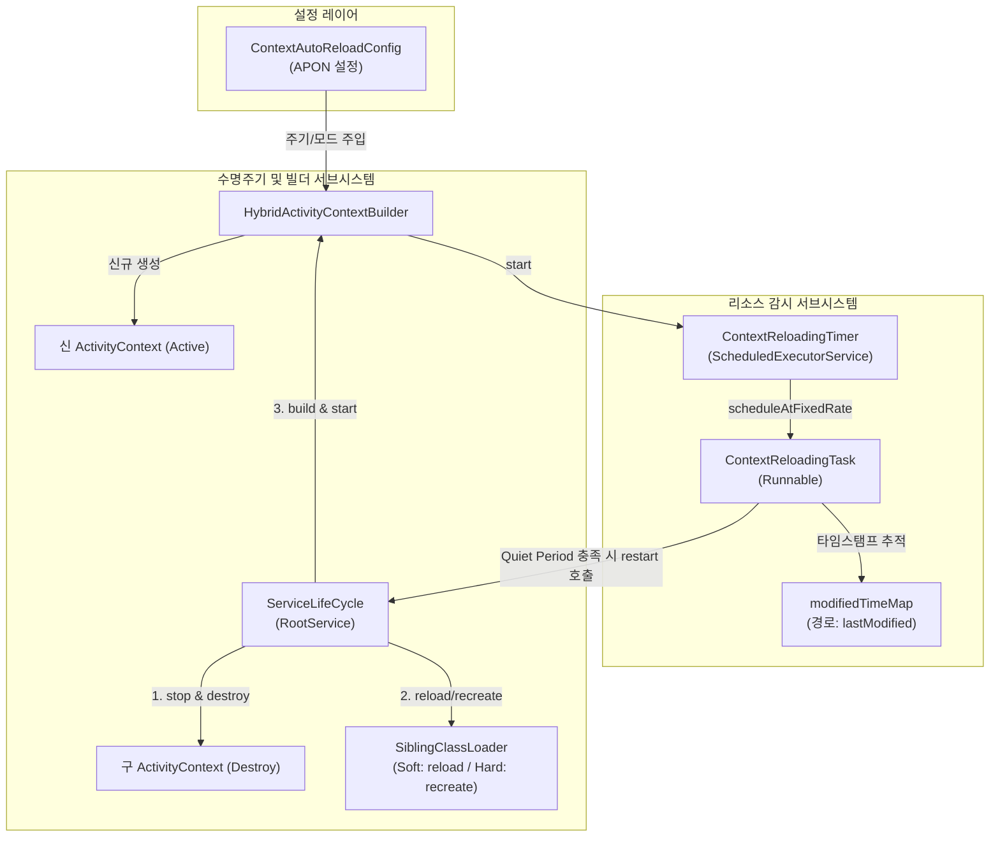
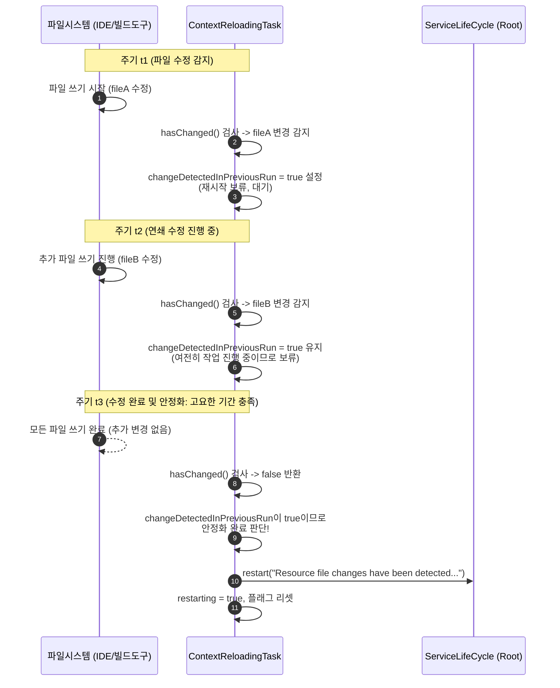
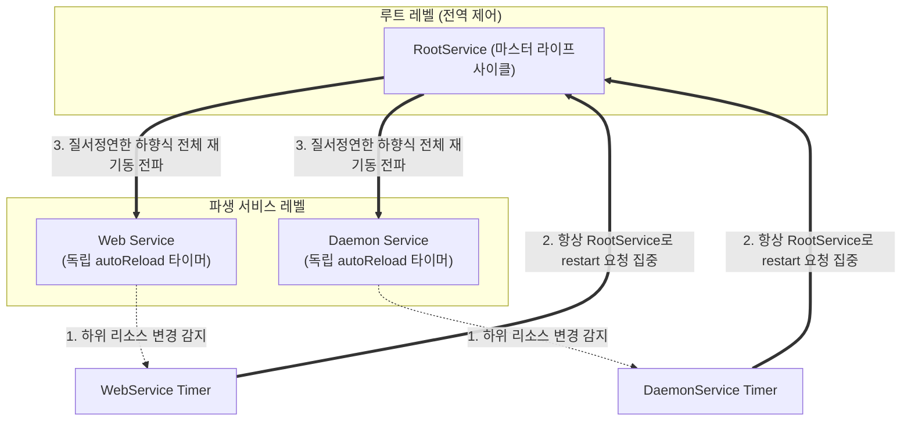
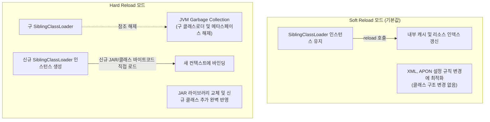
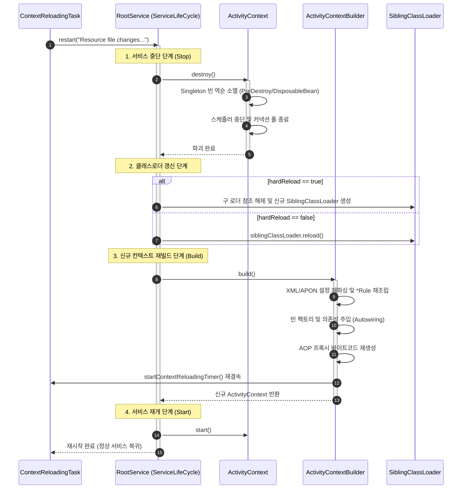

## 1. 개요

Aspectran 프레임워크의 자동 리로딩(Hot-Reloading) 기능은 애플리케이션 실행 중에 XML/APON 설정 파일이나 리소스 JAR 파일이 변경되었을 때, 전체 JVM 프로세스를 재시작하지 않고도 변경 사항을 동적으로 감지하여 컨텍스트에 즉시 반영하는 강력한 런타임 메커니즘입니다.

이 기능의 주된 목적과 가치는 다음과 같습니다.

*   **개발 생산성 극대화**: 개발자가 비즈니스 규칙(Translet), Aspect, 빈 정의 등을 수정한 후 서버를 매번 재부팅할 필요 없이 변경 사항을 수초 내에 핫스왑하여 개발 피드백 루프를 대폭 단축합니다.
*   **운영 중 동적 업데이트**: 무중단 또는 극히 짧은 순간의 컨텍스트 교체만으로 데이터소스 접속 정보 변경, 기능 플래그(Feature Flag) 전환, 스케줄링 주기 수정 등 런타임 설정 조정을 안전하게 수행할 수 있습니다.
*   **안전한 원자적 갱신**: 파일 복사 중이거나 다수의 설정 파일이 동시에 기록되는 동안 불완전한 상태로 재시작되는 것을 방지하기 위해 정교한 **고요한 기간(Quiet Period)** 감시 알고리즘을 내장하고 있습니다.

이 메커니즘은 단순히 일부 빈의 프로퍼티만 변경하는 임시방편이 아니라, 변경을 감지한 뒤 기존 `ActivityContext`를 질서정연하게 파괴(Destroy)하고 초기화 파이프라인을 통해 완전히 새로운 `ActivityContext`를 재조립(Rebuild)하는 완결적 수명주기 모델을 따릅니다.

## 2. 자동 리로딩 아키텍처 및 핵심 컴포넌트

Aspectran의 자동 리로딩은 전용 스케줄러 타이머, 파일 타임스탬프 감시 태스크, 빌더 파이프라인, 서비스 수명주기 제어기가 유기적으로 맞물려 작동합니다.



### 가. ContextAutoReloadConfig

`ContextAutoReloadConfig`는 `aspectran-config.apon` 파일의 `context` 블록 내에서 자동 리로딩의 활성화 여부, 검사 주기, 리로드 모드를 정의하는 APON 파라미터 컨테이너입니다.

*   `enabled`: 자동 리로딩 기능의 활성화 여부를 지정합니다. (기본값: `false`)
*   `scanIntervalSeconds`: 리소스 변경 감시 주기를 초 단위로 지정합니다. 양수가 아니거나 생략될 경우 기본값인 `10`초로 자동 보정됩니다.
*   `reloadMode`: 리로딩 시 클래스로더 처리 정책을 결정합니다.
    *   `soft` (기본값): 기존 `SiblingClassLoader` 인스턴스를 유지하면서 내부 리소스 캐시를 갱신하는 가벼운 모드입니다. 설정 파일(XML, APON) 위주의 변경 감지에 적합합니다.
    *   `hard`: 기존 `SiblingClassLoader`를 완전히 폐기하고 새로운 인스턴스를 생성합니다. 외부 JAR 파일이 교체되었거나 신규 바이트코드를 물리적으로 다시 로드해야 할 때 필수적입니다.

```apon
context: {
    rules: [
        /config/app-context.xml
    ]
    autoReload: {
        reloadMode: "hard"
        scanIntervalSeconds: 5
        enabled: true
    }
}
```

### 나. ContextReloadingTimer

`ContextReloadingTimer`는 백그라운드 스케줄링을 관할하는 관리자 클래스입니다.

*   **독립적 데몬 스레드 운용**: `CustomizableThreadFactory("ContextReloading-")`를 사용하여 데몬 스레드로 동작하는 `SingleThreadScheduledExecutor`를 생성합니다. 애플리케이션의 정상 종료를 방해하지 않습니다.
*   **고정 주기 스케줄링**: `executor.scheduleAtFixedRate(task, 0, scanIntervalSeconds, TimeUnit.SECONDS)`를 통해 설정된 주기마다 `ContextReloadingTask`의 검사 루프를 구동합니다.
*   **자원 관리**: 컨텍스트 빌더가 정지하거나 재시작될 때 `stop()`을 호출하여 기존 스케줄러를 `shutdownNow()`로 안전하게 중단하고 자원을 회수합니다.

### 다. ContextReloadingTask

`ContextReloadingTask`는 실제 파일 시스템 및 클래스패스 리소스의 타임스탬프를 감시하고 재시작 명령을 하달하는 `Runnable` 구현체입니다.

*   **`modifiedTimeMap`**: 감시 대상 파일의 절대 경로를 Key로, 해당 파일의 마지막 수정 시각(`lastModified`)을 Value로 저장하는 해시 맵을 유지합니다.
*   **스마트 리소스 해석 (`setResources`)**: 클래스로더에서 전달된 `URL`이 `jar:` 프로토콜인 경우 `JarURLConnection.getJarFileURL()`을 통해 JAR 아카이브 파일 자체를 파일시스템 `File` 객체로 역추적하여 모니터링 대상으로 등록합니다.
*   **2단계 상태 머신**: 파일 변경이 감지되었을 때 즉시 재시작하지 않고 `changeDetectedInPreviousRun` 플래그를 이용해 고요한 기간(Quiet Period)을 검증합니다.

### 라. ActivityContextBuilder 연계

`AbstractActivityContextBuilder`는 컨텍스트 빌드 파이프라인의 최종 단계(`startContextReloadingTimer`)에서 감시를 초기화합니다.

*   파싱 과정에서 수집된 모든 설정 파일(`appendedRuleFiles`)과 `SiblingClassLoader`가 로드한 모든 클래스패스 리소스(`siblingClassLoader.getAllResources()`)를 `ContextReloadingTimer`에 빠짐없이 등록합니다.
*   재시작 시 신규 클래스로더를 프로비저닝할 때 `hardReload` 옵션에 따라 기존 클래스로더의 `reload()`를 부를지, 완전히 새로운 `SiblingClassLoader`를 인스턴스화할지를 결정합니다.

### 마. ServiceLifeCycle

재시작 신호를 수신하는 진입점입니다. `ContextReloadingTask`는 파일 변경이 안정화되면 `serviceLifeCycle.restart(...)`를 호출하여 최상위 루트 서비스로부터 시작되는 전체 애플리케이션 수명주기 갱신을 촉발합니다.

## 3. 리소스 등록 및 감시 대상 식별

Aspectran은 단순히 정적인 파일 목록만 감시하는 것이 아니라, 설정 파일의 모듈화 구조와 동적 클래스패스까지 완벽하게 추적합니다.

### 가. 규칙 파일(Rule Files) 자동 수집

`HybridActivityContextBuilder`가 루트 설정 파일(`aspectran-config.xml` 등)을 파싱하는 동안 `<append file="..."/>` 지시문을 만나면 파서는 해당 보조 설정 파일들을 순차적으로 읽어 들입니다. 이때 빌더는 파싱 과정에 참여한 모든 실제 파일 객체를 `appendedRuleFiles` 컬렉션에 누적합니다.

빌드가 성공적으로 완료되면 이 목록이 그대로 `ContextReloadingTimer.addResource(File)`로 전달되어 감시 맵에 등록됩니다. 따라서 메인 설정 파일뿐만 아니라 수십 개로 분할된 하위 규칙 파일 중 어느 하나라도 수정되면 즉각 감지됩니다.

### 나. 클래스패스 및 JAR 파일 추적 메커니즘

`SiblingClassLoader`에 지정된 `<resourceLocations>` 경로의 리소스나 배포된 라이브러리 JAR 파일들도 자동 리로딩의 대상이 됩니다.

```java
public void setResources(Enumeration<URL> resources) {
    if (resources != null) {
        while (resources.hasMoreElements()) {
            URL url = resources.nextElement();
            try {
                File file;
                if (URL_PROTOCOL_JAR.equals(url.getProtocol())) {
                    JarURLConnection conn = (JarURLConnection)url.openConnection();
                    URL jarFileUrl = conn.getJarFileURL();
                    file = new File(jarFileUrl.toURI());
                } else {
                    file = new File(url.toURI());
                }
                addResource(file);
            } catch (Exception e) {
                logger.error("Failed to inspect resource for context reloading: {}", url, e);
            }
        }
    }
}
```

JAR URL(`jar:file:/app/lib/my-plugin.jar!/META-INF/...`)이 입력되면, 내부 엔트리가 아닌 물리적 호스트 파일인 `my-plugin.jar` 파일의 URI를 추출하여 `File` 객체로 변환합니다. 이를 통해 외부에서 새 버전의 JAR를 덮어쓰기만 해도 리로딩 타이머가 JAR 파일의 수정 시각 변화를 포착하게 됩니다.

> **참고**: IDE 개발 환경(Eclipse, IntelliJ 등)에서 테스트를 실행할 때 `ActivityContext.class`가 JAR가 아닌 일반 디렉터리(`target/classes` 등)에서 로드되면, 클래스 중복 로딩 충돌을 방지하기 위해 빌더가 `resourceLocations` 지정을 자동으로 바이패스하도록 설계되어 있습니다.

## 4. 고요한 기간(Quiet Period) 2-Pass 감시 알고리즘

파일이 대용량(수십~수백 MB의 JAR 파일)이거나, IDE/빌드 도구(Maven, Gradle)가 여러 개의 클래스 및 XML 파일을 디렉터리에 복사 중인 경우, 첫 번째 파일이 쓰여지는 순간 즉시 리로딩을 트리거하면 나머지 파일이 채 복사되지 않아 클래스를 찾지 못하거나 XML 파싱 문법 오류(Unexpected EOF)가 발생합니다.

Aspectran은 이러한 불완전한 상태 갱신을 방지하기 위해 **고요한 기간(Quiet Period)** 기반의 2-Pass 알고리즘을 사용합니다.



### 알고리즘 상세 코드 분석

```java
@Override
public void run() {
    if (restarting || modifiedTimeMap.isEmpty()) {
        return;
    }

    boolean changed = hasChanged();

    if (changed) {
        // 이번 주기에서 변경이 감지됨: 플래그만 세우고 다음 주기로 넘김
        changeDetectedInPreviousRun = true;
    } else {
        // 이번 주기에서는 변경이 감지되지 않음 (조용한 상태)
        if (changeDetectedInPreviousRun) {
            // 바로 직전 주기까지 변경이 진행되다가 이제 멈춤 -> 재시작 트리거!
            restarting = true;
            changeDetectedInPreviousRun = false;
            restartService();
        }
    }
}
```

1.  **초기 검사 및 변경 포착 (`changed == true`)**:
    등록된 리소스 중 하나라도 `file.lastModified()`가 기존 기록과 달라지면 `entry.setValue(lastModifiedTime)`로 타임스탬프를 갱신하고 `changed = true`를 반환합니다. 태스크는 `changeDetectedInPreviousRun = true`만 마킹하고 조용히 실행을 마칩니다.
2.  **연쇄 변경 대기**:
    빌드 도구가 계속해서 파일을 기록하는 동안에는 주기마다 `changed == true`가 유지되므로 재시작이 계속 연기됩니다.
3.  **고요한 기간 충족 (`changed == false && changeDetectedInPreviousRun == true`)**:
    더 이상 아무 파일도 변경되지 않는 한 주기가 지나면, `changed`는 `false`가 되지만 이전 플래그는 `true`로 남아 있습니다. 시스템은 "파일 수정 작업이 완전히 종료되어 시스템이 안정화되었다"고 확정하고 `restartService()`를 호출합니다.

이 간단하면서도 강력한 2-pass 구조 덕분에 Aspectran은 별도의 복잡한 파일 락(Lock) 확인 없이도 극히 안정적인 핫스왑을 실현합니다.

## 5. 계층적 서비스 구조와 중앙화된 루트 재시작

Aspectran은 여러 개의 서비스가 트리 형태로 연결되는 계층적 서비스(`CoreService`) 구조를 지원합니다. 루트 서비스 하위에 웹 서비스, 스케줄러 서비스, 백그라운드 워커 서비스 등이 파생(Derived)되어 동작할 수 있습니다.

자동 리로딩 메커니즘은 이 계층 구조에서 **"감시는 분산하되, 실행은 루트로 중앙화한다"**는 절대 원칙을 엄격하게 준수합니다.



### 중앙 집중식 재시작 보장 원리

`AbstractActivityContextBuilder`는 리로딩 타이머를 생성할 때 현재 빌더가 속한 서비스가 무엇이든 간에 반드시 최상위 루트 서비스의 `ServiceLifeCycle`을 주입합니다.

```java
// AbstractActivityContextBuilder.java
contextReloadingTimer = new ContextReloadingTimer(
        masterService.getRootService().getServiceLifeCycle(),
        scanIntervalSeconds);
```

이와 동시에 `AbstractServiceLifeCycle` 내부에서는 재시작 메서드 진입 시 호출 주체가 루트 서비스인지 엄격하게 검증합니다.

```java
// AbstractServiceLifeCycle.java
Assert.state(isRootService(), "Only the root service can be restarted");
```

### 왜 부분 재시작(Partial Restart)을 배제하는가?

하위 서비스만 개별적으로 재시작하는 '부분 재시작'은 이론적으로 매력적이지만, 실제 복잡한 엔터프라이즈 환경에서는 치명적인 부작용을 낳습니다.

*   **참조 무결성 파괴**: 상위 또는 형제 컨텍스트에 존재하는 싱글톤 빈이 재시작되는 하위 컨텍스트의 빈을 주입받아 캐싱하고 있었다면, 하위 빈이 파괴되는 즉시 댕글링 포인터(Dangling Pointer)나 `BeanDestroyedException`이 발생합니다.
*   **클래스로더 메모리 누수**: 하위 서비스만 클래스로더를 교체할 경우, 상위 클래스로더의 정적 필드(Static Reference), ThreadLocal, JDBC 드라이버 등록 해제 실패 등으로 인해 구버전 클래스로더가 GC되지 못하고 Metaspace OOM(Out of Memory)을 유발합니다.
*   **스케줄러 및 비동기 작업 꼬임**: 실행 중이던 Quartz 쿼츠 잡이나 비동기 액션 워커 스레드가 절반은 이전 클래스를, 절반은 신규 클래스를 바라보며 상태 불일치(Inconsistent State)를 겪게 됩니다.

따라서 Aspectran은 복잡하고 불완전한 부분 갱신 대신, **루트 서비스를 기점으로 모든 자식 서비스를 일괄 중단시키고 전체 컨텍스트를 완벽하게 재구성하는 방식**을 채택함으로써 100%의 예측 가능성과 일관성을 보장합니다.

## 6. SiblingClassLoader와 핫 클래스 리로딩

Aspectran의 클래스로더 시스템인 `SiblingClassLoader`는 자동 리로딩 시 클래스 바이트코드를 어떻게 갱신할 것인가를 결정짓는 핵심 엔진입니다.



### 가. Soft Reload vs Hard Reload 메커니즘

`AbstractActivityContextBuilder.createSiblingClassLoader()` 메서드는 `ContextAutoReloadConfig`의 `reloadMode`에 따라 완전히 다른 경로를 취합니다.

```java
protected SiblingClassLoader createSiblingClassLoader(String contextName, ClassLoader parentClassLoader)
        throws InvalidResourceException {
    if (siblingClassLoader == null || hardReload) {
        String[] resourcesToLoad = resourceLocations;
        if (resourceLocations != null) {
            URL url = ActivityContext.class.getResource("ActivityContext.class");
            if (url != null && !URL_PROTOCOL_JAR.equals(url.getProtocol())) {
                resourcesToLoad = null;
            }
        }
        siblingClassLoader = new SiblingClassLoader(contextName, parentClassLoader, resourcesToLoad);
    } else {
        siblingClassLoader.reload();
    }
    return siblingClassLoader;
}
```

*   **Soft 모드 (`hardReload == false`)**:
    기존 `siblingClassLoader`의 `reload()`를 호출합니다. 클래스로더 인스턴스 자체를 바꾸지 않으므로 매우 빠르며 메모리 부담이 없습니다. 설정 파일 내의 Translet 매핑, Aspect 포인트컷, 프로퍼티 값 수정 등을 반영할 때 가장 적합합니다.
*   **Hard 모드 (`hardReload == true`)**:
    기존 `siblingClassLoader`에 대한 참조를 끊고, 완전히 새로운 `SiblingClassLoader` 인스턴스를 생성합니다. 새로운 클래스로더는 파일시스템의 JAR 파일이나 클래스 파일로부터 최신 바이트코드를 처음부터 다시 읽어 들입니다. 기존 클래스로더가 로드했던 클래스들은 참조가 끊어지며 가비지 컬렉터(GC)에 의해 메타스페이스에서 안전하게 언로드됩니다.

### 나. 클래스 리로딩의 경계와 한계

자동 리로딩이 아무리 강력하더라도 JVM 언어 환경의 물리적 한계는 존재합니다.

1.  **애플리케이션 시스템 클래스로더의 불변성**:
    `SiblingClassLoader`가 로드한 클래스(즉, `<resourceLocations>`나 Aspectran 컨텍스트 범위의 빈들)는 완벽하게 언로드 및 리로드가 가능합니다. 하지만 애플리케이션 기동 시 JVM `AppClassLoader`나 부트스트랩 클래스로더가 이미 로드한 Aspectran 코어 프레임워크 자체의 클래스나 `main()` 메서드 클래스는 JVM 프로세스를 재시작하지 않는 한 바이트코드를 바꿀 수 없습니다.
2.  **모듈 분리 권장 구조**:
    따라서 런타임에 동적으로 변경될 수 있는 비즈니스 로직, 플러그인, 컨트롤러 등은 호스트 부트스트랩 클래스패스에 넣지 말고, Aspectran의 `resourceLocations` 디렉터리에 독립된 JAR 형태로 배치하는 것이 모듈형 핫스왑의 정석입니다.

## 7. 리로딩 실행 시퀀스 분석

설정 파일이 수정된 순간부터 신규 컨텍스트가 서비스를 재개하기까지의 전체 엔드투엔드(End-to-End) 흐름은 다음과 같습니다.



1.  **서비스 중단 및 자원 해제 (`destroy`)**:
    루트 서비스는 먼저 실행 중인 서블릿 리스너, Netty 채널, 백그라운드 스케줄러를 안전하게 정지시킵니다. 기존 `ActivityContext`의 `destroy()`가 실행되며 등록된 모든 싱글톤 빈들이 생성 역순으로 안전하게 소멸 콜백(`@PreDestroy`, `DisposableBean`)을 수행합니다. 데이터베이스 커넥션 풀, 파일 핸들, 스레드 풀이 모두 닫힙니다.
2.  **클래스로더 초기화**:
    `hardReload` 정책에 따라 신규 클래스로더를 준비합니다.
3.  **설정 재파싱 및 컨텍스트 재생성 (`build`)**:
    `HybridActivityContextBuilder`가 변경된 설정 파일들을 처음부터 다시 읽어 들여 `RuleParsingContext`를 구성하고, `BeanReferenceInspector`를 통해 의존성 유효성을 검증한 뒤 완전히 새로운 싱글톤 레지스트리와 AOP 프록시 체인을 생성합니다.
4.  **리로딩 타이머 재결속**:
    새로 빌드된 컨텍스트의 최신 리소스 목록을 기반으로 `ContextReloadingTimer`를 재시작하여 다음 파일 변경에 대비합니다.

## 8. 다른 프레임워크와의 비교 및 아키텍처적 고찰

핫 리로딩은 모든 애플리케이션 프레임워크가 해결하고자 하는 오랜 난제이며, 프레임워크마다 추구하는 가치에 따라 서로 다른 설계를 채택하고 있습니다.

| 비교 항목 | Aspectran 자동 리로딩 | Spring Boot DevTools | OSGi (Equinox, Felix) | JRebel (상용 솔루션) |
| :--- | :--- | :--- | :--- | :--- |
| **방식** | 빠른 전체 컨텍스트 재구축 (Fast Rebuild) | 2계층 클래스로더 기반 빠른 재시작 | 모듈(번들) 단위 독립적 부분 재시작 | JVM 바이트코드 레벨 동적 클래스 패치 |
| **재시작 범위** | 루트 서비스 및 전체 자식 컨텍스트 | Spring ApplicationContext 전체 | 변경된 해당 번들(Bundle)만 | 없음 (메서드/필드 동적 핫스왑) |
| **클래스로더 전략** | `SiblingClassLoader` (Soft/Hard 모드) | Base (라이브러리) + Restart (사용자 코드) | 번들마다 독립된 모듈 클래스로더 | 전용 Java 에이전트 인터셉션 |
| **복잡도** | **낮음 (안정적, 예측 가능)** | 낮음 (안정적) | 매우 높음 (클래스 가시성 및 의존성 지옥) | 높음 (환경 구성 및 상용 라이선스 필요) |
| **다운타임** | 극히 짧음 (수백 밀리초~수초) | 짧음 (수초) | 무중단 (해당 번들만 재배포) | 제로 다운타임 (완전 무중단) |
| **상태 보존** | 소실 (재시작 시 초기화) | 소실 (재시작 시 초기화) | 번들 외 상태 유지 가능 | 유지 (빈 인스턴스 및 세션 유지) |

### 가. OSGi 방식의 부분 재시작과의 차이점

OSGi는 완벽한 모듈화를 표방하며 개별 번들의 동적 언로드 및 설치를 지원합니다. 하지만 실무에서는 번들 간의 복잡한 패키지 `Import/Export` 결합으로 인해 하나의 번들을 갱신할 때 연쇄적인 `ClassNotFoundException`이나 `LinkageError`가 발생하기 쉽고, 이를 통제하기 위한 학습 비용과 설정 복잡도가 지나치게 큽니다.

Aspectran은 부분 재시작의 환상 대신, **전체 컨텍스트 재구축**을 선택하여 부작용을 원천 차단하고 예측 가능성을 최우선으로 확보했습니다.

### 나. JRebel 방식의 인플레이스(In-Place) 교체와의 차이점

JRebel은 JVM 에이전트를 통해 바이트코드를 직접 재정의하고, 프레임워크 내부 빈 팩토리를 후킹하여 변경된 메서드와 필드만 메모리에서 교체합니다.

그러나 프레임워크 레벨에서 이를 직접 구현하려면 모든 빈 호출과 프로퍼티 접근에 두터운 동적 프록시 계층을 도입해야 하므로, 평상시 런타임 성능에 상당한 오버헤드를 초래합니다. Aspectran은 "프로덕션 환경에서는 최고의 런타임 성능을 내고, 개발 환경에서는 빠른 전체 재시작으로 충분한 생산성을 제공한다"는 실용적인 트레이드오프를 선택했습니다.

## 9. 실무 활용 및 운영 가이드

자동 리로딩 기능을 운영 및 개발 환경에서 안전하고 효과적으로 활용하기 위한 권장 사항은 다음과 같습니다.

### 가. 개발 환경 (Development) 권장 설정

로컬 개발 환경에서는 즉각적인 설정 및 바이트코드 반영이 핵심이므로 다음과 같은 구성을 권장합니다.

```apon
context: {
    autoReload: {
        reloadMode: "hard"
        scanIntervalSeconds: 2
        enabled: true
    }
}
```

*   `scanIntervalSeconds`를 2~3초 수준으로 짧게 설정하여 코드나 규칙 수정 후 빠르게 결과를 확인할 수 있도록 합니다.
*   JAR 라이브러리 교체나 새로운 클래스 추가를 실시간으로 테스트해야 하는 경우 `reloadMode: "hard"`로 설정합니다.

### 나. 운영 환경 (Production) 고려사항 및 권장 전략

운영 환경에서는 자동 리로딩 사용 시 신중한 접근이 필요합니다.

*   **메모리 상태 소실 인지**: `ActivityContext`가 재시작되면 인메모리에 저장되어 있던 싱글톤 빈의 필드 값이나 로컬 캐시 데이터는 모두 증발합니다. 사용자 세션의 경우 `DefaultSessionManager`를 Redis나 외부 클러스터 세션 저장소와 연동하여 분리해 두어야 사용자 로그인 유실을 방지할 수 있습니다.
*   **운영 중 기본 비활성화 권장**: 대규모 트래픽이 유입되는 프로덕션 환경에서는 의도치 않은 파일 수정으로 인한 컨텍스트 재기동을 방지하기 위해 `enabled: false`로 설정하는 것이 안전합니다.
*   **안전한 설정 변경 배포**: 설정을 동적으로 바꾸어야 하는 경우, Canary 서버나 블루/그린 배포 단위를 활용하고, 설정 파일 복사가 완전히 끝난 뒤 원자적 심볼릭 링크(`ln -sfn`) 교체 방식으로 파일 시스템 타임스탬프를 갱신하는 것이 좋습니다.

## 10. 결론

Aspectran의 자동 리로딩 메커니즘은 단순한 파일 변경 감지기를 넘어, 프레임워크의 핵심 철학인 **안정성(Reliability)**과 **단순성(Simplicity)**이 완벽하게 투영된 아키텍처입니다.

1.  **고요한 기간(Quiet Period) 알고리즘**을 통해 파일 복사 중 발생할 수 있는 불완전한 상태에서의 오류를 원천 차단합니다.
2.  계층적 서비스 구조에서도 **루트 서비스 중심의 중앙 집중식 재기동**을 강제하여 분산된 컴포넌트 간의 참조 무결성을 완벽하게 보장합니다.
3.  **`SiblingClassLoader`의 Soft/Hard 이원화 모델**을 통해 가벼운 설정 변경과 무거운 바이트코드 교체를 상황에 맞게 최적화하여 처리합니다.

이로써 개발자는 쾌적한 피드백 루프 속에서 생산성을 극대화할 수 있으며, 시스템 운영자는 예측 가능하고 안전한 방식으로 서비스를 제어할 수 있습니다.
