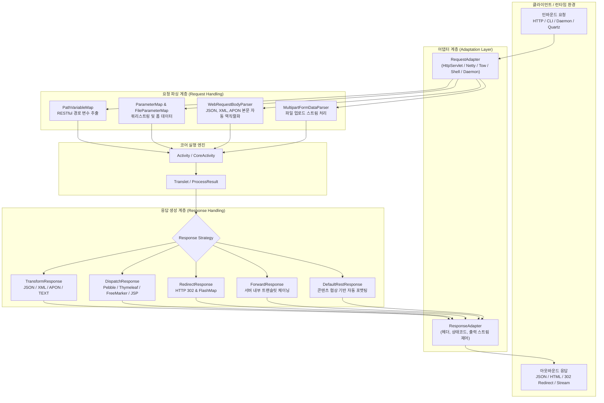
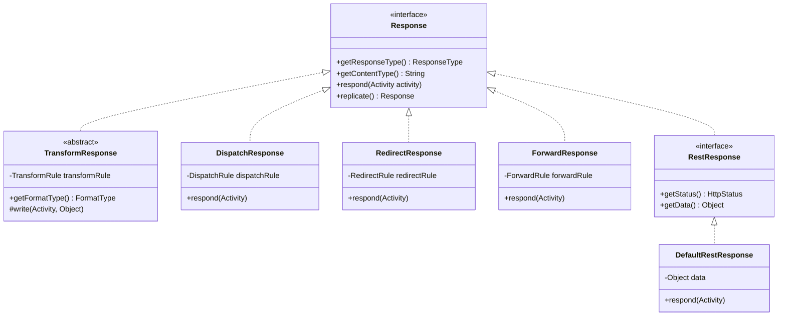
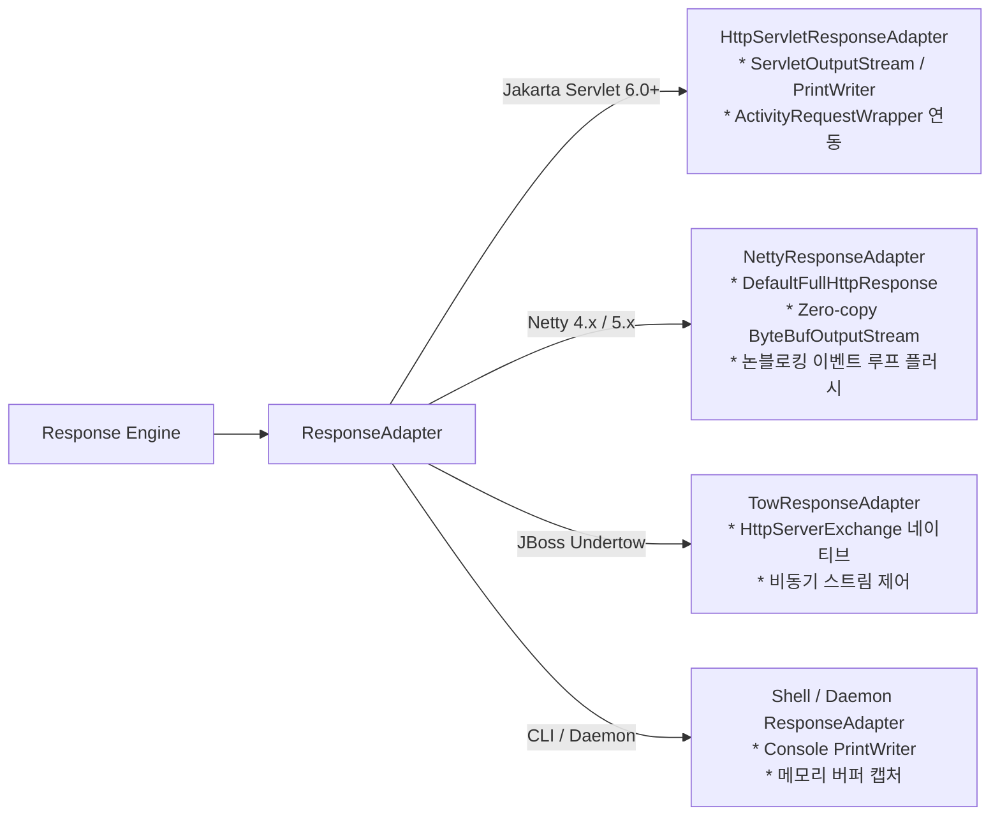

Aspectran의 요청-응답 처리 파이프라인은 다양한 인프라(서블릿 컨테이너, Netty 논블로킹 이벤트 루프, Undertow, OS 데몬, CLI 셸 등)에서 유입되는 이기종 입력을 단일 표준 인터페이스로 흡수하고, 비즈니스 처리 결과를 클라이언트가 요구하는 최적의 형식(RESTful JSON/XML, 템플릿 렌더링 HTML, HTTP 리다이렉트, 서버 내부 포워딩)으로 변환하여 송출하는 프레임워크의 핵심 I/O 오케스트레이션 서브시스템입니다.

Aspectran은 순수 HTTP 웹 추상화 계층인 `aspectran-web`과 서블릿 스펙 결합 모듈인 `aspectran-web-servlet`을 구조적으로 분리하여, 서블릿 환경뿐만 아니라 비서블릿(Servlet-less) 고성능 런타임에서도 완전히 동일한 요청 파싱 및 응답 생성 메커니즘을 제공합니다.

## 1. 전체 요청-응답 아키텍처 다이어그램

Aspectran의 I/O 파이프라인은 입력을 처리하는 **요청 계층(Request Layer)**과 출력을 생성하는 **응답 계층(Response Layer)**으로 명확히 구분됩니다.

## 2. 요청(Request) 처리 파이프라인

요청 처리는 외부 인프라의 네이티브 통신 객체를 프레임워크 표준 데이터 모델로 변환하고, 데이터 유효성을 검증하여 [`ActivityData`](https://github.com/aspectran/aspectran/blob/master/core/src/main/java/com/aspectran/core/activity/ActivityData.java)에 주입하는 4단계 프로세스로 이루어집니다.

### 1) 환경 어댑테이션 ([`RequestAdapter`](https://github.com/aspectran/aspectran/blob/master/core/src/main/java/com/aspectran/core/adapter/RequestAdapter.java))
- 각 실행 환경의 진입점에서 인입된 네이티브 요청 객체는 전용 어댑터로 감싸집니다:
  - 서블릿 환경: [`HttpServletRequestAdapter`](https://github.com/aspectran/aspectran/blob/master/web-servlet/src/main/java/com/aspectran/web/servlet/adapter/HttpServletRequestAdapter.java) (`jakarta.servlet.http.HttpServletRequest`)
  - Netty 환경: [`NettyRequestAdapter`](https://github.com/aspectran/aspectran/blob/master/with-netty/src/main/java/com/aspectran/netty/adapter/NettyRequestAdapter.java) (Netty `FullHttpRequest`)
  - Undertow 환경: [`TowRequestAdapter`](https://github.com/aspectran/aspectran/blob/master/with-undertow/src/main/java/com/aspectran/undertow/adapter/TowRequestAdapter.java) (`io.undertow.server.HttpServerExchange`)
  - Shell 환경: [`ShellRequestAdapter`](https://github.com/aspectran/aspectran/blob/master/shell/src/main/java/com/aspectran/shell/adapter/ShellRequestAdapter.java) (`TransletCommandLine`)
  - Daemon 환경: [`DaemonRequestAdapter`](https://github.com/aspectran/aspectran/blob/master/daemon/src/main/java/com/aspectran/daemon/adapter/DaemonRequestAdapter.java)
- 어댑터 계층은 파라미터, 헤더, 속성, 바디 스트림에 대한 공통 API를 제공하여 상위 비즈니스 로직의 인프라 종속성을 원천 차단합니다.

### 2) 파라미터 및 경로 변수 파싱
- **RESTful 경로 변수 추출 ([`PathVariableMap`](https://github.com/aspectran/aspectran/blob/master/core/src/main/java/com/aspectran/core/activity/request/PathVariableMap.java))**:
  트랜슬릿 이름에 정의된 URL 템플릿(예: `/users/{userId}/orders/{orderId}`)과 실제 요청 URI를 대조하여 세그먼트 값을 추출하고, 요청 파라미터 풀에 즉시 바인딩합니다.
- **파라미터 맵 ([`ParameterMap`](https://github.com/aspectran/aspectran/blob/master/core/src/main/java/com/aspectran/core/activity/request/ParameterMap.java))**:
  쿼리 스트링(Query String)과 폼(x-www-form-urlencoded) 데이터를 일관된 다중값 맵(`MultiValueMap`)으로 통합합니다.
- **필수값 검증 메커니즘**:
  [`RequestRule`](https://github.com/aspectran/aspectran/blob/master/core/src/main/java/com/aspectran/core/context/rule/RequestRule.java)에 선언된 필수 파라미터(`mandatory="true"`)가 누락된 경우, 비즈니스 액션이 호출되기 전에 즉시 [`MissingMandatoryParametersException`](https://github.com/aspectran/aspectran/blob/master/core/src/main/java/com/aspectran/core/activity/request/MissingMandatoryParametersException.java)을 발생시킵니다.

### 3) 웹 요청 본문(Body) 자동 파싱 ([`WebRequestBodyParser`](https://github.com/aspectran/aspectran/blob/master/web/src/main/java/com/aspectran/web/activity/request/WebRequestBodyParser.java))
웹 API 호출 시 페이로드(Payload)를 자동으로 역직렬화하는 정적 엔진입니다:
- **실시간 요청 크기 제한 ([`CountingInputStream`](https://github.com/aspectran/aspectran/blob/master/utils/src/main/java/com/aspectran/utils/io/CountingInputStream.java))**:
  `maxRequestSize` 설정에 따라 인바운드 스트림을 읽는 도중 한계 크기를 초과하면 즉시 [`SizeLimitExceededException`](https://github.com/aspectran/aspectran/blob/master/core/src/main/java/com/aspectran/core/activity/request/SizeLimitExceededException.java)을 던져 메모리 고갈 공격(DoS)을 방어합니다.
- **Content-Type 기반 자동 객체 매핑**:
  - `application/json` / `*+json`: [`JsonToParameters`](https://github.com/aspectran/aspectran/blob/master/utils/src/main/java/com/aspectran/utils/apon/JsonToParameters.java)를 통해 JSON 구조를 Aspectran 규칙 객체 또는 DTO로 변환
  - `application/xml` / `text/xml`: [`XmlToParameters`](https://github.com/aspectran/aspectran/blob/master/utils/src/main/java/com/aspectran/utils/apon/XmlToParameters.java)를 통한 XML 데이터 파싱
  - `application/apon`: APON 객체 파서 적용
  - `application/x-www-form-urlencoded`: URL 인코딩 폼 파싱

### 4) 멀티파트 파일 업로드 처리 ([`MultipartFormDataParser`](https://github.com/aspectran/aspectran/blob/master/web/src/main/java/com/aspectran/web/activity/request/MultipartFormDataParser.java))
- 대용량 파일 업로드 시 `multipart/form-data` 요청을 청크 단위로 스트리밍 처리합니다.
- 트랜슬릿 단위로 `@Multipart("beanName")` 어노테이션이나 설정을 부여하여 파일 크기 제한, 임시 디렉토리 위치, 메모리 임계값을 제어하며, 업로드된 파일 정보는 [`FileParameterMap`](https://github.com/aspectran/aspectran/blob/master/core/src/main/java/com/aspectran/core/activity/request/FileParameterMap.java)에 안전하게 저장됩니다.

## 3. 응답(Response) 처리 파이프라인

응답 처리는 비즈니스 액션의 실행 결과인 [`ProcessResult`](https://github.com/aspectran/aspectran/blob/master/core/src/main/java/com/aspectran/core/activity/process/result/ProcessResult.java)를 기반으로, 선언된 응답 전략에 따라 최종 HTTP 패킷이나 출력 스트림을 완성하는 단계입니다.

모든 응답 전략은 최상위 인터페이스인 [`Response`](https://github.com/aspectran/aspectran/blob/master/core/src/main/java/com/aspectran/core/activity/response/Response.java)를 구현합니다.

### 1) 변환 응답 ([`TransformResponse`](https://github.com/aspectran/aspectran/blob/master/core/src/main/java/com/aspectran/core/activity/response/transform/TransformResponse.java))
RESTful API 및 데이터 교환을 위한 핵심 응답 전략입니다. [`TransformResponseFactory`](https://github.com/aspectran/aspectran/blob/master/core/src/main/java/com/aspectran/core/activity/response/transform/TransformResponseFactory.java)에 의해 포맷 타입([`FormatType`](https://github.com/aspectran/aspectran/blob/master/core/src/main/java/com/aspectran/core/context/rule/type/FormatType.java))에 따라 적합한 변환기가 생성됩니다.

- **`JsonTransformResponse`**: `ProcessResult`의 데이터를 JSON 문자열로 직렬화하여 출력 스트림에 씁니다. 들여쓰기(`pretty`), 날짜 포맷, 널 필드 출력 옵션을 지원합니다.
- **`XmlTransformResponse`**: 계층적 XML 노드로 데이터를 직렬화합니다.
- **`AponTransformResponse`**: 가독성이 우수한 Aspectran APON(Parameters) 형식으로 출력합니다.
- **`TextTransformResponse`**: 순수 텍스트(Plain Text)로 변환합니다.
- **`XslTransformResponse`**: XML 데이터를 XSLT 스타일시트로 변환하여 최종 출력을 생성합니다.

### 2) 뷰 디스패치 응답 ([`DispatchResponse`](https://github.com/aspectran/aspectran/blob/master/core/src/main/java/com/aspectran/core/activity/response/dispatch/DispatchResponse.java))
서버 사이드 템플릿 렌더링(SSR)을 위한 응답 전략입니다:
- [`DispatchRule`](https://github.com/aspectran/aspectran/blob/master/core/src/main/java/com/aspectran/core/context/rule/DispatchRule.java)에 지정된 뷰 이름을 해석하여, 등록된 [`ViewDispatcher`](https://github.com/aspectran/aspectran/blob/master/core/src/main/java/com/aspectran/core/activity/response/dispatch/ViewDispatcher.java) 빈(Pebble, Thymeleaf, FreeMarker, JSP 등)에 렌더링을 위임합니다.
- `ActivityData`에 저장된 모든 비즈니스 모델 데이터는 템플릿 컨텍스트의 모델 맵으로 자동 복사되어 뷰 템플릿에서 즉시 접근할 수 있습니다.

### 3) 리다이렉트 응답 ([`RedirectResponse`](https://github.com/aspectran/aspectran/blob/master/core/src/main/java/com/aspectran/core/activity/response/RedirectResponse.java))
- 클라이언트 브라우저에게 HTTP 302(Found) 또는 303(See Other) 상태 코드를 전송하여 지정된 대상 URL로 페이지를 재요청하도록 유도합니다.
- **FlashMapManager 연동**: 리다이렉트 직전에 등록된 일회성 성공/오류 메시지는 [`FlashMapManager`](https://github.com/aspectran/aspectran/blob/master/core/src/main/java/com/aspectran/core/activity/FlashMapManager.java)에 의해 세션에 임시 보관되었다가, 다음 리다이렉트된 요청 도착 시 자동으로 복원되고 즉시 폐기됩니다.

### 4) 내부 포워드 응답 ([`ForwardResponse`](https://github.com/aspectran/aspectran/blob/master/core/src/main/java/com/aspectran/core/activity/response/ForwardResponse.java))
- 브라우저를 거치지 않고 서버 내부에서 다른 트랜슬릿으로 요청 처리 파이프라인을 체이닝합니다.
- **데이터 연속성 보장**: 이전 트랜슬릿에서 생성된 `ProcessResult`와 `ActivityData`가 새 트랜슬릿으로 그대로 인계되므로, 복합적인 비즈니스 로직을 모듈 단위로 재사용할 수 있습니다.

### 5) RESTful 콘텐츠 협상 응답 ([`DefaultRestResponse`](https://github.com/aspectran/aspectran/blob/master/web/src/main/java/com/aspectran/web/activity/response/DefaultRestResponse.java))
`aspectran-web` 모듈에 내장된 고수준 REST 응답 컴포넌트입니다.
- **2단계 콘텐츠 협상 (Content Negotiation)**:
  1. URI 확장자 검사: `.json`, `.xml`, `.apon`, `.txt` 확장자가 존재하면 해당 미디어 타입을 최우선 선택합니다.
  2. HTTP `Accept` 헤더 분석: 클라이언트가 전송한 `Accept` 헤더의 우선순위 가중치(`q` 값)를 분석하여 최적의 출력 포맷을 자동 결정합니다.
- **표준 REST 래퍼 지원 ([`ResponsePayload`](https://github.com/aspectran/aspectran/blob/master/web/support/rest/response/ResponsePayload.java))**:
  성공 시 [`SuccessResponse`](https://github.com/aspectran/aspectran/blob/master/web/support/rest/response/SuccessResponse.java), 실패 시 [`FailureResponse`](https://github.com/aspectran/aspectran/blob/master/web/support/rest/response/FailureResponse.java)를 통해 일관된 JSON/XML REST API 응답 규격을 제공합니다.

## 4. 다중 런타임 스트림 출력 및 버퍼링 제어

응답 데이터는 최종적으로 각 런타임 환경의 전용 [`ResponseAdapter`](https://github.com/aspectran/aspectran/blob/master/core/src/main/java/com/aspectran/core/adapter/ResponseAdapter.java)를 통해 물리적 네트워크로 송출됩니다.

- **Jakarta Servlet 컨테이너**:
  [`HttpServletResponseAdapter`](https://github.com/aspectran/aspectran/blob/master/web-servlet/src/main/java/com/aspectran/web/servlet/adapter/HttpServletResponseAdapter.java)가 서블릿 표준 출력 스트림을 래핑하며, JSP나 서블릿 필터와의 매끄러운 연동을 위해 [`ActivityRequestWrapper`](https://github.com/aspectran/aspectran/blob/master/web-servlet/src/main/java/com/aspectran/web/servlet/activity/ActivityRequestWrapper.java)가 요청 속성을 서블릿 스코프에 동기화합니다.
- **Netty 서블릿-프리 환경**:
  [`NettyResponseAdapter`](https://github.com/aspectran/aspectran/blob/master/with-netty/src/main/java/com/aspectran/netty/adapter/NettyResponseAdapter.java)는 별도의 서블릿 버퍼 오버헤드 없이 Netty의 제로카피 버퍼([`ByteBufOutputStream`](https://github.com/aspectran/aspectran/blob/master/with-netty/src/main/java/com/aspectran/netty/adapter/NettyResponseAdapter.java))에 직접 직렬화하고, HTTP Keep-Alive 및 청크 인코딩을 최적화하여 채널 파이프라인으로 플러시합니다.
- **Undertow 네이티브 환경**:
  [`TowResponseAdapter`](https://github.com/aspectran/aspectran/blob/master/with-undertow/src/main/java/com/aspectran/undertow/adapter/TowResponseAdapter.java)는 `HttpServerExchange`의 출력 채널을 직접 제어하여 최소한의 메모리 점유율로 대용량 데이터를 고속 스트리밍합니다.

## 5. 응답 전략 5종 종합 비교 매트릭스

| 응답 전략 구분 | 기본 구현 클래스 | 주요 반환 형식 | 클라이언트 URL 변화 | 데이터 전달 방식 | 적합한 사용 사례 |
| :--- | :--- | :--- | :--- | :--- | :--- |
| **Transform** | [`TransformResponse`](https://github.com/aspectran/aspectran/blob/master/core/src/main/java/com/aspectran/core/activity/response/transform/TransformResponse.java) | JSON, XML, APON, Text | 유지 | 출력 스트림 직렬화 | RESTful Web API, 모바일 앱 백엔드, 마이크로서비스 데이터 통신 |
| **Dispatch** | [`DispatchResponse`](https://github.com/aspectran/aspectran/blob/master/core/src/main/java/com/aspectran/core/activity/response/dispatch/DispatchResponse.java) | HTML (Pebble, Thymeleaf, JSP) | 유지 | 뷰 템플릿 모델 바인딩 | 전통적인 웹 브라우저 UI, 관리자 콘솔, SSR 웹 애플리케이션 |
| **Redirect** | [`RedirectResponse`](https://github.com/aspectran/aspectran/blob/master/core/src/main/java/com/aspectran/core/activity/response/RedirectResponse.java) | HTTP 302 / 303 헤더 | 변경 | URL 파라미터 및 `FlashMap` | 폼 제출 후 Post/Redirect/Get (PRG) 패턴, 로그인 완료 후 이동 |
| **Forward** | [`ForwardResponse`](https://github.com/aspectran/aspectran/blob/master/core/src/main/java/com/aspectran/core/activity/response/ForwardResponse.java) | 내부 트랜슬릿 처리 결과 | 유지 | 서버 메모리 (`ProcessResult` 인계) | 공통 비즈니스 로직 재사용, 내부 에러 페이지 라우팅 |
| **REST (Content Negotiation)** | [`DefaultRestResponse`](https://github.com/aspectran/aspectran/blob/master/web/src/main/java/com/aspectran/web/activity/response/DefaultRestResponse.java) | 클라이언트 요구 포맷 | 유지 | `Accept` 헤더 / 확장자 기반 결정 | 단일 엔드포인트에서 JSON과 XML을 동시 지원하는 고도화된 공개 API |

> **관련 세부 메커니즘**:
> - 요청을 받아 응답 전략을 결정하는 상위 실행 엔진의 전체 흐름은 [Aspectran 활동(Activities) 아키텍처](/ko/docs/mechanisms/aspectran-activities/) 문서를 참고하십시오.
> - 환경별 요청 및 응답 어댑터의 세부 구현 클래스는 [Aspectran 어댑터 아키텍처](/ko/docs/mechanisms/aspectran-adapters/) 문서를 참고하십시오.
> - 비즈니스 데이터를 생산하는 액션 컴포넌트의 상세 구조는 [Aspectran 액션(Actions) 아키텍처](/ko/docs/mechanisms/aspectran-actions/) 문서를 참고하십시오.

## 6. 다음 단계: 세부 메커니즘 탐색

요청 데이터를 전달받아 비즈니스 로직을 수행하고 `ProcessResult`를 생산하는 액션 컴포넌트들의 상세 실행 모델은 [Aspectran 액션(Actions) 아키텍처](/ko/docs/mechanisms/aspectran-actions/) 문서에서 확인할 수 있습니다.

전체 메커니즘 및 패키지 명세의 유기적 연결 관계를 확인하려면 **[Aspectran 세부 메커니즘 색인](/ko/docs/mechanisms/)**을 확인하십시오.
