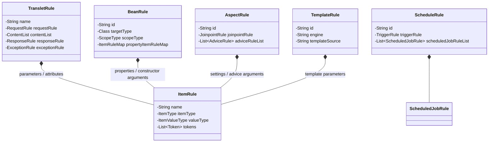

Aspectran 프레임워크의 [`com.aspectran.core.context.rule`](https://github.com/aspectran/aspectran/blob/master/core/src/main/java/com/aspectran/core/context/rule) 패키지는 애플리케이션의 모든 구성 요소(Bean, Translet, Aspect, Schedule, Template, Environment 등)를 선언적으로 정의하는 **설계도(Blueprint)** 객체 모델의 총체입니다.

Aspectran은 **선언적 정의(Definition)와 런타임 실행(Execution)의 철저한 분리** 원칙을 고수합니다. XML 문서, APON(Aspectran Parameters Object Notation) 텍스트, 자바 어노테이션 등 다양한 형식으로 작성된 설정은 부트스트랩 단계에서 파서에 의해 타입 안전한 순수 자바 객체(POJO) 형태의 `*Rule` 인스턴스로 파싱되어 메모리에 적재됩니다. 이후 런타임 엔진인 [`Activity`](https://github.com/aspectran/aspectran/blob/master/core/src/main/java/com/aspectran/core/activity/Activity.java)와 [`CoreService`](https://github.com/aspectran/aspectran/blob/master/core/src/main/java/com/aspectran/core/service/CoreService.java)는 이 불변 규칙 객체들을 해석하여 애플리케이션을 구동합니다.

## 1. 규칙 계층 구조 및 핵심 객체 트리

Aspectran의 규칙 아키텍처는 최상위 컨테이너 규칙부터 가장 작은 데이터 단위인 아이템 규칙에 이르기까지 엄격한 컴포지트(Composite) 계층 구조를 형성합니다.



### 1) 5대 최상위 핵심 구성 요소 규칙 (Top-Level Rules)
- **[`TransletRule`](https://github.com/aspectran/aspectran/blob/master/core/src/main/java/com/aspectran/core/context/rule/TransletRule.java)**: 요청 처리의 기본 단위인 트랜슬릿의 전체 라이프사이클을 규정하는 핵심 컨테이너입니다.
- **[`BeanRule`](https://github.com/aspectran/aspectran/blob/master/core/src/main/java/com/aspectran/core/context/rule/BeanRule.java)**: IoC 컨테이너가 인스턴스화하고 의존성을 주입할 Bean의 메타데이터를 정의합니다.
- **[`AspectRule`](https://github.com/aspectran/aspectran/blob/master/core/src/main/java/com/aspectran/core/context/rule/AspectRule.java)**: 조인포인트 대상 및 실행될 어드바이스 메서드 체인을 정의하는 AOP 규칙입니다.
- **[`ScheduleRule`](https://github.com/aspectran/aspectran/blob/master/core/src/main/java/com/aspectran/core/context/rule/ScheduleRule.java)**: Quartz 엔진과 결합할 트리거 주기 및 실행 대상 트랜슬릿 잡을 정의합니다.
- **[`TemplateRule`](https://github.com/aspectran/aspectran/blob/master/core/src/main/java/com/aspectran/core/context/rule/TemplateRule.java)**: 뷰 렌더링에 사용될 템플릿 엔진, 템플릿 파일 위치, 인라인 템플릿 본문을 정의합니다.

### 2) 데이터 단위 규칙: [`ItemRule`](https://github.com/aspectran/aspectran/blob/master/core/src/main/java/com/aspectran/core/context/rule/ItemRule.java)
- 모든 파라미터, 요청 속성, 생성자 인자, 빈 프로퍼티를 구성하는 최소 단위의 데이터 표현 객체입니다.

## 2. 조합 가능한 설계를 위한 "능력(Ability)" 인터페이스 체계

[`com.aspectran.core.context.rule.ability`](https://github.com/aspectran/aspectran/blob/master/core/src/main/java/com/aspectran/core/context/rule/ability) 패키지는 규칙 객체들이 가질 수 있는 기능을 모듈식으로 규정하는 계약(Contract) 인터페이스 집합입니다. 이 인터페이스들을 통해 프레임워크는 레고 블록처럼 유연하게 규칙을 조립하고 정적 분석을 수행할 수 있습니다.

```mermaid
classDiagram
    direction TB
    class Replicable~T~ {
        <<interface>>
        +replicate() T
    }
    class BeanReferenceable {
        <<interface>>
        +getBeanId() String
        +getTargetType() Class
    }
    class HasActionRules {
        <<interface>>
        +getActionRuleList() ActionRuleList
    }
    class HasResponseRules {
        <<interface>>
        +getResponseRuleList() ResponseRuleList
    }
    class HasPropertyRules {
        <<interface>>
        +getPropertyItemRuleMap() ItemRuleMap
    }
    class HasParameterRules {
        <<interface>>
        +getParameterItemRuleMap() ItemRuleMap
    }
    class HasAttributeRules {
        <<interface>>
        +getAttributeItemRuleMap() ItemRuleMap
    }
    class HasArgumentRules {
        <<interface>>
        +getArgumentItemRuleMap() ItemRuleMap
    }

    TransletRule ..|> Replicable~TransletRule~
    TransletRule ..|> HasActionRules
    TransletRule ..|> HasResponseRules
    TransletRule ..|> HasParameterRules
    TransletRule ..|> HasAttributeRules
    BeanRule ..|> Replicable~BeanRule~
    BeanRule ..|> BeanReferenceable
    BeanRule ..|> HasPropertyRules
    BeanRule ..|> HasArgumentRules
    AspectRule ..|> Replicable~AspectRule~
```



### 1) 불변 프로토타입 복제: [`Replicable<T>`](https://github.com/aspectran/aspectran/blob/master/core/src/main/java/com/aspectran/core/context/rule/ability/Replicable.java)
- **스레드 안전성(Thread Safety)의 핵심**:
  부트스트랩 시점에 파싱된 원본 규칙 인스턴스는 공유 메모리 영역에 **불변(Immutable) 프로토타입**으로 보존됩니다.
- 멀티스레드 환경에서 개별 요청이 인입될 때, `Replicable.replicate()`를 호출하여 독립적인 규칙 복제본을 생성하여 실행하므로 동시성 충돌이나 상태 오염이 원천적으로 차단됩니다.

### 2) 빈 참조 무결성 추적: [`BeanReferenceable`](https://github.com/aspectran/aspectran/blob/master/core/src/main/java/com/aspectran/core/context/rule/ability/BeanReferenceable.java)
- 다른 빈을 참조하는 속성이나 인자를 가진 규칙이 구현하는 마커 인터페이스입니다.
- 컨텍스트 빌드 단계에서 [`BeanReferenceInspector`](https://github.com/aspectran/aspectran/blob/master/core/src/main/java/com/aspectran/core/context/rule/validation/BeanReferenceInspector.java)가 이 인터페이스를 구현한 모든 규칙을 수집하여, 참조 대상 빈이 실제로 등록되어 있는지, 순환 참조가 없는지 사전에 전수 검사합니다.

### 3) 하위 규칙 소유 능력 인터페이스군
- [`HasActionRules`](https://github.com/aspectran/aspectran/blob/master/core/src/main/java/com/aspectran/core/context/rule/ability/HasActionRules.java): `<action>`, `<echo>`, `<headers>`, `<include>` 등의 액션 규칙을 자식으로 가질 수 있음을 선언합니다 (`TransletRule`, `AdviceRule`, `ChooseWhenRule` 등).
- [`HasResponseRules`](https://github.com/aspectran/aspectran/blob/master/core/src/main/java/com/aspectran/core/context/rule/ability/HasResponseRules.java): `<transform>`, `<dispatch>`, `<redirect>`, `<forward>` 등의 응답 규칙을 자식으로 가질 수 있음을 선언합니다 (`TransletRule`, `ExceptionThrownRule`).
- [`HasParameterRules`](https://github.com/aspectran/aspectran/blob/master/core/src/main/java/com/aspectran/core/context/rule/ability/HasParameterRules.java) / [`HasAttributeRules`](https://github.com/aspectran/aspectran/blob/master/core/src/main/java/com/aspectran/core/context/rule/ability/HasAttributeRules.java) / [`HasPropertyRules`](https://github.com/aspectran/aspectran/blob/master/core/src/main/java/com/aspectran/core/context/rule/ability/HasPropertyRules.java) / [`HasArgumentRules`](https://github.com/aspectran/aspectran/blob/master/core/src/main/java/com/aspectran/core/context/rule/ability/HasArgumentRules.java): 각각 파라미터, 속성, 프로퍼티, 인자 형태의 `ItemRule` 맵을 자식으로 가질 수 있는 능력을 명시합니다.

## 3. 5대 최상위 핵심 규칙 심층 분석

### 1) 요청-응답의 심장: [`TransletRule`](https://github.com/aspectran/aspectran/blob/master/core/src/main/java/com/aspectran/core/context/rule/TransletRule.java)
단일 웹 엔드포인트나 CLI 명령어, 배치 잡의 실행 경로 전체를 캡슐화합니다:
- **매핑 메타데이터**: 트랜슬릿 이름(`name`), 허용 HTTP 메서드(`allowedMethod`), 비동기 여부(`async`).
- **요청 규칙 ([`RequestRule`](https://github.com/aspectran/aspectran/blob/master/core/src/main/java/com/aspectran/core/context/rule/RequestRule.java))**: 문자 인코딩 설정, 필수 파라미터/속성 검증 조건, 요청 본문 파서 설정.
- **콘텐츠 및 액션 파이프라인 ([`ContentList`](https://github.com/aspectran/aspectran/blob/master/core/src/main/java/com/aspectran/core/activity/process/ContentList.java))**: 비즈니스 액션들의 순차 실행 목록.
- **응답 규칙 ([`ResponseRule`](https://github.com/aspectran/aspectran/blob/master/core/src/main/java/com/aspectran/core/context/rule/ResponseRule.java))**: 요청 성공 시 호출될 최종 응답 전략(Transform, Dispatch, Redirect, Forward).
- **예외 매핑 규칙 ([`ExceptionRule`](https://github.com/aspectran/aspectran/blob/master/core/src/main/java/com/aspectran/core/context/rule/ExceptionRule.java))**: 특정 예외 발생 시 전용 응답이나 에러 뷰로 전환하는 선언적 예외 매핑 테이블.

### 2) IoC 컴포넌트 청사진: [`BeanRule`](https://github.com/aspectran/aspectran/blob/master/core/src/main/java/com/aspectran/core/context/rule/BeanRule.java)
- **식별자 및 타입**: 빈 ID, 구현 클래스([`targetType`](https://github.com/aspectran/aspectran/blob/master/core/src/main/java/com/aspectran/core/context/rule/BeanRule.java#L87)), 팩토리 메서드([`factoryMethodName`](https://github.com/aspectran/aspectran/blob/master/core/src/main/java/com/aspectran/core/context/rule/BeanRule.java#L93)).
- **수명주기 스코프 ([`ScopeType`](https://github.com/aspectran/aspectran/blob/master/core/src/main/java/com/aspectran/core/context/rule/type/ScopeType.java))**: `SINGLETON`, `PROTOTYPE`, `REQUEST`, `SESSION`.
- **생명주기 콜백**: `initMethodName`, `destroyMethodName`.
- **의존성 주입 정의**: 생성자 인자 목록(`constructorArgumentList`), 프로퍼티 맵(`propertyItemRuleMap`).
- **AOP 프록시 마킹 ([`isProxied`](https://github.com/aspectran/aspectran/blob/master/core/src/main/java/com/aspectran/core/context/rule/BeanRule.java#L113))**: `BeanRuleAnalyzer`에 의해 AOP 대상임이 확인되면 빌드 시점에 프록시 플래그가 활성화됩니다.

### 3) AOP 횡단 관심사: [`AspectRule`](https://github.com/aspectran/aspectran/blob/master/core/src/main/java/com/aspectran/core/context/rule/AspectRule.java)
- **조인포인트 규칙 ([`JoinpointRule`](https://github.com/aspectran/aspectran/blob/master/core/src/main/java/com/aspectran/core/context/rule/JoinpointRule.java))**: 대상 트랜슬릿 이름 패턴, 빈 메서드 시그니처 패턴, 메서드 타입 제약 조건.
- **어드바이스 규칙 ([`AdviceRule`](https://github.com/aspectran/aspectran/blob/master/core/src/main/java/com/aspectran/core/context/rule/AdviceRule.java))**: 실행 시점(`BEFORE`, `AFTER`, `THROWN`, `FINALLY`) 및 호출 대상 어드바이스 빈/메서드.
- **실행 우선순위 (`order`)**: 여러 애스펙트가 동일 조인포인트에 중복될 때의 실행 순서 정수값.

### 4) 배치 및 스케줄: [`ScheduleRule`](https://github.com/aspectran/aspectran/blob/master/core/src/main/java/com/aspectran/core/context/rule/ScheduleRule.java)
- 스케줄러 식별자, 시작 지연 시간(`startDelaySeconds`), Quartz Cron 표현식 또는 간격 주기(Interval).
- 주기가 도래했을 때 실행할 하나 이상의 [`ScheduledJobRule`](https://github.com/aspectran/aspectran/blob/master/core/src/main/java/com/aspectran/core/context/rule/ScheduledJobRule.java)(대상 트랜슬릿 이름).

### 5) 뷰 템플릿: [`TemplateRule`](https://github.com/aspectran/aspectran/blob/master/core/src/main/java/com/aspectran/core/context/rule/TemplateRule.java)
- 템플릿 엔진 이름(`pebble`, `thymeleaf`, `freemarker` 등), 템플릿 파일 경로(`file`, `resource`, `url`), 또는 인라인 문자열 본문.

## 4. 데이터 표현 단위: `ItemRule`과 ASEL 토큰 시스템

[`ItemRule`](https://github.com/aspectran/aspectran/blob/master/core/src/main/java/com/aspectran/core/context/rule/ItemRule.java)은 Aspectran 설정에서 모든 동적 데이터와 파라미터를 표현하는 핵심 단위입니다.

### 1) 구조 및 타입 지원
- **아이템 구조 타입 ([`ItemType`](https://github.com/aspectran/aspectran/blob/master/core/src/main/java/com/aspectran/core/context/rule/type/ItemType.java))**:
  - `SINGLE`: 단일 객체
  - `ARRAY`: 배열
  - `LIST`: 자바 `List` 컬렉션
  - `MAP`: 키-값 `Map` 구조
  - `PROPERTIES`: `java.util.Properties`
  - `SET`: 자바 `Set` 컬렉션
- **아이템 값 타입 ([`ItemValueType`](https://github.com/aspectran/aspectran/blob/master/core/src/main/java/com/aspectran/core/context/rule/type/ItemValueType.java))**:
  - `STRING`, `INT`, `LONG`, `FLOAT`, `DOUBLE`, `BOOLEAN`, `PARAMETERS`

### 2) ASEL 토큰 파싱 및 런타임 지연 평가
`ItemRule`은 정적 텍스트뿐만 아니라 런타임 표현식 토큰([`Token`](https://github.com/aspectran/aspectran/blob/master/core/src/main/java/com/aspectran/core/context/asel/token/Token.java))을 내장할 수 있습니다:
- `#{beanId^property}`: 빈의 프로퍼티 값 참조
- `${paramName}`: 요청 파라미터 값 참조
- `@{attributeName}`: 요청 속성 값 참조
- `%{propertyName}`: 환경 프로퍼티 값 참조
- `${ENV:VAR_NAME}`: 시스템 환경 변수 참조
- `${SYS:sys.prop}`: JVM 시스템 프로퍼티 참조

## 5. 양방향 규칙 변환 엔진 (`converter`)

Aspectran은 규칙 객체 모델을 APON 파라미터 트리로 변환하거나, 반대로 APON 트리를 규칙 객체로 복원하는 강력한 양방향 변환 서브시스템을 탑재하고 있습니다.

- **[`RulesToParameters`](https://github.com/aspectran/aspectran/blob/master/core/src/main/java/com/aspectran/core/context/rule/converter/RulesToParameters.java)**:
  메모리에 적재된 `TransletRule`, `BeanRule`, `AspectRule` 객체들을 표준 APON(Parameters) 텍스트 포맷으로 직렬화합니다. 애플리케이션의 현재 구성을 파일로 덤프하거나 디버깅 콘솔에 시각화할 때 사용됩니다.
- **[`ParametersToRules`](https://github.com/aspectran/aspectran/blob/master/core/src/main/java/com/aspectran/core/context/rule/converter/ParametersToRules.java)**:
  APON으로 작성된 텍스트 구조를 자바 `*Rule` 객체 트리로 역직렬화합니다.

이 변환 엔진 덕분에 Aspectran은 XML 설정과 APON 설정을 100% 무손실 상호 호환하며 처리할 수 있습니다.

## 6. 대규모 모듈 분할 및 합성: `RuleAppender` 서브시스템

단일 XML/APON 파일에 수많은 설정을 모두 작성하는 대신, 도메인별/기능별로 설정을 분할하여 관리할 수 있도록 [`RuleAppender`](https://github.com/aspectran/aspectran/blob/master/core/src/main/java/com/aspectran/core/context/rule/appender/RuleAppender.java) 인터페이스를 제공합니다.

- **[`FileRuleAppender`](https://github.com/aspectran/aspectran/blob/master/core/src/main/java/com/aspectran/core/context/rule/appender/FileRuleAppender.java)**: 로컬 파일 시스템 상의 설정 파일(절대/상대 경로)을 임포트합니다.
- **[`ResourceRuleAppender`](https://github.com/aspectran/aspectran/blob/master/core/src/main/java/com/aspectran/core/context/rule/appender/ResourceRuleAppender.java)**: 클래스패스(Classpath) 리소스로부터 설정 파일을 임포트합니다.
- **[`UrlRuleAppender`](https://github.com/aspectran/aspectran/blob/master/core/src/main/java/com/aspectran/core/context/rule/appender/UrlRuleAppender.java)**: 외부 HTTP/HTTPS 원격 URL로부터 설정을 동적으로 로드합니다.
- **[`ParametersRuleAppender`](https://github.com/aspectran/aspectran/blob/master/core/src/main/java/com/aspectran/core/context/rule/appender/ParametersRuleAppender.java)**: 메모리상의 `AspectranParameters` 객체를 파싱 파이프라인에 직접 병합합니다.

```xml
<!-- 대규모 애플리케이션의 모듈 분할 설정 예시 -->
<aspectran>
    <append file="config/aspectran-common.xml"/>
    <append resource="com/aspectran/demo/user-translets.apon"/>
    <append resource="com/aspectran/demo/order-translets.apon"/>
</aspectran>
```

> 🔍 **관련 세부 메커니즘**
> - 규칙 객체들이 파싱되어 IoC 컨테이너로 완성되는 과정은 [ActivityContext 빌드 과정](/ko/docs/mechanisms/activity-context-building/) 문서를 참고하십시오.
> - 완성된 규칙 객체들이 요청 시점에 실행되는 라이프사이클은 [Aspectran 활동(Activities) 아키텍처](/ko/docs/mechanisms/aspectran-activities/) 문서를 참고하십시오.
> - 트랜슬릿 규칙 내부의 액션 실행 모델은 [Aspectran 액션(Actions) 아키텍처](/ko/docs/mechanisms/aspectran-actions/) 문서를 참고하십시오.

## 7. 다음 단계: 세부 메커니즘 탐색

선언된 규칙 객체들이 컨테이너 부트스트랩 파이프라인을 거쳐 최종 `ActivityContext`로 인덱싱되는 전체 과정은 [ActivityContext 빌드 과정](/ko/docs/mechanisms/activity-context-building/) 문서에서 확인할 수 있습니다.

전체 메커니즘 및 패키지 명세의 유기적 연결 관계를 확인하려면 **[Aspectran 세부 메커니즘 색인](/ko/docs/mechanisms/)**을 확인하십시오.
