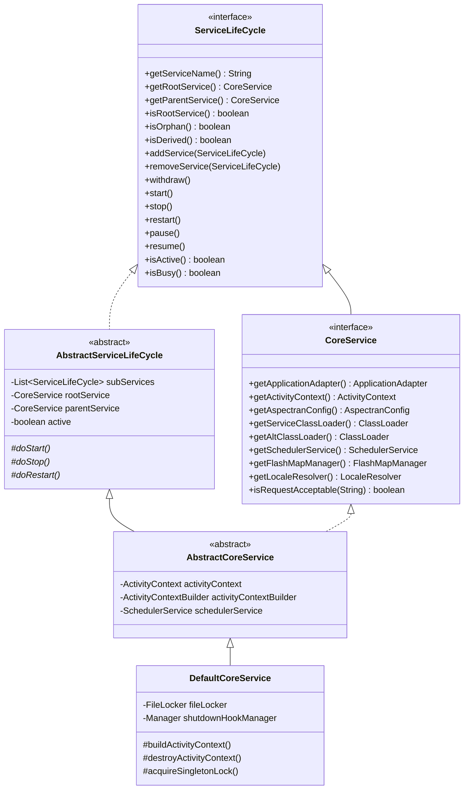
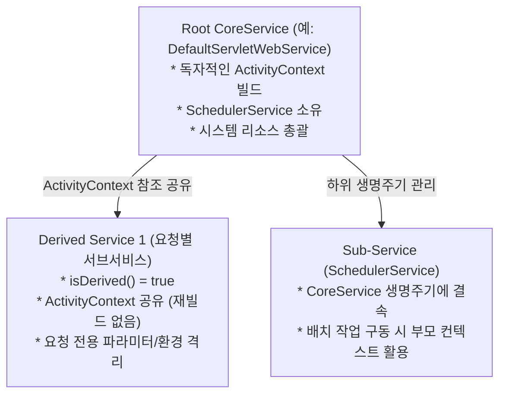
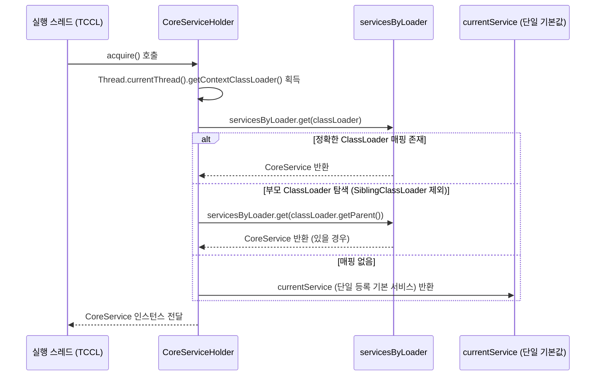
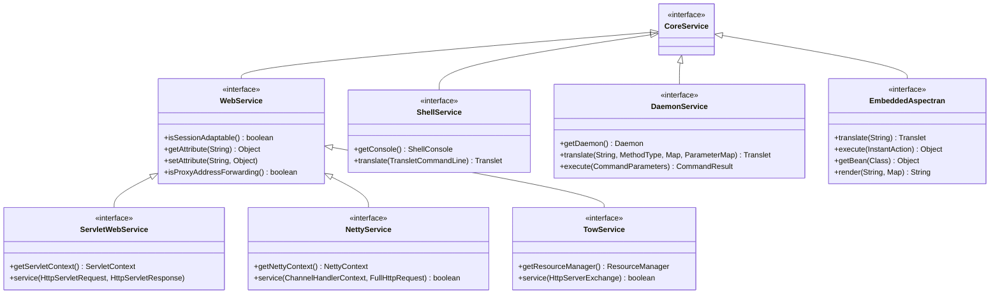
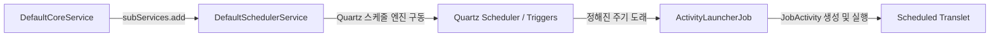

Aspectran의 서비스(`Service`) 계층은 프레임워크의 생명주기(Lifecycle)를 관리하고, 이기종 실행 환경의 진입점(Entry Point) 역할을 수행하는 최상위 오케스트레이션 컨테이너입니다. 웹 애플리케이션 서버, 고성능 비동기 비서블릿 네트워킹 엔진, 백그라운드 데몬 프로세스, 대화형 커맨드 라인 셸, 그리고 기존 자바 애플리케이션에 라이브러리로 탑재되는 임베디드 환경에 이르기까지, 모든 애플리케이션 진입점은 전용 서비스 구현체를 통해 부트스트래핑되고 구동됩니다.

Aspectran 서비스 아키텍처는 공통의 코어 컨테이너(`ActivityContext`)와 생명주기 계약을 공유하면서도, 각 런타임 환경의 고유한 특성을 완벽히 수용할 수 있도록 계층적 추상화와 모듈화 원칙에 따라 정밀하게 설계되었습니다.

## 1. 최상위 계약: `CoreService`와 `ServiceLifeCycle`

Aspectran 서비스 생태계의 중심에는 [`CoreService`](https://github.com/aspectran/aspectran/blob/master/core/src/main/java/com/aspectran/core/service/CoreService.java)와 [`ServiceLifeCycle`](https://github.com/aspectran/aspectran/blob/master/core/src/main/java/com/aspectran/core/service/ServiceLifeCycle.java) 인터페이스가 있습니다.



### `ServiceLifeCycle`: 전이적 트리형 생명주기 관리

[`ServiceLifeCycle`](https://github.com/aspectran/aspectran/blob/master/core/src/main/java/com/aspectran/core/service/ServiceLifeCycle.java)은 서비스의 상태 머신(State Machine)을 제어하고, 부모-자식 서비스 간의 계층적 관계를 규정합니다.

- **상태 제어 메서드**:
  - `start()`: 서비스를 초기화하고 활성화 상태(`active = true`)로 전환합니다.
  - `stop()`: 서비스와 연계된 하위 서비스 및 리소스를 정리하고 비활성화합니다.
  - `restart()`: 서비스를 안전하게 중지한 후 새로운 설정이나 리소스로 재시작합니다. 루트 서비스(`isRootService() == true`)에서만 호출할 수 있습니다.
  - `pause()`, `pause(timeout)`: 새로운 요청 처리를 일시적으로 거부하거나 대기하도록 서비스 상태를 일시정지합니다.
  - `resume()`: 일시정지된 서비스를 다시 활성화 상태로 복원합니다.
- **계층 및 하위 서비스 오케스트레이션**:
  - `addService(ServiceLifeCycle)` / `removeService(ServiceLifeCycle)`: 부모 서비스 하위에 자식 서비스를 등록하거나 해제합니다.
  - **생명주기 전파 (Lifecycle Cascading)**: [`AbstractServiceLifeCycle`](https://github.com/aspectran/aspectran/blob/master/core/src/main/java/com/aspectran/core/service/AbstractServiceLifeCycle.java) 구현체에 의해, 부모 서비스의 `start()`, `stop()`, `pause()`, `resume()` 호출은 등록된 모든 하위 서비스(`subServices`)에 동기화되어 순차 전파됩니다.
  - `withdraw()`: 부모 서비스와의 연결을 끊고 서비스 트리에서 탈퇴합니다.

### `CoreService`: 프레임워크 런타임의 심장

[`CoreService`](https://github.com/aspectran/aspectran/blob/master/core/src/main/java/com/aspectran/core/service/CoreService.java)는 단순한 생명주기 제어를 넘어, 실행 중인 Aspectran 인스턴스의 모든 핵심 요소에 접근할 수 있는 루트 인터페이스입니다.

- **컨텍스트 접근**: 모든 Bean, Translet, Aspect 정의가 로드되어 있는 [`ActivityContext`](https://github.com/aspectran/aspectran/blob/master/core/src/main/java/com/aspectran/core/context/ActivityContext.java)를 반환합니다.
- **환경 추상화**: 하부 실행 환경(서블릿 컨테이너, 임베디드 네이티브 서버, OS 프로세스 등)을 추상화하는 최상위 [`ApplicationAdapter`](https://github.com/aspectran/aspectran/blob/master/core/src/main/java/com/aspectran/core/adapter/ApplicationAdapter.java)를 제공합니다.
- **클래스로더 분리 및 핫 리로딩**: 기본 서비스 클래스로더([`getServiceClassLoader()`](https://github.com/aspectran/aspectran/blob/master/core/src/main/java/com/aspectran/core/service/CoreService.java#L150)) 외에, 동적 클래스 재로딩이나 격리를 지원하는 대체 클래스로더([`getAltClassLoader()`](https://github.com/aspectran/aspectran/blob/master/core/src/main/java/com/aspectran/core/service/CoreService.java#L156))를 지원합니다.
- **부가 인프라 관리**: 요청 단위 전달 메시지를 다루는 `FlashMapManager`, 국제화를 지원하는 `LocaleResolver`, 비동기 배치/주기 작업을 담당하는 `SchedulerService`를 총괄합니다.

### `DefaultCoreService`: 부트스트래핑 파이프라인

[`DefaultCoreService`](https://github.com/aspectran/aspectran/blob/master/core/src/main/java/com/aspectran/core/service/DefaultCoreService.java)는 `AbstractCoreService`를 상속한 표준 부트스트래퍼 구현체로서 다음과 같은 핵심 부트스트랩 파이프라인을 실행합니다.

1. **설정 주입 및 시스템 속성 동기화**:
   [`AspectranConfig`](https://github.com/aspectran/aspectran/blob/master/core/src/main/java/com/aspectran/core/context/config/AspectranConfig.java)를 읽어 암호화 알고리즘(`PBEncryptionUtils`), 시스템 프로퍼티, 기본 경로(`basePath`)를 구성합니다.
2. **싱글톤 인스턴스 파일 잠금 (`FileLocker`)**:
   `context.singleton` 설정이 활성화된 경우, 운영체제 수준의 파일 락([`FileLocker`](https://github.com/aspectran/aspectran/blob/master/utils/src/main/java/com/aspectran/utils/FileLocker.java))을 획득하여 동일 애플리케이션의 중복 실행을 원천 차단합니다.
3. **`ActivityContext` 빌드 및 초기화**:
   [`HybridActivityContextBuilder`](https://github.com/aspectran/aspectran/blob/master/core/src/main/java/com/aspectran/core/context/builder/HybridActivityContextBuilder.java)를 인스턴스화하여 XML, APON, Java 어노테이션 기반 규칙들을 파싱하고 컨텍스트를 빌드 및 초기화(`initialize()`)합니다.
4. **자식 `SchedulerService` 생성**:
   설정에 스케줄러 항목이 존재할 경우 하위 서비스로서 Quartz 기반 스케줄러를 자동 구축하고 수명주기를 결속시킵니다.
5. **JVM 셧다운 훅(`ShutdownHook`) 등록**:
   JVM 비정상 종료 시에도 안전하게 파일 락을 해제하고 컨텍스트 자원을 닫을 수 있도록 런타임 셧다운 훅을 등록합니다.

## 2. 파생 서비스(Derived Service)와 공유 컨텍스트 모델

Aspectran 서비스 아키텍처의 독창적인 특징 중 하나는 **파생 서비스(Derived Service)** 메커니즘입니다.



- **`isDerived()` 플래그**:
  서비스가 파생 모드로 생성되면 자체적으로 `ActivityContext`를 파싱하여 빌드하지 않고, 부모 서비스([`getParentService()`](https://github.com/aspectran/aspectran/blob/master/core/src/main/java/com/aspectran/core/service/CoreService.java#L49))가 이미 구축해 둔 `ActivityContext`와 `AspectranConfig` 인스턴스를 직접 전달받아 공유합니다.
- **성능 및 리소스 절감**:
  거대한 엔터프라이즈 애플리케이션에서 무거운 Bean 컨테이너를 중복으로 띄우지 않고, 동일 컨텍스트를 공유하면서 요청 진입점이나 런타임 환경 파라미터만 분리하여 격리된 서브 서비스를 가볍게 생성할 수 있습니다.
- **`isOrphan()` 판단 로직**:
  부모 서비스가 없거나, 부모 서비스가 이미 활성화되어 독립적으로 시작/종료 관리가 가능한 상태인지를 판별합니다.

## 3. 글로벌 런타임 레지스트리: `CoreServiceHolder`

단일 JVM 내부에서 복수의 웹 애플리케이션, 백그라운드 워커, 또는 OSGi/모듈러 환경이 구동될 때, 임의의 스레드에서 올바른 `CoreService`를 찾아낼 수 있도록 돕는 정적 중앙 허브가 바로 [`CoreServiceHolder`](https://github.com/aspectran/aspectran/blob/master/core/src/main/java/com/aspectran/core/service/CoreServiceHolder.java)입니다.

### 클래스로더 기반 서비스 라우팅 및 룩업 체계

`CoreServiceHolder`는 스레드 안전한 동시성 맵(`ConcurrentHashMap`)을 사용하여 서비스들을 등록하고 탐색합니다.



- **다중 컨텍스트 격리**:
  서블릿 컨테이너의 `WebAppClassLoader`나 서브 모듈별 클래스로더를 키(`ClassLoader`)로 하여 개별 `CoreService`를 매핑하므로, 서로 다른 애플리케이션이 동일 JVM에 공존해도 컨텍스트가 교차 오염되지 않습니다.
- **클래스 기반 매핑**:
  특정 Bean 클래스 타입([`CoreServiceHolder.hold(Class<?>, CoreService)`](https://github.com/aspectran/aspectran/blob/master/core/src/main/java/com/aspectran/core/service/CoreServiceHolder.java#L128))으로도 바인딩을 지원하여 정적 유틸리티나 프레임워크 플러그인에서 현재 컨텍스트를 즉시 획득할 수 있습니다.
- **`ServiceHoldingListener`**:
  서비스가 홀더에 등록되거나(`afterServiceHolding`) 해제될 때(`beforeServiceRelease`) 이벤트를 수신하여 외부 모니터링이나 분산 작업 잠금 시스템을 초기화/종료할 수 있습니다.

## 4. 실행 환경별 특화 서비스 구현체 체계

`DefaultCoreService`를 근간으로, 각 런타임 환경의 진입점과 통신 프로토콜을 전담하는 6대 특화 서비스가 제공됩니다.



### 1) 서블릿 웹 서비스: `ServletWebService` (`DefaultServletWebService`)

[`ServletWebService`](https://github.com/aspectran/aspectran/blob/master/web-servlet/src/main/java/com/aspectran/web/servlet/service/ServletWebService.java)는 Apache Tomcat, Jetty, Red Hat WildFly 등 Jakarta Servlet 스펙(Servlet 6.0+)을 준수하는 서블릿 컨테이너와의 완벽한 브리지를 담당합니다.

- **핵심 진입점**:
  [`service(HttpServletRequest, HttpServletResponse)`](https://github.com/aspectran/aspectran/blob/master/web-servlet/src/main/java/com/aspectran/web/servlet/service/ServletWebService.java#L67) 메서드가 프론트 컨트롤러 서블릿(`WebActivityServlet`)에 의해 호출됩니다.
- **주요 기능 및 동작**:
  - **URI 디코딩 및 정규화**: 인코딩 설정에 맞춰 요청 URI를 복원하고 컨텍스트 경로를 산출합니다.
  - **정적 자원 및 DefaultServlet 위임**: 등록된 트랜슬릿 규칙과 일치하지 않는 요청([`!isRequestAcceptable(requestName)`](https://github.com/aspectran/aspectran/blob/master/web-servlet/src/main/java/com/aspectran/web/servlet/service/DefaultServletWebService.java#L91))은 컨테이너의 디폴트 서블릿 핸들러(`DefaultServletHttpRequestHandler`)로 넘겨 CSS, JS, 이미지 등 정적 리소스를 고속 서비스합니다.
  - **서블릿 3.0+ 비동기 요청 처리**: `request.isAsyncStarted()` 상태를 인지하여 백그라운드 스레드에서 응답이 완료될 때까지 비동기 사이클을 제어합니다.
  - **컨텍스트 바인딩**: `ServletContext` 속성에 루트 서비스를 바인딩(`ROOT_WEB_SERVICE_ATTR_NAME`)하여 웹 애플리케이션 전역에서 서비스를 획득할 수 있도록 합니다.

### 2) 비서블릿 고성능 웹 서비스: `NettyService` (`DefaultNettyService`)

[`NettyService`](https://github.com/aspectran/aspectran/blob/master/with-netty/src/main/java/com/aspectran/netty/service/NettyService.java)는 서블릿 API 오버헤드를 완전히 걷어내고, Netty의 고성능 논블로킹 이벤트 루프(EventLoopGroup) 위에서 HTTP/1.1 및 HTTP/2를 처리합니다.

- **핵심 진입점**:
  [`service(ChannelHandlerContext ctx, FullHttpRequest request)`](https://github.com/aspectran/aspectran/blob/master/with-netty/src/main/java/com/aspectran/netty/service/NettyService.java#L78)
- **주요 기능 및 동작**:
  - Netty 파이프라인의 인바운드 핸들러에서 직접 호출되어, 제로-카피 버퍼([`ByteBuf`](https://github.com/aspectran/aspectran/blob/master/with-netty/src/main/java/com/aspectran/netty/service/DefaultNettyService.java#L35)) 및 네이티브 요청 객체를 전용 활동 객체([`NettyActivity`](https://github.com/aspectran/aspectran/blob/master/with-netty/src/main/java/com/aspectran/netty/activity/NettyActivity.java))로 감쌉니다.
  - 프레임워크 일시정지(`checkPaused`) 시 즉시 HTTP 503(Service Unavailable) 응답을 전송하고 연결을 관리합니다.
  - 자체 세션 매니저([`SessionManager`](https://github.com/aspectran/aspectran/blob/master/core/src/main/java/com/aspectran/core/component/session/SessionManager.java))와 직결되어 비서블릿 환경에서도 완벽한 클러스터링/메모리 세션을 지원합니다.

### 3) 초경량 임베디드 웹 서비스: `TowService` (`DefaultTowService`)

[`TowService`](https://github.com/aspectran/aspectran/blob/master/with-undertow/src/main/java/com/aspectran/undertow/service/TowService.java)는 JBoss Undertow의 비동기 핸들러 아키텍처를 직결한 고효율 임베디드 웹 서비스입니다.

- **핵심 진입점**:
  [`service(HttpServerExchange exchange)`](https://github.com/aspectran/aspectran/blob/master/with-undertow/src/main/java/com/aspectran/undertow/service/TowService.java#L52)
- **주요 기능 및 동작**:
  - 서블릿 레이어를 우회하고 Undertow 네이티브 [`HttpServerExchange`](https://github.com/aspectran/aspectran/blob/master/with-undertow/src/main/java/com/aspectran/undertow/service/TowService.java#L19)를 직접 제어하여 극도로 낮은 메모리 풋프린트를 유지합니다.
  - 내장 정적 리소스 매니저([`ResourceManager`](https://github.com/aspectran/aspectran/blob/master/with-undertow/src/main/java/com/aspectran/undertow/service/TowService.java#L20))를 통합하여 클래스패스나 외부 파일 디렉토리의 파일을 다이렉트로 서빙합니다.

### 4) 대화형 CLI 셸 서비스: `ShellService` (`DefaultShellService`)

[`ShellService`](https://github.com/aspectran/aspectran/blob/master/shell/src/main/java/com/aspectran/shell/service/ShellService.java)는 JLine3 라이브러리를 통합하여 ANSI 컬러 출력, 자동 완성, 명령어 히스토리를 지원하는 터미널 콘솔 인터페이스입니다.

- **핵심 진입점**:
  [`translate(TransletCommandLine transletCommandLine)`](https://github.com/aspectran/aspectran/blob/master/shell/src/main/java/com/aspectran/shell/service/ShellService.java#L93)
- **주요 기능 및 동작**:
  - 터미널에서 입력된 명령어를 파싱하여 옵션(`-option`), 인자(`arguments`), 요청 파라미터가 포함된 [`TransletCommandLine`](https://github.com/aspectran/aspectran/blob/master/shell/src/main/java/com/aspectran/shell/command/TransletCommandLine.java)으로 변환합니다.
  - 전용 셸 콘솔([`ShellConsole`](https://github.com/aspectran/aspectran/blob/master/shell/src/main/java/com/aspectran/shell/console/ShellConsole.java))을 통해 실시간 대화형 I/O를 수행하며, CLI 세션 어댑터를 통해 상태를 유지할 수 있습니다.

### 5) 백그라운드 데몬 서비스: `DaemonService` (`DefaultDaemonService`)

[`DaemonService`](https://github.com/aspectran/aspectran/blob/master/daemon/src/main/java/com/aspectran/daemon/service/DaemonService.java)는 Unix/Linux/Windows 상주 프로세스로 실행되는 백그라운드 서비스를 지원합니다.

- **핵심 진입점**:
  - 비즈니스 트랜슬릿 실행: [`translate(String name, MethodType method, Map, ParameterMap)`](https://github.com/aspectran/aspectran/blob/master/daemon/src/main/java/com/aspectran/daemon/service/DaemonService.java#L89)
  - 관리 명령 실행: [`execute(CommandParameters)`](https://github.com/aspectran/aspectran/blob/master/daemon/src/main/java/com/aspectran/daemon/service/DaemonService.java#L102) / [`execute(String apon)`](https://github.com/aspectran/aspectran/blob/master/daemon/src/main/java/com/aspectran/daemon/service/DaemonService.java#L113)
- **주요 기능 및 동작**:
  - **4대 데몬 브리지 연동**: `DefaultDaemon`(독립 스레드), `ProcrunDaemon`(Windows 서비스), `JsvcDaemon`(Apache Commons Daemon), `SimpleDaemon`(경량 러너)과 상호작용합니다.
  - **이원화된 명령 분기**: 서비스가 일시정지(`pause`) 상태일 때 일반 비즈니스 트랜슬릿(`translate`) 요청은 차단되지만, 시스템 관리 명령(`execute`)은 계속해서 처리되어 재시작, 상태 점검, 핫 리로딩 등을 수행할 수 있습니다.
  - **비동기 파일 커맨더([`FileCommander`](https://github.com/aspectran/aspectran/blob/master/daemon/src/main/java/com/aspectran/daemon/command/polling/FileCommander.java))**: 폴링 디렉토리를 주기적으로 감시하여 명령 파일이 유입되면 자동으로 이를 실행하고 결과를 회신합니다.

### 6) 임베디드 라이브러리 퍼사드: `EmbeddedAspectran` (`DefaultEmbeddedAspectran`)

[`EmbeddedAspectran`](https://github.com/aspectran/aspectran/blob/master/embed/src/main/java/com/aspectran/embed/service/EmbeddedAspectran.java)은 기존 스프링(Spring), Quarkus, Java SE 데스크톱 애플리케이션 등 외부 자바 런타임에 Aspectran을 컴포넌트로 내장할 때 사용하는 고수준 퍼사드(Facade) API입니다.

- **팩토리 메서드**:
  ```java
  EmbeddedAspectran aspectran = EmbeddedAspectran.run("config/aspectran-config.apon");
  ```
- **직관적인 조작 메서드**:
  - 트랜슬릿 실행: `aspectran.translate("myTranslet", parameterMap)`
  - 인스턴트 액션 실행: `aspectran.execute((activity) -> { return activity.getBean("myBean"); })`
  - Bean 조회: `aspectran.getBean(MyService.class)`
  - 템플릿 렌더링: `aspectran.render("welcomeTemplate", modelMap)`
  - 리소스 종료: `aspectran.destroy()`

## 5. 기능 확장 하위 서비스: `SchedulerService`

[`SchedulerService`](https://github.com/aspectran/aspectran/blob/master/core/src/main/java/com/aspectran/core/scheduler/service/SchedulerService.java)는 `CoreService`에 결속되어 Quartz 기반 스케줄링 기능을 통합 제공하는 대표적인 자식 서비스(Sub-service)입니다.



- **생명주기 동기화**:
  `SchedulerService`는 독립적으로 단독 기동되지 않으며, 상위 `CoreService`가 `start()`, `stop()`, `pause()`, `resume()`될 때 동기화되어 함께 기동 및 정지됩니다.
- **선언적 스케줄 규칙 (`ScheduleRule`) 매핑**:
  XML이나 APON에 선언된 Cron 표현식 또는 간격 주기 설정을 읽어 Quartz의 `JobDetail` 및 `Trigger` 객체로 자동 변환합니다.
- **컨텍스트 완벽 결합 (`ActivityLauncherJob`)**:
  주기가 도래하여 Quartz 잡이 기동될 때, Aspectran의 전용 잡 실행체인 `ActivityLauncherJob`이 실행됩니다. 이 잡은 부모 서비스의 `ActivityContext`를 기반으로 [`JobActivity`](https://github.com/aspectran/aspectran/blob/master/core/src/main/java/com/aspectran/core/scheduler/activity/JobActivity.java)를 생성하여 트랜슬릿을 수행하므로, 스케줄 작업 내부에서도 일반 웹 요청과 완전히 동일하게 Bean 의존성 주입, AOP 트랜잭션, 템플릿 렌더링을 누릴 수 있습니다.
- **분산 환경 잡 잠금 ([`ScheduledJobLockProvider`](https://github.com/aspectran/aspectran/blob/master/core/src/main/java/com/aspectran/core/component/schedule/ScheduledJobLockProvider.java))**:
  다중 인스턴스(클러스터) 환경에서 동일 스케줄 작업이 여러 노드에서 중복 실행되는 것을 방지하기 위해 분산 잡 락 메커니즘을 지원합니다.
- **세부 스케줄 제어**:
  전체 스케줄러를 일시정지(`pauseAll()`)하는 것 외에도, 특정 스케줄 규칙 ID만 지정하여 일시정지(`pause(scheduleId)`)하거나 재개(`resume(scheduleId)`)할 수 있습니다.

## 6. 서비스 구현체별 종합 비교 매트릭스

| 서비스 구분 | 기본 구현체 | 주요 실행 환경 | 진입점 (Entry Method) | 네이티브 통신 객체 | 세션 지원 | 비고 |
| :--- | :--- | :--- | :--- | :--- | :--- | :--- |
| **Servlet Web** | [`DefaultServletWebService`](https://github.com/aspectran/aspectran/blob/master/web-servlet/src/main/java/com/aspectran/web/servlet/service/DefaultServletWebService.java) | Tomcat, Jetty 등 서블릿 컨테이너 | `service(HttpServletRequest, HttpServletResponse)` | `HttpServletRequest`, `HttpServletResponse` | 서블릿 세션 연동 | 정적 자원 디폴트 서블릿 위임, 비동기 컨텍스트 지원 |
| **Netty** | [`DefaultNettyService`](https://github.com/aspectran/aspectran/blob/master/with-netty/src/main/java/com/aspectran/netty/service/DefaultNettyService.java) | 고성능 마이크로서비스, 비서블릿 HTTP/2 | `service(ChannelHandlerContext, FullHttpRequest)` | Netty `FullHttpRequest`, `ChannelHandlerContext` | 자체 세션 매니저 지원 | 서블릿-프리, 논블로킹 이벤트 루프, 제로카피 버퍼링 |
| **Undertow** | [`DefaultTowService`](https://github.com/aspectran/aspectran/blob/master/with-undertow/src/main/java/com/aspectran/undertow/service/DefaultTowService.java) | 초경량 임베디드 웹 | `service(HttpServerExchange)` | Undertow `HttpServerExchange` | 자체 세션 매니저 지원 | 초경량 풋프린트, 네이티브 리소스 매니저 결합 |
| **Shell** | [`DefaultShellService`](https://github.com/aspectran/aspectran/blob/master/shell/src/main/java/com/aspectran/shell/service/DefaultShellService.java) | 대화형 콘솔 (CLI) | `translate(TransletCommandLine)` | `TransletCommandLine`, `ShellConsole` | 셸 세션 어댑터 | JLine3 기반 ANSI 터미널 제어, 자동완성/히스토리 |
| **Daemon** | [`DefaultDaemonService`](https://github.com/aspectran/aspectran/blob/master/daemon/src/main/java/com/aspectran/daemon/service/DefaultDaemonService.java) | OS 상주 백그라운드 프로세스 | `translate(...)` / `execute(...)` | `CommandParameters`, `CommandResult` | 데몬 세션 어댑터 | 4대 데몬 브리지, 비즈니스/관리 명령 이원화, 파일 폴링 |
| **Embed** | [`DefaultEmbeddedAspectran`](https://github.com/aspectran/aspectran/blob/master/embed/src/main/java/com/aspectran/embed/service/DefaultEmbeddedAspectran.java) | 기존 Java 앱/테스트 코드 내장 | `translate(...)` / `execute(...)` / `getBean(...)` | `AspectranActivity`, `InstantActivity` | 인메모리 세션 | 간결한 고수준 퍼사드 API, `run()` 팩토리 제공 |
| **Scheduler** | [`DefaultSchedulerService`](https://github.com/aspectran/aspectran/blob/master/core/src/main/java/com/aspectran/core/scheduler/service/DefaultSchedulerService.java) | 주기적/배치 작업 엔진 | `ActivityLauncherJob.execute()` | Quartz `JobExecutionContext` | 비세션 환경 | `CoreService`에 결속된 자식 서비스, 분산 락 지원 |

> **관련 세부 메커니즘**:
> - 서비스가 요청을 받아 생성하는 개별 실행 단위의 세부 구조와 라이프사이클은 [Aspectran 활동(Activities) 아키텍처](/ko/docs/mechanisms/aspectran-activities/) 문서를 참고하십시오.
> - 이기종 네이티브 환경을 단일 프로토콜로 감싸는 어댑터 계층의 상세 내용은 [Aspectran 어댑터 아키텍처](/ko/docs/mechanisms/aspectran-adapters/) 문서를 참고하십시오.
> - 다양한 런타임의 상세 부트스트래핑과 서버 구성 방식은 [Aspectran 다중 실행 환경 아키텍처](/ko/docs/mechanisms/aspectran-execution-environments/) 문서를 참고하십시오.

## 7. 다음 단계: 세부 메커니즘 탐색

Aspectran의 서비스 아키텍처는 개별 요청이 도래했을 때 이를 안전하게 캡슐화하는 [`Activity`](https://github.com/aspectran/aspectran/blob/master/core/src/main/java/com/aspectran/core/activity/Activity.java) 객체를 생성하고 제어권을 위임합니다.

전체 메커니즘 및 패키지 명세의 유기적 연결 관계를 확인하려면 **[Aspectran 세부 메커니즘 색인](/ko/docs/mechanisms/)**을 확인하십시오.
