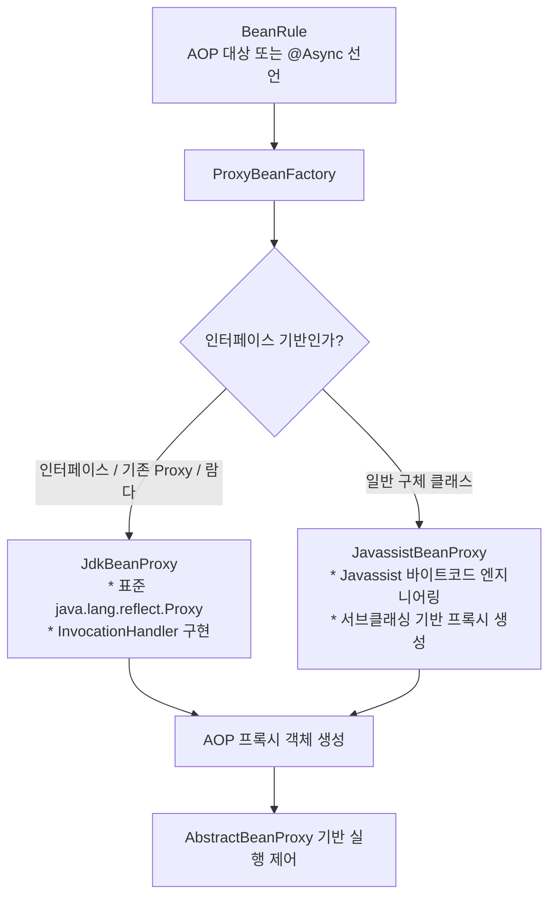
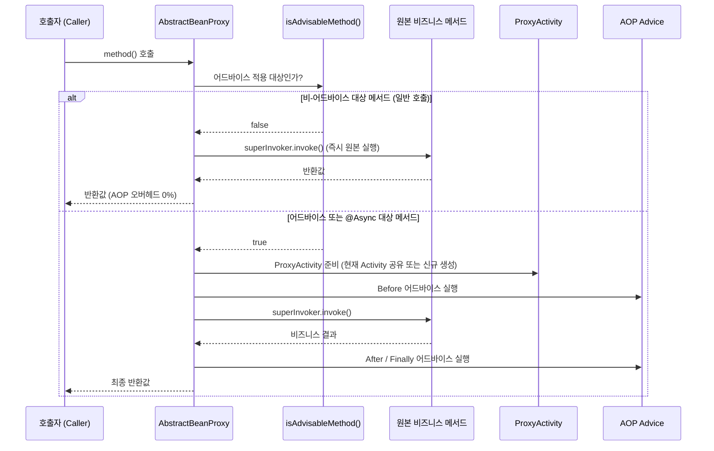
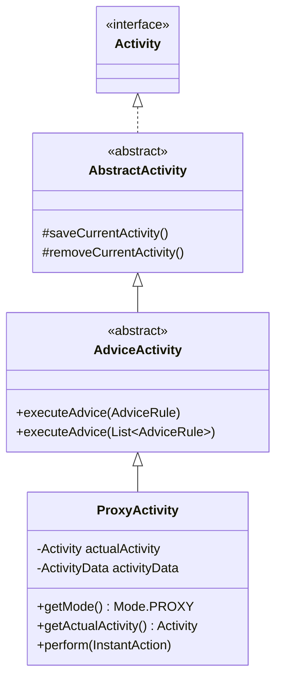
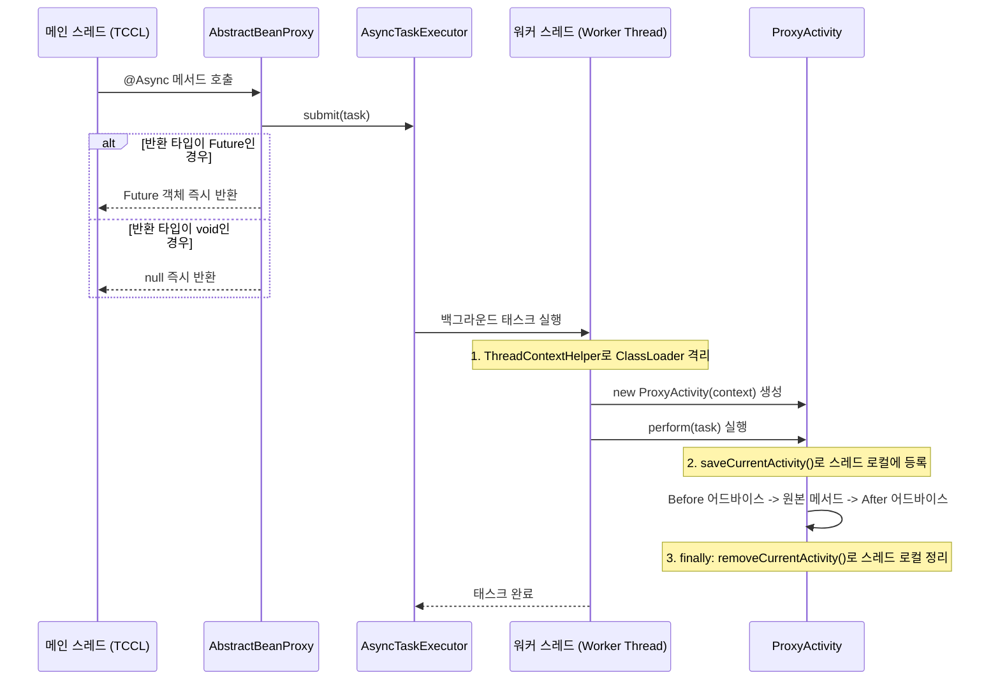

Aspectran의 관점 지향 프로그래밍(AOP, Aspect-Oriented Programming) 프록시 메커니즘은 **극대화된 런타임 성능**과 **비동기(`@Async`) 환경에서의 완벽한 컨텍스트 전파 및 스레드 격리**를 실현하도록 설계되었습니다.

전통적인 프레임워크의 AOP 프록시는 프록시된 객체의 모든 메서드 호출마다 인터셉터 체인 조회, 포인트컷 매칭, 컨텍스트 스택 생성을 반복하여 불필요한 성능 오버헤드를 유발했습니다. Aspectran은 부트스트랩 시점의 사전 정적 분석([`BeanRuleAnalyzer`](https://github.com/aspectran/aspectran/blob/master/core/src/main/java/com/aspectran/core/component/bean/BeanRuleAnalyzer.java))과 런타임의 선택적 인터셉션([`AbstractBeanProxy`](https://github.com/aspectran/aspectran/blob/master/core/src/main/java/com/aspectran/core/component/bean/proxy/AbstractBeanProxy.java)), 그리고 어드바이스 전용 경량 실행 컨텍스트인 [`ProxyActivity`](https://github.com/aspectran/aspectran/blob/master/core/src/main/java/com/aspectran/core/activity/ProxyActivity.java)를 결합하여 제로-오버헤드에 가까운 고속 AOP 런타임을 제공합니다.

## 1. 프록시 생성 아키텍처: `ProxyBeanFactory`

빈(Bean)에 AOP 애스펙트나 `@Async` 비동기 어노테이션이 적용될 필요가 있는 경우, IoC 컨테이너는 [`ProxyBeanFactory`](https://github.com/aspectran/aspectran/blob/master/core/src/main/java/com/aspectran/core/component/bean/proxy/ProxyBeanFactory.java)를 통해 타깃 빈을 래핑하는 최적의 프록시 인스턴스를 생성합니다.



### 1) 이원화된 프록시 생성 전략
- **인터페이스 기반 빈**: 타깃 클래스가 인터페이스이거나, 이미 JDK 프록시 객체이거나, 람다 클래스인 경우 표준 리플렉션 기반인 [`JdkBeanProxy`](https://github.com/aspectran/aspectran/blob/master/core/src/main/java/com/aspectran/core/component/bean/proxy/JdkBeanProxy.java)를 생성합니다.
- **구체 클래스(Concrete Class) 기반 빈**: 인터페이스가 없는 일반 클래스인 경우 고성능 바이트코드 조작 라이브러리인 Javassist를 사용하여 타깃 클래스를 동적으로 상속한 서브클래스 프록시([`JavassistBeanProxy`](https://github.com/aspectran/aspectran/blob/master/core/src/main/java/com/aspectran/core/component/bean/proxy/JavassistBeanProxy.java))를 생성합니다.
- **[`SuperInvoker`](https://github.com/aspectran/aspectran/blob/master/core/src/main/java/com/aspectran/core/component/bean/proxy/SuperInvoker.java)**: Javassist와 JDK 동적 프록시가 공통으로 원본(Super) 메서드를 호출할 수 있도록 추상화된 단일 인터페이스 콜백입니다.

### 2) 부트스트랩 시점의 사전 프록시 결정 ([`BeanRuleAnalyzer`](https://github.com/aspectran/aspectran/blob/master/core/src/main/java/com/aspectran/core/component/bean/BeanRuleAnalyzer.java))
컨텍스트 빌드 단계에서 `BeanRuleAnalyzer.determineProxyBean()` 메서드는 등록된 모든 `AspectRule`의 포인트컷 패턴을 전체 빈의 메서드와 미리 대조합니다. 이 과정에서 AOP 적용 대상인 빈만 선별적으로 프록시 생성 플래그([`beanRule.setProxied(true)`](https://github.com/aspectran/aspectran/blob/master/core/src/main/java/com/aspectran/core/context/rule/BeanRule.java#L113))를 설정하므로, AOP와 무관한 빈들은 어떠한 프록시 오버헤드도 없이 순수 POJO로 기동됩니다.

## 2. 핵심 실행 제어기: `AbstractBeanProxy`

[`AbstractBeanProxy`](https://github.com/aspectran/aspectran/blob/master/core/src/main/java/com/aspectran/core/component/bean/proxy/AbstractBeanProxy.java)는 모든 프록시 구현체(JDK, Javassist)가 공유하는 최상위 추상 클래스로서, 메서드 가로채기(Interception)와 어드바이스 실행 라이프사이클을 통제합니다.



### 1) 제로-오버헤드 선택적 인터셉션 ([`isAdvisableMethod`](https://github.com/aspectran/aspectran/blob/master/core/src/main/java/com/aspectran/core/component/bean/proxy/AbstractBeanProxy.java#L105))
프록시된 빈의 메서드가 호출될 때, `AbstractBeanProxy`는 가장 먼저 해당 메서드가 어드바이스 대상인지 검사합니다:
- 해당 메서드에 적용될 `AdviceRule`이 없고 `@Async` 어노테이션도 부여되어 있지 않다면, 어드바이스 규칙 룩업이나 컨텍스트 전환 없이 즉시 [`superInvoker.invoke()`](https://github.com/aspectran/aspectran/blob/master/core/src/main/java/com/aspectran/core/component/bean/proxy/AbstractBeanProxy.java#L132)를 호출하여 원본 코드를 실행합니다.
- 이로 인해 빈 내부의 수많은 게터/세터나 헬퍼 메서드 호출에서 발생하는 프록시 페널티가 완전히 배제됩니다.

### 2) 동기 및 비동기 분기 제어
- `@Async` 어노테이션이 감지된 경우: 백그라운드 태스크 실행기([`AsyncTaskExecutor`](https://github.com/aspectran/aspectran/blob/master/core/src/main/java/com/aspectran/core/component/bean/async/AsyncTaskExecutor.java))로 작업을 이관하는 비동기 파이프라인(`invokeAsync`)을 구동합니다.
- 동기 메서드인 경우: 현재 호출자 스레드에서 직접 어드바이스 체인을 실행하는 동기 파이프라인(`invokeSync`)을 구동합니다.

### 3) 메서드 힌트 스캐너 ([`ProxyHintScanner`](https://github.com/aspectran/aspectran/blob/master/core/src/main/java/com/aspectran/core/component/bean/proxy/ProxyHintScanner.java))
빈 메서드에 선언된 `@Hint` 어노테이션을 스캔하여 파라미터 힌트([`HintParameters`](https://github.com/aspectran/aspectran/blob/master/core/src/main/java/com/aspectran/core/activity/HintParameters.java)) 맵을 구성합니다. 메서드 호출 시 `activity.pushHint(hints)`를 통해 MyBatis SQL 쿼리 힌트나 캐시 힌트를 활동 컨텍스트 스택에 주입하고, 메서드 종료 후 `popHint()`로 안전하게 정리합니다.

## 3. 어드바이스 실행 전용 경량 엔진: `ProxyActivity`

[`ProxyActivity`](https://github.com/aspectran/aspectran/blob/master/core/src/main/java/com/aspectran/core/activity/ProxyActivity.java)는 일반적인 웹 요청이나 콘솔 명령 처리를 위한 무거운 오버헤드를 걷어내고, 오직 **AOP 어드바이스 실행 및 비동기 컨텍스트 격리**만을 위해 특화된 전용 활동 객체입니다.



### 1) 2가지 생성 모드 (독립 모드 vs 래핑 모드)
`ProxyActivity`는 호출 환경에 따라 유연하게 2가지 형태로 인스턴스화됩니다:
- **독립 모드 (`new ProxyActivity(context)`)**:
  - 현재 스레드에 실행 중인 `Activity`가 존재하지 않을 때(예: 독립적인 비동기 워커 스레드나 스케줄러 외부 호출) 생성됩니다.
  - 자체적인 빈 [`ActivityData`](https://github.com/aspectran/aspectran/blob/master/core/src/main/java/com/aspectran/core/activity/ActivityData.java)를 생성하여 완전히 독립된 컨텍스트에서 어드바이스를 실행합니다.
- **래핑 모드 (`new ProxyActivity(actualActivity)`)**:
  - 호출자 스레드에 이미 활성 `Activity`(예: 웹 요청 처리 중인 `ServletWebActivity`)가 존재할 때 생성됩니다.
  - 원본 활동([`actualActivity`](https://github.com/aspectran/aspectran/blob/master/core/src/main/java/com/aspectran/core/activity/ProxyActivity.java#L35))을 감싸며, **원본 활동의 `ActivityData`와 환경을 그대로 공유**합니다. 이를 통해 AOP 어드바이스 내부에서도 현재 HTTP 요청의 파라미터나 세션에 자유롭게 접근할 수 있습니다.

### 2) 명확한 역할 제한과 경량화
`ProxyActivity`는 요청 라우팅이나 뷰 렌더링을 직접 수행하지 않으므로, 불필요한 메서드(`getTranslet()`, `getDeclaredResponse()` 등) 호출 시 `UnsupportedOperationException`을 발생시켜 역할 경계를 엄격히 유지합니다.

## 4. 비동기(`@Async`) 실행 및 워커 스레드 컨텍스트 전파

비동기 메서드 호출 시 `AbstractBeanProxy`와 `ProxyActivity`는 워커 스레드로의 컨텍스트 전파와 리소스 해제를 안전하게 조율합니다.



1. **비동기 반환 타입 검증**:
   `@Async`가 선언된 메서드는 반드시 `void`이거나 `java.util.concurrent.Future` 인터페이스를 반환해야 합니다. 그 외의 타입을 반환하면 [`AsyncExecutionException`](https://github.com/aspectran/aspectran/blob/master/core/src/main/java/com/aspectran/core/component/bean/async/AsyncExecutionException.java)이 발생합니다.
2. **워커 스레드 내의 컨텍스트 생성**:
   워커 스레드에는 기존 활성 활동이 없으므로, 독립 모드의 `ProxyActivity`가 인스턴스화됩니다.
3. **중첩 호출 시 컨텍스트 재사용**:
   비동기 메서드 내부에서 동일 빈이나 다른 빈의 `@Advisable` 메서드를 연쇄 호출할 경우, 이미 워커 스레드의 ThreadLocal에 `ProxyActivity`가 등록되어 있으므로 새로운 컨텍스트를 생성하지 않고 기존 인스턴스를 재사용합니다.
4. **완벽한 스레드 로컬 클린업**:
   비동기 실행이 끝나면 `perform()`의 `finally` 블록에서 `removeCurrentActivity()`가 실행되어, 스레드 풀로 반환되는 워커 스레드의 메모리 누수를 원천 차단합니다.

## 5. AOP 조인포인트 처리 4대 라이프사이클 흐름

AOP 대상 메서드가 실행될 때 `AbstractBeanProxy`는 다음과 같은 4단계 어드바이스 사이클을 실행합니다.

```mermaid
graph TD
    Start[메서드 호출] --> Before[1. BEFORE 어드바이스<br/>* 트랜잭션 시작<br/>* 권한 인가 검증]
    Before --> Exec[2. 원본 비즈니스 메서드 실행<br/>superInvoker.invoke()]
    Exec --> Success{예외 발생 여부}

    Success -->|정상 실행| After[3. AFTER 어드바이스<br/>* 트랜잭션 커밋<br/>* 감사 로그 기록]
    Success -->|예외 발생| Thrown[3. THROWN 어드바이스<br/>* 트랜잭션 롤백<br/>* 예외 로깅 및 복구]

    After --> Finally[4. FINALLY 어드바이스<br/>* 힌트 스택 팝<br/>* 리소스 해제]
    Thrown --> Finally
    Finally --> End[결과 반환 또는 예외 전파]
```

1. **Before 어드바이스**: 메서드 실행 전에 보안 인가, 파라미터 유효성 검사, 분산 락 획득을 수행합니다. 제약 조건 위반 시 [`AdviceConstraintViolationException`](https://github.com/aspectran/aspectran/blob/master/core/src/main/java/com/aspectran/core/activity/aspect/AdviceConstraintViolationException.java)을 던져 비즈니스 메서드 실행을 차단할 수 있습니다.
2. **타깃 메서드 실행**: 원본 비즈니스 로직을 수행합니다.
3. **After 어드바이스**: 비즈니스 로직이 정상 완료된 직후 실행 결과를 가공하거나 후속 이벤트를 발행합니다.
4. **Thrown 어드바이스**: 비즈니스 로직 수행 중 예외 발생 시 호출되어 롤백을 수행하거나 사용자 친화적인 예외로 변환합니다.
5. **Finally 어드바이스**: 성공/실패 여부와 무관하게 항상 실행되어 `activity.popHint()` 및 자원 해제를 보장합니다.

> **관련 세부 메커니즘**:
> - 프록시가 사용하는 어드바이스 실행 엔진의 전체 구조는 [Aspectran 활동(Activities) 아키텍처](/ko/docs/mechanisms/aspectran-activities/) 문서를 참고하십시오.
> - 프록시 빈이 등록되고 관리되는 IoC 컨테이너 모델은 [ActivityContext: Aspectran 컨테이너의 심장부](/ko/docs/mechanisms/activity-context/) 문서를 참고하십시오.
> - AOP 애스펙트와 조인포인트를 선언하는 메타데이터 스키마는 [Aspectran 규칙 아키텍처](/ko/docs/mechanisms/aspectran-rule-architecture/) 문서를 참고하십시오.

## 6. 다음 단계: 세부 메커니즘 탐색

프록시 객체가 인스턴스화되는 스코프(Singleton, Prototype, Request, Session)의 상세 메모리 관리 모델은 [Aspectran 빈 스코프 아키텍처](/ko/docs/mechanisms/aspectran-bean-scopes/) 문서에서 확인할 수 있습니다.

전체 메커니즘 및 패키지 명세의 유기적 연결 관계를 확인하려면 **[Aspectran 세부 메커니즘 색인](/ko/docs/mechanisms/)**을 확인하십시오.
