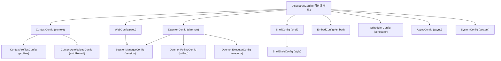

## 1. 설계 목표 및 주요 역할

`com.aspectran.core.context.config` 패키지는 Aspectran 프레임워크의 모든 실행 환경과 기능 서브시스템에 대한 설정값을 캡슐화하는 **타입-안전(Type-Safe) APON 파라미터 컨테이너 클래스들의 집합**입니다.

이 패키지의 핵심 설계 목표는 다음과 같습니다.

*   **설정의 객체 모델화 및 강력한 타입 안전성**: 텍스트 파일(APON, XML)에 기술된 설정 정보를 자바 객체 모델로 즉시 파싱하여, 컴파일 타임 검증과 직관적인 Getter/Setter 메서드를 통해 설정값에 접근할 수 있도록 합니다.
*   **APON(Aspectran Parameters Object Notation) 엔진과의 밀접한 결합**: 모든 설정 클래스는 `com.aspectran.utils.apon.DefaultParameters`를 상속하여, 간결하고 가독성 높은 APON 포맷과 1:1로 매핑되는 계층형 파라미터 트리를 구성합니다.
*   **실행 환경별 모듈성(Modularity) 극대화**: 웹(`WebConfig`), 데몬(`DaemonConfig`), 대화형 셸(`ShellConfig`), 임베디드(`EmbedConfig`), 스케줄러(`SchedulerConfig`), 비동기 작업기(`AsyncConfig`), 시스템 프로퍼티(`SystemConfig`) 등으로 설정을 기능별로 엄격히 분리하여 불필요한 결합도를 제거합니다.
*   **설정의 불변성(Immutability) 지향**: 부트스트랩 단계에서 `ActivityContextBuilder`에 의해 한 번 주입된 설정 객체는 런타임에 임의로 변경되지 않는 것을 원칙으로 하여, 전체 애플리케이션의 일관성과 예측 가능성을 보장합니다.

## 2. 주요 클래스 및 설정 파라미터 구조



### `AspectranConfig` (최상위 루트 클래스)

Aspectran 설정 파일(`aspectran-config.apon`)의 최상위 루트 파라미터 컨테이너입니다.

*   **주요 책임 및 관리 파라미터**:
    *   `system`: JVM 전역 시스템 프로퍼티(`System.setProperty`)를 주입하기 위한 `SystemConfig` 블록입니다.
    *   `context`: 모든 Aspectran 애플리케이션에 필수적인 코어 컨텍스트 설정 블록(`ContextConfig`)입니다.
    *   `web` / `daemon` / `shell` / `embed`: 특정 런타임 환경에 특화된 설정 블록입니다.
    *   `scheduler`: 백그라운드 Quartz 스케줄러 구동 옵션 블록(`SchedulerConfig`)입니다.
    *   `async`: `@Async` 비동기 액션 워커 스레드 풀 설정 블록(`AsyncConfig`)입니다.

### `ContextConfig` (코어 컨텍스트 설정)

실행 환경과 무관하게 `ActivityContext`를 빌드하는 데 필수적인 핵심 정보들을 정의합니다.

*   **주요 파라미터 분석**:
    *   `basePath`: 애플리케이션의 루트 기본 디렉터리 경로입니다. 모든 상대 경로는 이 경로를 기준으로 해석됩니다.
    *   `rules`: Aspectran의 메인 비즈니스 규칙(Bean, Translet, Aspect, Schedule)이 정의된 XML/APON 설정 파일 또는 리소스 경로 목록(`String[]`)입니다.
    *   `basePackages`: `@Component`, `@Bean`, `@Aspect` 등의 어노테이션을 자동으로 스캔할 기준 패키지 목록(`String[]`)입니다.
    *   `resources`: `SiblingClassLoader`가 동적으로 로드할 외부 JAR 파일 및 클래스 디렉터리 경로 목록(`resourceLocations`)입니다.
    *   `profiles`: 활성화할 환경 프로필을 정의하는 `ContextProfilesConfig` 블록입니다.
    *   `autoReload`: 설정 파일 및 리소스 변경 시 컨텍스트를 자동 재기동하는 `ContextAutoReloadConfig` 블록입니다.

### `ContextProfilesConfig` 및 `ContextAutoReloadConfig`

*   **`ContextProfilesConfig`**:
    *   `baseProfiles`: 항상 적용되는 기반 프로필 목록입니다.
    *   `defaultProfiles`: 활성 프로필이 없을 때 폴백되는 기본 프로필 목록입니다.
    *   `activeProfiles`: 현재 환경에서 명시적으로 활성화할 프로필 목록입니다. (예: `dev`, `prod`, `qa`)
*   **`ContextAutoReloadConfig`**:
    *   `enabled`: 자동 리로딩 활성화 여부 (`true` / `false`).
    *   `scanIntervalSeconds`: 리소스 타임스탬프 스캔 주기(초).
    *   `reloadMode`: 클래스로더 갱신 정책 (`soft`: 캐시 갱신 / `hard`: SiblingClassLoader 재생성).

### `WebConfig` (웹 런타임 설정)

서블릿(`aspectran-web-servlet`), Undertow(`aspectran-undertow`), Netty(`aspectran-netty`) 등 모든 웹 런타임에서 공통으로 참조하는 웹 설정입니다.

*   `uriDecoding`: 유입된 HTTP 요청 URI를 디코딩할 문자 인코딩(예: `UTF-8`)입니다.
*   `trailingSlashRedirect`: 트랜슬릿 매핑 시 끝자리 슬래시(`/`) 유무에 따라 자동으로 301/302 리다이렉트를 수행할지 여부입니다.
*   `proxyAddressForwarding`: 리버스 프록시(`X-Forwarded-For`, `X-Forwarded-Proto`) 헤더를 신뢰하여 클라이언트 원격 IP와 프로토콜을 보정할지 여부입니다.
*   `session`: HTTP 세션 관리 방식을 정의하는 `SessionManagerConfig` 블록입니다.

### `SessionManagerConfig` 및 `SessionFileStoreConfig`

Aspectran의 세션 매니저를 구성하는 상세 설정입니다.

*   `timeout`: 세션 만료 시간(초 또는 분)입니다.
*   `maxActiveSessions`: 메모리에 유지할 수 있는 최대 활성 세션 개수입니다.
*   `evictionIdleSeconds`: 유휴 세션을 메모리에서 퇴출(Evict)하기까지의 대기 시간입니다.
*   `fileStore`: 서버 재시작 시 세션 데이터를 디스크 파일에 직렬화하여 영속화하기 위한 `SessionFileStoreConfig` 블록입니다.

### `DaemonConfig`, `ShellConfig`, `EmbedConfig`

각 비-웹 실행 환경에 특화된 설정 클래스들입니다.

*   **`DaemonConfig`**:
    *   `executor`: 데몬 명령어를 처리할 비동기 스레드 풀 설정(`DaemonExecutorConfig`)입니다.
    *   `polling`: 파일 기반 원격 명령(`FileCommander`) 감시 주기 및 작업 디렉터리를 정의하는 `DaemonPollingConfig`입니다.
*   **`ShellConfig`**:
    *   `greetings`: 셸 진입 시 콘솔에 출력할 환영 메시지 배너입니다.
    *   `prompt`: 터미널 프롬프트 문자열 포맷(예: `aspectran> `)입니다.
    *   `historyFile`: 사용자가 입력한 명령어 히스토리를 저장할 파일 경로입니다.
    *   `style`: ANSI 색상 및 텍스트 스타일을 지정하는 `ShellStyleConfig` 블록입니다.
*   **`EmbedConfig`**:
    *   다른 호스트 애플리케이션 내에 내장될 때 필요한 세션 타임아웃 및 가상 실행 옵션을 관리합니다.

### `SchedulerConfig` 및 `AsyncConfig`

*   **`SchedulerConfig`**:
    *   `startDelaySeconds`: 서비스 시작 후 Quartz 스케줄러 트리거 가동까지의 지연 대기 시간(초)입니다.
    *   `waitOnShutdown`: 서비스 정지 시 현재 실행 중인 배치 작업이 끝날 때까지 대기(Graceful Shutdown)할지 여부입니다.
*   **`AsyncConfig`**:
    *   `corePoolSize`, `maxPoolSize`, `queueCapacity`: `@Async` 비동기 워커 스레드 풀의 크기 및 대기 큐 크기입니다.

### `SystemConfig`

*   애플리케이션 부트스트랩 극초기 단계에서 `System.setProperty(key, value)`로 주입할 전역 시스템 속성들의 키-값 맵입니다.

## 3. APON 설정 예시로 보는 패키지 매핑

```apon
system: {
    properties: {
        file.encoding: "UTF-8"
        sun.stdout.encoding: "UTF-8"
    }
}
context: {
    basePath: "/app"
    rules: [
        /config/app-context.xml
    ]
    basePackages: [
        com.example.app
    ]
    profiles: {
        active: [ dev ]
    }
    autoReload: {
        reloadMode: "hard"
        scanIntervalSeconds: 5
        enabled: true
    }
}
web: {
    uriDecoding: "UTF-8"
    trailingSlashRedirect: true
    proxyAddressForwarding: true
    session: {
        timeout: 1800
        maxActiveSessions: 10000
    }
}
scheduler: {
    startDelaySeconds: 5
    waitOnShutdown: true
}
async: {
    corePoolSize: 10
    maxPoolSize: 50
    queueCapacity: 1000
}
```

위의 선언적인 APON 설정은 프레임워크 기동 시 `AspectranConfigReader`에 의해 `AspectranConfig` 객체 트리로 일괄 변환되며, 각 서비스 빌더(`DefaultCoreService`, `DefaultServletWebService`, `DefaultTowService`, `DefaultNettyService` 등)로 전달되어 컴포넌트들을 완벽하게 초기화합니다.

## 4. 패키지 요약 및 아키텍처적 의미

`com.aspectran.core.context.config` 패키지는 Aspectran의 **선언적 설정(Declarative Configuration)과 런타임 실행 컴포넌트 사이의 완벽한 디커플링을 제공하는 추상화의 정수**입니다.

1.  **타입 안전성과 오류 사전 차단**: 문자열 기반 설정을 타입이 엄격한 파라미터 키(`ParameterKey`)와 전용 클래스로 캡슐화하여, 런타임 파싱 오류나 오타를 조기에 발견하고 검증할 수 있습니다.
2.  **모듈식 환경 구성**: 공통 컨텍스트(`ContextConfig`)와 개별 런타임 환경(`WebConfig`, `DaemonConfig`, `ShellConfig` 등)이 계층적으로 격리되어 있어, 다중 런타임을 동시 운용하거나 새로운 실행 환경을 확장하기 매우 용이합니다.
3.  **APON 데이터 모델의 완벽한 활용**: 복잡한 중첩 구조를 직관적이고 깔끔한 APON 문법으로 표현할 수 있도록 뒷받침하는 기술적 근간이 됩니다.
