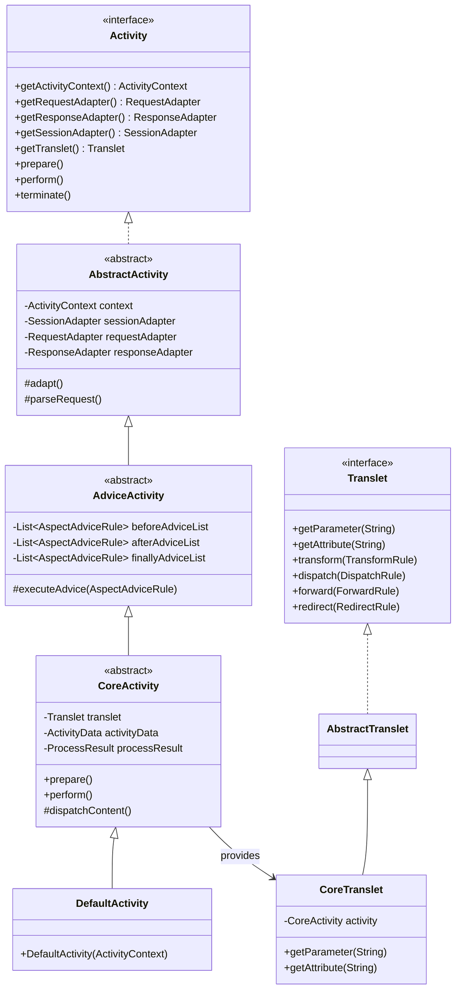

## 1. 설계 목표 및 주요 역할

`com.aspectran.core.activity` 패키지는 Aspectran 프레임워크의 **단일 요청-응답 처리 실행 엔진(Execution Engine)**의 심장부입니다. 외부에서 웹 HTTP 요청, 소켓 데이터, 콘솔 셸 명령, 백그라운드 스케줄러 트리거가 유입되었을 때 이를 일관된 규칙 기반으로 처리하는 모든 추상화와 구체 로직이 이 패키지에 집약되어 있습니다.

이 패키지의 핵심 설계 목표는 다음과 같습니다.

*   **요청 처리의 완벽한 표준화**: 요청의 출처(HTTP, TCP, CLI, 배치)에 관계없이 일관된 파이프라인을 통해 처리하기 위한 표준 활동 모델(`Activity`)을 정의합니다.
*   **실행 엔진과 사용자 API의 명확한 분리 (Engine vs Facade)**: 프레임워크 내부의 복잡한 AOP 어드바이스 체인, 예외 전파, 어댑터 관리 등은 `Activity`가 전담하고, 개발자가 작성하는 비즈니스 액션 코드에는 단순화된 퍼사드 인터페이스인 `Translet`만 노출하여 인지 부하를 최소화합니다.
*   **환경 독립적 어댑터 결속**: 어댑터 패턴(Adapter Pattern)을 극대화하여, 실행 엔진 코어가 서블릿, Netty 채널, 터미널 스트림 등의 구체 인프라를 전혀 알지 못해도 표준 `RequestAdapter`, `ResponseAdapter`, `SessionAdapter`를 통해 상호작용하도록 합니다.
*   **선언적 AOP 어드바이스 파이프라인 결합**: 요청의 라이프사이클 단계마다 사전 정의된 포인트컷에 일치하는 Aspect 어드바이스(`BEFORE`, `AFTER`, `AROUND`, `THROWN`, `FINALLY`)를 자연스럽게 인터셉트하여 실행합니다.
*   **유연한 파생 활동 지원**: 비동기 워커 스레드 처리를 위한 `ProxyActivity`, 경량 템플릿 렌더링을 위한 `InstantActivity` 등 다양한 요구에 부응하는 특화된 활동 모델을 제공합니다.

## 2. 주요 클래스 및 인터페이스 상세 분석

### `Activity` (인터페이스)

단일 요청-응답 라이프사이클 전체를 통제하는 중앙 실행 제어기(Controller)의 최상위 명세입니다.

*   **주요 책임**:
    *   전역 애플리케이션 컨텍스트인 `ActivityContext`에 대한 접근을 제공합니다.
    *   현재 요청을 추상화하는 어댑터 삼총사(`RequestAdapter`, `ResponseAdapter`, `SessionAdapter`)에 대한 접근점을 제공합니다.
    *   개발자에게 노출할 `Translet` 퍼사드 인스턴스를 제공합니다.
    *   전체 파이프라인의 수명주기 진입점(`prepare()`, `perform()`)을 선언합니다.
    *   요청 처리 도중 즉시 응답을 완료하고 흐름을 끊는 조기 종료(`terminate()`) 제어권을 제공합니다.
    *   ASEL 표현식 평가기(`TokenEvaluator`, `ItemEvaluator`)에 대한 접근 통로를 제공합니다.

### `AbstractActivity` (추상 클래스)

`Activity`의 기본 인프라 바인딩과 스레드 로컬 관리를 담당하는 추상 뼈대 클래스입니다.

*   **주요 책임 및 동작**:
    *   `ActivityContext`와의 결속을 유지하고, 현재 활동을 `ActivityContext.setCurrentActivity(this)`를 통해 스레드 로컬에 안전하게 바인딩합니다.
    *   환경별 하위 클래스가 구체적인 입출력 스트림을 표준 어댑터로 감싸도록 `adapt()` 및 `parseRequest()` 템플릿 메서드를 규정합니다.

### `AdviceActivity` (추상 클래스)

`AbstractActivity`를 상속하여 **Aspectran의 선언적 AOP 어드바이스 인터셉션 엔진**을 장착한 상위 클래스입니다.

*   **주요 책임 및 실행 흐름**:
    *   현재 요청 경로와 메서드에 일치하는 Aspect 규칙들을 수집하고 우선순위(`order`)에 따라 정렬합니다.
    *   `BEFORE`, `AFTER`, `THROWN`, `FINALLY` 단계별 어드바이스 실행 큐를 유지합니다.
    *   어드바이스 내부에서 빈 메서드를 호출하거나 추가 액션을 실행할 때 컨텍스트 스택을 올바르게 제어합니다.

### `CoreActivity` (추상 클래스)

`AdviceActivity`를 상속하며, Aspectran의 표준 트랜슬릿 처리 파이프라인을 완벽하게 구현한 핵심 클래스입니다.

*   **엔드투엔드 실행 파이프라인 (`perform()`)**:
    1.  **어댑터 결속 (`adapt`)**: 서블릿, Netty, 터미널 등의 원시 객체를 `RequestAdapter`, `ResponseAdapter`, `SessionAdapter`로 변환합니다.
    2.  **`BEFORE` 어드바이스 실행**: 트랜슬릿 비즈니스 액션이 시작되기 전 사전 보안 검사, 트랜잭션 시작, 권한 인가를 수행합니다.
    3.  **콘텐츠 액션 실행 (`dispatchContent`)**: `<contents>` 블록에 정의된 액션(`InvokeAction`, `IncludeAction`, `ChooseAction` 등)을 순차적으로 디스패치하여 비즈니스 로직을 수행하고 결과를 `ProcessResult`에 저장합니다.
    4.  **응답 처리 (`response`)**: 선언된 응답 규칙(JSON/XML/XSL 변환인 `TransformRule`, 템플릿 뷰 포워딩인 `DispatchRule`, URL 리다이렉트인 `RedirectRule`, 내부 포워딩인 `ForwardRule`)에 따라 클라이언트 응답을 렌더링합니다.
    5.  **`AFTER` 어드바이스 실행**: 비즈니스 액션 및 응답 렌더링이 성공적으로 끝난 후 후속 로깅이나 리소스 정리를 수행합니다.
    6.  **`THROWN` 어드바이스 실행**: 파이프라인 실행 중 예외(`ActivityException`)가 발생한 경우 예외 핸들러 애스펙트를 구동하여 트랜잭션 롤백 및 에러 페이지를 처리합니다.
    7.  **`FINALLY` 어드바이스 실행**: 성공/실패 여부에 관계없이 최종 정리 작업을 수행합니다.
    8.  **응답 스트림 종료 (`response.end()`)**: 모든 버퍼를 플러시하고 출력을 완료합니다.

### `Translet` (인터페이스) 및 `CoreTranslet` (구현체)

개발자가 작성하는 액션 메서드나 컨트롤러 코드에 주입되는 **사용자 친화적 퍼사드(Facade)**입니다.

*   **주요 책임**:
    *   요청 파라미터(`getParameter`, `getParameterValues`), 요청 속성(`getAttribute`, `setAttribute`), 파일 파라미터(`getFileParameter`) 등에 대한 직관적인 접근 메서드를 제공합니다.
    *   액션 코드 내부에서 프로그래밍 방식으로 응답 방식을 동적으로 변경할 수 있는 흐름 제어 메서드(`transform()`, `dispatch()`, `redirect()`, `forward()`)를 노출합니다.
    *   실행된 이전 액션들의 결과 객체 모음인 `ProcessResult`에 접근할 수 있게 합니다.
    *   `CoreTranslet`은 모든 호출을 백그라운드의 `CoreActivity` 및 어댑터에 안전하게 위임합니다.

### `ActivityData` (클래스)

단일 요청 내에서 접근 가능한 모든 데이터를 단일 뷰로 통합하여 제공하는 지연 로딩(Lazy Loading) 맵 퍼사드입니다.

*   요청 파라미터, 요청 속성, 세션 속성, `ProcessResult`에 저장된 액션 결과값을 단일 네임스페이스로 묶어 제공합니다.
*   ASEL 표현식(`#{user.name}`, `#{actionResult.orderId}`) 평가 시 최우선 검색 대상 컨테이너로 동작합니다.

### `InstantActivity` 및 `InstantActivitySupport`

기존의 정규 트랜슬릿 흐름과 별개로, 뷰 템플릿(Thymeleaf, FreeMarker)을 즉석에서 렌더링하거나 특정 비즈니스 액션만 경량으로 단발성 실행해야 할 때 사용하는 **인스턴트 활동 객체**입니다.

*   부모 `Activity`가 존재하는 경우 세션 및 컨텍스트 상태를 계승하며, 독립 실행 시에도 최소한의 인프라 어댑터만 갖추어 신속하게 실행을 완료합니다.

### `ProxyActivity` (클래스)

`@Async` 비동기 메서드 호출 시 워커 스레드로 컨텍스트를 전파하거나, 외부 스레드 풀에서 트랜슬릿 컨텍스트를 시뮬레이션할 때 사용되는 프록시 활동 객체입니다.

*   원본 활동 객체의 어댑터와 보안 컨텍스트를 스레드 안전하게 복제하여 비동기 스레드에서도 `ActivityContext.getCurrentActivity()`를 안전하게 호출할 수 있게 합니다.

### `FlashMap` 및 `FlashMapManager`

웹 환경에서 PRG (Post/Redirect/Get) 패턴을 완벽하게 지원하기 위한 컴포넌트입니다.

*   리다이렉트 발생 시 1회성 속성(Flash Attribute)을 세션에 임시 보관한 뒤, 다음 GET 요청 시 자동으로 복원하여 `ActivityData`에 병합하고 세션에서 즉시 삭제합니다.

## 3. 다른 패키지와의 상호작용

*   **`com.aspectran.core.service`**: `CoreService.service(Activity)`를 통해 활동 객체가 유입되고 실행이 개시됩니다.
*   **`com.aspectran.core.adapter`**: `Activity`는 `RequestAdapter`, `ResponseAdapter`, `SessionAdapter`를 소유하며, 실행 파이프라인의 모든 입출력은 어댑터 인터페이스를 통해 일어납니다.
*   **`com.aspectran.core.activity.process`**: `CoreActivity.dispatchContent()`는 이 패키지의 `ContentList`와 `Executable` 액션 체인을 실행하고, 결과물을 `ProcessResult`로 수집합니다.
*   **각 런타임 활동 패키지 (`web.servlet`, `netty`, `undertow`, `shell`, `daemon`, `embed`)**: 각 실행 환경의 활동 클래스(`ServletWebActivity`, `NettyActivity`, `TowActivity`, `ShellActivity` 등)는 `CoreActivity`를 상속하여 자신의 런타임 어댑터를 결속합니다.

## 4. 패키지 요약 및 아키텍처적 의미

`com.aspectran.core.activity` 패키지는 Aspectran의 아키텍처적 정체성을 드러내는 가장 중요한 패키지 중 하나입니다.

1.  **엔진과 퍼사드의 완전한 분리**: `Activity`는 복잡한 라이프사이클 엔진을 감당하고, `Translet`은 개발자에게 간결하고 강력한 API를 선사하여 유지보수성과 생산성을 극대화합니다.
2.  **어댑터 패턴의 극대화**: 실행 엔진이 네트워크나 플랫폼에 종속되지 않고 순수한 비즈니스 파이프라인으로 유지될 수 있는 것은, 모든 외부 세계와의 접점을 이 패키지의 활동 객체들이 어댑터를 통해 추상화하기 때문입니다.
3.  **유기적인 AOP 결속**: 별도의 외부 프레임워크 없이도 활동의 라이프사이클 단계마다 Aspect 어드바이스가 물 흐르듯 결합되어 강력한 엔터프라이즈 기능을 자연스럽게 수행합니다.
