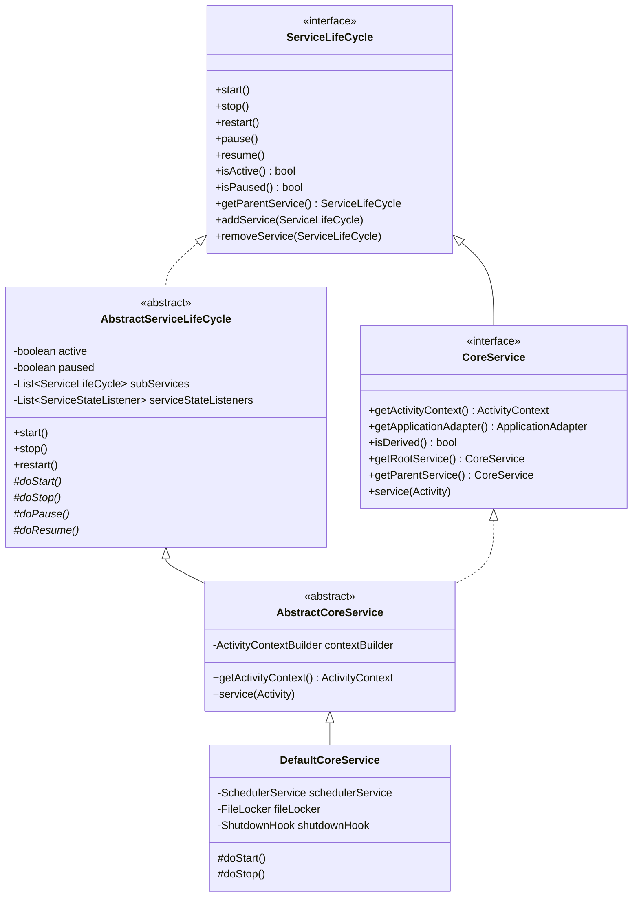

## 1. 설계 목표 및 주요 역할

`com.aspectran.core.service` 패키지는 Aspectran 프레임워크의 **서비스 계층 최상위 기반이자 부트스트래핑 엔진**을 정의합니다. 모든 실행 환경(Web, Netty, Undertow, Shell, Daemon, Embed)의 구체적인 서비스들은 이 패키지에 정의된 인터페이스와 추상 클래스를 상속받아 구현됩니다.

이 패키지의 핵심 설계 목표는 다음과 같습니다.

*   **일관된 생명주기 계약(Contract)**: 애플리케이션의 시작(`start`), 정지(`stop`), 재시작(`restart`), 일시정지(`pause`), 재개(`resume`) 등 복잡한 상태 천이를 예측 가능하고 스레드 안전(Thread-Safe)하게 관리하는 표준화된 수명주기 프레임워크를 제공합니다.
*   **계층적 서비스(Hierarchical Services) 전파**: 서비스 간의 부모-자식 관계를 형성하여, 루트 서비스의 생명주기 명령이 모든 하위 파생 서비스(`subServices`)로 질서정연하게 전파되도록 합니다.
*   **중앙 접근 지점(Central Access Point) 제공**: 프레임워크의 심장부인 `ActivityContext`에 접근할 수 있는 유일한 표준 관문인 `CoreService`를 정의하여, 빈(Bean), 트랜슬릿(Translet), 애스펙트(Aspect), 환경 변수 등에 안전하게 접근할 수 있도록 캡슐화합니다.
*   **다양한 런타임 환경 지원 기반**: 프로토콜과 인프라에 독립적인 코어 추상화(`AbstractCoreService`)를 제공함으로써, 웹 서블릿 컨테이너나 Netty 채널 파이프라인, JLine 셸 등 어떠한 환경에서도 일관된 실행 모델을 재사용할 수 있게 합니다.
*   **클래스로더 기반 멀티 테넌시 지원**: 동일한 JVM 내에서 여러 웹 애플리케이션이나 마이크로 모듈이 공존할 수 있도록, `ClassLoader`를 라우팅 키로 사용하는 `CoreServiceHolder` 서비스 로케이터를 제공합니다.

주요 디자인 패턴으로는 생명주기 관리 로직의 뼈대를 제공하는 **템플릿 메서드 패턴(Template Method Pattern)**이 `AbstractServiceLifeCycle`과 `AbstractCoreService`에 적용되었으며, `CoreServiceHolder`를 통해 **서비스 로케이터 패턴(Service Locator Pattern)**, 상태 변경 이벤트를 외부에 브로드캐스팅하는 **옵저버 패턴(Observer Pattern)**이 적용되어 있습니다.

## 2. 주요 클래스 및 인터페이스 상세 분석



### `ServiceLifeCycle` (인터페이스)

Aspectran 내에서 생명주기를 갖는 모든 서비스 컴포넌트가 구현해야 하는 최상위 계약입니다.

*   **주요 책임**:
    *   서비스의 상태를 제어하는 표준 인터페이스(`start()`, `stop()`, `restart()`, `pause()`, `resume()`)를 규정합니다.
    *   계층 구조 형성을 위한 메서드(`getParentService()`, `addService(ServiceLifeCycle)`, `removeService(ServiceLifeCycle)`)를 제공하여 부모 서비스가 자식 서비스들의 수명주기를 종속적으로 제어할 수 있도록 합니다.
    *   현재 활성화 상태(`isActive()`) 및 일시정지 상태(`isPaused()`)를 조회하는 질의 메서드를 제공합니다.

### `AbstractServiceLifeCycle` (추상 클래스)

`ServiceLifeCycle` 인터페이스의 핵심 동기화 및 전파 로직을 구현한 추상 뼈대 클래스입니다.

*   **주요 책임 및 구현 원리**:
    *   **상태 가시성 보장**: `volatile boolean active`와 `volatile boolean paused` 플래그를 두어 멀티스레드 환경에서 서비스 상태 변경이 즉각적으로 모든 스레드에 인지되도록 보장합니다.
    *   **스레드 세이프 동기화**: 모든 수명주기 전이 메서드는 `synchronized` 블록 내에서 실행되어 동시 호출 시 발생할 수 있는 경쟁 상태(Race Condition)를 원천 차단합니다.
    *   **트리형 수명주기 전파**: 부모 서비스의 `start()`, `stop()` 실행 시 등록된 모든 하위 서비스(`subServices`)의 동일 메서드를 연쇄적으로 호출합니다.
    *   **루트 서비스 제약 검증**: 안전한 상태 보장을 위해 재시작 시 `Assert.state(isRootService(), "Only the root service can be restarted")`를 검증하여 부분 재시작으로 인한 상태 파편화를 방지합니다.
*   **핵심 템플릿 메서드**:
    *   `start()`: 이미 활성 상태인지 검사한 후, 하위 구현체가 구체적인 시작 로직을 구현하도록 `doStart()`를 호출하고, 연이어 모든 자식 서비스의 `start()`를 호출합니다.
    *   `stop()`: `doStop()`을 호출하여 자체 리소스를 해제한 후, 등록된 모든 자식 서비스의 `stop()`을 역순으로 호출합니다.
    *   `doStart()`, `doStop()`, `doPause()`, `doResume()`: 하위 서비스 클래스가 실제 초기화 및 종료 작업을 수행하도록 강제하는 추상 템플릿 메서드입니다.

### `CoreService` (인터페이스)

Aspectran 애플리케이션의 **실질적인 본체**를 나타내는 핵심 서비스 인터페이스입니다. `ServiceLifeCycle`을 상속합니다.

*   **주요 책임**:
    *   `getActivityContext()`: 애플리케이션의 모든 빈, 트랜슬릿, 애스펙트가 살아있는 `ActivityContext` 인스턴스를 반환합니다.
    *   `getApplicationAdapter()`: 루트 디렉터리와 환경 속성을 캡슐화한 `ApplicationAdapter`에 접근합니다.
    *   `isDerived()`: 현재 서비스가 상위 `CoreService`의 `ActivityContext`를 공유하는 파생 서비스인지 여부를 반환합니다. `true`인 경우 자체 컨텍스트를 빌드하지 않고 부모의 컨텍스트를 그대로 계승합니다.
    *   `getRootService()` / `getParentService()`: 계층 트리 내에서 최상위 루트 서비스 및 직속 부모 서비스를 탐색합니다.
    *   `service(Activity activity)`: 외부에서 유입된 요청을 담은 `Activity` 객체를 실행 파이프라인에 진입시키는 단일 실행 관문입니다.

### `AbstractCoreService` (추상 클래스)

`CoreService` 인터페이스와 `AbstractServiceLifeCycle`을 결합한 핵심 추상 구현체입니다.

*   **주요 책임 및 동작 방식**:
    *   `ActivityContextBuilder` 인스턴스를 유지하며, 독립 서비스 모드일 경우 직접 컨텍스트 빌드를 총괄합니다.
    *   `service(Activity activity)` 구현:
        ```java
        public void service(Activity activity) throws ActivityException {
            Assert.state(isActive(), "CoreService is not active");
            activity.prepare();
            activity.perform();
        }
        ```
        서비스 활성화 여부를 검증한 후, `Activity`의 준비(`prepare`)와 실행(`perform`) 파이프라인을 순차 구동합니다.

### `DefaultCoreService` (구현 클래스)

독립적인 Aspectran 애플리케이션의 **표준 부트스트래퍼(Bootstrapper)** 구현체입니다.

*   **주요 책임 및 핵심 메서드**:
    *   **설정 기반 초기화**: `AspectranConfig` 설정 객체를 주입받아 `HybridActivityContextBuilder`를 구성하고, `ActivityContext`를 프로비저닝합니다.
    *   **스케줄러 서비스 통합 관리**: 설정 파일에 스케줄러(`scheduler`)가 정의되어 있을 경우, `SchedulerService`를 자식 서비스로 자동 인스턴스화하고 생명주기를 동기화합니다.
    *   **단일 인스턴스 파일 락 (`FileLocker`)**: 동일한 기본 경로(`basePath`)에서 중복 프로세스가 실행되어 파일이나 데이터베이스가 손상되는 것을 방지하기 위해 `.lock` 파일 기반의 상호 배제 잠금을 획득합니다.
    *   **JVM Shutdown Hook 등록**: `Runtime.getRuntime().addShutdownHook()`을 통해 프로세스가 `SIGTERM` 등의 시그널로 종료될 때 컨텍스트 소멸(`stop()`)이 보장되도록 안전망을 구축합니다.

### `CoreServiceHolder` (유틸리티 클래스)

런타임에 실행 중인 `CoreService` 인스턴스들을 스레드 및 클래스로더 컨텍스트별로 매핑하여 제공하는 **서비스 로케이터(Service Locator)**입니다.

*   **주요 책임 및 라우팅 알고리즘**:
    *   `Map<ClassLoader, CoreService> serviceMap`을 스레드 안전하게 유지합니다.
    *   `acquire()` 메서드 호출 시 현재 실행 스레드의 컨텍스트 클래스로더(`Thread.currentThread().getContextClassLoader()`)를 키로 삼아 정확한 서비스 인스턴스를 반환합니다.
    *   만약 직속 클래스로더로 매핑되지 않는다면 부모 클래스로더 체인을 상향 탐색하며, 최후에는 단일 등록된 루트 서비스를 반환하는 3단계 폴백(Fallback) 라우팅을 지원합니다.
    *   `putService(CoreService)` 및 `release(CoreService)`를 통해 서비스 생성과 소멸에 맞춰 레지스트리를 자동으로 갱신합니다.

### `RequestAcceptor` (인터페이스)

서비스 진입점에서 처리 가능한 트랜슬릿 요청인지 사전에 인가하고 필터링하는 정책 계약입니다.

*   허용할 트랜슬릿 이름 패턴이나 제외할 패턴을 설정하여, 외부의 유효하지 않은 요청이나 관리자 전용 트랜슬릿에 대한 무단 접근을 서비스 진입 레벨에서 차단합니다.

### `ServiceStateListener` 및 `ServiceHoldingListener`

서비스의 생명주기 상태 전이를 감지하는 리스너 체계입니다.

*   `ServiceStateListener`: 서비스가 `STARTED`, `STOPPED`, `PAUSED`, `RESUMED` 상태로 전환될 때 콜백을 수신합니다.
*   `ServiceHoldingListener`: `CoreService`가 시작될 때 자동으로 `CoreServiceHolder.putService()`를 호출하고, 정지될 때 `CoreServiceHolder.release()`를 호출하여 서비스 레지스트리의 정합성을 무결하게 유지합니다.

## 3. 다른 패키지와의 상호작용

*   **`com.aspectran.core.context`**: `CoreService`는 `ActivityContext`를 캡슐화하여 제공하며, 컨텍스트 내의 모든 빈 레지스트리, 규칙 레지스트리, 템플릿 렌더러에 대한 최상위 접근 통로가 됩니다.
*   **`com.aspectran.core.activity`**: `CoreService.service(Activity)`를 호출하여 요청 처리의 주도권을 넘깁니다. `Activity`는 서비스로부터 컨텍스트와 어댑터를 전달받아 실제 비즈니스 트랜슬릿을 수행합니다.
*   **`com.aspectran.core.scheduler.service`**: `DefaultCoreService`는 자신의 시작(`doStart`) 시점에 `SchedulerService`를 자식 서비스로 등록하여 작업 스케줄링을 활성화합니다.
*   **각 런타임 서비스 패키지 (`web`, `netty`, `undertow`, `shell`, `daemon`, `embed`)**: 각 런타임의 최상위 서비스 클래스들은 `AbstractCoreService` 또는 `DefaultCoreService`를 상속하여 자체 엔진(Netty 채널, 서블릿 핸들러, JLine 콘솔 등)과 연결합니다.

## 4. 패키지 요약 및 아키텍처적 의미

`com.aspectran.core.service` 패키지는 Aspectran 프레임워크가 단순한 컴포넌트 컨테이너에 머무르지 않고, **독립적이고 견고한 엔터프라이즈 서비스 런타임**으로 작동하게 만드는 기반입니다.

1.  **완전한 수명주기 캡슐화**: 템플릿 메서드 패턴을 통해 복잡한 초기화/파괴 로직을 안전하게 통제하며, 부모-자식 트리 전파를 통해 계층 구조 전체의 정합성을 보장합니다.
2.  **환경 중립적 코어 아키텍처**: 요청 처리의 핵심 진입점(`service(Activity)`)을 프로토콜과 완전히 격리시켜 웹, 비동기 소켓, 콘솔, 데몬 등 어떠한 환경에도 유연하게 이식될 수 있습니다.
3.  **지능형 멀티 테넌시 라우팅**: `CoreServiceHolder`를 통해 단일 JVM 내에서도 복수의 애플리케이션 컨텍스트가 상호 충돌 없이 완벽하게 독립적으로 격리 및 식별될 수 있도록 보장합니다.
