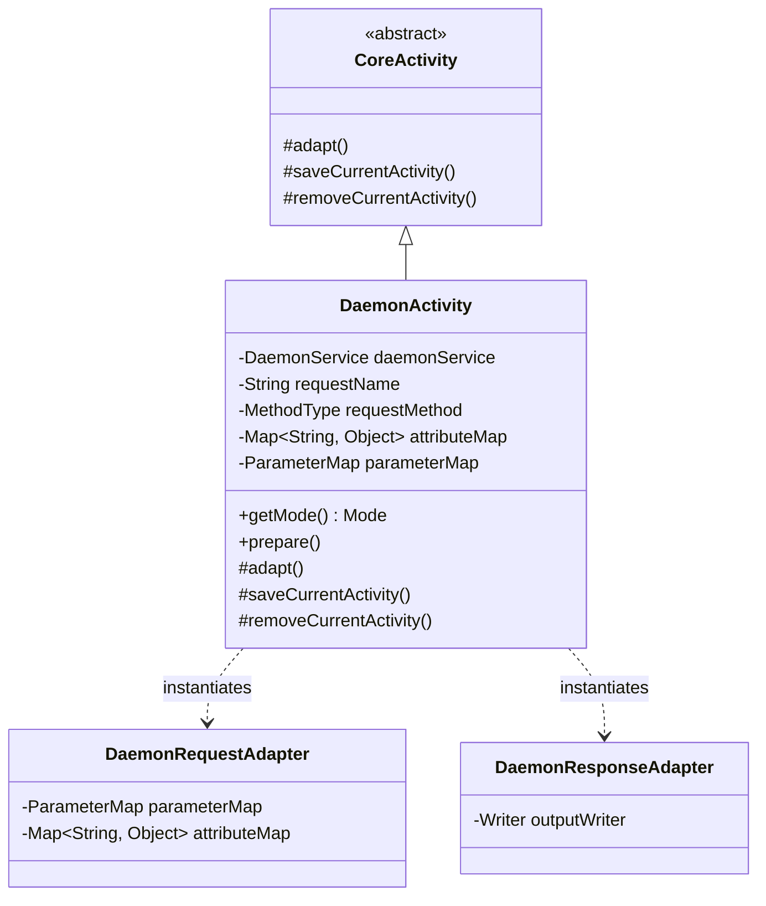

## 1. 설계 목표 및 주요 역할

`com.aspectran.daemon.activity` 패키지는 `DaemonService`에서 프로그래밍 방식(`translate`)으로 시작된 트랜슬릿 호출을 **실제로 실행하는 전용 `Activity` 구현체 및 가상화 어댑터**를 제공합니다.

이 패키지의 핵심 설계 목표는 다음과 같습니다.

*   **프로그래밍 방식 호출의 실행 환경 구체화**: 추상적인 `CoreActivity`를 상속받아, 실제 네트워크 소켓이나 콘솔 입출력이 존재하지 않는 백그라운드 데몬 환경에서 트랜슬릿 파이프라인을 온전하게 구동할 수 있는 `DaemonActivity`를 제공합니다.
*   **인메모리(In-Memory) 요청/응답 시뮬레이션**: 외부 HTTP 스트림 대신 `Map<String, Object>`(속성/파라미터)과 `OutputStringWriter`를 사용하여 요청과 응답을 메모리 상에서 완벽하게 시뮬레이션하는 어댑터를 장착합니다.
*   **비-웹 환경에서의 완전한 세션 라이프사이클 관리**: `DaemonActivity`가 실행되는 동안 `DefaultSessionAdapter`를 통해 가상 세션에 접근(`access()`)하고, 완료 시점에 세션 상태를 플러시 및 갱신(`complete()`)하는 정교한 세션 에이전트 수명주기를 보장합니다.
*   **엔진과 호출자의 완벽한 가교**: 호출자가 전달한 가상 요청 메서드(`MethodType`), 트랜슬릿 이름(`requestName`), 인자들을 `CoreActivity`의 표준 준비(`prepare()`) 및 실행(`perform()`) 단계로 변환하여 주입합니다.

## 2. 주요 클래스 상세 분석



### `DaemonActivity` (구현 클래스)

데몬 런타임 환경을 위한 `Activity`의 최종 구체 클래스입니다. `DaemonService.translate()`가 호출될 때마다 요청 단위로 인스턴스화됩니다.

*   **주요 책임 및 속성**:
    *   `daemonService`: 상위 데몬 서비스 인스턴스를 유지하여 컨텍스트, 세션 매니저, FlashMap 매니저, Locale 리졸버를 인출합니다.
    *   `getMode()`: 현재 실행 모드가 `Mode.DAEMON`임을 반환하여 데몬 전용 분기 로직이 올바르게 동작하도록 합니다.
    *   `requestName` / `requestMethod`: 대상 트랜슬릿 이름과 가상 HTTP 메서드(`GET`, `POST` 등)를 보관하며, `prepare()` 단계에서 이를 기반으로 타겟 `TransletRule`을 바인딩합니다.
    *   `attributeMap` / `parameterMap`: 프로그래밍 방식으로 전달된 요청 속성과 파라미터를 보관합니다.

*   **핵심 메서드 심층 분석**:
    *   `prepare()`:
        ```java
        public void prepare() throws TransletNotFoundException, ActivityPrepareException {
            Assert.state(requestName != null, "requestName is not set");
            Assert.state(requestMethod != null, "requestMethod is not set");
            prepare(requestName, requestMethod);
        }
        ```
        호출 전 필수 파라미터 유효성을 검증한 후, 코어 엔진의 규칙 레지스트리에서 이름과 메서드에 부합하는 트랜슬릿 규칙을 탐색하여 결속합니다.
    *   `adapt()`: **데몬 가상화 어댑테이션의 핵심**입니다.
        ```java
        @Override
        protected void adapt() throws AdapterException {
            setSessionAdapter(daemonService.newSessionAdapter());

            DaemonRequestAdapter requestAdapter = new DaemonRequestAdapter(getTranslet().getRequestMethod());
            if (attributeMap != null) {
                requestAdapter.setAttributeMap(attributeMap);
            }
            if (parameterMap != null) {
                requestAdapter.setParameterMap(parameterMap);
            }
            setRequestAdapter(requestAdapter);

            Writer outputWriter = new OutputStringWriter();
            DaemonResponseAdapter responseAdapter = new DaemonResponseAdapter(outputWriter);
            setResponseAdapter(responseAdapter);

            setFlashMapManager(daemonService.getFlashMapManager());
            setLocaleResolver(daemonService.getLocaleResolver());

            super.adapt();
        }
        ```
        1.  `daemonService.newSessionAdapter()`를 통해 가상 세션 어댑터를 결속합니다.
        2.  `DaemonRequestAdapter`에 호출자가 전달한 속성과 파라미터를 주입하여 표준 요청 어댑터로 설정합니다.
        3.  `OutputStringWriter`를 감싼 `DaemonResponseAdapter`를 생성하여 응답 어댑터로 설정합니다. 템플릿 렌더링이나 문자열 변환 결과는 이 Writer 버퍼에 안전하게 축적됩니다.
        4.  서비스에 등록된 다국어(`LocaleResolver`) 및 플래시 맵 매니저를 연결합니다.
    *   `saveCurrentActivity()` / `removeCurrentActivity()`:
        ```java
        @Override
        protected void saveCurrentActivity() {
            super.saveCurrentActivity();
            if (isOriginalActivity() && hasSessionAdapter() &&
                    getSessionAdapter() instanceof DefaultSessionAdapter sessionAdapter) {
                sessionAdapter.getSessionAgent().access();
            }
        }

        @Override
        protected void removeCurrentActivity() {
            if (isOriginalActivity() && hasSessionAdapter() &&
                    getSessionAdapter() instanceof DefaultSessionAdapter sessionAdapter) {
                sessionAdapter.getSessionAgent().complete();
            }
            super.removeCurrentActivity();
        }
        ```
        최초 활동(`isOriginalActivity`) 진입 시 `sessionAdapter.getSessionAgent().access()`를 호출하여 세션의 마지막 접근 시간을 갱신하고, 활동 종료 시 `complete()`를 호출하여 변경된 세션 데이터를 스레드 세이프하게 반영 및 정리합니다.

## 3. 다른 패키지와의 상호작용

*   **`com.aspectran.daemon.service`**: `DefaultDaemonService`는 모든 `translate()` 요청에 대해 `DaemonActivity`를 생성하고 파라미터를 주입한 뒤 실행 파이프라인을 구동합니다.
*   **`com.aspectran.daemon.adapter`**: `DaemonActivity`는 내부적으로 `DaemonRequestAdapter`와 `DaemonResponseAdapter`를 직접 생성하여 요청과 응답을 인메모리로 처리합니다.
*   **`com.aspectran.core.activity`**: `DaemonActivity`는 `CoreActivity`를 상속받아 그 안에 구현된 AOP 어드바이스 체인(`BEFORE`, `AFTER`, `THROWN`, `FINALLY`), 액션 디스패치(`dispatchContent`), 응답 변환 로직을 일체 변경 없이 100% 재사용합니다.

## 4. 패키지 요약 및 아키텍처적 의미

`com.aspectran.daemon.activity` 패키지와 `DaemonActivity`는 Aspectran의 **어댑터 아키텍처가 지닌 추상화와 격리의 극치**를 보여줍니다.

1.  **완전한 물리 환경 추상화**: 실제 소켓이나 스트림이 없는 순수한 자바 런타임 메모리 환경에서도 `DaemonRequestAdapter`와 `DaemonResponseAdapter`를 통해 완벽한 요청-응답 사이클을 가상화합니다.
2.  **코어 엔진의 제로 수정**: `CoreActivity`는 자신이 웹에서 호출되었는지 데몬에서 호출되었는지 알 필요가 없으며, 단지 어댑터 인터페이스를 통해 파라미터를 읽고 응답을 기록할 뿐입니다.
3.  **정교한 세션 라이프사이클 동기화**: `saveCurrentActivity`와 `removeCurrentActivity` 훅을 통해 비-웹 환경에서도 세션 에이전트의 접근(`access`)과 완료(`complete`)가 완벽하게 통제되어 안전한 상태 유지를 지원합니다.
