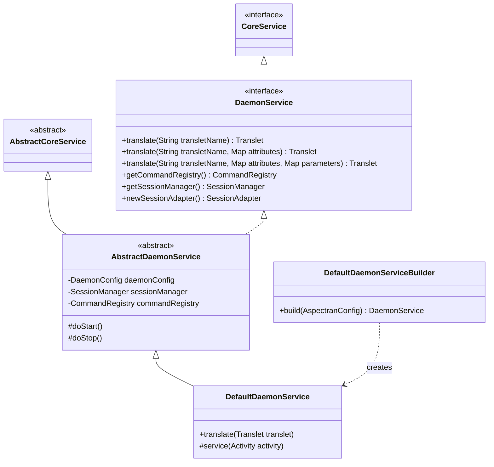
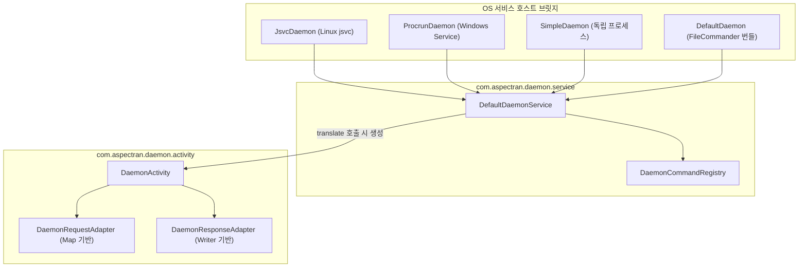

## 1. 설계 목표 및 주요 역할

`com.aspectran.daemon.service` 패키지는 Aspectran 프레임워크를 웹 서버나 GUI 없이 **독립적인 백그라운드 프로세스(데몬/서비스)로 구동하기 위한 서비스 계층 구현체**를 제공합니다.

이 패키지의 핵심 설계 목표는 다음과 같습니다.

*   **독립 실행 환경(Stand-alone Runtime) 완비**: 웹 컨테이너나 WAS에 의존하지 않고, 운영체제(OS) 수준의 서비스 데몬(Linux `systemd`, `jsvc`, Windows Service `procrun`)으로 등록되어 자체 수명주기를 완벽하게 영위하는 실행 기반을 제공합니다.
*   **능동적(Proactive) 요청 실행 모델**: 외부의 HTTP 요청을 수동적으로 수신하는 웹 환경과 달리, 내부 스케줄러, 메시지 큐 리스너, 파일 감시 폴러(`FileCommander`) 등이 직접 비즈니스 로직(트랜슬릿)을 트리거하는 능동적 실행 모델을 구현합니다.
*   **프로그래밍 방식의 표준 진입점 (`translate`)**: 코드 내에서 트랜슬릿 이름을 지정하여 가상 요청을 발행하고 결과를 동기식으로 반환받을 수 있는 정교한 API 게이트웨이를 제공합니다.
*   **비-웹(Non-Web) 환경에서의 세션 관리**: 데몬 프로세스 내에서 여러 번의 `translate()` 호출 간에 상태를 공유할 수 있도록 `DefaultSessionManager`를 내장하여 인메모리 세션 메커니즘을 지원합니다.
*   **명령 제어 서브시스템 통합**: `DaemonCommandRegistry`와 결합하여 파일 기반 원격 명령(`FileCommander`)이나 내부 커맨드 인터페이스를 통해 런타임 제어(재시작, 컴포넌트 리로드, 시스템 정보 조회 등)를 수행할 수 있게 합니다.

## 2. 주요 클래스 및 인터페이스 상세 분석

### `DaemonService` (인터페이스)

데몬 환경에 특화된 Aspectran 서비스의 최상위 명세입니다. `CoreService`를 상속합니다.

*   **주요 책임**:
    *   `translate(...)`: 프로그래밍 방식으로 트랜슬릿을 실행하는 핵심 오버로딩 메서드들을 제공합니다. 트랜슬릿 이름, 속성(Attributes), 파라미터(Parameters), 가상 HTTP 메서드(Method)를 전달받아 실행하고 완료된 `Translet` 객체를 반환합니다.
    *   `getCommandRegistry()`: 데몬 내부에서 등록 및 실행 가능한 커맨드 목록을 관리하는 `CommandRegistry`를 반환합니다.
    *   `getSessionManager()`: 데몬 내에서 상태 저장을 위해 사용되는 `SessionManager`에 대한 접근을 제공합니다.
    *   `newSessionAdapter()`: 데몬 전용 가상 세션을 추상화한 `SessionAdapter` 인스턴스를 생성합니다.

### `AbstractDaemonService` (추상 클래스)

`DaemonService`의 핵심 인프라 구성을 캡슐화한 추상 클래스입니다.

*   **주요 책임 및 구현 디테일**:
    *   **세션 매니저 초기화**: `DaemonConfig`에 정의된 세션 설정(`sessionConfig`)을 바탕으로 `DefaultSessionManager`를 생성하고, 서비스 생명주기(`doStart`, `doStop`)와 연동합니다.
    *   **명령어 레지스트리 구축**: 내장 커맨드(`restart`, `quit`, `sysinfo`, `translet`, `pollingInterval` 등)를 탑재한 `DaemonCommandRegistry`를 초기화합니다.
    *   **명령 폴러 연계**: `FileCommander`와 같은 외부 파일 감시 폴러가 활성화되어 있을 경우 백그라운드 스레드를 기동하여 명령 파일을 모니터링합니다.

### `DefaultDaemonService` (구현 클래스)

`DaemonService`의 최종 기본 구현체로, 트랜슬릿 호출을 수신하여 `DaemonActivity`를 인스턴스화하고 전체 실행 파이프라인을 구동합니다.

*   **핵심 실행 파이프라인 (`translate`)**:
    1.  **서비스 활성화 검증**: 서비스가 중지되었거나 일시정지(`isPaused`) 상태인지 확인하고, 정지 상태이면 요청을 거부합니다.
    2.  **인가 정책 검사 (`RequestAcceptor`)**: 등록된 `RequestAcceptor`가 존재할 경우 호출된 `transletName`이 인가된 범위 내에 있는지 검증합니다.
    3.  **`DaemonActivity` 인스턴스화**: 전달받은 요청 파라미터, 속성 맵, 가상 메서드를 주입하여 전용 `DaemonActivity`를 생성합니다.
    4.  **실행 파이프라인 구동**: `service(activity)` -> `activity.prepare()` -> `activity.perform()`을 순차적으로 호출하여 Aspectran 표준 파이프라인(AOP 어드바이스, 액션 실행, 응답 처리)을 수행합니다.
    5.  **결과 반환**: 작업이 완료된 후 실행 결과(`ProcessResult`)와 출력 결과가 담긴 `Translet` 객체를 반환합니다.

### `DefaultDaemonServiceBuilder` (빌더 클래스)

`AspectranConfig` 설정으로부터 `DefaultDaemonService`를 조립하고 초기화하는 팩토리 빌더입니다.

*   설정 파일(`aspectran-config.apon`)의 `daemon` 블록으로부터 인코딩, 세션 타임아웃, 커맨드 레지스트리 옵션을 파싱하여 주입합니다.
*   `ServiceStateListener`를 등록하여 서비스 기동 완료 시 `CoreServiceHolder`에 자신을 등록하도록 구성합니다.

## 3. 다른 패키지 및 서브시스템과의 상호작용

*   **4대 데몬 호스트 브릿지**: `JsvcDaemon`(Apache Commons Daemon), `ProcrunDaemon`(Apache Commons Daemon Procrun), `SimpleDaemon`(기본 main 진입점), `DefaultDaemon`(FileCommander 연동)이 `DaemonService`를 소유하고 OS 서비스 명령(`init`, `start`, `stop`, `destroy`)을 `ServiceLifeCycle`로 전달합니다.
*   **`com.aspectran.daemon.command.polling`**: `FileCommander`는 특정 디렉터리에 생성되는 `.command` 파일을 감시하다가, 명령이 감지되면 `DaemonService.translate()`를 호출하여 작업을 위임합니다.
*   **`com.aspectran.daemon.activity`**: `DaemonService`는 모든 호출을 `DaemonActivity`로 변환하여 Aspectran 코어 엔진에 전달합니다.

## 4. 패키지 요약 및 아키텍처적 의미

`com.aspectran.daemon.service` 패키지는 수동적으로 외부 요청을 기다리는 일반적인 웹 프레임워크의 틀을 깨고, Aspectran을 **완전한 엔터프라이즈 배치 및 백그라운드 워커 컨테이너**로 확장시키는 핵심 어댑터 계층입니다.

1.  **동일한 비즈니스 로직의 다목적 재사용**: 웹 컨트롤러를 위해 작성한 Translet 규칙을 코드 한 줄 수정 없이 데몬의 `translate()`를 통해 백그라운드 배치 작업이나 시스템 관리 명령으로 즉시 호출할 수 있습니다.
2.  **OS 친화적 수명주기 완비**: 리눅스와 윈도우의 표준 시스템 서비스 브릿지와 자연스럽게 연동되어 프로덕션 환경의 안정적인 장기 실행(Long-Running) 데몬 애플리케이션을 구축할 수 있습니다.
3.  **인메모리 세션 및 가상화**: 네트워크 연결이 없는 환경에서도 가상 세션과 인메모리 요청/응답 스트림을 완벽하게 지원하여 일관된 프로그래밍 모델을 제공합니다.
