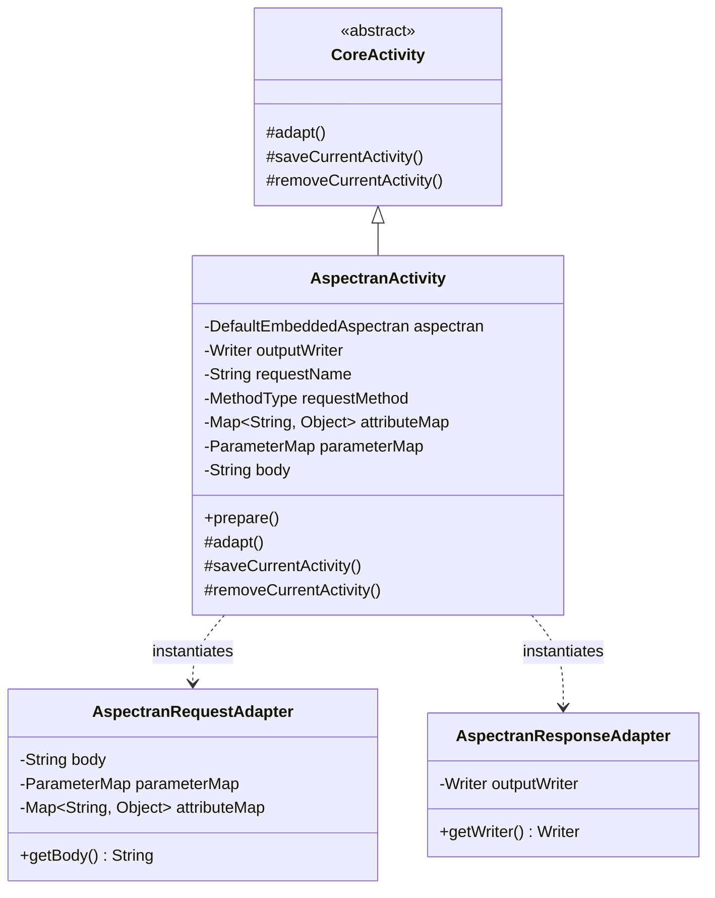

## 1. 설계 목표 및 주요 역할

`com.aspectran.embed.activity` 패키지는 다른 Java 애플리케이션 내에 내장된 `EmbeddedAspectran` 서비스로부터 시작된 프로그래밍 방식의 트랜슬릿 호출을 **실제 Aspectran 코어 파이프라인에서 실행하는 전용 `Activity` 구현체 및 임베디드 어댑터**를 제공합니다.

이 패키지의 핵심 설계 목표는 다음과 같습니다.

*   **임베디드 실행 컨텍스트의 구체화**: 네트워크 소켓이나 웹 컨테이너 없이 다른 JVM 애플리케이션의 메모리 공간에서 직접 구동되는 특수한 환경을 위한 `AspectranActivity`를 제공합니다.
*   **고급 인메모리 요청 시뮬레이션**: 단순한 파라미터(`ParameterMap`) 및 속성(`Map`)뿐만 아니라, JSON/XML 형태의 **요청 본문(Request Body)** 문자열까지 직접 주입받아 REST API 스타일의 `POST`, `PUT`, `PATCH` 요청을 코드 레벨에서 완벽하게 시뮬레이션합니다.
*   **유연한 출력 스트림 바인딩**: 기본 제공되는 인메모리 버퍼(`OutputStringWriter`) 외에도, 호스트 애플리케이션이 전달한 임의의 `Writer` 스트림(파일 스트림, 소켓 스트림, 콘솔 출력 등)으로 트랜슬릿의 렌더링 결과를 다이렉트 스트리밍할 수 있도록 지원합니다.
*   **안전한 세션 상태 제어**: 임베디드 환경에 설정된 `DefaultSessionManager`와 연동하여, 활동의 진입과 종료 시점에 세션의 접근 시각 갱신(`access`) 및 세션 데이터 확정(`complete`)을 투명하게 보장합니다.

## 2. 주요 클래스 상세 분석



### `AspectranActivity` (구현 클래스)

임베디드 런타임 환경을 위한 `Activity`의 최종 구현체입니다. `DefaultEmbeddedAspectran.translate()` 호출 시마다 새롭게 인스턴스화됩니다.

*   **주요 책임 및 속성**:
    *   `aspectran`: 상위 `DefaultEmbeddedAspectran` 서비스를 참조하여 컨텍스트, 가상 세션 어댑터, 플래시맵, 로케일 리졸버를 인출합니다.
    *   `outputWriter`: 응답 출력을 기록할 `Writer` 인스턴스입니다. 외부에서 지정하지 않으면 기본적으로 `OutputStringWriter`가 생성되어 메모리에 문자열을 버퍼링합니다.
    *   `body`: 클라이언트 요청 본문(Payload)을 담는 문자열로, JSON/XML 본문 파싱 액션에서 활용됩니다.
    *   `requestName` / `requestMethod`: 대상 트랜슬릿 식별자와 HTTP 가상 메서드(`GET`, `POST` 등)입니다.
    *   `attributeMap` / `parameterMap`: 프로그래밍 방식으로 전달된 속성과 파라미터 컨테이너입니다.

*   **핵심 메서드 심층 분석**:
    *   `prepare()`:
        ```java
        public void prepare() throws TransletNotFoundException, ActivityPrepareException {
            Assert.state(requestName != null, "requestName is not set");
            Assert.state(requestMethod != null, "requestMethod is not set");
            prepare(requestName, requestMethod);
        }
        ```
        호출 전 필수 요청 식별자들의 유효성을 검증하고, 코어 엔진의 `TransletRuleRegistry`로부터 타깃 규칙을 찾아 바인딩합니다.
    *   `adapt()`: **임베디드 어댑테이션의 핵심 구현부**입니다.
        ```java
        @Override
        protected void adapt() throws AdapterException {
            setSessionAdapter(aspectran.newSessionAdapter());

            AspectranRequestAdapter requestAdapter = new AspectranRequestAdapter(getTranslet().getRequestMethod());
            if (parameterMap != null) {
                requestAdapter.setParameterMap(parameterMap);
            }
            if (attributeMap != null) {
                requestAdapter.setAttributeMap(attributeMap);
            }
            if (body != null) {
                requestAdapter.setBody(body);
            }
            setRequestAdapter(requestAdapter);

            if (outputWriter == null) {
                outputWriter = new OutputStringWriter();
            }
            AspectranResponseAdapter responseAdapter = new AspectranResponseAdapter(outputWriter);
            setResponseAdapter(responseAdapter);

            setFlashMapManager(aspectran.getFlashMapManager());
            setLocaleResolver(aspectran.getLocaleResolver());

            super.adapt();
        }
        ```
        1.  `aspectran.newSessionAdapter()`를 통해 가상 세션 어댑터를 연결합니다.
        2.  `AspectranRequestAdapter`를 생성하고 파라미터, 속성, 그리고 `body` 페이로드를 전달하여 요청 어댑터를 완성합니다.
        3.  지정된 `outputWriter`를 감싼 `AspectranResponseAdapter`를 생성하여 뷰 렌더링 및 출력 스트림을 결속합니다.
        4.  플래시맵 매니저와 로케일 리졸버를 결합합니다.
    *   `saveCurrentActivity()` / `removeCurrentActivity()`:
        활동 시작 시 세션 에이전트의 `access()`를 호출하여 마지막 접근 시각을 갱신하고, 활동 종료 시 `complete()`를 호출하여 변경된 세션 속성을 안전하게 커밋하고 리소스를 정리합니다.

## 3. 다른 패키지와의 상호작용

*   **`com.aspectran.embed.service`**: `DefaultEmbeddedAspectran`은 `translate()` 요청 시 직접 `AspectranActivity`를 생성하고, 인자를 바인딩한 뒤 `service(activity)`로 실행을 위임합니다.
*   **`com.aspectran.embed.adapter`**: `AspectranActivity`는 내부적으로 `AspectranRequestAdapter`와 `AspectranResponseAdapter`를 인스턴스화하여 외부 환경과의 입출력을 표준화합니다.
*   **`com.aspectran.core.activity`**: `AspectranActivity`는 `CoreActivity`를 상속받아 그 안에 구현된 AOP 어드바이스 체인(`BEFORE`, `AFTER`, `THROWN`, `FINALLY`), 액션 디스패치(`dispatchContent`), 응답 변환 로직을 일체 변경 없이 100% 재사용합니다.

## 4. 패키지 요약 및 아키텍처적 의미

`com.aspectran.embed.activity` 패키지와 `AspectranActivity`는 Aspectran의 **어댑터 기반 아키텍처가 제공하는 뛰어난 재사용성과 확장성**을 잘 나타냅니다.

1.  **Request Body 시뮬레이션의 우수성**: 단순 Key-Value 파라미터에 그치지 않고 본문 페이로드(`body`)까지 시뮬레이션할 수 있어, 임베디드 라이브러리 환경에서도 완벽한 RESTful API 서비스 파이프라인을 테스트하고 실행할 수 있습니다.
2.  **커스텀 스트림 출력 지원**: 외부 애플리케이션이 원하는 `Writer`를 직접 주입받을 수 있어 메모리 버퍼링 오버헤드 없이 파일이나 외부 네트워크 스트림으로의 직접 렌더링이 가능합니다.
3.  **플랫폼 격리 완성**: 호스트 애플리케이션의 런타임 기술 스택에 구애받지 않고, 순수한 객체 호출만으로 엔터프라이즈급 트랜슬릿 처리 엔진을 손쉽게 활용할 수 있는 기반을 제공합니다.
