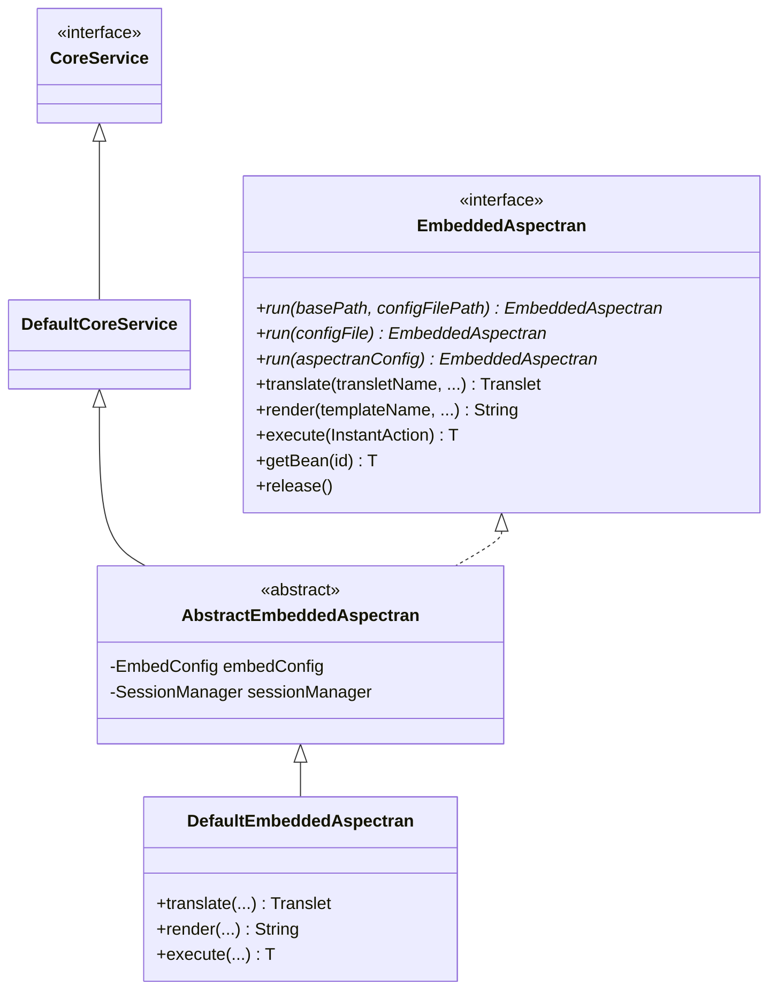
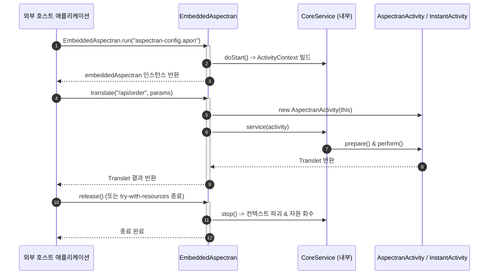

## 1. 설계 목표 및 주요 역할

`com.aspectran.embed.service` 패키지는 다른 표준 Java 애플리케이션(Spring Boot, Dropwizard, 독립 CLI, GUI 앱 등) 내에 Aspectran 프레임워크를 **경량 라이브러리처럼 내장(Embed)하여 손쉽게 사용할 수 있도록 최적화된 고수준 서비스 퍼사드(High-Level Facade)**를 제공합니다.

이 패키지의 핵심 설계 목표는 다음과 같습니다.

*   **개발자 친화적인 원스톱 퍼사드(Facade) 제공**: `CoreService`의 복잡한 계층 구조나 수명주기 전파 로직을 몰라도, 단 하나의 인터페이스인 `EmbeddedAspectran`을 통해 DI, AOP, 템플릿 렌더링, 트랜슬릿 실행 등 프레임워크의 모든 핵심 기능을 직관적으로 제어할 수 있도록 합니다.
*   **원라이너(One-Liner) 부트스트래핑**: 정적 팩토리 메서드 `EmbeddedAspectran.run(...)`을 통해 설정 파일 경로, `File` 객체, 또는 APON 텍스트만 넘기면 컨텍스트 빌드부터 서비스 기동까지 단 한 줄의 코드로 완결되도록 합니다.
*   **실무 유스케이스 중심의 API 디자인**: 트랜슬릿 동기 실행(`translate`), 템플릿 엔진 직접 렌더링(`render`), 람다 기반 컨텍스트 코드 블록 실행(`execute`), 빈 인출(`getBean`) 등 임베디드 환경에서 가장 빈번하게 요구되는 기능에 특화된 메서드를 집중 배치합니다.
*   **자원 관리 및 격리**: 호스트 애플리케이션의 메모리와 스레드를 공유하면서도, 필요할 때 `release()` 한 번으로 Aspectran의 모든 싱글톤 빈과 리소스(스레드 풀, DB 커넥션 풀 등)를 깨끗하게 정리(Teardown)할 수 있는 안전한 격리 환경을 보장합니다.

## 2. 주요 클래스 및 인터페이스 상세 분석

### `EmbeddedAspectran` (인터페이스)

임베디드 모드에서 Aspectran과 상호작용하기 위한 **단일 진입점 퍼사드**입니다. `AutoCloseable`을 구현하여 `try-with-resources` 구문을 완벽하게 지원합니다.

*   **주요 책임 및 핵심 메서드**:
    *   **정적 팩토리 메서드군 (`run`)**:
        *   `EmbeddedAspectran.run(File aspectranConfigFile)`
        *   `EmbeddedAspectran.run(String basePath, String configFilePath)`
        *   `EmbeddedAspectran.run(AspectranConfig aspectranConfig)`
        *   기본 경로와 설정 파일을 전달받아 `DefaultEmbeddedAspectran` 인스턴스를 생성하고 내부 `start()`를 즉시 호출하여 활성 상태의 퍼사드 인스턴스를 반환합니다.
    *   `translate(String transletName, ...)`: 프로그래밍 방식으로 특정 트랜슬릿을 호출하고 실행 결과를 담은 `Translet` 객체를 반환합니다.
    *   `render(String templateName, ...)` / `render(TemplateRule, ...)`: 트랜슬릿 파이프라인 전체를 타지 않고, 뷰 템플릿(Thymeleaf, FreeMarker 등)만 즉석에서 렌더링하여 문자열로 추출합니다.
    *   `execute(InstantAction<T> action)`: Aspectran의 스레드 로컬 컨텍스트를 활성화한 상태에서 람다(Lambda) 코드 블록을 실행하고 결과를 반환합니다.
    *   `getBean(String id)` / `getBean(Class<T> type)`: `ActivityContext`의 빈 레지스트리로부터 싱글톤 빈 인스턴스를 직접 인출합니다.
    *   `release()`: 내장된 Aspectran 컨텍스트 전체를 파괴하고 리소스를 안전하게 해제합니다. (`close()`와 동일)

### `AbstractEmbeddedAspectran` (추상 클래스)

`DefaultCoreService`를 직접 상속하면서 `EmbeddedAspectran` 인터페이스를 구현하는 핵심 가교 추상 클래스입니다.

*   **주요 책임 및 구조적 의미**:
    *   내부적으로는 완전한 `CoreService`로서의 모든 수명주기 및 컨텍스트 관리 로직을 내재화합니다.
    *   외부에는 복잡한 프레임워크 내부 클래스들을 완전히 은폐하고 오직 `EmbeddedAspectran`의 단순화된 편의 메서드만을 노출합니다.
    *   `EmbedConfig` 설정을 주입받아 임베디드 전용 세션 매니저(`DefaultSessionManager`)를 인스턴스화하고 관리합니다.

### `DefaultEmbeddedAspectran` (구현 클래스)

`EmbeddedAspectran`의 최종 구현체로, 프로그래밍 방식의 호출들을 `AspectranActivity` 및 `InstantActivity`로 변환하여 실행합니다.

*   **핵심 실행 파이프라인 분석**:
    *   `translate(...)`:
        1.  전용 활동 객체인 `AspectranActivity`를 생성합니다.
        2.  대상 트랜슬릿 이름, 속성 맵, 파라미터 맵, 요청 본문(Body) 스트림을 주입합니다.
        3.  출력 결과를 가로채기 위한 `OutputStringWriter`를 결속합니다.
        4.  `service(activity)` -> `activity.prepare()` -> `activity.perform()`을 호출하여 비즈니스 규칙과 어드바이스를 구동하고, 실행 완료된 `Translet` 객체를 반환합니다.
    *   `render(...)` 및 `execute(...)`:
        *   정규 트랜슬릿 파이프라인보다 훨씬 가벼운 **`InstantActivity`**를 즉석에서 생성하여 구동합니다.
        *   `execute(InstantAction<T>)`의 경우 주어진 람다 블록을 `InstantActivity`의 컨텍스트 스택 안에서 실행하므로, 람다 내부에서 `ActivityContext.getCurrentActivity()`를 정상적으로 조회할 수 있습니다.

## 3. 다른 패키지와의 상호작용

*   **`com.aspectran.core.service`**: `DefaultEmbeddedAspectran`은 `DefaultCoreService`를 직접 상속하여 컨텍스트 수명주기를 완벽하게 공유합니다.
*   **`com.aspectran.embed.activity`**: `translate()` 호출 시 `AspectranActivity`를 생성하여 요청 파라미터와 바디 데이터를 어댑터로 감싸 처리합니다.
*   **`com.aspectran.core.activity`**: `render()` 및 `execute()` 실행 시 경량 일회성 활동인 `InstantActivity`를 활용합니다.

## 4. 패키지 요약 및 아키텍처적 의미

`com.aspectran.embed.service` 패키지는 **퍼사드 패턴(Facade Pattern)의 모범적인 구현**입니다.

1.  **진입 장벽의 최소화**: 외부 개발자는 Aspectran의 5단계 빌드 파이프라인이나 어댑터 대칭 구조를 일일이 학습하지 않아도, `EmbeddedAspectran.run()` 한 줄로 프레임워크의 강력한 기능(AOP, 트랜잭션, 템플릿 엔진)을 즉시 활용할 수 있습니다.
2.  **유스케이스 중심의 설계**: 일반적인 서블릿/소켓 서버 구동이 목적이 아닌, "특정 템플릿 렌더링 모듈로만 쓰고 싶다", "규칙 기반 트랜슬릿 연산 엔진으로만 쓰고 싶다"는 요구에 완벽하게 부합합니다.
3.  **안전한 격리와 해제**: `AutoCloseable` 구현을 통해 다른 프레임워크나 애플리케이션 내부에서 메모리 누수 없이 안전하게 생성하고 소멸시킬 수 있는 신뢰성을 보장합니다.
