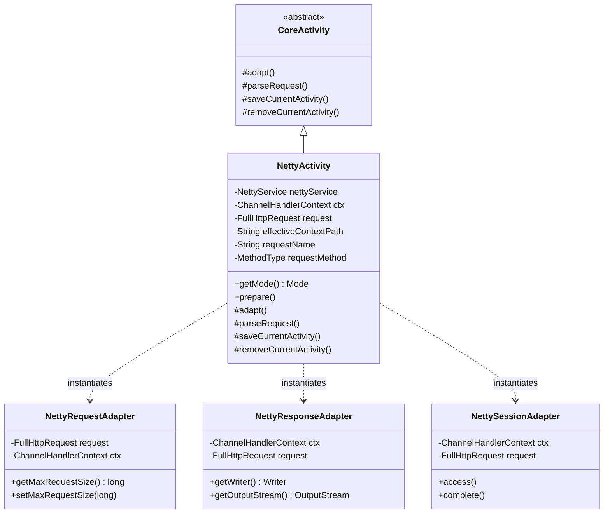

## 1. 설계 목표 및 주요 역할

`com.aspectran.netty.activity` 패키지는 Netty 임베디드 웹 서버 환경에서 유입된 HTTP 요청을 **서블릿 API 없이 네이티브 `ChannelHandlerContext` 및 `FullHttpRequest` 기반으로 직접 처리하는 전용 `Activity` 구현체 및 어댑터 계층**을 제공합니다.

이 패키지의 핵심 설계 목표는 다음과 같습니다.

*   **Netty 비동기 채널 실행 컨텍스트의 구체화**: 표준 `CoreActivity`를 상속받아, Netty의 `ChannelHandlerContext`와 `FullHttpRequest`를 직접 감싸서 처리하는 `NettyActivity`를 제공합니다.
*   **고급 HTTP 웹 명세의 완벽한 수용**: HTTP 메서드 오버라이드(`X-HTTP-Method-Override`, `X-Method-Override`), 프록시 포워딩 헤더(`X-Forwarded-For`), 최대 요청 크기 제한(`maxRequestSize`), 인코딩 처리를 Netty 채널 레벨에서 지원합니다.
*   **Netty 전용 세션 매니저 연계**: `NettySessionAdapter`를 통해 쿠키 기반 세션 ID 추적, 만료 시간 관리 및 세션 에이전트 수명주기(`access()`, `complete()`)를 보장합니다.
*   **웹 요청 본문(Body) 및 멀티파트 폼 파싱**: `WebRequestBodyParser`와 연계하여 Netty의 `ByteBuf` 버퍼로부터 대용량 파일 업로드(`multipart/form-data`)와 URL 인코딩 폼(`application/x-www-form-urlencoded`) 데이터를 효율적으로 파싱합니다.

## 2. 주요 클래스 상세 분석



### `NettyActivity` (구현 클래스)

Netty 환경을 위한 `Activity`의 최종 구현체입니다. `DefaultNettyService.service()`가 호출될 때마다 유입된 `ChannelHandlerContext` 및 `FullHttpRequest` 단위로 인스턴스화됩니다.

*   **주요 책임 및 속성**:
    *   `nettyService`: 상위 `NettyService` 인스턴스를 유지하여 세션 매니저, 플래시맵, 로케일 리졸버를 인출합니다.
    *   `ctx`: Netty의 채널 핸들러 컨텍스트로, 네트워크 소켓 채널과 파이프라인 제어 권한을 소유합니다.
    *   `request`: Netty 네이티브 `FullHttpRequest` 객체로, HTTP 메서드, URI, 헤더, `ByteBuf` 본문 데이터를 보관합니다.
    *   `effectiveContextPath`: 리버스 프록시 환경에서 절대 경로를 조립하기 위한 유효 컨텍스트 경로입니다.
    *   `getMode()`: 항상 `Mode.WEB`을 반환하여 웹 전용 어드바이스 및 뷰 디스패처가 활성화되도록 합니다.

*   **핵심 메서드 심층 분석**:
    *   `prepare()` 및 히든 메서드 오버라이드:
        ```java
        @Override
        public void prepare(@NonNull String requestName, MethodType requestMethod)
                throws TransletNotFoundException, ActivityPrepareException {
            if (requestMethod == MethodType.POST) {
                String method = request.headers().get(HttpHeaders.X_HTTP_METHOD_OVERRIDE);
                if (method == null) {
                    method = request.headers().get(HttpHeaders.X_METHOD_OVERRIDE);
                }
                if (method != null) {
                    MethodType hiddenRequestMethod = MethodType.resolve(method);
                    if (hiddenRequestMethod != null) {
                        requestMethod = hiddenRequestMethod;
                    }
                }
            }
            super.prepare(requestName, requestMethod);
        }
        ```
        `POST` 요청에 `X-HTTP-Method-Override` 헤더가 포함된 경우 이를 감지하여 `PUT`, `DELETE` 등으로 가상 메서드를 동적 승격시킵니다.
    *   `adapt()`: **Netty 어댑테이션의 핵심 구현부**입니다.
        ```java
        @Override
        protected void adapt() throws AdapterException {
            NettyResponseAdapter responseAdapter = new NettyResponseAdapter(ctx, request, this);
            setResponseAdapter(responseAdapter);

            if (nettyService.isSessionAdaptable()) {
                if (getPendingActivity() == null) {
                    NettySessionAdapter sessionAdapter = new NettySessionAdapter(ctx, request, responseAdapter, this);
                    setSessionAdapter(sessionAdapter);
                } else if (getPendingActivity().hasSessionAdapter()) {
                    setSessionAdapter(getPendingActivity().getSessionAdapter());
                }
            }

            NettyRequestAdapter requestAdapter = new NettyRequestAdapter(
                    getTranslet().getRequestMethod(), request, ctx, getContextPath(),
                    nettyService.isProxyAddressForwarding());
            setRequestAdapter(requestAdapter);

            setFlashMapManager(nettyService.getFlashMapManager());
            setLocaleResolver(nettyService.getLocaleResolver());

            super.adapt();
        }
        ```
        1.  `NettyResponseAdapter`를 먼저 생성하여 응답 버퍼 및 헤더를 준비합니다.
        2.  `NettySessionAdapter`를 결속하여 Netty 환경에서의 세션 어댑테이션을 활성화합니다.
        3.  `NettyRequestAdapter`를 결속하여 파라미터, 헤더, 프록시 포워딩, 최대 요청 크기 제한을 적용합니다.
        4.  플래시맵 매니저 및 로케일 리졸버를 결합합니다.
    *   `parseRequest()`:
        `WebRequestBodyParser`를 구동하여 Netty의 `ByteBuf` 본문으로부터 멀티파트 폼(`multipart/form-data`) 및 폼 파라미터를 파싱합니다.
    *   `saveCurrentActivity()` / `removeCurrentActivity()`:
        활동 시작 시 `sessionAdapter.access()`를 호출하여 세션 최종 접근 시각을 갱신하고, 활동 종료 시 `sessionAdapter.complete()`를 호출하여 변경된 세션 속성을 커밋하고 쿠키 헤더를 갱신합니다.

## 3. 다른 패키지와의 상호작용

*   **`com.aspectran.netty.service`**: `DefaultNettyService`는 유입된 모든 HTTP 요청에 대해 `NettyActivity`를 생성하고, `prepare()` 및 `perform()`을 호출하여 실행을 위임합니다.
*   **`com.aspectran.netty.adapter`**: `NettyActivity`는 내부적으로 `NettyRequestAdapter`, `NettyResponseAdapter`, `NettySessionAdapter`를 직접 인스턴스화하여 Netty 객체와의 통신을 추상화합니다.
*   **`com.aspectran.web.activity.request`**: `WebRequestBodyParser`를 통해 대용량 멀티파트 파일 업로드와 폼 데이터를 처리합니다.
*   **`com.aspectran.core.activity`**: `NettyActivity`는 `CoreActivity`를 상속받아 그 안에 구현된 AOP 어드바이스 체인(`BEFORE`, `AFTER`, `THROWN`, `FINALLY`), 액션 디스패치(`dispatchContent`), 응답 변환 로직을 일체 변경 없이 100% 재사용합니다.

## 4. 패키지 요약 및 아키텍처적 의미

`com.aspectran.netty.activity` 패키지와 `NettyActivity`는 Aspectran의 **어댑터 아키텍처가 고성능 비동기 이벤트 기반 네트워킹과 얼마나 자연스럽게 융합될 수 있는가**를 보여주는 대표적인 결실입니다.

1.  **네트워크 소켓 채널 직접 결속**: `ChannelHandlerContext`와 직접 결합되어 응답 데이터를 즉시 플러시(`writeAndFlush`)하거나 HTTP 청크 스트리밍을 수행할 수 있습니다.
2.  **완전한 웹 기능의 재현**: 서블릿이 없는 환경임에도 불구하고 멀티파트 업로드, 세션 관리, Method Override, 콘텐츠 협상 등 엔터프라이즈 웹에 필요한 모든 기능을 완벽하게 지원합니다.
3.  **다중 환경과의 일관성**: 서블릿(`ServletWebActivity`), Undertow(`TowActivity`)와 완벽하게 대칭되는 어댑터 계약을 이행하므로, 개발자는 실행 환경이 바뀌어도 동일한 코드베이스를 유지할 수 있습니다.
