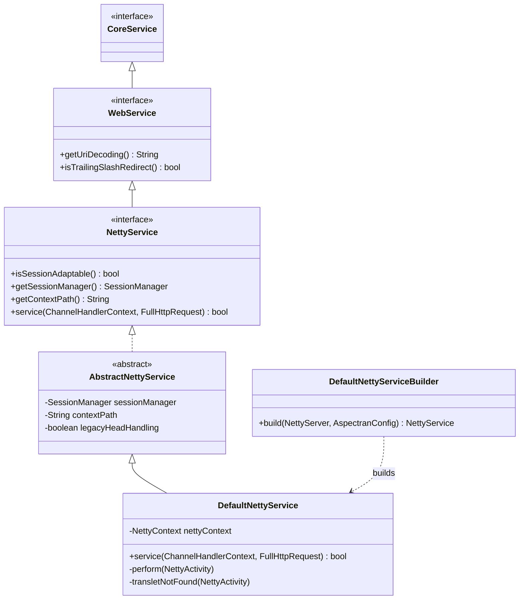
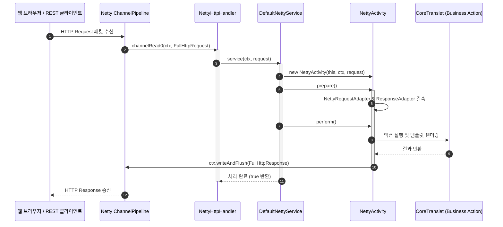

## 1. 설계 목표 및 주요 역할

`com.aspectran.netty.service` 패키지는 비동기 이벤트 기반 네트워크 애플리케이션 프레임워크인 **Netty 위에서 Aspectran을 서블릿 컨테이너 없이 순수 논블로킹 I/O(NIO) 웹 서버로 구동하기 위한 서비스 계층 구현체**를 제공합니다.

이 패키지의 핵심 설계 목표는 다음과 같습니다.

*   **서블릿-프리(Servlet-Free) 비동기 논블로킹 웹 서버**: 표준 서블릿 스펙(`jakarta.servlet`)이나 블로킹 I/O 스레드 풀의 제약 없이, Netty의 `EventLoopGroup`, `ChannelHandlerContext`, 그리고 `FullHttpRequest`와 직접 맞물려 극대화된 네트워크 처리량과 최소 지연시간(Ultra-Low Latency)을 달성합니다.
*   **순수 웹 인터페이스(`WebService`) 계승**: `aspectran-web` 모듈의 최상위 `WebService` 인터페이스를 구현하여, 서블릿이나 Undertow 환경과 동일하게 세션 관리, URI 디코딩, 트레일링 슬래시 자동 리다이렉트(`trailingSlashRedirect`) 등 표준 웹 설정(`WebConfig`)을 재사용합니다.
*   **Netty 채널 파이프라인 핸들러와의 완벽한 결속**: `NettyHttpHandler`를 통해 Netty의 채널 파이프라인(`ChannelPipeline`)에 인바운드 핸들러로 등록되며, 정적 리소스 핸들러(`NettyResourceHandler`), 경로 기반 로깅 그룹(`PathBasedLoggingGroupHandler`), HTTP 콘텐츠 압축(`SelectiveHttpContentCompressor`)과 유기적으로 협력합니다.
*   **스레드 컨텍스트 클래스로더 스위칭 및 세션 격리**: Netty I/O 워커 스레드가 비즈니스 트랜슬릿을 수행할 때 `ThreadContextHelper.overrideClassLoader()`를 통해 `SiblingClassLoader` 컨텍스트를 스레드에 바인딩하고, 쿠키 기반 `NettySessionManager`를 통해 세션 상태를 유지합니다.

## 2. 주요 클래스 및 인터페이스 상세 분석



### `NettyService` (인터페이스)

Netty 기반 비동기 웹 서비스를 위한 Aspectran의 핵심 명세입니다. `WebService`를 상속합니다.

*   **주요 책임**:
    *   `WebService`를 상속하여 웹 공통 라이프사이클과 설정을 계승합니다.
    *   `service(ChannelHandlerContext ctx, FullHttpRequest request)`: Netty 채널 파이프라인에서 수신된 단일 HTTP 요청을 받아 트랜슬릿 파이프라인을 실행하는 웹 진입점 메서드를 선언합니다.
    *   `getSessionManager()` / `setSessionManager(SessionManager)`: Netty 환경에 맞게 조정된 세션 매니저를 관리합니다.
    *   `getContextPath()` / `setContextPath(String)`: 복수 컨텍스트 라우팅을 위한 컨텍스트 경로를 제어합니다.

### `AbstractNettyService` (추상 클래스)

`NettyService`의 기본 웹 인프라 로직을 캡슐화한 추상 클래스입니다.

*   `WebConfig` 설정을 주입받아 URI 문자열 디코딩 방식, 세션 타임아웃, 트레일링 슬래시 자동 리다이렉트 정책을 수립합니다.
*   서비스 생명주기(`doStart`, `doStop`) 동안 Netty 세션 매니저와 백그라운드 리소스 정리를 총괄합니다.

### `DefaultNettyService` (구현 클래스)

`NettyService`의 최종 핵심 구현체로, Netty 채널로부터 전달된 `FullHttpRequest`를 받아 `NettyActivity`를 생성하고 전체 실행 파이프라인을 구동합니다.

*   **핵심 실행 파이프라인 (`service(ChannelHandlerContext, FullHttpRequest)`)**:
    1.  **서비스 활성화 검사**: 서비스가 `paused` 상태인 경우 503 Service Unavailable 오류 응답을 즉시 채널로 전송하고 처리를 중단합니다.
    2.  **요청 URI 파싱 및 디코딩**: `request.uri()`에서 쿼리 스트링을 분리한 경로를 `getUriDecoding()`에 따라 안전하게 디코딩하고, `contextPath`를 제외한 실제 트랜슬릿 이름(`requestName`)을 도출합니다.
    3.  **인가 검사 (`isRequestAcceptable`)**: `RequestAcceptor`를 통해 해당 URI가 Aspectran이 처리하도록 인가된 트랜슬릿인지 검증합니다. 비인가 시 404 Not Found를 전송합니다.
    4.  **`NettyActivity` 인스턴스화**: `ChannelHandlerContext`, `FullHttpRequest`, 유효 컨텍스트 경로를 주입하여 전용 활동 객체 `NettyActivity`를 생성합니다.
    5.  **`prepare()` 및 트레일링 슬래시 리다이렉트**:
        *   트랜슬릿이 발견되지 않으면(`TransletNotFoundException`), 슬래시(`/`)를 보정한 트랜슬릿이 존재하는지 확인하여 자동으로 301/302 리다이렉트 응답을 Netty 채널로 송출합니다.
    6.  **`perform()` 실행 및 클래스로더 격리**:
        ```java
        ClassLoader origClassLoader = ThreadContextHelper.overrideClassLoader(getServiceClassLoader());
        try {
            activity.perform();
        } finally {
            ThreadContextHelper.restoreClassLoader(origClassLoader);
        }
        ```
        스레드 컨텍스트 클래스로더를 Aspectran 서비스 클래스로더로 임시 전환한 후 표준 AOP 어드바이스, 액션, 템플릿 변환 파이프라인을 구동합니다.

### `DefaultNettyServiceBuilder` (빌더 클래스)

내장 Netty 서버(`NettyServer`) 및 `AspectranConfig` 설정으로부터 `DefaultNettyService` 인스턴스를 조립하는 팩토리 빌더입니다.

*   Netty 부트스트랩(`ServerBootstrap`), 소켓 채널 옵션, 파이프라인 초기화자(`NettyChannelInitializer`)를 결속하여 완전한 논블로킹 웹 서버 서비스를 완성합니다.

## 3. 다른 패키지 및 Netty 파이프라인과의 상호작용



*   **`com.aspectran.web.service`**: 최상위 인터페이스인 `WebService`를 상속하여 웹 공통 규격을 완벽하게 준수합니다.
*   **`com.aspectran.netty.activity`**: 모든 HTTP 요청에 대해 `NettyActivity`를 생성하여 코어 엔진의 표준 라이프사이클로 진입시킵니다.
*   **`io.netty.channel` 및 `io.netty.handler.codec.http`**: Netty의 `ChannelHandlerContext` 및 `FullHttpRequest`/`FullHttpResponse` 네이티브 API와 직접 통신하여 헤더, 상태 코드, 바이트 버퍼를 제어합니다.

## 4. 패키지 요약 및 아키텍처적 의미

`com.aspectran.netty.service` 패키지는 Aspectran 프레임워크가 **현대적인 이벤트 루프 기반의 논블로킹 고성능 웹 서버 기술을 완벽하게 수용했음을 보여주는 첨단 어댑터 계층**입니다.

1.  **서블릿-프리 비동기 이벤트 루프**: 블로킹 서블릿 스레드 모델을 완전히 탈피하고 Netty의 고성능 `EventLoopGroup` 스레드 상에서 직접 동작하여, 수만 개의 동시 접속을 최소한의 리소스로 처리할 수 있습니다.
2.  **설정의 대칭성과 이식성**: 서블릿이나 Undertow 환경에서 동작하던 기존의 XML/APON 설정과 트랜슬릿 액션을 코드 변경 없이 Netty 환경으로 100% 이식할 수 있습니다.
3.  **정교한 채널 파이프라인 협력**: 정적 리소스 핸들러, 접근 로그, 경로 기반 로깅 그룹 및 동적 GZIP/Brotli 압축 핸들러와 매끄럽게 연결되어 완성도 높은 독립 실행형 웹 서버를 제공합니다.
