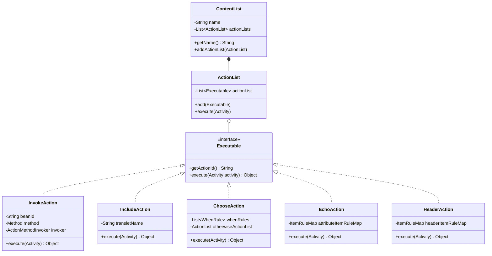
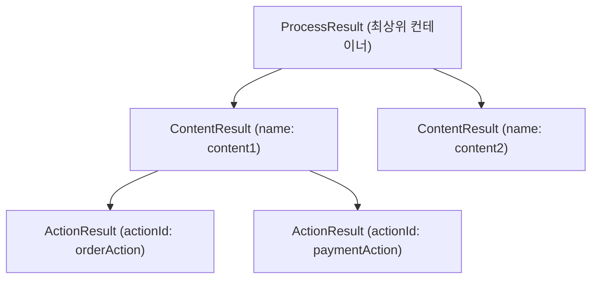

## 1. 설계 목표 및 주요 역할

`com.aspectran.core.activity.process` 패키지는 `Activity`의 실행 파이프라인 내에서 `<contents>`와 `<response>` 블록에 선언된 **실행 가능한 액션(Action)들을 구조화된 트리 형태로 조립하고, 이를 순차적으로 디스패치하여 결과를 체계적으로 수집하는 책임**을 가집니다.

이 패키지의 핵심 설계 목표는 다음과 같습니다.

*   **명령 패턴(Command Pattern) 기반의 표준화**: 모든 구체적인 비즈니스 동작(빈 메서드 호출, 서브 트랜슬릿 포함, 조건 분기, 헤더 조작, 문자열 에코 등)을 `Executable`이라는 공통 명령 인터페이스로 추상화하여, 실행 엔진이 일관된 방식으로 모든 종류의 액션을 구동할 수 있도록 합니다.
*   **컴포지트 패턴(Composite Pattern) 기반의 구조적 실행 컨테이너**: 액션들을 담는 `ActionList`와 이름있는 논리 단위를 형성하는 `ContentList`를 통해, 설정 파일에 선언된 중첩 블록을 메모리 상에서 동일한 트리 구조로 모델링합니다.
*   **지능형 파라미터 바인딩 (`ActionMethodInvoker`)**: 액션 메서드 실행 시 필요한 인자(`Activity`, `Translet`, 요청 파라미터, 속성, 세션 등)를 리플렉션과 ASEL 토큰 평가기를 통해 자동으로 분석하고 주입합니다.
*   **실행 구조와 1:1 대칭을 이루는 결과 모델 (`result` 패키지)**: 액션 실행 결과를 담는 `ProcessResult` -> `ContentResult` -> `ActionResult` 계층을 두어, 실행된 액션의 트리 구조와 동일한 데이터 구조로 결과값을 보존하고 후속 액션이나 뷰 템플릿에서 ID를 통해 손쉽게 참조할 수 있도록 합니다.

## 2. 주요 클래스 및 인터페이스 상세 분석

### 최상위 액션 컨테이너: `ContentList` 및 `ActionList`

트랜슬릿 설정에 정의된 액션 블록들을 메모리에 트리 구조로 배치하는 컴포넌트입니다.

*   **`ContentList` (클래스)**:
    *   `<contents>` 또는 `<content>` 태그에 대응되는 최상위 실행 블록 컨테이너입니다.
    *   블록의 고유한 이름(`name`)을 가질 수 있으며, 여러 개의 `ActionList`를 자식으로 포함합니다.
    *   실행 결과 레벨에서 `ContentResult`와 1:1로 직접 매핑됩니다.
*   **`ActionList` (클래스)**:
    *   순차적으로 실행되어야 할 `Executable` 액션들의 순서 있는 리스트 컨테이너입니다.
    *   `<content>` 내부뿐만 아니라 `<when>`, `<otherwise>` 블록처럼 조건부로 실행되는 액션 그룹을 캡슐화합니다.
    *   `execute(Activity activity)`를 통해 내부에 보관된 액션들을 순서대로 실행하고, 각 액션의 반환값을 `ContentResult`에 기록합니다.

### 구체적인 액션 구현체: `com.aspectran.core.activity.process.action`

*   **`Executable` (인터페이스)**:
    *   모든 액션 클래스가 반드시 구현해야 하는 명령(Command) 인터페이스입니다.
    *   `execute(Activity activity)`: 액션의 실제 비즈니스 로직을 구동합니다. 현재 실행 중인 `Activity`를 인자로 받아 컨텍스트, 빈 레지스트리, 요청/세션 데이터에 자유롭게 접근할 수 있습니다.
    *   `getActionId()`: 액션의 고유 식별자(ID)를 반환합니다. 이 ID는 `ProcessResult`에서 결과값을 검색하는 키로 사용됩니다.
*   **`InvokeAction` (클래스)**:
    *   지정된 빈(Bean)의 메서드를 호출하는 가장 핵심적인 액션입니다.
    *   `ActionMethodInvoker`를 내장하여, 메서드 시그니처에 선언된 파라미터 타입에 맞추어 `Translet`, `Activity`, 요청 속성, HTTP 파라미터를 지능적으로 주입합니다.
*   **`MethodAction` (클래스)**:
    *   빈 인스턴스화 없이 정적 메서드(Static Method)나 특정 인스턴스 메서드를 직접 호출할 때 사용하는 액션입니다.
*   **`IncludeAction` (클래스)**:
    *   다른 트랜슬릿의 실행 내용을 현재 위치에 포함(Include)시키는 액션입니다.
    *   대상 트랜슬릿 규칙을 탐색한 후, 현재 `Activity`의 하위 파생 활동을 생성하여 실행함으로써 트랜슬릿 공통 로직을 모듈화합니다.
*   **`ChooseAction` (클래스)**:
    *   선언적 조건 분기(`<choose>-<when>-<otherwise>`)를 수행하는 액션입니다.
    *   각 `<when>` 블록의 `test` 표현식(AsEL)을 순차 평가하여 처음으로 참(`true`)이 되는 `ActionList`를 실행하며, 모두 거짓일 경우 `<otherwise>` 블록을 실행합니다.
*   **`EchoAction` 및 `HeaderAction` (클래스)**:
    *   `EchoAction`: 속성 데이터를 응답 본문(Body) 스트림에 직접 출력합니다.
    *   `HeaderAction`: `ResponseAdapter`를 통해 응답 헤더(HTTP Header)를 동적으로 추가하거나 변경합니다.
*   **`AdviceAction` 및 `MethodAdviceAction` (클래스)**:
    *   AOP 애스펙트 어드바이스(`BEFORE`, `AFTER`, `THROWN`, `FINALLY`) 로직을 `Executable` 형태로 래핑하여 액션 파이프라인과 완벽하게 통합합니다.

### 액션 실행 결과 모델: `com.aspectran.core.activity.process.result`

*   **`ProcessResult` (클래스)**:
    *   단일 `Activity` 라이프사이클 동안 실행된 모든 액션의 최종 결과물들을 보관하는 최상위 컨테이너입니다.
    *   `Map<String, ContentResult>` 형태로 여러 콘텐츠 블록의 결과를 관리하며, `ActivityData`와 결합하여 `#{orderAction}` 같은 AsEL 표현식으로 결과 객체에 즉시 접근할 수 있도록 지원합니다.
*   **`ContentResult` (클래스)**:
    *   단일 `ContentList` 블록의 실행 결과를 표현합니다.
    *   내부에 `List<ActionResult>`를 유지하며, 블록 내에서 실행된 각 액션의 순서와 반환값을 보존합니다.
*   **`ActionResult` (클래스)**:
    *   개별 `Executable` 액션 하나의 실행 결과를 캡슐화합니다.
    *   액션의 고유 식별자인 `actionId`와 메서드가 실제로 반환한 객체인 `resultValue`를 안전하게 보관합니다.

## 3. 다른 패키지와의 상호작용

*   **`com.aspectran.core.activity`**: `CoreActivity.dispatchContent()`는 이 패키지의 `ContentList`를 순회하며 `ActionList.execute()`를 호출하고, 반환된 결과를 `ProcessResult`에 차곡차곡 누적합니다.
*   **`com.aspectran.core.context.rule`**: `<action>`, `<invoke>`, `<include>`, `<choose>` 등의 설정 규칙 객체(`ActionRule`, `InvokeActionRule`, `IncludeActionRule`, `ChooseRule` 등)가 빌드 타임에 파싱되어 이 패키지의 구체적인 `Executable` 구현체로 인스턴스화됩니다.
*   **`com.aspectran.core.component.bean`**: `InvokeAction`은 `Activity`를 통해 빈 레지스트리에 접근하여 대상 빈 인스턴스를 획득하고 메서드를 호출합니다.

## 4. 패키지 요약 및 아키텍처적 의미

`com.aspectran.core.activity.process` 패키지는 선언적인 XML/APON 비즈니스 규칙이 **런타임에 동적으로 동작하는 실행 가능한 객체 트리와 결과 데이터 모델로 실체화되는 핵심 메커니즘**입니다.

1.  **명령 및 컴포지트 패턴의 완벽한 융합**: 액션들을 `Executable`로 추상화하고 `ActionList`와 `ContentList`로 중첩 구성하여, 복잡하고 계층적인 비즈니스 워크플로우를 매우 직관적이고 유연하게 처리합니다.
2.  **실행과 데이터의 완벽한 디커플링**: 액션 간에 데이터를 직접 파라미터로 넘겨 결합도를 높이지 않고, `ProcessResult`라는 공유된 구조화 결과 저장소를 매개로 하여 느슨하게 결합된 데이터 파이프라인을 구축합니다.
3.  **뛰어난 확장성**: 새로운 유형의 비즈니스 액션이 필요할 경우 `Executable` 인터페이스만 구현하여 액션 트리에 추가하면, 기존 실행 엔진의 코드 수정 없이 무한히 확장할 수 있는 개방-폐쇄 원칙(OCP)을 실현합니다.
