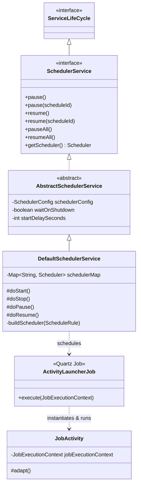
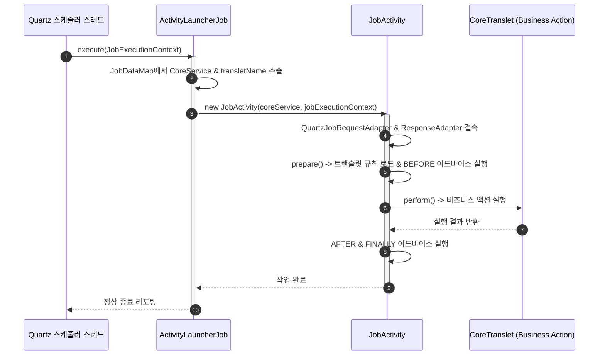

## 1. 설계 목표 및 주요 역할

`com.aspectran.core.scheduler.service` 패키지는 엔터프라이즈 환경에서 검증된 스케줄링 엔진인 **Quartz를 Aspectran 프레임워크의 서비스 생명주기 및 규칙 아키텍처에 완벽하게 통합**하는 역할을 전담합니다.

이 패키지의 핵심 설계 목표는 다음과 같습니다.

*   **선언적 스케줄링(Declarative Scheduling)**: 개발자가 복잡한 Quartz 저수준 API(`SchedulerFactory`, `JobDetail`, `TriggerBuilder` 등)를 직접 코딩할 필요 없이, Aspectran 설정 파일(XML/APON)에 `<schedule>` 규칙을 선언하는 것만으로 정교한 배치 및 예약 작업을 정의할 수 있도록 합니다.
*   **완전한 컨텍스트 내 작업 실행**: 스케줄러에 의해 트리거된 작업이 단순한 정적 자바 메서드가 아니라, Aspectran의 완전한 `ActivityContext` 내에서 구동되도록 합니다. 이를 통해 의존성 주입(DI), 선언적 트랜잭션 관리, AOP 어드바이스 인터셉션, 템플릿 변환 등 프레임워크의 모든 기능을 동일하게 향유할 수 있습니다.
*   **서비스 생명주기와의 완벽한 동기화**: `SchedulerService`는 최상위 `CoreService`의 자식 서비스(`subServices`)로 편입되어, 루트 서비스가 시작(`start`), 일시정지(`pause`), 재개(`resume`), 정지(`stop`)될 때 Quartz 스케줄러의 엔진 상태도 원자적으로 동기화됩니다.
*   **어댑터/브릿지(Adapter/Bridge) 아키텍처**: Quartz의 실행 모델(`JobExecutionContext`, `JobDataMap`)과 Aspectran의 표준 실행 모델(`Activity`, `RequestAdapter`, `ResponseAdapter`) 사이의 간극을 투명하게 메우는 전용 브릿지를 제공합니다.

## 2. 주요 클래스 및 컴포넌트 상세 분석

### `SchedulerService` (인터페이스)

Aspectran 내의 모든 스케줄링 관리 기능을 규정하는 서비스 인터페이스입니다. `ServiceLifeCycle`을 상속합니다.

*   **주요 책임**:
    *   부모 `CoreService`의 하위 서비스로 등록되어 서비스 트리 수명주기를 함께합니다.
    *   개별 스케줄 그룹 또는 특정 스케줄 ID에 대한 일시정지(`pause(String scheduleId)`) 및 재개(`resume(String scheduleId)`) 제어 메서드를 제공합니다.
    *   전체 스케줄 작업의 일괄 중지(`pauseAll()`) 및 일괄 재개(`resumeAll()`) 기능을 지원합니다.
    *   내부적으로 관리되는 Quartz `org.quartz.Scheduler` 인스턴스에 대한 안전한 접근점을 제공합니다.

### `AbstractSchedulerService` (추상 클래스)

`SchedulerService`의 공통 인프라 설정과 수명주기 뼈대를 구현한 추상 클래스입니다.

*   **주요 책임 및 설정 속성**:
    *   `SchedulerConfig` 객체를 주입받아 스케줄러의 구동 특성을 설정합니다.
    *   `startDelaySeconds`: 서비스 기동 후 Quartz 스케줄러가 실제 트리거를 가동하기까지의 지연 대기 시간(초)을 제어합니다. 애플리케이션의 모든 핵심 빈과 캐시가 완전히 워밍업된 후 배치가 시작되도록 유도합니다.
    *   `waitOnShutdown`: 서비스가 종료(`stop`)될 때 현재 실행 중인 배치 작업이 끝날 때까지 안전하게 대기(Graceful Shutdown)할 것인지 여부를 결정합니다.

### `DefaultSchedulerService` (구현 클래스)

`SchedulerService`의 최종 핵심 구현체로, Aspectran의 `ScheduleRule` 메타데이터를 Quartz 스케줄러에 바인딩하고 전체 스케줄링 사이클을 관장합니다.

*   **핵심 동작 파이프라인 (`doStart`)**:
    1.  `ActivityContext`의 `ScheduleRuleRegistry`로부터 등록된 모든 `ScheduleRule` 목록을 조회합니다.
    2.  스케줄 규칙에 참조된 `schedulerBean`이 존재하면 해당 빈을 조회하고, 없으면 `QuartzSchedulerFactoryBean`을 통해 기본 스케줄러를 프로비저닝합니다.
    3.  스케줄 규칙에 포함된 각 `ScheduledJobRule`에 대해 Quartz의 `JobDetail` 인스턴스를 생성합니다. 이때 실제 실행될 클래스는 Aspectran의 범용 브릿지인 **`ActivityLauncherJob`**으로 지정됩니다.
    4.  실행할 대상 트랜슬릿 이름(`transletName`), `CoreService` 참조 등을 `JobDataMap`에 안전하게 패킹합니다.
    5.  `<trigger>` 선언에 따라 `CronTrigger` (Cron 표현식 기반) 또는 `SimpleTrigger` (주기/반복 횟수 기반)를 생성합니다.
    6.  `scheduler.scheduleJob(jobDetail, trigger)`를 호출하여 Quartz 스케줄러에 등록합니다.
    7.  설정된 `startDelaySeconds`가 있다면 지연 후 `scheduler.startDelayed()`를, 그렇지 않다면 `scheduler.start()`를 호출하여 스케줄링 엔진을 가동합니다.
*   **종료 및 제어 로직 (`doStop`, `doPause`, `doResume`)**:
    *   `doStop()`: 관리 중인 모든 Quartz `Scheduler`에 대해 `shutdown(waitOnShutdown)`을 호출하여 작업을 안전하게 마무리하고 스레드 풀을 회수합니다.
    *   `doPause()` / `doResume()`: 스케줄러의 `standby()` 및 `start()`를 호출하여 일시정지/재개를 수행합니다.

### `ActivityLauncherJob` (Quartz Job 구현체)

Quartz 라이브러리의 `org.quartz.Job` 인터페이스를 구현한, **Aspectran과 Quartz 엔진을 잇는 핵심 콜백 브릿지(Bridge)**입니다.

*   **주요 책임 및 동작**:
    *   스케줄된 시간이 도래하면 Quartz 워커 스레드에 의해 `execute(JobExecutionContext)`가 호출됩니다.
    *   `JobExecutionContext`에 보관된 `CoreService` 인스턴스와 대상 `transletName`을 인출합니다.
    *   데몬 실행과 유사하게 전용 `JobActivity`를 생성하여 트랜슬릿 실행 파이프라인(`prepare()`, `perform()`)을 기동합니다.
    *   작업 실행 중 발생한 예외는 `JobExecutionException`으로 적절히 래핑되어 Quartz 리스너 체인으로 전달됩니다.

### `JobActivity` 및 전용 어댑터군

스케줄 작업 실행에 최적화된 `CoreActivity` 구체 클래스입니다.

*   **`JobActivity`**: Quartz 워커 스레드 환경에서 동작하는 특화된 활동 객체로, 스레드 로컬에 컨텍스트를 바인딩하고 작업 완료 후 안전하게 정리합니다.
*   **`QuartzJobRequestAdapter`**: Quartz의 `JobDataMap`에 저장된 파라미터와 컨텍스트 속성을 표준 `RequestAdapter`로 변환하여 트랜슬릿 내부 액션들이 일반 요청 파라미터를 읽듯이 자연스럽게 데이터를 조회할 수 있도록 지원합니다.
*   **`QuartzJobResponseAdapter`**: 배치 작업의 최종 결과물이나 로그를 캡슐화하는 전용 응답 어댑터입니다.

### `ActivityJobListener` 및 `ActivityJobReporter`

Quartz의 `JobListener` 인터페이스를 구현한 모니터링 컴포넌트입니다.

*   스케줄 작업의 시작, 성공 완료, 예외 발생 시점을 가로채어 실행 소요 시간과 처리 결과를 로깅하고 감사(Audit) 레포트를 생성합니다.

### `QuartzSchedulerFactoryBean`

Aspectran 컨텍스트 내에서 Quartz `Scheduler` 인스턴스를 커스터마이징하여 빈으로 등록할 수 있게 해주는 팩토리 빈입니다.

*   클러스터링 환경을 위한 DB 기반 잡 저장소(`JobStoreTX`, `JobStoreCMT`), 분산 락, 데이터소스 커넥션 풀과의 결합을 선언적으로 설정할 수 있도록 지원합니다.

## 3. 다른 패키지와의 상호작용

*   **`com.aspectran.core.service`**: `SchedulerService`는 `CoreService`에 자식으로 등록되어 상위 서비스의 상태 변경에 맞춰 기동 및 종료됩니다.
*   **`com.aspectran.core.activity`**: `ActivityLauncherJob`은 `JobActivity`를 생성하여 `CoreActivity`의 표준 요청 처리 파이프라인(AOP 어드바이스, 액션 실행, 트랜잭션 등)을 구동합니다.
*   **`com.aspectran.core.context.rule`**: `<schedule>` 및 `<job>` 태그로 정의된 `ScheduleRule`과 `ScheduledJobRule` 메타데이터를 파싱하여 Quartz 스케줄러에 등록합니다.
*   **`org.quartz`**: 스케줄러 코어 엔진, 트리거 및 잡 디테일 구성을 위해 Quartz 라이브러리의 표준 API와 직접 통신합니다.

## 4. 패키지 요약 및 아키텍처적 의미

`com.aspectran.core.scheduler.service` 패키지는 엔터프라이즈 스케줄링을 프레임워크의 일급 시민(First-Class Citizen)으로 끌어올린 뛰어난 통합 아키텍처를 보여줍니다.

1.  **완전한 어댑터/브릿지 패턴의 승리**: 외부 스케줄링 프레임워크(Quartz)의 스레드 풀 및 실행 컨텍스트를 `ActivityLauncherJob`과 `JobActivity`를 통해 Aspectran의 표준 실행 모델로 투명하게 전환시킵니다.
2.  **선언적 배치 개발**: 개발자는 복잡한 스케줄러 설정과 스레드 관리에 신경 쓸 필요 없이, 일반 웹 요청을 개발하듯 트랜슬릿을 작성하고 이를 `<schedule>` 태그로 지정하기만 하면 완벽한 배치 작업이 완성됩니다.
3.  **서비스 생명주기 일체화**: 백그라운드 스케줄러가 독립적으로 겉돌지 않고 애플리케이션의 루트 수명주기(`ServiceLifeCycle`)에 결속되어 일시정지, 재개, 안전한 종료(Graceful Shutdown)가 완벽하게 통제됩니다.
