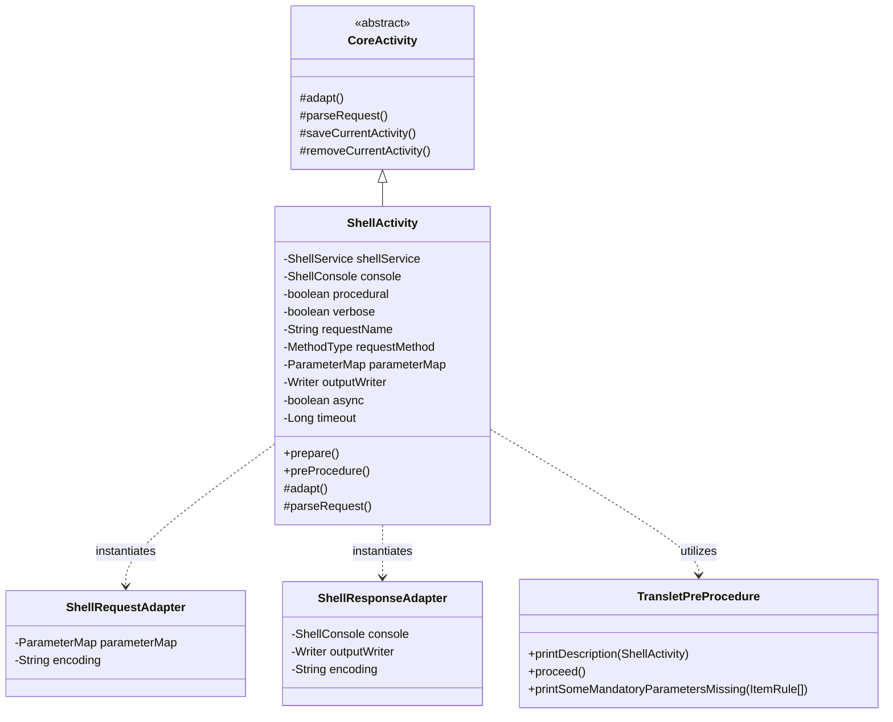

## 1. 설계 목표 및 주요 역할

`com.aspectran.shell.activity` 패키지는 `ShellService`에서 파싱된 커맨드라인 명령어를 **대화형 콘솔 터미널 환경에서 실제로 실행하는 전용 `Activity` 구현체 및 어댑터 계층**을 제공합니다.

이 패키지의 핵심 설계 목표는 다음과 같습니다.

*   **대화형 터미널 실행 컨텍스트의 구체화**: 추상적인 `CoreActivity`를 상속받아, ANSI 컬러 스타일링과 사용자 키보드 입력이 존재하는 CLI 환경에서 트랜슬릿 파이프라인을 구동할 수 있는 `ShellActivity`를 제공합니다.
*   **대화형 파라미터 프롬프팅 (`TransletPreProcedure`)**: 트랜슬릿 실행에 필수적인 파라미터(`mandatory="true"`)가 명령어 인자에 누락되었을 때 바로 실패하지 않고, `ShellConsole`을 통해 사용자에게 직접 대화형 프롬프트를 띄워 값을 입력받는 지능형 입력 보완 메커니즘을 지원합니다.
*   **유연한 출력 제어 및 리다이렉션**: 콘솔 화면 출력뿐만 아니라 사용자가 지정한 파일 리다이렉션(`>`, `>>`) 스트림을 `ShellResponseAdapter`에 투명하게 바인딩하여 출력 결과를 파일로 저장하거나 버퍼링할 수 있도록 합니다.
*   **상세 모드 및 비동기 실행 제어**: 명령어 실행 과정의 상세 내역을 출력하는 Verbose 모드(`-v`)와, 트랜슬릿 규칙에 정의된 비동기(`async="true"`, `timeout`) 속성을 인지하여 백그라운드 작업으로 디스패치할 수 있는 메타데이터를 유지합니다.

## 2. 주요 클래스 상세 분석



### `ShellActivity` (구현 클래스)

대화형 셸 환경을 위한 `Activity`의 최종 구현체입니다. `ShellService.translate()`가 호출될 때마다 요청 단위로 인스턴스화됩니다.

*   **주요 책임 및 속성**:
    *   `shellService` / `console`: 상위 셸 서비스와 JLine3 기반 `ShellConsole` 참조를 유지합니다.
    *   `procedural`: 필수 입력값 누락 시 대화형 프롬프트를 띄울 것인지 여부를 제어합니다.
    *   `verbose`: 실행 파이프라인의 상세 단계별 디버그 출력을 콘솔에 출력할 것인지 여부를 나타냅니다.
    *   `parameterMap`: 커맨드라인 옵션 파서(`OptionParser`)가 추출한 파라미터 목록입니다.
    *   `outputWriter`: 콘솔 출력 스트림 또는 파일 리다이렉션 스트림입니다.
    *   `async` / `timeout`: 트랜슬릿 규칙(`TransletRule`)에 명시된 비동기 구동 여부와 타임아웃(ms) 메타데이터를 캐싱합니다.

*   **핵심 메서드 심층 분석**:
    *   `adapt()`: **셸 환경을 위한 어댑테이션의 핵심 구현부**입니다.
        ```java
        @Override
        protected void adapt() throws AdapterException {
            setSessionAdapter(shellService.newSessionAdapter());

            ShellRequestAdapter requestAdapter = new ShellRequestAdapter(getTranslet().getRequestMethod());
            requestAdapter.setEncoding(console.getEncoding());
            if (getParameterMap() != null) {
                requestAdapter.setParameterMap(getParameterMap());
            }
            setRequestAdapter(requestAdapter);

            Writer outputWriter = (getOutputWriter() != null ? getOutputWriter() : new OutputStringWriter());
            ShellResponseAdapter responseAdapter = new ShellResponseAdapter(console, outputWriter);
            responseAdapter.setEncoding(console.getEncoding());
            setResponseAdapter(responseAdapter);

            setFlashMapManager(shellService.getFlashMapManager());
            setLocaleResolver(shellService.getLocaleResolver());

            super.adapt();
        }
        ```
        1.  `shellService.newSessionAdapter()`를 통해 셸 세션 어댑터를 연결합니다.
        2.  `ShellRequestAdapter`에 커맨드라인 파라미터를 바인딩하고 콘솔 문자 인코딩을 설정합니다.
        3.  출력 스트림(`outputWriter`)과 `console`을 감싸는 `ShellResponseAdapter`를 구성하여 콘솔 스타일러 및 리다이렉션 출력을 활성화합니다.
        4.  플래시맵 매니저 및 로케일 리졸버를 결속합니다.
    *   `parseRequest()`: **대화형 프롬프팅 및 유효성 검증의 핵심**입니다.
        ```java
        @Override
        protected void parseRequest() throws RequestParseException, ActivityTerminatedException {
            TransletPreProcedure procedure = new TransletPreProcedure(
                    console, getTransletRule(), getParameterMap(), isProcedural());
            procedure.printDescription(this);
            try {
                procedure.proceed();
                super.parseRequest();
            } catch (MissingMandatoryParametersException e) {
                procedure.printSomeMandatoryParametersMissing(e.getItemRules());
                terminate("Some mandatory parameters are missing");
            } catch (MissingMandatoryAttributesException e) {
                procedure.printSomeMandatoryAttributesMissing(e.getItemRules());
                terminate("Some mandatory attributes are missing");
            }
        }
        ```
        1.  `TransletPreProcedure`를 생성하여 해당 트랜슬릿의 설명과 안내 문구를 콘솔에 렌더링합니다.
        2.  `procedure.proceed()`를 실행합니다. 이때 `isProcedural() == true`이면 누락된 필수 파라미터를 사용자에게 한 줄씩 물어보고(예: 패스워드 입력의 경우 마스킹 처리), 입력된 값을 파라미터 맵에 동적으로 채워 넣습니다.
        3.  그래도 필수 값이 누락되었을 경우(`MissingMandatoryParametersException`), 빨간색 오류 메시지를 콘솔에 안내하고 `terminate()`를 호출하여 활동을 안전하고 우아하게 종료합니다.
    *   `saveCurrentActivity()` / `removeCurrentActivity()`:
        다른 환경과 마찬가지로 `DefaultSessionAdapter`의 세션 에이전트 수명주기(`access()`, `complete()`)를 보장하여 여러 명령어 실행 간 세션 상태가 온전하게 유지되도록 합니다.

## 3. 다른 패키지와의 상호작용

*   **`com.aspectran.shell.service`**: `DefaultShellService`는 커맨드라인 파싱 후 `ShellActivity`를 생성하고, 리다이렉션 출력 스트림을 결속한 뒤 실행을 지시합니다.
*   **`com.aspectran.shell.console`**: `ShellActivity`는 `ShellConsole`의 스타일러와 프롬프트 빌더를 통해 ANSI 컬러 출력과 사용자 키 입력을 처리합니다.
*   **`com.aspectran.shell.command`**: `TransletPreProcedure`는 트랜슬릿 규칙의 파라미터 요구사항을 검사하고 대화형 절차를 주도합니다.
*   **`com.aspectran.core.activity`**: `ShellActivity`는 `CoreActivity`를 상속하여 AOP 어드바이스, 액션 실행, 응답 처리 파이프라인 전체를 그대로 재사용합니다.

## 4. 패키지 요약 및 아키텍처적 의미

`com.aspectran.shell.activity` 패키지와 `ShellActivity`는 Aspectran의 `Activity` 실행 모델이 **단순한 배치/웹 요청을 넘어 고도의 사용자 대화형(Interactive) 워크플로우까지 얼마나 유연하게 수용할 수 있는가**를 완벽하게 입증합니다.

1.  **지능형 대화형 확장 (`TransletPreProcedure`)**: 필수 파라미터 누락 시 즉각적인 오류로 요청을 튕겨내지 않고, 콘솔 프롬프트를 통해 사용자의 입력을 실시간으로 보완하여 파이프라인을 완주시키는 뛰어난 사용성을 제공합니다.
2.  **완전한 CLI 입출력 가상화**: UNIX 표준 리다이렉션(`>`, `>>`)과 ANSI 콘솔 스타일링을 `ShellResponseAdapter`로 일원화하여, 비즈니스 액션 코드가 터미널 제어 시퀀스를 직접 신경 쓰지 않아도 됩니다.
3.  **플랫폼 일관성 유지**: 셸 전용 기능들을 `Activity`의 표준 라이프사이클(`prepare -> adapt -> parseRequest -> perform -> finish`) 안에 매끄럽게 녹여내어 코어 엔진의 아키텍처적 무결성을 철저하게 지켜냅니다.
