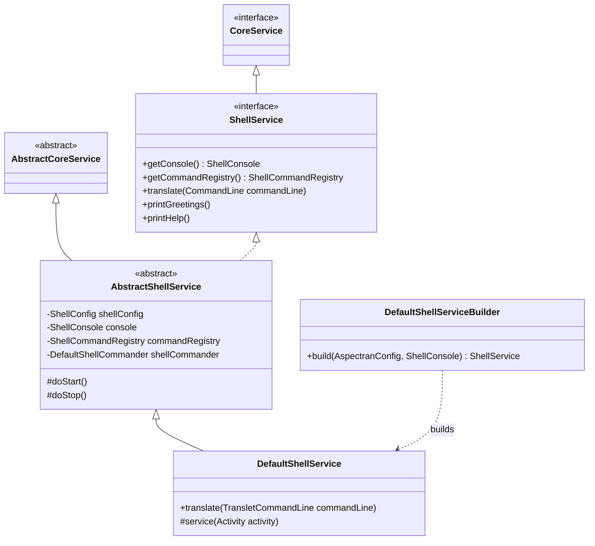
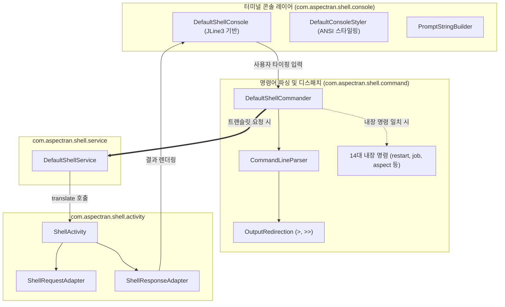

## 1. 설계 목표 및 주요 역할

`com.aspectran.shell.service` 패키지는 Aspectran 프레임워크를 **JLine3 기반의 고기능 대화형 커맨드 라인 셸(Interactive Command-Line Shell)**로 구동하기 위한 특화된 서비스 계층 구현체를 제공합니다.

이 패키지의 핵심 설계 목표는 다음과 같습니다.

*   **사용자 주도적(User-Driven) 대화형 런타임 제공**: 외부 HTTP 요청이나 스케줄러가 아닌, 터미널 콘솔을 통해 사용자가 직접 타이핑한 명령어를 읽고 해석하여 실행하는 대화형 상호작용 모델을 구현합니다.
*   **고급 터미널 콘솔 추상화 (`ShellConsole`)**: ANSI 컬러 스타일링, 자동 완성(Tab Completion), 멀티라인 편집, 명령어 히스토리 관리(`historyFile`) 등 강력한 터미널 기능을 `ShellConsole` 인터페이스로 캡슐화하여 서비스 코드가 JLine3 라이브러리의 저수준 복잡성에 얽매이지 않도록 합니다.
*   **커맨드 라인 파싱 및 출력 리다이렉션 지원**: 입력된 문자열을 트랜슬릿 이름, 옵션, 파라미터, 속성으로 분해하고, 표준 UNIX 셸과 동일한 출력 리다이렉션(`>` 파일 덮어쓰기, `>>` 파일 덧붙이기)을 투명하게 지원합니다.
*   **비동기 백그라운드 실행 모드**: 장시간 소요되는 배치 트랜슬릿이나 작업을 셸에서 백그라운드로 실행할 수 있도록 `--async` 옵션과 결합된 비동기 실행 파이프라인을 지원합니다.
*   **풍부한 내장 관리 명령군 연계**: `ShellCommandRegistry`를 탑재하여 트랜슬릿 호출뿐만 아니라 시스템 정보(`sysinfo`), 애스펙트 조회(`aspect`), 잡 스케줄링 제어(`job`), 암호화 토큰 생성(`pbencrypt`/`pbdecrypt`), 핫 리스타트(`restart`) 등 14여 종의 내장 명령어를 즉시 실행할 수 있게 합니다.

## 2. 주요 클래스 및 인터페이스 상세 분석

### `ShellService` (인터페이스)

대화형 셸 환경에 특화된 Aspectran 서비스의 최상위 명세입니다. `CoreService`를 상속합니다.

*   **주요 책임**:
    *   `getConsole()`: ANSI 색상, 프롬프트, 키 입력을 총괄하는 `ShellConsole` 인터페이스를 노출합니다.
    *   `getCommandRegistry()`: 셸에서 사용 가능한 모든 명령어가 등록된 `ShellCommandRegistry`에 접근합니다.
    *   `translate(CommandLine commandLine)`: 사용자의 입력을 구조화한 커맨드라인 객체를 받아 비즈니스 파이프라인을 실행합니다.
    *   `printGreetings()` / `printHelp()`: 셸 기동 시 출력할 환영 메시지(ASCII 아트 배너) 및 명령어 도움말을 콘솔에 렌더링합니다.

### `AbstractShellService` (추상 클래스)

`ShellService`의 공통 터미널 인프라와 명령어 라우팅 엔진을 캡슐화한 추상 클래스입니다.

*   **주요 책임 및 구현 디테일**:
    *   `ShellConfig`에 정의된 프롬프트 포맷, 환영 메시지, 히스토리 파일 경로, 기본 인코딩 설정을 반영합니다.
    *   `DefaultShellCommander`를 생성하여 사용자가 입력한 문자열이 프레임워크 내장 명령(`sysinfo`, `restart` 등)인지, 아니면 등록된 트랜슬릿 호출인지를 1차 판별하여 적절한 실행기로 디스패치합니다.
    *   서비스 수명주기(`doStart`, `doStop`)에 맞춰 콘솔 스트림을 열고 닫으며, 세션 매니저를 초기화합니다.

### `DefaultShellService` (구현 클래스)

`ShellService`의 최종 기본 구현체로, 커맨드라인 요청을 `ShellActivity`로 변환하여 실행하고 결과를 콘솔에 출력합니다.

*   **핵심 실행 파이프라인 (`translate`)**:
    1.  **커맨드라인 분석**: `TransletCommandLine`으로부터 트랜슬릿 식별자, 가상 메서드, 옵션 목록, 요청 파라미터 및 속성을 추출합니다.
    2.  **출력 대상(Target Writer) 결정**:
        *   사용자가 명령어 끝에 출력 리다이렉션(`> /tmp/out.txt` 또는 `>> /tmp/out.txt`)을 지정했다면, 해당 파일 경로의 파일 스트림 `Writer`를 생성합니다.
        *   리다이렉션이 없으면 `console.getWriter()`를 대상 출력 스트림으로 바인딩합니다.
    3.  **`ShellActivity` 인스턴스화**: 요청 파라미터와 결정된 출력 `Writer`를 주입하여 전용 `ShellActivity`를 생성합니다.
    4.  **동기 vs 비동기 분기**:
        *   일반 실행: `service(activity)` -> `activity.prepare()` -> `activity.perform()`을 순차 호출하여 즉시 결과를 출력합니다.
        *   비동기 실행(`--async` 플래그): `CompletableFuture.runAsync()`를 통해 백그라운드 스레드 풀에서 작업을 비동기 구동하고 콘솔에는 비동기 작업 접수 완료 메시지를 즉각 반환합니다.

### `DefaultShellServiceBuilder` (빌더 클래스)

`AspectranConfig` 설정과 콘솔 인스턴스를 조합하여 `DefaultShellService`를 빌드하는 팩토리 클래스입니다.

*   JLine3 `Terminal` 및 `LineReader`가 장착된 `DefaultShellConsole`을 프로비저닝하고, 콘솔 스타일러(`DefaultConsoleStyler`)와 프롬프트 빌더(`DefaultPromptStringBuilder`)를 결합합니다.
*   기동 완료 시 `CoreServiceHolder`에 서비스를 등록하고, 설정된 환영 메시지를 콘솔에 출력합니다.

## 3. 다른 패키지 및 셸 서브시스템과의 상호작용

*   **`com.aspectran.shell.console`**: 모든 사용자 입출력은 `ShellConsole`을 통하며, 탭 자동완성 및 문법 강조(Syntax Highlighting)를 제공합니다.
*   **`com.aspectran.shell.command`**: `CommandLineParser`가 파싱한 결과는 `TransletCommandLine`으로 패킹되며, 리다이렉션 파일 핸들링은 `OutputRedirection`이 전담합니다.
*   **`com.aspectran.shell.activity`**: `ShellService`는 모든 트랜슬릿 실행을 `ShellActivity`에 위임하며, 필수 입력값이 누락되었을 경우 대화형 프롬프트 콜백을 실행합니다.

## 4. 패키지 요약 및 아키텍처적 의미

`com.aspectran.shell.service` 패키지는 엔터프라이즈 프레임워크가 제공할 수 있는 **가장 강력하고 현대적인 대화형 CLI 관리 환경**을 완성합니다.

1.  **사용자 주도적 상호작용 모델**: 웹(HTTP 수동 반응)이나 데몬(내부 능동 실행)과 완전히 구별되는 사용자 대화형 CLI 모델을 구축하여 시스템 관리자 및 개발자에게 직관적인 운영 도구를 제공합니다.
2.  **완전한 콘솔 추상화와 UNIX 셸 기능 탑재**: JLine3 터미널과 연동되어 탭 완성, 히스토리, ANSI 색상, 입출력 파일 리다이렉션(`>`, `>>`) 등 실용적인 터미널 기능을 프레임워크 코어와 완벽하게 융합했습니다.
3.  **관리 및 테스트의 단일 창구**: 별도의 HTTP 클라이언트나 REST 도구 없이도 터미널에서 즉시 빈을 검증하고, 트랜슬릿을 호출하며, 스케줄링 작업을 수동 트리거할 수 있는 최상의 생산성 환경을 제공합니다.
