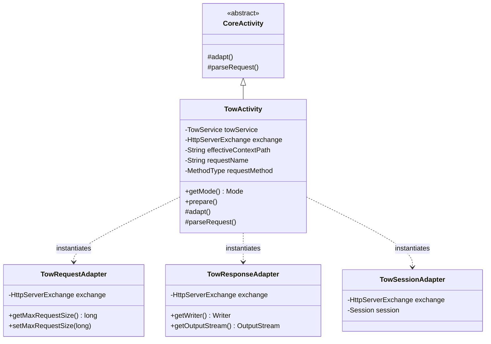

## 1. 설계 목표 및 주요 역할

`com.aspectran.undertow.activity` 패키지는 Undertow 임베디드 웹 서버 환경에서 유입된 HTTP 요청을 **서블릿 API 없이 네이티브 `HttpServerExchange` 기반으로 직접 처리하는 전용 `Activity` 구현체 및 어댑터 계층**을 제공합니다.

이 패키지의 핵심 설계 목표는 다음과 같습니다.

*   **서블릿-리스(Servlet-less) 웹 실행 컨텍스트의 구체화**: 표준 `CoreActivity`를 상속받아, 서블릿 컨테이너(`jakarta.servlet`)라는 간접 계층 없이 Undertow의 초고속 네이티브 I/O 객체인 `HttpServerExchange`를 직접 감싸서 처리하는 `TowActivity`를 제공합니다.
*   **고급 HTTP 웹 기능의 완벽한 수용**: HTTP 메서드 오버라이드(`X-HTTP-Method-Override`, `X-Method-Override`), 프록시 포워딩 헤더(`X-Forwarded-For`), 최대 요청 크기 제한(`maxRequestSize`), 문자 인코딩 결정을 네이티브 교환 객체 레벨에서 처리합니다.
*   **Undertow 세션 매니저와의 투명한 결속**: Undertow 채널의 어태치먼트 키(`SessionManager.ATTACHMENT_KEY`, `SessionConfig.ATTACHMENT_KEY`)를 통해 Undertow 네이티브 세션을 `TowSessionAdapter`로 감싸 인메모리/분산 세션 기능을 지원합니다.
*   **웹 요청 본문(Body) 및 멀티파트 폼 파싱**: `WebRequestBodyParser`와 연계하여 대용량 파일 업로드(`multipart/form-data`)와 URL 인코딩 폼(`application/x-www-form-urlencoded`) 데이터를 논블로킹 방식으로 신속하게 파싱합니다.

## 2. 주요 클래스 상세 분석



### `TowActivity` (구현 클래스)

Undertow 환경을 위한 `Activity`의 최종 구현체입니다. `DefaultTowService.service()`가 호출될 때마다 유입된 `HttpServerExchange` 단위로 인스턴스화됩니다.

*   **주요 책임 및 속성**:
    *   `towService`: 상위 `TowService` 인스턴스를 유지하여 리소스 매니저, 플래시맵, 로케일 리졸버, 세션 활성화 정책을 인출합니다.
    *   `exchange`: Undertow의 네이티브 HTTP 교환 객체로, 요청 헤더, 쿼리 스트링, I/O 버퍼 스트림을 소유합니다.
    *   `effectiveContextPath`: 역방향 컨텍스트 경로를 유지하여 절대 URL 링크 생성 시 올바른 접두사를 조합합니다.
    *   `getMode()`: 항상 `Mode.WEB`을 반환하여 웹 특화 AOP 어드바이스 및 뷰 디스패처가 활성화되도록 합니다.

*   **핵심 메서드 심층 분석**:
    *   `prepare()` 및 히든 메서드 오버라이드:
        ```java
        @Override
        public void prepare(@NonNull String requestName, MethodType requestMethod)
                throws TransletNotFoundException, ActivityPrepareException {
            if (requestMethod == MethodType.POST) {
                String method = exchange.getRequestHeaders().getFirst(HttpHeaders.X_HTTP_METHOD_OVERRIDE);
                if (method == null) {
                    method = exchange.getRequestHeaders().getFirst(HttpHeaders.X_METHOD_OVERRIDE);
                }
                if (method != null) {
                    MethodType hiddenRequestMethod = MethodType.resolve(method);
                    if (hiddenRequestMethod != null) {
                        requestMethod = hiddenRequestMethod;
                    }
                }
            }
            super.prepare(requestName, requestMethod);
        }
        ```
        RESTful API 클라이언트나 방화벽 제약으로 인해 `PUT`, `DELETE` 요청을 직접 보내지 못하고 `POST`로 우회할 때, `X-HTTP-Method-Override` 헤더를 검사하여 가상 메서드를 해당 메서드로 동적 승격시킵니다.
    *   `adapt()`: **Undertow 어댑테이션의 핵심 구현부**입니다.
        ```java
        @Override
        protected void adapt() throws AdapterException {
            if (towService.isSessionAdaptable()) {
                SessionManager sessionManager = exchange.getAttachment(SessionManager.ATTACHMENT_KEY);
                SessionConfig sessionConfig = exchange.getAttachment(SessionConfig.ATTACHMENT_KEY);
                if (sessionManager != null && sessionConfig != null) {
                    setSessionAdapter(new TowSessionAdapter(exchange));
                }
            }

            TowRequestAdapter requestAdapter = new TowRequestAdapter(getTranslet().getRequestMethod(), exchange);
            requestAdapter.setProxyAddressForwarding(towService.isProxyAddressForwarding());
            // maxRequestSize 및 인코딩 바인딩
            setRequestAdapter(requestAdapter);

            ResponseAdapter responseAdapter = new TowResponseAdapter(exchange, this);
            setResponseAdapter(responseAdapter);
            super.adapt();
        }
        ```
        1.  Undertow 어태치먼트로부터 세션 매니저를 확인하여 `TowSessionAdapter`를 결속합니다.
        2.  `TowRequestAdapter`를 생성하여 역방향 프록시 주소 포워딩(`isProxyAddressForwarding`), 요청 본문 최대 크기 제한(`setMaxEntitySize`)을 적용합니다.
        3.  `TowResponseAdapter`를 구성하여 Undertow의 네이티브 `OutputStream` 및 `Writer`로 직접 응답 데이터를 쓸 수 있도록 연결합니다.
    *   `parseRequest()`:
        `WebRequestBodyParser`를 구동하여 요청의 `MediaType`에 따라 `multipart/form-data` 멀티파트 파일 파싱 또는 `application/x-www-form-urlencoded` 폼 파라미터 파싱을 수행합니다.

## 3. 다른 패키지와의 상호작용

*   **`com.aspectran.undertow.service`**: `DefaultTowService`는 들어오는 모든 요청에 대해 `TowActivity`를 생성하고, `prepare()` 및 `perform()`을 호출하여 작업을 위임합니다.
*   **`com.aspectran.undertow.adapter`**: `TowActivity`는 내부적으로 `TowRequestAdapter`, `TowResponseAdapter`, `TowSessionAdapter`를 직접 인스턴스화하여 Undertow 네이티브 객체와의 통신을 추상화합니다.
*   **`com.aspectran.web.activity.request`**: `WebRequestBodyParser`를 통해 대용량 멀티파트 파일 업로드와 폼 데이터를 처리합니다.
*   **`com.aspectran.core.activity`**: `TowActivity`는 `CoreActivity`를 상속받아 그 안에 구현된 AOP 어드바이스 체인(`BEFORE`, `AFTER`, `THROWN`, `FINALLY`), 액션 디스패치(`dispatchContent`), 응답 변환 로직을 일체 변경 없이 100% 재사용합니다.

## 4. 패키지 요약 및 아키텍처적 의미

`com.aspectran.undertow.activity` 패키지와 `TowActivity`는 Aspectran의 **어댑터 아키텍처가 서블릿의 한계를 뛰어넘어 고성능 네이티브 비동기 웹 환경을 어떻게 정복했는가**를 잘 보여줍니다.

1.  **네이티브 I/O 직접 결속**: 서블릿 스펙의 복잡한 래퍼를 거치지 않고 Undertow의 `HttpServerExchange`에 직접 붙어 동작하므로, HTTP 헤더 파싱 및 스트리밍 전송 속도가 극대화됩니다.
2.  **모바일 및 REST 친화적 아키텍처**: HTTP Method Override, 프록시 포워딩, 대용량 파일 크기 제한 등 엔터프라이즈 REST API 서비스에 필수적인 기능들이 활동 계층 초기 단계에서 매끄럽게 처리됩니다.
3.  **중첩 활동(`pendingActivity`)의 완벽한 지원**: 내부 포워딩이나 인클루드 액션 실행 시 이전 `TowActivity`의 세션과 어댑터를 안전하게 계승하여 복잡한 웹 플로우에서도 데이터 일관성을 보장합니다.
