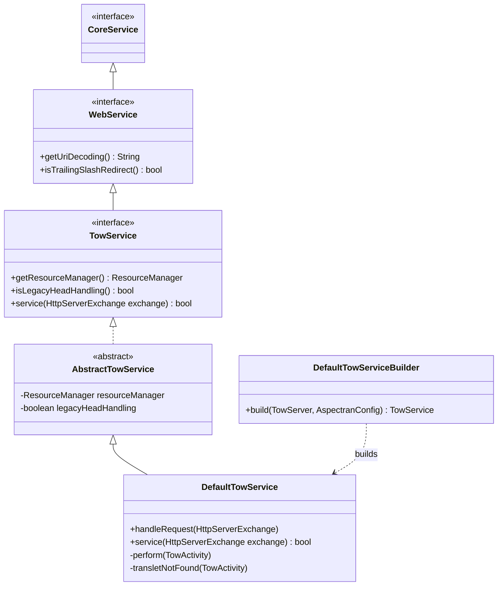
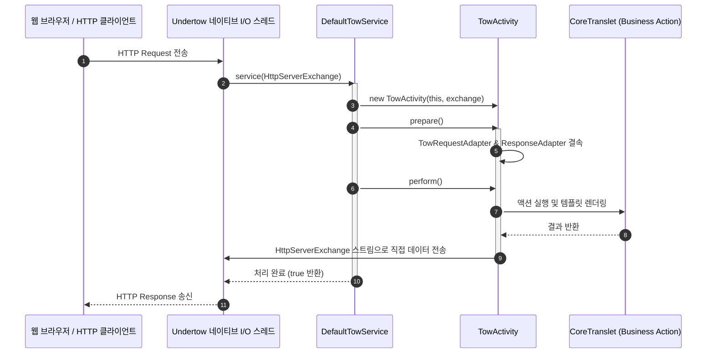

## 1. 설계 목표 및 주요 역할

`com.aspectran.undertow.service` 패키지는 JBoss의 초경량 고성능 비동기 웹 서버인 **Undertow 위에서 Aspectran을 서블릿 컨테이너 없이 직접 구동(Servlet-less Embedded Web Server)**하기 위한 특화된 서비스 계층 구현체를 제공합니다.

이 패키지의 핵심 설계 목표는 다음과 같습니다.

*   **서블릿-프리(Servlet-Free) 초고속 웹 런타임**: 전통적인 서블릿 스펙(`jakarta.servlet`)과 컨테이너 오버헤드를 완전히 걷어내고, Undertow의 네이티브 I/O 객체인 `HttpServerExchange`와 직접 상호작용하여 마이크로서비스 환경에서 최상의 처리량과 최소한의 메모리 풋프린트를 달성합니다.
*   **순수 웹 인터페이스(`WebService`) 계승**: `aspectran-web` 모듈의 최상위 웹 서비스 인터페이스인 `WebService`를 상속하여, 서블릿 환경과 동일한 세션 관리(`sessionConfig`), URI 디코딩, 트레일링 슬래시 리다이렉트(`trailingSlashRedirect`) 등 웹 표준 설정(`WebConfig`)을 100% 호환성 있게 재사용합니다.
*   **Undertow 핸들러 체인과의 원활한 결합**: `DefaultTowService`는 Undertow의 `HttpHandler`로 동작하거나 핸들러 체인의 최종 종착지로 결속되어, 정적 리소스 서빙(`ResourceManager`), 접근 로그(`AccessLogHandler`), 압축 인코딩 핸들러와 매끄럽게 연계됩니다.
*   **스레드 컨텍스트 클래스로더 스위칭**: 요청 처리 시 `ThreadContextHelper.overrideClassLoader()`를 통해 `SiblingClassLoader` 컨텍스트를 스레드에 바인딩하여 런타임 클래스 로딩 충돌을 방지합니다.

## 2. 주요 클래스 및 인터페이스 상세 분석



### `TowService` (인터페이스)

Undertow 기반 웹 서비스를 위한 Aspectran의 핵심 명세입니다. (`Tow`는 Undertow의 서픽스에서 유래한 명칭입니다.)

*   **주요 책임**:
    *   `WebService`를 상속하여 웹 공통 설정 및 라이프사이클을 공유합니다.
    *   `service(HttpServerExchange exchange)`: Undertow의 I/O 채널로부터 유입된 단일 HTTP 교환 객체를 받아 트랜슬릿을 실행하는 웹 진입점 메서드를 선언합니다.
    *   `getResourceManager()`: 정적 파일(HTML, CSS, JS, 이미지)을 서빙하기 위한 Undertow 전용 리소스 매니저를 노출합니다.

### `AbstractTowService` (추상 클래스)

`TowService`의 공통 웹 인프라 로직을 구현한 추상 클래스입니다.

*   `WebConfig` 설정을 주입받아 URI 문자열 디코딩 방식, 트레일링 슬래시 자동 리다이렉트 정책, 정적 리소스 매니저를 초기화합니다.
*   서비스 생명주기(`doStart`, `doStop`) 동안 Undertow 세션 매니저 및 백그라운드 리소스 정리를 총괄합니다.

### `DefaultTowService` (구현 클래스)

`TowService`의 최종 핵심 구현체로, Undertow의 `HttpServerExchange`를 받아 `TowActivity`를 생성하고 전체 실행 파이프라인을 구동합니다.

*   **핵심 실행 파이프라인 (`service(HttpServerExchange)`)**:
    1.  **서비스 일시정지 검사**: 서비스가 `paused` 상태인 경우 즉시 503 Service Unavailable 오류를 전송하고 처리를 중단합니다.
    2.  **요청 식별자 및 메서드 해석**: `exchange.getRequestURI()`를 읽어 `getUriDecoding()`에 따라 안전하게 디코딩하고, `exchange.getRequestMethod()`로부터 가상 `MethodType`(`GET`, `POST` 등)을 매핑합니다.
    3.  **인가 검사 (`isRequestAcceptable`)**: `RequestAcceptor`를 통해 해당 URI가 Aspectran이 처리하도록 인가된 트랜슬릿인지 검증합니다.
    4.  **`TowActivity` 인스턴스화**: `exchange` 객체와 유효 컨텍스트 경로를 주입하여 전용 활동 객체 `TowActivity`를 생성합니다.
    5.  **`prepare()` 및 트레일링 슬래시 리다이렉트**:
        *   트랜슬릿을 찾지 못한 경우(`TransletNotFoundException`), 끝에 슬래시(`/`)를 붙였을 때 매핑되는 트랜슬릿이 존재하는지 확인하여 자동으로 301/302 리다이렉트를 발행합니다.
    6.  **`perform()` 실행 및 클래스로더 격리**:
        ```java
        ClassLoader origClassLoader = ThreadContextHelper.overrideClassLoader(getServiceClassLoader());
        try {
            activity.perform();
        } finally {
            ThreadContextHelper.restoreClassLoader(origClassLoader);
        }
        ```
        스레드 컨텍스트 클래스로더를 Aspectran 서비스 클래스로더로 임시 전환한 후 표준 AOP 어드바이스, 액션, 템플릿 변환 파이프라인을 구동합니다.

### `DefaultTowServiceBuilder` (빌더 클래스)

내장 Undertow 서버(`TowServer`) 및 `AspectranConfig` 설정으로부터 `DefaultTowService` 인스턴스를 조립하는 팩토리 빌더입니다.

*   포트 바인딩, 리스너 설정, SSL/TLS 컨텍스트, 웹 세션 설정 및 Undertow 핸들러 체인을 결속하여 최종 기동 가능한 서비스 인스턴스를 완성합니다.

## 3. 다른 패키지 및 Undertow 엔진과의 상호작용



*   **`com.aspectran.web.service`**: 최상위 인터페이스인 `WebService`를 상속하여 웹 공통 규격을 완벽하게 준수합니다.
*   **`com.aspectran.undertow.activity`**: 모든 HTTP 요청 교환에 대해 `TowActivity`를 생성하여 코어 엔진의 표준 라이프사이클로 진입시킵니다.
*   **`io.undertow.server`**: Undertow의 `HttpServerExchange` 네이티브 API와 직접 통신하여 헤더, 상태 코드, 버퍼 스트림을 제어합니다.

## 4. 패키지 요약 및 아키텍처적 의미

`com.aspectran.undertow.service` 패키지는 Aspectran 프레임워크가 **서블릿 스펙이라는 전통적인 틀을 벗어나 현대적인 초고속 비동기 마이크로서비스 웹 서버로 진화할 수 있음을 입증하는 대표적인 어댑터 계층**입니다.

1.  **서블릿 오버헤드 제로화**: `HttpServletRequest/Response` 래퍼 객체나 필터 체인의 중간 복사 과정을 건너뛰고, Undertow 네이티브 `HttpServerExchange` 채널과 직접 맞닿아 동작함으로써 극대화된 I/O 처리 성능을 자랑합니다.
2.  **설정의 재사용성과 이식성**: 서블릿 환경을 위해 작성된 `<web>` 블록 설정과 Translet 비즈니스 로직을 전혀 수정하지 않고도 배포 인프라를 Undertow 임베디드 서버로 즉시 교체할 수 있습니다.
3.  **지능형 라우팅 및 리다이렉션**: 디코딩, 트레일링 슬래시 자동 보정, 정적 리소스 매니저와의 원활한 협업을 통해 경량 서버이면서도 완전한 엔터프라이즈 웹 기능을 제공합니다.
