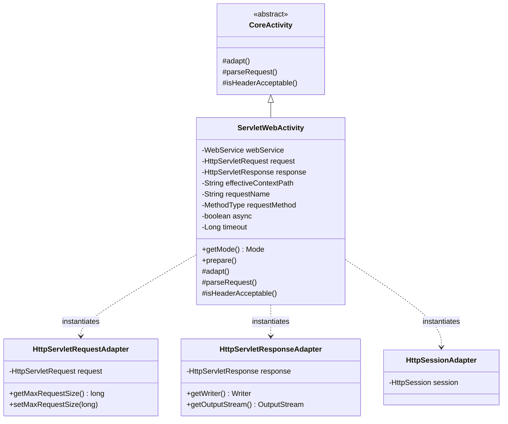

## 1. 설계 목표 및 주요 역할

`com.aspectran.web.servlet.activity` 패키지는 Aspectran의 코어 실행 엔진(`CoreActivity`)을 **표준 Java/Jakarta EE 서블릿(Servlet) 환경에 맞게 조정하는 특화된 실행기 및 어댑터 계층**을 제공합니다.

이 패키지의 핵심 설계 목표는 다음과 같습니다.

*   **서블릿 웹 실행 환경의 구체화**: 프로토콜에 독립적인 `CoreActivity`를 상속받아, 최신 Jakarta Servlet API(`jakarta.servlet.http.HttpServletRequest`, `HttpServletResponse`)와 직접 연동하는 `ServletWebActivity`를 제공합니다.
*   **완벽한 어댑터 캡슐화**: 서블릿 표준 객체들을 직접 다루지 않고, Aspectran 표준 인터페이스인 `HttpServletRequestAdapter`, `HttpServletResponseAdapter`, `HttpSessionAdapter` 뒤로 은폐하여 코어 파이프라인의 독립성을 보장합니다.
*   **고급 HTTP 웹 명세 지원**: 가상 HTTP 메서드 오버라이드(`X-HTTP-Method-Override`), 프록시 포워딩 헤더(`X-Forwarded-For`), HTTP `Accept` 헤더 기반 콘텐츠 협상(`isHeaderAcceptable`), 최대 요청 본문 크기 제한(`maxRequestSize`) 등을 활동 레벨에서 지원합니다.
*   **웹 전용 요청 파싱 및 비동기 처리**: `WebRequestBodyParser`를 통한 대용량 멀티파트 파일 업로드(`multipart/form-data`) 파싱, URL 인코딩 폼 처리, 그리고 서블릿 3.0+ 비동기 요청 처리(`isAsync()`, `AsyncContext`)를 매끄럽게 통합합니다.

## 2. 주요 클래스 상세 분석



### `ServletWebActivity` (구현 클래스)

서블릿 기반 웹 환경을 위한 `Activity`의 최종 구현체입니다. `ServletWebService.service()`가 호출될 때마다 유입된 `HttpServletRequest` 단위로 새롭게 인스턴스화됩니다.

*   **주요 책임 및 속성**:
    *   `webService`: 상위 `ServletWebService`를 참조하여 세션 활성화 여부, 프록시 포워딩, 플래시맵 매니저, 로케일 리졸버를 인출합니다.
    *   `request` / `response`: Jakarta Servlet 표준 요청 및 응답 인스턴스입니다.
    *   `effectiveContextPath`: 리버스 프록시나 가상 호스트 환경에서 올바른 상대/절대 URL 링크를 생성하기 위한 유효 컨텍스트 경로입니다.
    *   `async` / `timeout`: 트랜슬릿 규칙에 정의된 비동기 처리 여부 및 타임아웃 메타데이터입니다.
    *   `getMode()`: 항상 `Mode.WEB`을 반환하여 웹 전용 어드바이스 및 뷰 디스패처가 활성화되도록 합니다.

*   **핵심 메서드 심층 분석**:
    *   `prepare()` 및 메서드 오버라이드:
        ```java
        @Override
        public void prepare(@NonNull String requestName, MethodType requestMethod)
                throws TransletNotFoundException, ActivityPrepareException {
            if (requestMethod == MethodType.POST) {
                String method = request.getHeader(HttpHeaders.X_HTTP_METHOD_OVERRIDE);
                if (method == null) {
                    method = request.getHeader(HttpHeaders.X_METHOD_OVERRIDE);
                }
                if (method != null) {
                    MethodType hiddenRequestMethod = MethodType.resolve(method);
                    if (hiddenRequestMethod != null) {
                        requestMethod = hiddenRequestMethod;
                    }
                }
            }
            super.prepare(requestName, requestMethod);
        }
        ```
        방화벽이나 구형 클라이언트로 인해 `PUT`, `DELETE`를 전송하지 못하는 경우, `X-HTTP-Method-Override` 헤더를 통해 요청 메서드를 안전하게 동적 변환합니다.
    *   `adapt()`: **서블릿 환경을 위한 어댑테이션의 핵심 구현부**입니다.
        ```java
        @Override
        protected void adapt() throws AdapterException {
            if (webService.isSessionAdaptable()) {
                SessionAdapter sessionAdapter = new HttpSessionAdapter(request);
                setSessionAdapter(sessionAdapter);
            }

            HttpServletRequestAdapter requestAdapter = new HttpServletRequestAdapter(getTranslet().getRequestMethod(), request);
            requestAdapter.setProxyAddressForwarding(webService.isProxyAddressForwarding());
            // maxRequestSize 및 requestEncoding 설정
            setRequestAdapter(requestAdapter);

            ResponseAdapter responseAdapter = new HttpServletResponseAdapter(response, this);
            // responseEncoding 설정
            setResponseAdapter(responseAdapter);

            setFlashMapManager(webService.getFlashMapManager());
            setLocaleResolver(webService.getLocaleResolver());

            super.adapt();
        }
        ```
        1.  `request.getSession()`을 래핑하는 `HttpSessionAdapter`를 결속하여 서블릿 세션과 Aspectran 세션을 투명하게 연결합니다.
        2.  `HttpServletRequestAdapter`를 생성하여 파라미터, 헤더, 속성, 최대 요청 크기(`maxRequestSize`)를 바인딩합니다.
        3.  `HttpServletResponseAdapter`를 구성하여 `response.getOutputStream()` 및 `response.getWriter()`를 통한 표준 응답 출력을 결합합니다.
    *   `parseRequest()`:
        `WebRequestBodyParser`를 구동하여 HTTP 요청 본문이 `multipart/form-data`인 경우 업로드된 파일들을 파싱하여 `FileParameter`로 변환하고, 폼 데이터는 요청 파라미터로 매핑합니다.
    *   `isHeaderAcceptable(String headerRule)`:
        HTTP `Accept` 헤더와 트랜슬릿 규칙의 허용 미디어 타입을 비교하여 클라이언트가 원하는 표현 형식(JSON, XML, HTML 등)에 부합하는지 콘텐츠 협상을 수행합니다.

## 3. 다른 패키지와의 상호작용

*   **`com.aspectran.web.servlet.service`**: `DefaultServletWebService`는 모든 HTTP 요청에 대해 `ServletWebActivity`를 생성하고, `prepare()` 및 `perform()`을 호출하여 실행을 위임합니다.
*   **`com.aspectran.web.servlet.adapter`**: `ServletWebActivity`는 `HttpServletRequestAdapter`, `HttpServletResponseAdapter`, `HttpSessionAdapter`를 생성하여 Jakarta Servlet 객체들을 표준 인터페이스 뒤로 캡슐화합니다.
*   **`com.aspectran.web.activity.request`**: `WebRequestBodyParser`를 통해 대용량 멀티파트 파일 업로드와 URL 인코딩 폼 데이터를 처리합니다.
*   **`com.aspectran.core.activity`**: `ServletWebActivity`는 `CoreActivity`를 상속받아 그 안에 구현된 AOP 어드바이스 체인(`BEFORE`, `AFTER`, `THROWN`, `FINALLY`), 액션 디스패치(`dispatchContent`), 응답 변환 로직을 일체 변경 없이 100% 재사용합니다.

## 4. 패키지 요약 및 아키텍처적 의미

`com.aspectran.web.servlet.activity` 패키지와 `ServletWebActivity`는 Aspectran의 **어댑터 패턴(Adapter Pattern)이 제공하는 완벽한 기술 격리의 표준 모델**입니다.

1.  **엔터프라이즈 서블릿 표준과의 무결한 통합**: Jakarta EE 표준 서블릿 API 위에서 동작하면서도, 코어 비즈니스 액션과 트랜슬릿 파이프라인이 서블릿 스펙에 직접 종속되지 않도록 완벽하게 보호합니다.
2.  **모바일 및 REST 친화적 아키텍처**: HTTP Method Override, 클라이언트 IP 포워딩 해석, Accept 헤더 콘텐츠 협상 등 현대적인 웹 API 서비스에 필수적인 기능들이 활동 단계 초반에 자동화되어 제공됩니다.
3.  **다중 런타임 간의 완전한 대칭성**: Undertow의 `TowActivity`나 Netty의 `NettyActivity`와 완전히 동일한 어댑터 인터페이스 계약을 준수하므로, 개발자는 런타임 서버가 바뀌더라도 동일한 방식으로 비즈니스 로직을 개발하고 유지보수할 수 있습니다.
