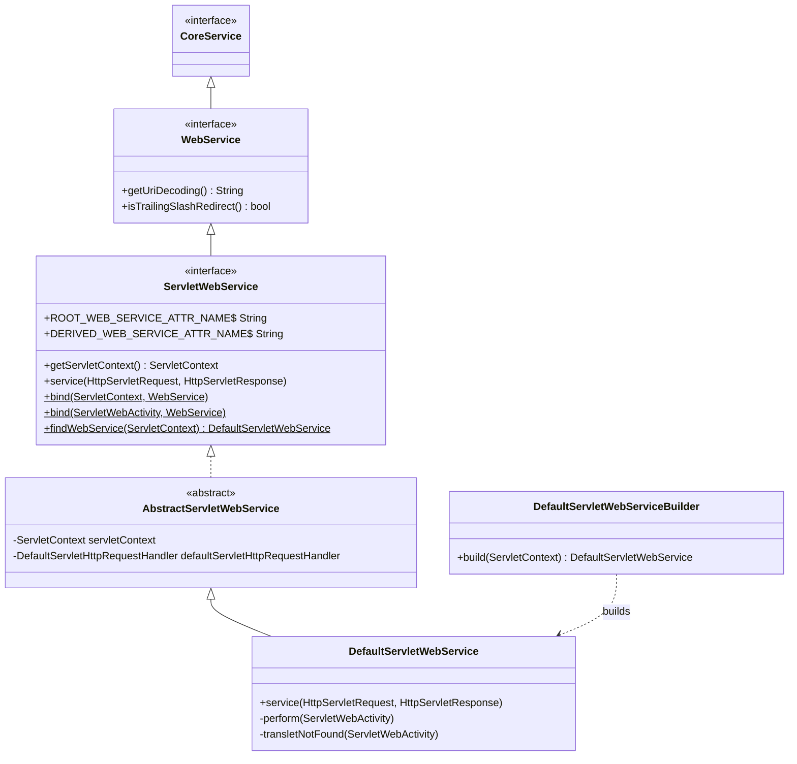
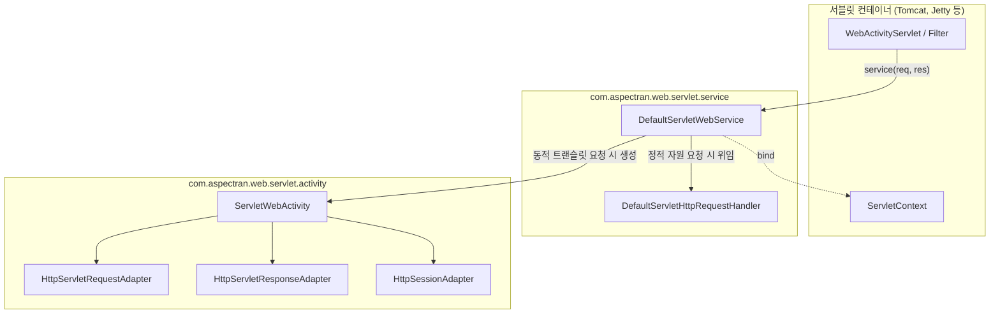

## 1. 설계 목표 및 주요 역할

`com.aspectran.web.servlet.service` 패키지는 Aspectran 프레임워크를 **표준 Java/Jakarta EE 서블릿(Servlet) 컨테이너(Tomcat, Jetty 등) 환경에서 실행**하기 위한 핵심 서비스 계층 구현체를 제공합니다. 순수 웹 추상화 모듈인 `aspectran-web`의 `WebService` 인터페이스를 계승하여, 표준 서블릿 명세(`jakarta.servlet`)와 Aspectran 코어 엔진 사이의 완벽한 다리 역할을 수행합니다.

이 패키지의 핵심 설계 목표는 다음과 같습니다.

*   **표준 Jakarta Servlet API와의 완벽한 융합**: `HttpServletRequest`, `HttpServletResponse`, `ServletContext` 등 서블릿 표준 객체들과 프로토콜에 독립적인 Aspectran 코어 엔진 사이의 정교한 어댑테이션을 수행합니다.
*   **프론트 컨트롤러(Front Controller) 패턴의 단일 진입점**: 모든 웹 요청을 수신하는 `service(HttpServletRequest, HttpServletResponse)` 진입점을 제공하여, 요청 인가(`RequestAcceptor`), 트랜슬릿 매핑, 예외 처리 및 응답 전송을 일원화합니다.
*   **정적 리소스와 동적 요청의 지능형 분리**: Aspectran 규칙에 매핑된 동적 트랜슬릿 요청은 코어 파이프라인으로 처리하고, 정적 자원(CSS, JS, 이미지, HTML 등)에 대한 요청은 `DefaultServletHttpRequestHandler`를 통해 서블릿 컨테이너의 기본 서블릿(Default Servlet)으로 투명하게 위임하여 최상의 서빙 효율을 달성합니다.
*   **서블릿 스코프 기반 서비스 바인딩 및 서비스 로케이터**: `ServletContext` 및 `ServletRequest` 속성에 루트 웹 서비스(`ROOT_WEB_SERVICE_ATTR_NAME`)와 파생 웹 서비스(`DERIVED_WEB_SERVICE_ATTR_NAME`)를 바인딩하여, 필터, 리스너, JSP 커스텀 태그 등 외부 서블릿 컴포넌트가 Aspectran 컨텍스트에 안전하게 접근할 수 있도록 지원합니다.

## 2. 주요 클래스 및 인터페이스 상세 분석

### `ServletWebService` (인터페이스)

서블릿 환경에 특화된 Aspectran 웹 서비스의 최상위 명세입니다. `WebService`를 상속합니다.

*   **주요 책임 및 상수**:
    *   `ROOT_WEB_SERVICE_ATTR_NAME`: `ServletContext`에 최상위 루트 웹 서비스 인스턴스를 저장하기 위한 속성 키입니다.
    *   `DERIVED_WEB_SERVICE_ATTR_NAME`: 요청 단위로 생성된 파생 웹 서비스를 보관하기 위한 `ServletRequest` 속성 키입니다.
    *   `getServletContext()`: 서블릿 컨테이너와의 통신을 위한 `ServletContext` 참조를 반환합니다.
    *   `service(HttpServletRequest, HttpServletResponse)`: 모든 HTTP 웹 요청이 유입되는 단일 프론트 컨트롤러 진입점입니다.
    *   `bind(...)` / `findWebService(...)`: 서블릿 컨텍스트 또는 활동 객체에 웹 서비스를 바인딩하고 탐색하는 정적 헬퍼 메서드를 제공합니다.

### `AbstractServletWebService` (추상 클래스)

`ServletWebService`의 서블릿 인프라 연동 공통 로직을 캡슐화한 추상 클래스입니다.

*   `WebConfig` 설정을 주입받아 URI 인코딩, 세션 타임아웃, 트레일링 슬래시 리다이렉트 정책을 수립합니다.
*   서블릿 컨테이너가 제공하는 `DefaultServlet`(Tomcat의 `default`, Jetty의 `org.eclipse.jetty.servlet.DefaultServlet` 등)을 식별하여 `DefaultServletHttpRequestHandler`를 초기화합니다.
*   서비스 수명주기(`doStart`, `doStop`) 동안 서블릿 세션 매니저 및 웹소켓 엔드포인트 익스포터(`ServerEndpointExporter`)를 안전하게 초기화하고 정리합니다.

### `DefaultServletWebService` (구현 클래스)

`ServletWebService`의 최종 핵심 구현체로, 서블릿 컨테이너로부터 유입된 모든 요청을 처리합니다.

*   **핵심 실행 파이프라인 (`service(HttpServletRequest, HttpServletResponse)`)**:
    1.  **서비스 활성화 검사**: 서비스가 일시정지(`isPaused`) 상태인 경우 503 Service Unavailable 응답을 보냅니다.
    2.  **요청 URI 파싱 및 디코딩**: 요청 URI에서 컨텍스트 경로를 제외한 트랜슬릿 이름(`requestName`)을 추출하고 설정된 문자 인코딩으로 안전하게 디코딩합니다.
    3.  **인가 검사 및 정적 리소스 위임**:
        *   `isRequestAcceptable(requestName)`을 검사합니다.
        *   Aspectran이 처리할 대상이 아니라면, CSS/JS/이미지 등의 정적 리소스일 가능성을 감안하여 `defaultServletHttpRequestHandler.handle(request, response)`를 호출해 서블릿 컨테이너의 기본 서블릿으로 처리를 넘깁니다.
    4.  **`ServletWebActivity` 인스턴스화**: `request`와 `response` 객체를 주입하여 전용 활동 객체인 `ServletWebActivity`를 생성합니다.
    5.  **`prepare()` 및 트레일링 슬래시 리다이렉트**:
        *   트랜슬릿이 발견되지 않으면(`TransletNotFoundException`), 끝에 슬래시(`/`)를 보정한 트랜슬릿이 존재하는지 확인하여 자동으로 301/302 리다이렉트를 처리합니다.
    6.  **`perform()` 실행 및 클래스로더 격리**:
        `ThreadContextHelper.overrideClassLoader()`를 통해 서비스 클래스로더로 전환한 뒤, 표준 AOP 어드바이스, 비즈니스 액션 실행, 응답 변환(JSON, XML, JSP, Thymeleaf 등)을 수행합니다.

### `DefaultServletWebServiceBuilder` (빌더 클래스)

`ServletContextListener`의 `contextInitialized()` 또는 `WebActivityServlet.init()` 시점에 호출되어 `DefaultServletWebService`를 조립하는 빌더입니다.

*   `web.xml`의 `<context-param>`이나 서블릿 `<init-param>`에 정의된 설정 파일 위치(`aspectran.config.file`)를 읽어와 `AspectranConfig`를 로드합니다.
*   웹 서비스 인스턴스를 빌드한 후 `ServletWebService.bind(servletContext, webService)`를 호출하여 전역 속성으로 등록하고, `CoreServiceHolder`에 등록하여 클래스로더 기반 서비스 로케이터를 활성화합니다.

### `DefaultServletHttpRequestHandler` (정적 리소스 핸들러)

Aspectran에 매핑되지 않은 URL 요청을 서블릿 컨테이너의 Default Servlet으로 포워딩하는 컴포넌트입니다.

*   컨테이너 종류(Tomcat, Jetty, Resin 등)에 따라 기본 서블릿 이름(`default`)을 자동으로 감지하고, `RequestDispatcher`를 통해 리소스 서빙을 효율적으로 위임합니다.

## 3. 다른 패키지와의 상호작용

*   **`com.aspectran.web.service`**: 순수 웹 추상화 인터페이스 `WebService`를 구현하여 웹 서비스 표준 계약을 충족합니다.
*   **`com.aspectran.web.servlet.activity`**: 유효한 모든 웹 요청에 대해 `ServletWebActivity`를 생성하여 코어 요청 처리 파이프라인으로 연결합니다.
*   **`jakarta.servlet`**: 최신 Jakarta EE 서블릿 API(`HttpServletRequest`, `HttpServletResponse`, `ServletContext`, `AsyncContext`)와 직접 연동됩니다.

## 4. 패키지 요약 및 아키텍처적 의미

`com.aspectran.web.servlet.service` 패키지는 Aspectran 프레임워크가 **표준 서블릿 컨테이너 환경에서 가장 안정적이고 최적화된 엔터프라이즈 웹 애플리케이션으로 작동하도록 보장하는 핵심 어댑터 계층**입니다.

1.  **완전한 환경 분리와 추상화**: 프로토콜에 독립적인 Aspectran 코어 엔진 위에 서블릿 API를 결합하여, 비즈니스 액션과 트랜슬릿 규칙이 특정 서블릿 기술에 결합되지 않도록 합니다.
2.  **정적/동적 자원의 효율적 하이브리드 라우팅**: 모든 요청을 무조건 프레임워크 파이프라인으로 태우지 않고, 정적 자원은 컨테이너의 고속 기본 서블릿으로 바이패스하여 런타임 성능을 극대화합니다.
3.  **Jakarta EE 최신 표준 완벽 지원**: `javax.servlet`을 탈피하고 최신 `jakarta.servlet` 스펙을 완전히 준수하여 최신 WAS 환경 및 컨테이너와의 완벽한 호환성을 제공합니다.
