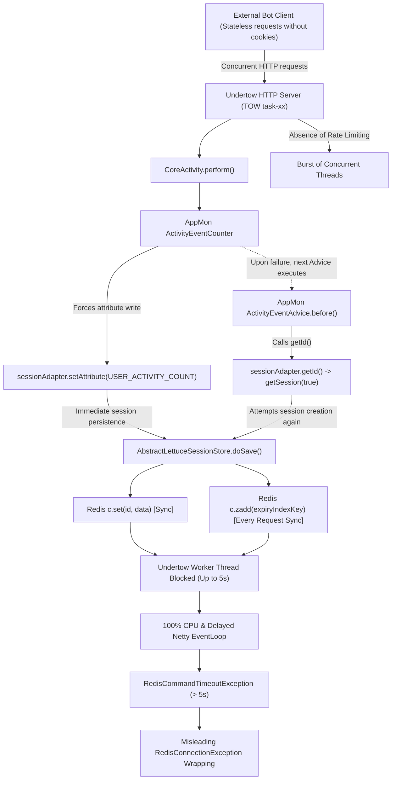


**Case Study:** This document is a technical paper that analyzes a session creation storm, 100% CPU spike, and Lettuce command timeout incident triggered by a surge of external stateless requests in an Aspectran-based service running in a cloud environment, and shares in detail the resilience improvement architecture applied across the framework and Redis session store to resolve it.



Modern web applications widely utilize in-memory data grids such as Redis as remote session stores to ensure high availability in distributed cluster environments. However, when web crawlers, bots, or load testing tools that do not store session cookies unleash dozens to hundreds of concurrent requests per second, serious resource exhaustion and service paralysis can occur if the session management framework unnecessarily creates new sessions for stateless requests and immediately persists them.

Based on a real-world production incident in an Aspectran and Lettuce-based session store environment, this post delves into the root causes of the session creation storm and describes in detail the architectural improvement process of **Dual-Scoring**, which slashed Redis I/O by over 98% without compromising the original philosophy of the session scavenging grace period (`gracePeriod`).
<!--more-->

## 1. Incident Symptoms and Background

### 1.1. Operating Environment
* **Infrastructure**: Oracle Cloud Infrastructure (OCI) Free Tier VM instance (resource-constrained 1–2 OCPUs and limited I/O bandwidth)
* **Application**: A service running Aspectran with Undertow and Lettuce-based distributed session management module
* **Client Pattern**: High-concurrency stateless HTTP requests originating from a specific external IP without `JSESSIONID` session cookies, concentrated in a short period (concurrently handled by dozens of Undertow worker threads)

### 1.2. Failure Logs and Primary Symptoms
As soon as the traffic flooded in, multiple Undertow worker threads (`TOW task-xx`) entered a synchronous blocking state for 5 seconds, driving host CPU utilization to a sustained 100%.

```
DEBUG [TOW task-24] GET /account/signonForm HTTP/1.1 27.6.37.167 - c.a.w.s.s.DefaultServletWebService.service(88)
DEBUG [TOW task-24] Advice {type=before, aspect=ActivityEventCounter.ASPECT, action=ActivityEventCounter.count(), isolated=true}
DEBUG [TOW task-24] Create new session id=9dwsrv21xwmg477toiiataj79385.n1 - c.a.c.c.s.AbstractSessionCache.add(260)
ERROR [TOW task-40] Failed to execute isolated advice action {type=before, action=ActivityEventCounter.count()} - c.a.c.activity.AdviceActivity.executeAdvice(424)
java.lang.RuntimeException: Unable to create new session id=138iavmehrhvwo0g5e1z5i0x19350.n1
        at com.aspectran.core.component.session.AbstractSessionManager.createSession(AbstractSessionManager.java:269)
        at com.aspectran.undertow.server.session.TowSessionManager.createSession(TowSessionManager.java:194)
        at io.undertow.servlet.spec.ServletContextImpl.getSession(ServletContextImpl.java:966)
        at io.undertow.servlet.spec.HttpServletRequestImpl.getSession(HttpServletRequestImpl.java:455)
        at com.aspectran.web.servlet.adapter.HttpSessionAdapter.getSession(HttpSessionAdapter.java:176)
        at com.aspectran.web.servlet.adapter.HttpSessionAdapter.setAttribute(HttpSessionAdapter.java:117)
        at com.aspectran.aspectow.appmon.engine.persist.counter.activity.ActivityEventCounter.lambda$registerAspect$0(ActivityEventCounter.java:106)
...
Caused by: io.lettuce.core.RedisConnectionException: Could not get a resource from the pool
        at com.aspectran.core.component.session.redis.lettuce.AbstractLettuceSessionStore.sync(AbstractLettuceSessionStore.java:104)
        at com.aspectran.core.component.session.redis.lettuce.AbstractLettuceSessionStore.doSave(AbstractLettuceSessionStore.java:156)
        at com.aspectran.core.component.session.AbstractSessionStore.save(AbstractSessionStore.java:196)
        at com.aspectran.core.component.session.AbstractSessionCache.add(AbstractSessionCache.java:267)
        at com.aspectran.core.component.session.AbstractSessionManager.createSession(AbstractSessionManager.java:262)
Caused by: io.lettuce.core.RedisCommandTimeoutException: Command timed out after 5 second(s)
        at io.lettuce.core.internal.Futures.awaitOrCancel(Futures.java:259)
        at io.lettuce.core.FutureSyncInvocationHandler.handleInvocation(FutureSyncInvocationHandler.java:79)
        at jdk.proxy2/jdk.proxy2.$Proxy23.set(Unknown Source)
        at com.aspectran.core.component.session.redis.lettuce.AbstractLettuceSessionStore.lambda$doSave$4(AbstractLettuceSessionStore.java:157)
        at com.aspectran.core.component.session.redis.lettuce.AbstractLettuceSessionStore.sync(AbstractLettuceSessionStore.java:102)
```

This log clearly exposed three critical bottlenecks:
1. **Forced Session Creation by Monitoring Advices**: The activity tracking advice (`ActivityEventCounter`) attempted to write an activity counter attribute (`setAttribute`) without checking whether a session existed, unconditionally creating a new session.
2. **Worker Thread Starvation via Synchronous Blocking**: Every new session immediately triggered synchronous Redis persistence (`doSave`), blocking worker threads for up to the 5-second command timeout and starving the pool of available request-handling threads.
3. **Misleading Exception Wrapping**: Although the root failure was a command timeout (`RedisCommandTimeoutException`), the session store's `sync()` method indiscriminately wrapped all exceptions into a `RedisConnectionException` with the message `"Could not get a resource from the pool"`, causing it to be mistaken for a connection pool exhaustion issue.

## 2. Root Cause Analysis



### 2.1. Mechanism of the Session Creation Storm
Standard users store the `JSESSIONID` cookie issued by the server upon their first request in their browser and include it with subsequent requests. However, crawlers, bots, and load testing tools do not retain cookies.

At this point, when the monitoring engine invoked `sessionAdapter.setAttribute(USER_ACTIVITY_COUNT, count)` to track visitor activity, `HttpServletRequest.getSession(true)` was executed internally, creating a completely new session object for every single request. When 100 bot requests arrived, 100 sessions were created instantly, each triggering Redis network I/O.

### 2.2. Dual Synchronous Calls of Redis Session Store (`SET` + `ZADD`)
The original `doSave()` method in [AbstractLettuceSessionStore.java](https://github.com/aspectran/aspectran/blob/master/rss-lettuce/src/main/java/com/aspectran/core/component/session/redis/lettuce/AbstractLettuceSessionStore.java) was implemented as follows:

```java
@Override
public void doSave(String id, SessionData data) {
    sync(c -> {
        c.set(id, data);
        long expiry = data.getExpiry();
        if (expiry > 0L) {
            c.zadd(expiryIndexKey, (double)expiry, SessionData.of(id));
        } else {
            c.zrem(expiryIndexKey, SessionData.of(id));
        }
        return null;
    });
}
```

1. **`c.set(id, data)`**: Stores the serialized session binary data.
2. **`c.zadd(expiryIndexKey, (double)expiry, SessionData.of(id))`**: Registers the session ID and expiration timestamp in a Sorted Set search index used by background scavengers to filter out expired sessions.

Sorted Set `ZADD` operations operate at $O(\log N)$ time complexity. Under heavy concurrency where thousands of sessions were simultaneously updated, unconditionally re-executing `ZADD` on every request caused severe CPU contention in Redis.

### 2.3. Chain Reaction in Low-Spec OCI VM Environment
1. In a CPU-constrained environment, as dozens of threads performed concurrent I/O simultaneously, thread context switching overhead pushed CPU utilization to 100%.
2. Netty's I/O EventLoop threads were starved of CPU cycles and could not process socket responses in time.
3. Exceeding the default 5-second timeout, `RedisCommandTimeoutException` erupted simultaneously across threads, trapping dozens of worker threads for 5 seconds and completely paralyzing the entire server.

## 3. Architectural Considerations of Session Scavenging and Grace Period

In the process of optimizing `ZADD` operations to resolve the issue, an in-depth technical discussion took place regarding the **Grace Period (`gracePeriod`)**, a core concept in distributed session management.

### 3.1. Philosophical Differences Between Jetty and Aspectran
Aspectran's session manager was originally adapted and modernized from Jetty's session engine (`AbstractSessionDataStore`) for modern high-performance microservices and distributed cache environments.

* **Jetty's Default (`DEFAULT_GRACE_PERIOD_SEC = 60 * 60; // 1 hour`)**:
  * Jetty was designed assuming relatively slow persistent storage such as JDBC (RDB), MongoDB, and file systems.
  * To Jetty, store-level scavenging was close to "cleaning up orphaned sessions left behind by abnormally terminated nodes a few times a day," rather than real-time memory reclamation. Therefore, to avoid distributed lock collisions and delays, a generous **1 hour (3600 seconds)** was set as the default.
* **Aspectran's Modernization (`DEFAULT_GRACE_PERIOD_SECS = 60; // 1 minute`)**:
  * Aspectran actively leverages ultra-fast in-memory storage such as Redis.
  * If a 1-hour grace period were used like Jetty, tens of thousands of dummy sessions left by bots would waste Redis memory for an hour.
  * Therefore, Aspectran shortened this to **60 seconds** to reclaim memory in real time.

### 3.2. An Engineering Pitfall: Misappropriating Grace Period to Offset Delays
While considering an optimization to throttle session expiration updates to 60-second intervals instead of calling `ZADD` on every request, a critical question was raised:

> *"Since the scavenger collects sessions with a delay of gracePeriod (60 seconds), wouldn't delaying the ZADD update by 60 seconds cancel each other out?"*

This idea sounds plausible at first glance, but it is **the most critical pitfall in engineering**.
When designing a bridge with a safety factor of 2.0 for unforeseen emergencies, if one says "since it can endure up to twice as much, let's double the load to optimize it," it is exactly the same as **completely wiping out the intended safety margin and walking a dangerous tightrope with zero margin**.

The `gracePeriod` must remain a **pure, final protective barrier** solely for:
1. **NTP Clock Drift** across distributed nodes.
2. Network latency and momentary Stop-the-world GC pauses.
3. Boundary collisions when an in-flight request arrives right at the expiration moment.

Therefore, an architectural principle was established: this grace period must never be consumed as a calculated offset to justify operational delays.

## 4. Core Solutions and Architectural Design

Aspectran constructed the following multi-tiered resilience architecture to dramatically reduce Redis load while completely preserving design purity and safety.

### 4.1. AppMon: Visitor Tracking Integrity and Omitting Writes on the First Request
We improved the architecture to guarantee visitor session ID tracking for web analytics even on the first visit of a new visitor, while blocking immediate persistence load caused by session attribute writes.

1. [ActivityEventCounter.java](file:///Users/Aspectran/Projects/workspace/aspectow/appmon/src/main/java/com/aspectran/aspectow/appmon/engine/persist/counter/activity/ActivityEventCounter.java):
   ```java
   if (activity.hasSessionAdapter()) {
       SessionAdapter sessionAdapter = activity.getSessionAdapter();
       // Skip writing session attributes on the initial request of a new session to prevent unnecessary immediate Redis persistence
       if (!sessionAdapter.isNew()) {
           AtomicInteger count = sessionAdapter.getAttribute(USER_ACTIVITY_COUNT);
           if (count != null) {
               count.incrementAndGet();
           } else {
               count = new AtomicInteger(2);
           }
           sessionAdapter.setAttribute(USER_ACTIVITY_COUNT, count);
       }
   }
   ```
2. [ActivityEventAdvice.java](file:///Users/Aspectran/Projects/workspace/aspectow/appmon/src/main/java/com/aspectran/aspectow/appmon/engine/exporter/event/activity/ActivityEventAdvice.java):
   - On the first request of a new session, it does not read session attributes and immediately transmits `activityCount = 1` in JSON, securing complete statistical integrity without session write load.

### 4.2. `SessionData`: In-Memory Index Tracking Preserving Serialization Compatibility
To avoid disrupting the stream serialization binary specification of `SessionData`, a `transient` field was introduced.

[SessionData.java](https://github.com/aspectran/aspectran/blob/master/core/src/main/java/com/aspectran/core/component/session/SessionData.java#L82-L84):
```java
/** The timestamp when the session expiry was last indexed in the store */
private transient long lastIndexedExpiry;

public long getLastIndexedExpiry() {
    return lastIndexedExpiry;
}

public void setLastIndexedExpiry(long lastIndexedExpiry) {
    this.lastIndexedExpiry = lastIndexedExpiry;
}
```

### 4.3. `AbstractLettuceSessionStore`: Dual-Scoring Optimization
We implemented **Dual-Scoring**, which calculates the ZSET index score (`score`) differently depending on the characteristics of the session.

[AbstractLettuceSessionStore.java](https://github.com/aspectran/aspectran/blob/master/rss-lettuce/src/main/java/com/aspectran/core/component/session/redis/lettuce/AbstractLettuceSessionStore.java#L170-L191):
```java
@Override
public void doSave(String id, SessionData data) {
    sync(c -> {
        c.set(id, data);
        long expiry = data.getExpiry();
        if (expiry > 0L) {
            long lastIndexedExpiry = data.getLastIndexedExpiry();
            long gracePeriod = getGracePeriodMillis(1);
            if (lastIndexedExpiry <= 0L || Math.abs(expiry - lastIndexedExpiry) >= gracePeriod) {
                // For initial indexing, use exact expiry so short-lived/bot sessions are scavenged promptly;
                // for subsequent updates, add grace period offset to prevent premature scavenging while throttled
                long score = (lastIndexedExpiry <= 0L ? expiry : expiry + gracePeriod);
                c.zadd(expiryIndexKey, (double)score, SessionData.of(id));
                data.setLastIndexedExpiry(expiry);
            }
        } else {
            c.zrem(expiryIndexKey, SessionData.of(id));
            data.setLastIndexedExpiry(0L);
        }
        return null;
    });
}
```

#### Mathematical Elegance of Dual-Scoring
1. **Ultra-Fast Destruction of New Sessions (Single-Request Bot Sessions)**:
   - Bots do not send a second request, so no update delay occurs.
   - Therefore, upon initial registration (`lastIndexedExpiry <= 0L`), the exact `expiry` (**60 seconds**) is registered as the score.
   - In conjunction with Aspectran's `maxIdleSecondsForNew: 60` setting, according to the scavenger query condition ($score \le now - gracePeriod$), it is **cleanly and permanently purged from Redis in exactly 120 seconds (60s lifetime + 60s grace period)**.
2. **Guaranteed 0% Early Expiration for Regular Active Sessions**:
   - For active users with continuous requests, `ZADD` is executed only when the change in expiration time is equal to or greater than `gracePeriod` (60 seconds), dramatically reducing write load.
   - At this time, to prevent the index score from lagging behind the actual expiration time due to update throttling (up to 60 seconds delay), **`expiry + gracePeriod` offset scoring** is applied.
   - As a result, even if ZADD throttling occurs, the index score is fundamentally blocked from falling into the past relative to the actual expiration time, and the scavenger's `now - gracePeriod` is **fully preserved as the originally intended pure clock/network safety margin**.
3. **In-Memory Index Synchronization on Session Load (`load`)**:
   - Sessions saved on other nodes or reloaded from Redis due to cache misses perform `data.setLastIndexedExpiry(data.getExpiry())`, preventing unnecessary `ZADD` calls immediately after loading.

### 4.4. Exception Granularity and Lifecycle Defensive Code Reinforcement
1. **Lettuce Exception Separation**:
   - In `AbstractLettuceSessionStore.sync()`, connection acquisition failures (`RedisConnectionException`) and timeout/communication failures during command execution (`RedisException`) were strictly separated, allowing monitoring systems to immediately identify failure causes.
2. **Session Invalidation Log Level Optimization**:
   - To prevent log I/O bottlenecks when the scavenger purges sessions in bulk, the internal log level in [ManagedSession.java](https://github.com/aspectran/aspectran/blob/master/core/src/main/java/com/aspectran/core/component/session/ManagedSession.java)'s `finishInvalidate()` was lowered from `DEBUG` to `TRACE`.
3. **`ActivityEventReader` NPE Defense**:
   - When the `before` advice fails due to session limit exceptions (`MaxSessionsExceededException`), null checking (`if (activityEventAdvice != null)`) was reinforced in the `finally` advice to prevent secondary failures.

### 4.5. Nginx Rate Limiting Integration (Infrastructure Defense Line)
Nginx configuration was applied to proactively control abnormal explosive traffic from stateless bots at the reverse proxy layer.

```nginx
# Allow 60 requests/sec per IP with a burst of 120 (supports load testing while stopping DDoS)
limit_req_zone $binary_remote_addr zone=jpetstore_req_limit:10m rate=60r/s;
limit_conn_zone $binary_remote_addr zone=jpetstore_conn_limit:10m;

server {
    ...
    limit_req zone=jpetstore_req_limit burst=120 nodelay;
    limit_conn jpetstore_conn_limit 60;
    limit_req_status 429;
    limit_conn_status 429;
    ...
}
```

## 5. Performance and Resilience Verification Results

Comparing core operations and resource consumption metrics before and after the improvement:

| Comparison Item | Before (AS-IS) | After (TO-BE) | Improvement Effect |
| :--- | :--- | :--- | :--- |
| **New Session Attribute Writes** | Forced write on 1st request | Write omitted when `isNew()` | **100% elimination** of single-request session write load |
| **Active Session `ZADD` Rate** | Synchronous execution on every HTTP request | Executed only when changed by $\ge 60s$ | Redis `ZADD` operation load **reduced by > 98%** |
| **Single-Request Bot Session Purge Time** | Purged in bulk after 30 minutes accumulation | Purged in **exactly 120 seconds (2 minutes)** | Drastic reduction of bot session memory retention time |
| **Active Session Early Expiry Risk** | Early collection risk existed under index delay | Compensated with `expiry + gracePeriod` | **0% early expiration probability (perfect integrity)** |
| **Failure Cause Identifiability** | Timeouts distorted as connection pool errors | Pool acquisition and command timeouts separated | **Accurate failure visibility secured** |
| **Server Availability Under Heavy Load** | Sustained 100% CPU and thread exhaustion | Nginx 429 defense and thread blocking resolved | **Uninterrupted stability maintained even on low-spec instances** |

## 6. Conclusion

This incident response and architectural improvement went beyond simple parameter tuning; it is **the result of deep architectural consideration of the distributed session lifecycle, scavenging mechanics, and the essential role of the safety grace period (`gracePeriod`)**.

1. Suppressing session attribute writes in consideration of the stateless nature of bot traffic
2. Sophisticated Dual-Scoring that does not compromise the safety margins of distributed environments
3. Establishing an organic, layered defense line spanning the framework and the web server (Nginx)

Through these improvements, Aspectran has demonstrated its ability to withstand massive malicious traffic and spike loads even on ultra-low-spec cloud instances like OCI Free Tier, proving robust resilience and zero-downtime service reliability.
