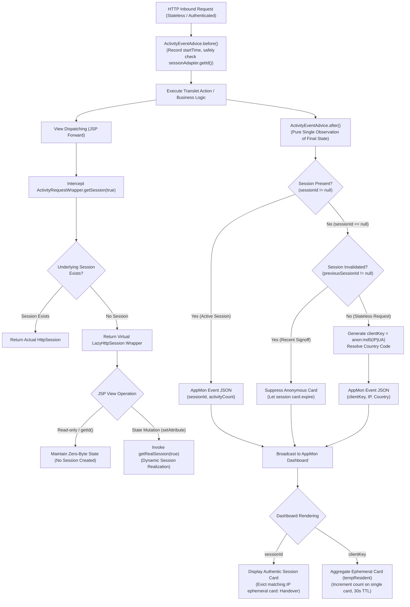


**Case Study (Part 2):** This document is the second follow-up case study to [Preventing Session Creation Storms and Architecting Redis Session Store Resilience Under Massive Stateless Traffic](/en/blog/2026-11-20-session-storm-prevention-and-redis-resilience). Although remote Redis write bottlenecks were mitigated in Part 1, JVM heap profiling revealed that session objects were still being minted on every stateless request. This post shares the complete journey of tracing the root causes: eliminating state-mutating side effects from `SessionAdapter.getId()`, overcoming the rigid constraints of the standard Servlet/JSP specification via a transparent `LazyHttpSession` lazy evaluation architecture, and establishing a zero-leak stateless observability pipeline with automated dashboard handover.



When architecting high-performance distributed web services, one of the most formidable engineering challenges is **how to cleanly and thoroughly isolate massive volumes of stateless HTTP requests that require no session state**. When web search crawlers, L7 health-check probes, and anonymous first-time visitors bombard an application with traffic, the backend must avoid allocating even a single byte of session state in memory or remote datastores. Only then can constrained computing resources be dedicated entirely to genuine business transactions.

In the initial architectural mitigation (Part 1), Aspectran eliminated Redis synchronous I/O bottlenecks by suppressing attribute writes for unauthenticated first visits (`isNew() == true`) and introducing Dual-Scoring index throttling, successfully resolving 100% CPU spikes and Lettuce command timeouts. However, deeper scrutiny of real-world production traffic uncovered a insidious **secondary session leak: while Redis writes were gone, the application server continued allocating brand-new session objects in the JVM heap for every stateless request and issuing `Set-Cookie: JSESSIONID=...` response headers to clients.**

This post examines the root causes of this secondary leak, details the purification of `SessionAdapter` to restore object-oriented Command-Query Separation (CQS), presents a zero-touch **Lazy Session Evaluation** mechanism that overcomes decades-old JSP specification constraints without altering template code, and introduces a deterministic client-fingerprinting scheme for real-time dashboard observability.
<!--more-->

## 1. Limitations of the Initial Mitigation and Identification of the Secondary Issue

### 1.1 Sequence of Events: Redis I/O Was Tamed, but Why Were Session Objects Still Being Created?
The primary goal of the initial optimization ([Preventing Session Creation Storms and Architecting Redis Session Store Resilience](/en/blog/2026-11-20-session-storm-prevention-and-redis-resilience)) was relieving pressure on the central Redis store:
1. `ActivityEventCounter` skipped `USER_ACTIVITY_COUNT` attribute writes for brand-new sessions (`isNew() == true`), blocking premature Redis `c.set()` executions.
2. `AbstractLettuceSessionStore` employed Dual-Scoring to throttle sorted set (`ZADD`) expiration indexing to 60-second intervals.
3. Nginx Rate Limiting established a defensive perimeter against volumetric bot spikes.

These measures successfully extinguished CPU saturation and command timeouts. Redis write operations dropped by over 98%.

However, sustained load testing and bot monitoring revealed a lingering anomaly. **Outbound HTTP responses continued delivering freshly minted `Set-Cookie: JSESSIONID=...` headers on every stateless request, and the Undertow session manager was continuously allocating tens of thousands of short-lived `TowSession` instances on the JVM heap.**

While Redis I/O had been eliminated, the application server itself was still operating as an unconstrained session factory for stateless traffic.

### 1.2 Monitoring Log Analysis: The Epicenters of Forced Session Creation
Debugging the session allocation stack trace identified two primary epicenters responsible for triggering session creation:

The first epicenter resided in AppMon's monitoring interceptor, [ActivityEventAdvice.java](https://github.com/aspectran/aspectow/blob/main/appmon/src/main/java/com/aspectran/aspectow/appmon/engine/exporter/event/activity/ActivityEventAdvice.java):

```java
// Legacy ActivityEventAdvice.java (Before Refactoring)
public void before(@NonNull Activity activity) {
    startTime = System.currentTimeMillis();

    // Since the servlet container does not allow session creation after
    // the response is committed, the session ID must be secured in advance.
    if (activity.hasSessionAdapter()) {
        sessionId = activity.getSessionAdapter().getId(); // <- The Epicenter!
    }
}
```

The second epicenter was located in the view rendering layer of JSP-based applications (e.g., JPetStore). Even when backend business logic (Translet actions) executed purely read-only, stateless catalog queries, dispatching to a JSP view caused the servlet container to forcibly mint a new session instance.

### 1.3 Three Structural Dimensions of the Problem
Thorough analysis revealed three structural dimensions contributing to the issue:
1. **Framework Core (`SessionAdapter`)**: A simple identifier getter (`getId()`) caused **state-mutating side effects** by creating a session whenever one did not exist.
2. **View Layer (`Servlet / JSP Specification`)**: The default `<%@ page session="true" %>` directive in the standard Jakarta Servlet/JSP specification created a **premature session creation dilemma**.
3. **Observability Dashboard (`AppMon Dashboard`)**: The monitoring UI lacked an identity and **session handover mechanism** to visualize stateless visitors without allocating server-side sessions.

## 2. Root Cause Analysis 1: Getter Side Effects in `SessionAdapter` and the Lifecycle Dilemma

### 2.1 The Legacy of Past Design Philosophy and Violation of Object-Oriented Principles
When Aspectran was initially designed, [SessionAdapter.java](https://github.com/aspectran/aspectran/blob/master/core/src/main/java/com/aspectran/core/adapter/SessionAdapter.java) implemented `getId()` under the following premise:

> *"If `getId()` is invoked within the current request context, the caller needs a valid session identifier; therefore, if no session exists yet, one must be created immediately to guarantee a non-null ID."*

In accordance with this view, `SessionAdapter` implementations delegated to `getSession(true).getId()`.

However, this design violated **Command-Query Separation (CQS)**:
* In clean object-oriented architecture, a getter method must be an idempotent, read-only query that leaves system state intact.
* In contrast, `getId()` invoked `getSession(true)`, issuing session cookies, registering records in the session manager, and potentially triggering persistence stores—mutating system state on a simple read.
* This flaw cascaded into metadata getters: in [TowSessionAdapter.java](https://github.com/aspectran/aspectran/blob/master/with-undertow/src/main/java/com/aspectran/undertow/adapter/TowSessionAdapter.java) and [HttpSessionAdapter.java](https://github.com/aspectran/aspectran/blob/master/web-servlet/src/main/java/com/aspectran/web/servlet/adapter/HttpSessionAdapter.java), methods such as `getCreationTime()` and `getLastAccessedTime()` also called `getSession(true)`. Inquiring about a session's creation timestamp unexpectedly forced a session into existence.

### 2.2 The Inherent Lifecycle Dilemma of the `before()` Phase
`ActivityEventAdvice` attempted to secure the session in `before()` due to standard servlet container constraints:

```
[Client HTTP Request]
         │
         ▼
┌──────────────────┐
│ before()         │ ──> (Dilemma 1) Unknown whether client is a bot or an authentic user
└────────┬─────────┘
         ▼
┌──────────────────┐
│ Translet Action  │ ──> Business logic executes; creates session if needed (e.g., login)
└────────┬─────────┘
         ▼
┌──────────────────┐
│ View / Commit    │ ──> (Dilemma 2) HTTP headers committed! Creating new session here fails
└────────┬─────────┘
         ▼
┌──────────────────┐
│ after()          │ ──> Eager pre-acquisition was previously used to avoid post-commit failures
└──────────────────┘
```

1. **Dual Nature of Cookie-Less Inbound Requests**:
   * A first-time human visitor arrives without session cookies.
   * Conversely, stateless web scrapers, automated security scanners, and health probes also arrive without cookies.
2. **Indeterminacy at the `before()` Phase**:
   * A human user's session is created during business logic execution (action methods, authentication, cart additions).
   * At the initial `before()` interceptor phase, **it is physically impossible to determine whether the incoming request will eventually establish session state or terminate statelessly.**
3. **Flawed Pre-Acquisition Strategy**:
   * Because creating a new session after HTTP response headers are committed throws an `IllegalStateException`, legacy code attempted to defensively acquire the ID in `before()`. Combined with `getId()`'s side effects, this forced session creation across 100% of stateless requests.

## 3. Root Cause Analysis 2: Premature Session Creation by Standard Servlet/JSP Specifications

Even when backend actions remained strictly stateless, forwarding to the view layer triggered another session creation vector.

### 3.1 Implicit Session Binding in the JSP Specification (`session="true"`)
According to the Jakarta Servlet and JSP specifications, all JSP pages default to `<%@ page session="true" %>` unless explicitly overridden.

JSP translation engines (such as Apache Jasper) automatically generate bytecode to bind the implicit `session` variable at the beginning of the compiled service method:

```java
// Bytecode generated by JSP servlet compilers (_jspService)
HttpSession session = null;
...
session = request.getSession(true); // <- Container-level forced session creation!
```

Consequently, even for read-only catalog browsing where the Translet action creates no session, dispatching via `RequestDispatcher.forward()` causes the servlet container to allocate an `HttpSession` and emit `Set-Cookie: JSESSIONID=...`.

### 3.2 The Critical Pitfall and Structural Dilemma of `<%@ page session="false" %>`
One might suggest adding `<%@ page session="false" %>` across all JSP templates. However, in dynamic enterprise applications, this approach is unviable:

1. **Complete Removal of the Implicit `session` Reference**:
   * Under `session="false"`, the compiler omits the `session` variable declaration entirely.
2. **Breakdown of Dynamic Session Utilization**:
   * If a user logs in during the action phase, causing Java business logic to legitimately create a session via `getSession(true)`, the forwarded JSP with `session="false"` cannot reference that session. Any scriptlet or EL expression evaluating `${sessionScope.user}` results in compilation errors (`session cannot be resolved to a variable`) or runtime failures.
3. **Impossibility of Conditional Binding**:
   * Standard JSP directives cannot express the requirement: **"Reference the session if it exists; do not create one if it does not."**

### 3.3 Discrepancies Across Template Engines
Modern template engines like Thymeleaf (used in PetClinic) do not forcibly bind an implicit session object, allowing seamless stateless processing. In contrast, legacy applications relying on JSP (such as JPetStore) were bound to `<%@ page session="true" %>`. Without an interception layer at the framework level, true stateless execution remained impossible for JSP views.

## 4. Root Cause Analysis 3: Stateless Monitoring Limitations in AppMon Dashboard

Suppressing server-side sessions for stateless traffic introduced challenges for real-time visualization in AppMon:

1. **Dashboard Meltdown via Random Ephemeral IDs**:
   * Assigning arbitrary UUIDs or temporary session tokens to stateless requests flooded the dashboard. When a crawler scanned hundreds of URLs, hundreds of ephemeral cards crowded the UI, degrading browser DOM performance.
2. **Coexistence of Ephemeral and Authentic Cards**:
   * When an anonymous visitor navigated statelessly and subsequently logged in, the UI retained both the ephemeral card and the newly minted authentic session card, distorting real-time metrics.
3. **Reconciling Observability with Zero Server-Side Footprint**:
   * The monitoring subsystem needed a mechanism to track stateless bot activity on the dashboard without maintaining session state on the server.

## 5. Architectural Redesign: Multi-Layered Solutions for True Zero-Byte Sessions

To address these interconnected challenges, Aspectran introduced a multi-layered architecture spanning core adapters, servlet wrappers, monitoring interceptors, and dashboard frontends.



### 5.1 Purifying `SessionAdapter` as a Stateless Getter and Introducing `getId(boolean create)`

First, core framework semantics were corrected. `getId()` was refactored into a pure query that returns `null` when no session exists, eliminating state mutation.

[SessionAdapter.java](https://github.com/aspectran/aspectran/blob/master/core/src/main/java/com/aspectran/core/adapter/SessionAdapter.java#L57-L75):
```java
public interface SessionAdapter {

    /**
     * Returns the unique identifier assigned to this session.
     * Unlike earlier versions, this method does NOT create a new session
     * if one does not already exist, returning {@code null} instead.
     * To ensure a session is created if absent, use {@link #getId(boolean)}
     * with {@code true}.
     * @return the session ID, or {@code null} if no session exists
     */
    String getId();

    /**
     * Returns the unique identifier assigned to this session.
     * @param create {@code true} to create a new session if one does not exist;
     *               {@code false} to return {@code null} if there is no current session
     * @return the session ID, or {@code null} if {@code create} is false and no session exists
     */
    default String getId(boolean create) {
        return (create || isValid() ? getId() : null);
    }

    ...
}
```

All adapter implementations ([TowSessionAdapter.java](https://github.com/aspectran/aspectran/blob/master/with-undertow/src/main/java/com/aspectran/undertow/adapter/TowSessionAdapter.java), [HttpSessionAdapter.java](https://github.com/aspectran/aspectran/blob/master/web-servlet/src/main/java/com/aspectran/web/servlet/adapter/HttpSessionAdapter.java), [SessionAgent.java](https://github.com/aspectran/aspectran/blob/master/core/src/main/java/com/aspectran/core/component/session/SessionAgent.java), [NettySessionAdapter.java](https://github.com/aspectran/aspectran/blob/master/with-netty/src/main/java/com/aspectran/netty/adapter/NettySessionAdapter.java)) were updated to derive from `getSession(false)`:

```java
@Override
public String getId() {
    return getId(false);
}

@Override
public String getId(boolean create) {
    Session session = getSession(create);
    return (session != null ? session.getId() : null);
}

@Override
public long getCreationTime() {
    Session session = getSession(false);
    return (session != null ? session.getCreationTime() : 0L);
}

@Override
public long getLastAccessedTime() {
    Session session = getSession(false);
    return (session != null ? session.getLastAccessedTime() : 0L);
}

@Override
public int getMaxInactiveInterval() {
    Session session = getSession(false);
    return (session != null ? session.getMaxInactiveInterval() : 0);
}
```

Calls to `getId()` and metadata getters on stateless requests now safely return `null` or `0L` without instantiating session objects.

### 5.2 Paradigm Shift in AppMon: From "Eager Pre-Acquisition" to "Pure Single Observation" Post-Execution

With `getId()` purified, AppMon's monitoring strategy shifted from eager pre-allocation to **observing final session state in `after()` via a single inspection (Pure Single Observation)** once business logic concludes.

[ActivityEventAdvice.java](https://github.com/aspectran/aspectow/blob/main/appmon/src/main/java/com/aspectran/aspectow/appmon/engine/exporter/event/activity/ActivityEventAdvice.java):
```java
public void before(@NonNull Activity activity) {
    startTime = System.currentTimeMillis();
    // Returns null if absent; 0% chance of session creation
    if (activity.hasSessionAdapter()) {
        previousSessionId = activity.getSessionAdapter().getId();
    }
}

public String after(@NonNull Activity activity) {
    long elapsedTime = System.currentTimeMillis() - startTime;

    String sessionId = null;
    int activityCount = 0;
    String clientKey = null;
    String ipAddress = null;
    String countryCode = null;

    if (activity.hasSessionAdapter()) {
        SessionAdapter sessionAdapter = activity.getSessionAdapter();
        // Inspect session created during business execution via getSession(false)
        sessionId = sessionAdapter.getId();
        if (sessionId != null) {
            if (sessionAdapter.isNew()) {
                activityCount = 1;
            } else {
                AtomicInteger counter = sessionAdapter.getAttribute(USER_ACTIVITY_COUNT);
                if (counter != null) {
                    activityCount = counter.get();
                }
            }
        }
    }

    // Detect session invalidation (e.g., logout during action execution)
    boolean sessionTerminated = (sessionId == null && previousSessionId != null);

    // Generate deterministic ephemeral key only for pure stateless requests
    if (sessionId == null && !sessionTerminated && activity.hasTranslet()) {
        Translet translet = activity.getTranslet();
        RequestAdapter requestAdapter = translet.getRequestAdapter();
        ipAddress = WebUtils.getRemoteAddr(translet);
        if (StringUtils.hasLength(ipAddress)) {
            String userAgent = (requestAdapter != null ? requestAdapter.getHeader("User-Agent") : null);
            String raw = ipAddress + "|" + (userAgent != null ? userAgent : "");
            clientKey = "anon:" + DigestUtils.md5DigestAsHex(raw).substring(0, 12);
            IPCountryResolver ipCountryResolver = activityEventReader.getIpCountryResolver();
            if (ipCountryResolver != null) {
                Locale locale = (requestAdapter != null ? requestAdapter.getLocale() : null);
                countryCode = ipCountryResolver.resolveCountryCode(ipAddress, locale);
            }
        }
    }
    ...
}
```

* **Servlet Specification Safety**: Creating a session after response commitment throws an exception; however, reading an existing session via `getSession(false)` is safe and standardized across servlet containers.
* **Session Invalidation Detection**: If a session existed in `before()` but is absent in `after()` (`sessionTerminated = true`), an explicit logout occurred. The system suppresses generation of an `anon:...` card, allowing the session card to expire cleanly.

### 5.3 `ActivityRequestWrapper` and `LazyHttpSession`: Lazy Session Evaluation in the JSP View Layer

To address premature session creation induced by `<%@ page session="true" %>` without modifying JSP source files, Aspectran introduced **Lazy Session Evaluation** to the servlet layer.

[ActivityRequestWrapper.java](https://github.com/aspectran/aspectran/blob/master/web-servlet/src/main/java/com/aspectran/web/servlet/activity/ActivityRequestWrapper.java#L51-L74):
```java
public class ActivityRequestWrapper extends HttpServletRequestWrapper {

    private HttpSession lazySession;

    @Override
    public HttpSession getSession() {
        return getSession(true);
    }

    @Override
    public HttpSession getSession(boolean create) {
        if (!create) {
            return super.getSession(false);
        }
        HttpSession session = super.getSession(false);
        if (session != null) {
            return session;
        }
        // Defer physical container session creation; return virtual lazy wrapper!
        if (lazySession == null) {
            lazySession = new LazyHttpSession(this);
        }
        return lazySession;
    }

    HttpSession getRealSession(boolean create) {
        return super.getSession(create);
    }
}
```

The underlying [LazyHttpSession.java](https://github.com/aspectran/aspectran/blob/master/web-servlet/src/main/java/com/aspectran/web/servlet/activity/LazyHttpSession.java) implements `jakarta.servlet.http.HttpSession` and segregates behavior based on invocation semantics:

```java
public class LazyHttpSession implements HttpSession {

    private static final String JSTL_PREFIX = "jakarta.servlet.jsp.jstl.";

    private final ActivityRequestWrapper wrapper;

    @Nullable
    private HttpSession getSession(boolean create) {
        return wrapper.getRealSession(create);
    }

    // [1. Pure Read Operations] Never creates a container session!
    @Override
    public String getId() {
        HttpSession session = getSession(false);
        return (session != null ? session.getId() : null);
    }

    @Override
    public Object getAttribute(String name) {
        HttpSession session = getSession(false);
        return (session != null ? session.getAttribute(name) : null);
    }

    @Override
    public Enumeration<String> getAttributeNames() {
        HttpSession session = getSession(false);
        return (session != null ? session.getAttributeNames() : Collections.emptyEnumeration());
    }

    @Override
    public boolean isNew() {
        return false;
    }

    // [2. Invalidation Operations] Safe No-ops if session does not exist
    @Override
    public void removeAttribute(String name) {
        HttpSession session = getSession(false);
        if (session != null) {
            session.removeAttribute(name);
        }
    }

    @Override
    public void invalidate() {
        HttpSession session = getSession(false);
        if (session != null) {
            session.invalidate();
        }
    }

    // [3. State-Mutating Operations] Materialize the actual container session!
    @Override
    public void setAttribute(String name, Object value) {
        if (value != null) {
            // When JSTL fmt tags attempt to cache response charset or locale settings,
            // ignore them if no underlying session exists yet to prevent premature creation
            if (name != null && name.startsWith(JSTL_PREFIX) && getSession(false) == null) {
                return;
            }
            // Trigger actual container session creation and set-cookie header emission
            HttpSession session = getSession(true);
            if (session != null) {
                session.setAttribute(name, value);
            }
        } else {
            removeAttribute(name);
        }
    }
}
```

#### An Unexpected Pitfall in Practice: Defending Against Implicit JSTL `<fmt:>` Session Caching
During initial design, it was expected that read-only views would never invoke `setAttribute()`. However, practical testing with JPetStore's product details view (`Product.jsp`) exposed an unexpected pitfall: employing the standard **`<fmt:formatNumber>` tag inadvertently triggered session creation**:

* **A Legacy Artifact from JSTL 1.0**: Standard JSTL implementations (`SetLocaleSupport`) were originally designed to automatically cache the response character encoding into an `HttpSession` attribute (`jakarta.servlet.jsp.jstl.fmt.request.charset`) whenever formatting tags (`<fmt:formatNumber>`, `<fmt:formatDate>`, `<fmt:setLocale>`) were executed, ensuring future form submissions could synchronize character sets.
* **Forced Premature Realization**: Under standard JSP behavior, `pageContext.getSession() != null` evaluated to true due to `LazyHttpSession`, causing JSTL to invoke `setAttribute("jakarta.servlet.jsp.jstl.fmt.request.charset", "UTF-8")`. `LazyHttpSession` initially interpreted this as an authentic state-changing write, immediately realizing a container session.
* **Seamless Namespace Isolation**: Aspectran hardened `LazyHttpSession.setAttribute()` to intercept the `jakarta.servlet.jsp.jstl.` namespace. When no underlying session exists (`getSession(false) == null`), these framework-internal caching writes are safely treated as no-ops. Once an authentic session is established (e.g., following login), JSTL can write to it normally, maintaining 100% backward compatibility with the Jakarta JSTL specification.

This guarantees that JSP developers can freely employ standard JSTL formatting tags without risking premature session allocation, delivering true zero-byte stateless operations.

#### Advantages of the Lazy Session Architecture
1. **Zero-Touch Preservation of Existing JSP Templates**:
   * No modifications are required across application JSP files.
   * When JSPs render model data or evaluate expressions like `${sessionScope.user}`, `LazyHttpSession.getAttribute()` executes safely, preserving a 0-byte memory footprint.
2. **Seamless Dynamic Session Support**:
   * If an action creates a session (e.g., during login), `ActivityRequestWrapper` returns the authentic session instance, allowing the JSP to access session attributes.
   * If a JSP writes an attribute via `setAttribute()`, the wrapper promotes the virtual session to an authentic container session on demand.

### 5.4 Deterministic `clientKey` Ephemeral Resident Cards and Handover Mechanism in AppMon Dashboard

To visualize stateless activity without server-side storage overhead, the frontend and backend were unified through fingerprint-based aggregation.

1. **Deterministic `clientKey` Ephemeral Cards (`tempResident`)**:
   * For stateless traffic, the server generates `clientKey = "anon:" + md5(ipAddress + "|" + userAgent).substring(0, 12)`.
   * When `dashboard-viewer.js` receives an event with a `clientKey`:
     - If a matching card exists: It increments the activity counter and extends the 30-second TTL timer.
     - If no card exists: It renders a new card marked `tempResident: true` with `inactiveInterval: 30`.
   * **When a web crawler hits 1,000 pages, the dashboard renders a single card with its counter reaching 1,000, preventing UI degradation.**
2. **Automated Session Handover**:
   * When an anonymous visitor logs in and receives an authentic session, the dashboard intercepts the subsequent `session.created` event and removes any ephemeral card sharing the same IP (`data-user-key='i:${ipAddress}'`).
   * This handover mechanism prevents duplicate cards for the same visitor.
3. **Frontend DOM Traversal Optimization (`find` $\rightarrow$ `children`)**:
   * Deep recursive DOM queries (`find("li")`) across `dashboard-viewer.js` were replaced with shallow, scoped child lookups (`children("li")`), maintaining responsive UI rendering under high event throughput.

### 5.5 Cluster Architectures and Session Store `savePeriodSecs` Optimization Principles

Guidelines were established regarding the persistence synchronization interval (`savePeriodSecs`) across cluster typologies (Sticky vs. Non-Sticky).

#### 1) Distinct Roles of Session Stores
* **`FileSessionStore`**:
  * Serializes sessions to the local filesystem. Ideal for standalone deployments or **L4/L7 Sticky Session clusters**.
  * Enables rolling restarts without requiring external Redis infrastructure.
* **`LettuceSessionStore`**:
  * Utilizes Redis as a centralized distributed store. Required for **Non-Sticky clusters** or environments requiring automated high-availability failover.

#### 2) Rationale for Retaining the Defensive Global Default (`savePeriodSecs = 0`)
* **Why the Framework Default Remains `0`**:
  * The framework cannot infer load balancer routing topology at runtime.
  * Setting `savePeriodSecs > 0` by default in a Non-Sticky cluster could cause requests alternating between nodes to encounter stale timestamps or premature expiration.
  * **Retaining `savePeriodSecs = 0` (immediate flush upon request completion) serves as the safest defensive default to guarantee distributed data consistency.**
* **Environment-Specific Recommendations**:
  * **Standalone or Sticky Clusters (`FileSessionStore` / `LettuceSessionStore`)**: Configuring `savePeriodSecs: 60` to `180` is recommended. Pure reads update `lastAccessedTime` in local memory and skip redundant store writes, cutting I/O operations by over 95%.
  * **Non-Sticky Clusters (`LettuceSessionStore`)**: Retain the default `savePeriodSecs: 0` to preserve cross-node consistency.

## 6. Comprehensive Comparison and Empirical Validation Results

The following table summarizes the system characteristics before and after the secondary refactoring:

| Dimension | Post-Part 1 Mitigation (AS-IS) | Architectural Completion (TO-BE) | Tangible Impact |
| :--- | :--- | :--- | :--- |
| **`SessionAdapter.getId()`** | Forced creation via `getSession(true)` if absent | Returns `null` if absent (`getSession(false)`) | **Getter side effects eliminated** |
| **Metadata Queries (`getCreationTime`)** | Forced session creation via `getSession(true)` | Derived via `getSession(false)`, returns `0L` if absent | **Zero risk of session creation on reads** |
| **AppMon Interception Timing** | Eager pre-acquisition in `before()` | Pure single observation in `after()` | **Aligned with Servlet commit lifecycle** |
| **JSP View Dispatching (JPetStore)** | Premature creation via `<%@ page session="true" %>` | Intercepted via `LazyHttpSession` | **Zero-byte footprint without altering JSPs** |
| **Stateless Bot Server Footprint** | Continuous allocation/expiry in JVM heap | **0 Bytes allocated** in heap and remote store | **True statelessness achieved** |
| **Dashboard Bot Monitoring** | Unbounded card proliferation on random IDs | Aggregated onto single card via `clientKey` | **Bot traffic consolidated; DOM load reduced** |
| **User Authentication Transition** | Ephemeral and authentic cards coexisted | Ephemeral card evicted upon authentic session creation | **Seamless session handover** |
| **Dashboard DOM Performance** | Broad recursive `find()` queries | Scoped direct `children()` traversal | **Smooth UI rendering under heavy load** |

### Empirical Validation Results
1. **JPetStore (JSP-Based View) Verification**:
   * Under bot traffic loads, outbound `Set-Cookie: JSESSIONID` headers were eliminated. Undertow active session metrics and Redis keys remained **at zero**.
   * Upon authentication or adding items to the shopping cart, `LazyHttpSession` materialized into an authentic session, issuing cookies as expected.
2. **AppMon Dashboard Verification**:
   * Repeated crawler requests mapped to a single ephemeral card displaying client IP and geolocation flags, updating activity counters smoothly before expiring cleanly after 30 seconds of inactivity.
   * When an anonymous user authenticated, their temporary card was cleared and replaced by an authentic session card.

## 7. Concluding Remarks: Authentic Framework Resilience and Architectural Purity

This secondary refactoring went beyond addressing a defect; it re-examined core design assumptions and standard specification behaviors to improve architecture:

1. **Restoration of Command-Query Separation (CQS)**: Re-established the principle that query methods must never modify system state.
2. **The Utility of Lazy Evaluation**: Overcame longstanding JSP specification constraints (`<%@ page session="true" %>`) through transparent proxying via `LazyHttpSession`, avoiding changes to existing template files.
3. **Backend and Frontend Synergy**: Achieved zero server-side state allocation for stateless requests while maintaining real-time dashboard visibility through fingerprinting and automated handover mechanisms.

Through these improvements, Aspectran maintains resilience and resource efficiency under heavy stateless traffic, ensuring high-availability session management even in resource-constrained cloud environments.
