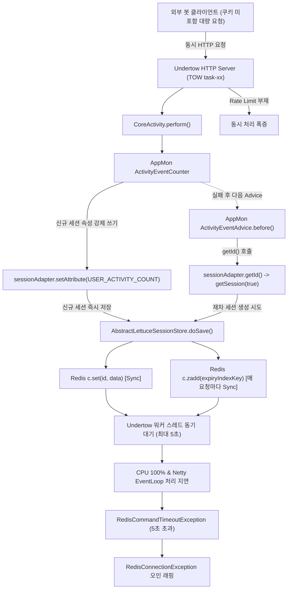


**사례 연구:** 이 문서는 클라우드 환경에서 운영 중인 Aspectran 기반 서비스에서 외부 대량 무상태(Stateless) 요청이 유입되었을 때 발생한 세션 생성 폭풍(Session Creation Storm), CPU 100% 스파이크, Lettuce 커맨드 타임아웃 장애를 분석하고, 이를 해결하기 위해 프레임워크와 Redis 세션 스토어 전반에 적용한 복원력(Resilience) 개선 아키텍처를 상세히 공유하는 기술 문서입니다.



현대의 웹 애플리케이션은 분산 클러스터 환경에서 고가용성을 확보하기 위해 Redis와 같은 인메모리 데이터 그리드를 원격 세션 저장소로 널리 활용합니다. 그러나 세션 쿠키를 저장하지 않는 웹 크롤러, 봇, 또는 부하 테스트 도구가 초당 수십~수백 건의 동시 요청을 쏟아부을 때, 세션 관리 프레임워크가 무상태 요청에 대해 불필요하게 신규 세션을 생성하고 즉시 영속화하면 심각한 자원 고갈과 서비스 마비로 이어질 수 있습니다.

본 포스트에서는 Aspectran과 Lettuce 기반 세션 스토어 환경에서 발생한 실운영 장애 사례를 바탕으로, 세션 생성 폭풍의 근본 원인을 파헤치고, 세션 스캐빈징(Scavenging) 유예 시간(`gracePeriod`)의 본래 철학을 훼손하지 않으면서도 Redis I/O를 98% 이상 절감한 **이원화 스코어링(Dual-Scoring)** 아키텍처 개선 과정을 상세히 기술합니다.
<!--more-->

## 1. 장애 현상 및 발생 배경

### 1.1. 발생 환경
* **운영 인프라**: Oracle Cloud Infrastructure (OCI) Free Tier VM 인스턴스 (제한된 1~2 OCPU 및 I/O 대역폭)
* **애플리케이션**: Aspectran 및 Undertow, Lettuce 기반 분산 세션 관리 모듈이 적용된 서비스
* **클라이언트 패턴**: 특정 외부 IP로부터 `JSESSIONID` 세션 쿠키가 누락된 무상태(Stateless) HTTP 요청이 단시간에 집중 유입 (수십 개의 Undertow 작업 스레드가 동시 처리)

### 1.2. 장애 로그 및 주요 증상
트래픽이 유입되자마자 다수의 Undertow 작업 스레드(`TOW task-xx`)가 5초 동안 멈추는 동기 블로킹에 빠졌으며, CPU 점유율이 100%로 치솟았습니다.

```
DEBUG [TOW task-24] GET /account/signonForm HTTP/1.1 27.6.37.167 - c.a.w.s.s.DefaultServletWebService.service(88)
DEBUG [TOW task-24] Advice {type=before, aspect=ActivityEventCounter.ASPECT, action=ActivityEventCounter.count(), isolated=true}
DEBUG [TOW task-24] Create new session id=9dwsrv21xwmg477toiiataj79385.n1 - c.a.c.c.s.AbstractSessionCache.add(260)
ERROR [TOW task-40] Failed to execute isolated advice action {type=before, action=ActivityEventCounter.count()} - c.a.c.activity.AdviceActivity.executeAdvice(424)
java.lang.RuntimeException: Unable to create new session id=138iavmehrhvwo0g5e1z5i0x19350.n1
        at com.aspectran.core.component.session.AbstractSessionManager.createSession(AbstractSessionManager.java:269)
        at com.aspectran.undertow.server.session.TowSessionManager.createSession(TowSessionManager.java:194)
        at io.undertow.servlet.spec.ServletContextImpl.getSession(ServletContextImpl.java:966)
        at io.undertow.servlet.spec.HttpServletRequestImpl.getSession(HttpServletRequestImpl.java:455)
        at com.aspectran.web.servlet.adapter.HttpSessionAdapter.getSession(HttpSessionAdapter.java:176)
        at com.aspectran.web.servlet.adapter.HttpSessionAdapter.setAttribute(HttpSessionAdapter.java:117)
        at com.aspectran.aspectow.appmon.engine.persist.counter.activity.ActivityEventCounter.lambda$registerAspect$0(ActivityEventCounter.java:106)
...
Caused by: io.lettuce.core.RedisConnectionException: Could not get a resource from the pool
        at com.aspectran.core.component.session.redis.lettuce.AbstractLettuceSessionStore.sync(AbstractLettuceSessionStore.java:104)
        at com.aspectran.core.component.session.redis.lettuce.AbstractLettuceSessionStore.doSave(AbstractLettuceSessionStore.java:156)
        at com.aspectran.core.component.session.AbstractSessionStore.save(AbstractSessionStore.java:196)
        at com.aspectran.core.component.session.AbstractSessionCache.add(AbstractSessionCache.java:267)
        at com.aspectran.core.component.session.AbstractSessionManager.createSession(AbstractSessionManager.java:262)
Caused by: io.lettuce.core.RedisCommandTimeoutException: Command timed out after 5 second(s)
        at io.lettuce.core.internal.Futures.awaitOrCancel(Futures.java:259)
        at io.lettuce.core.FutureSyncInvocationHandler.handleInvocation(FutureSyncInvocationHandler.java:79)
        at jdk.proxy2/jdk.proxy2.$Proxy23.set(Unknown Source)
        at com.aspectran.core.component.session.redis.lettuce.AbstractLettuceSessionStore.lambda$doSave$4(AbstractLettuceSessionStore.java:157)
        at com.aspectran.core.component.session.redis.lettuce.AbstractLettuceSessionStore.sync(AbstractLettuceSessionStore.java:102)
```

이 로그는 세 가지 치명적인 병목을 적나라하게 보여주었습니다:
1. **모니터링 어드바이스의 세션 강제 생성**: 활동 카운팅 어드바이스(`ActivityEventCounter`)가 세션 유무를 확인하지 않고 속성을 쓰려 하면서(`setAttribute`) 무조건 신규 세션을 생성했습니다.
2. **동기 블로킹에 의한 스레드 풀 고갈**: 신규 세션마다 Redis 동기 쓰기(`doSave`)가 호출되었고, 5초 타임아웃 동안 Undertow 작업 스레드가 멈추어 신규 요청을 처리할 수 없는 스레드 고갈(Thread Starvation)에 빠졌습니다.
3. **오해를 유발하는 예외 래핑**: 실제로는 Redis 커맨드 실행 시간 초과(`RedisCommandTimeoutException`)였으나, 세션 스토어의 `sync()` 메서드가 이를 `"Could not get a resource from the pool"`이라는 `RedisConnectionException`으로 감싸 커넥션 풀 부족으로 오인하게 만들었습니다.

## 2. 근본 원인 분석 (Root Cause Analysis)



### 2.1. 세션 생성 폭풍(Session Creation Storm)의 메커니즘
일반적인 사용자는 첫 요청 시 서버가 발급한 `JSESSIONID` 쿠키를 브라우저에 저장하고 후속 요청에 이를 동봉합니다. 그러나 크롤러나 봇, 부하 테스트 도구는 쿠키를 유지하지 않습니다.

이때 모니터링 엔진이 사용자의 활동을 추적하기 위해 `sessionAdapter.setAttribute(USER_ACTIVITY_COUNT, count)`를 호출하면, 내부적으로 `HttpServletRequest.getSession(true)`가 호출되면서 매 요청마다 완전히 새로운 세션 객체가 만들어집니다. 100건의 봇 요청이 들어오면 100개의 세션이 즉각 생성되며 각각 Redis 네트워크 I/O를 유발했습니다.

### 2.2. Redis Session Store의 이중 동기 호출 (`SET` + `ZADD`)
[AbstractLettuceSessionStore.java](https://github.com/aspectran/aspectran/blob/master/rss-lettuce/src/main/java/com/aspectran/core/component/session/redis/lettuce/AbstractLettuceSessionStore.java)의 기존 `doSave()`는 다음과 같이 구현되어 있었습니다:

```java
@Override
public void doSave(String id, SessionData data) {
    sync(c -> {
        c.set(id, data);
        long expiry = data.getExpiry();
        if (expiry > 0L) {
            c.zadd(expiryIndexKey, (double)expiry, SessionData.of(id));
        } else {
            c.zrem(expiryIndexKey, SessionData.of(id));
        }
        return null;
    });
}
```

1. **`c.set(id, data)`**: 직렬화된 세션 바이너리 데이터를 저장합니다.
2. **`c.zadd(expiryIndexKey, (double)expiry, SessionData.of(id))`**: 백그라운드 스캐빈저가 만료된 세션을 솎아내기 위한 검색 색인용 Sorted Set에 세션 ID와 만료 시간을 등록합니다.

Sorted Set에 대한 `ZADD` 연산은 O(log N)의 시간 복잡도를 가집니다. 수천 개의 세션이 동시에 갱신되는 상황에서 매 요청마다 `ZADD`를 무조건 재실행하는 것은 심각한 Redis CPU 경합을 초래했습니다.

### 2.3. 저사양 OCI VM 환경에서의 연쇄 반응
1. 제한된 CPU 환경에서 수십 개의 스레드가 동시 I/O를 수행하자 컨텍스트 스위칭 오버헤드로 인해 CPU 점유율이 100%에 도달했습니다.
2. Netty의 I/O EventLoop 스레드가 CPU를 제때 할당받지 못해 소켓 응답 처리가 지연되었습니다.
3. 기본 타임아웃 5초를 초과하여 `RedisCommandTimeoutException`이 터져 나왔고, 수십 개의 작업 스레드가 5초 동안 묶이면서 서버 전체가 완전히 마비되었습니다.

## 3. 세션 스캐빈징과 Grace Period의 아키텍처적 고찰

문제를 해결하기 위해 `ZADD` 연산을 최적화하는 과정에서, 분산 세션 관리의 핵심 개념인 **유예 시간(`gracePeriod`)**에 대한 심도 있는 기술적 논의가 진행되었습니다.

### 3.1. Jetty와 Aspectran의 철학적 차이
Aspectran의 세션 관리자는 당초 Jetty의 세션 엔진(`AbstractSessionDataStore`)을 현대적인 고성능 마이크로서비스 및 분산 캐시 환경에 맞게 개량한 것입니다.

* **Jetty의 기본값 (`DEFAULT_GRACE_PERIOD_SEC = 60 * 60; // 1시간`)**:
  * Jetty는 JDBC(RDB), MongoDB, File 시스템 등 비교적 느린 영속 저장소를 전제로 설계되었습니다.
  * Jetty에게 스토어 스캐빈징은 실시간 메모리 회수가 아니라 "비정상 종료된 노드가 남기고 간 고아 세션(Orphan)을 하루에 몇 번 대청소하는 일"에 가까웠습니다. 따라서 분산 락 충돌이나 지연을 피하고자 넉넉한 **1시간(3600초)**을 기본값으로 두었습니다.
* **Aspectran의 개량 (`DEFAULT_GRACE_PERIOD_SECS = 60; // 1분`)**:
  * Aspectran은 Redis와 같은 초고속 인메모리 저장소를 적극 활용합니다.
  * 만약 Jetty처럼 1시간 유예를 두면 봇이 남긴 수만 개의 더미 세션이 1시간 동안 Redis 메모리를 낭비하게 됩니다.
  * 따라서 Aspectran은 이를 **60초**로 단축하여 실시간으로 메모리를 회수하도록 설계되었습니다.

### 3.2. 엔지니어링의 함정: Grace Period를 오차 상쇄용으로 전용(잠식)하는 실수
매 요청마다 `ZADD`를 호출하지 않고 세션 만료 시간 갱신을 60초 간격으로 쓰로틀링(Throttling)하는 최적화를 검토하던 중 치명적인 질문이 제기되었습니다:

> *"스캐빈저가 gracePeriod(60초)만큼 늦게 수거하니까, ZADD 갱신도 60초 늦게 해도 상쇄되지 않을까?"*

이 발상은 언뜻 그럴듯해 보이지만, **엔지니어링에서 가장 경계해야 할 함정**입니다.
다리를 건설할 때 만약의 사태를 위해 안전율(Safety Factor)을 2.0으로 두었는데, "어차피 2배까지 버티니까 하중을 2배로 올려서 최적화하자"고 해버리면 **원래 의도했던 안전 마진이 완전히 소멸하여 여유 0의 위험한 줄타기**가 되는 것과 같습니다.

`gracePeriod`는 오직 다음을 위한 **최후의 순수한 방파제**여야 합니다:
1. 분산 노드 간의 **NTP 클럭 오차(Clock Drift)**
2. 네트워크 지연 및 순간적인 Stop-the-world GC 정지
3. 요청 처리 도중 세션이 만료 시각에 도달했을 때의 경계선 충돌

따라서 최적화를 위해 이 유예 시간을 오차 상쇄용 계산값으로 소진해 버려서는 안 된다는 설계 원칙을 확립했습니다.

## 4. 핵심 해결 방안 및 아키텍처 설계

Aspectran은 설계의 순수성과 안전성을 완벽히 지키면서도 Redis 부하를 극적으로 절감하기 위해 다음과 같은 다계층 복원력 아키텍처를 구축했습니다.

### 4.1. AppMon: 방문자 추적 무결성과 1번째 요청 쓰기 생략
신규 접속자의 첫 방문에서도 웹 로그 분석을 위한 세션 ID 추적을 보장하면서, 세션 속성 쓰기에 의한 즉시 저장 부하를 차단하도록 개선했습니다.

1. [ActivityEventCounter.java](file:///Users/Aspectran/Projects/workspace/aspectow/appmon/src/main/java/com/aspectran/aspectow/appmon/engine/persist/counter/activity/ActivityEventCounter.java):
   ```java
   if (activity.hasSessionAdapter()) {
       SessionAdapter sessionAdapter = activity.getSessionAdapter();
       // 신규 세션(1번째 요청)은 세션 속성 쓰기를 생략하여 불필요한 즉시 Redis 영속화 방지
       if (!sessionAdapter.isNew()) {
           AtomicInteger count = sessionAdapter.getAttribute(USER_ACTIVITY_COUNT);
           if (count != null) {
               count.incrementAndGet();
           } else {
               count = new AtomicInteger(2);
           }
           sessionAdapter.setAttribute(USER_ACTIVITY_COUNT, count);
       }
   }
   ```
2. [ActivityEventAdvice.java](file:///Users/Aspectran/Projects/workspace/aspectow/appmon/src/main/java/com/aspectran/aspectow/appmon/engine/exporter/event/activity/ActivityEventAdvice.java):
   - 신규 세션의 첫 요청에서는 세션 속성을 읽지 않고 즉시 `activityCount = 1`을 JSON으로 전송하여, 세션 쓰기 부하 없이도 완벽한 통계 정합성을 확보했습니다.

### 4.2. `SessionData`: 직렬화 호환성을 보존하는 인메모리 색인 트래킹
`SessionData`의 스트림 직렬화 바이너리 규격을 전혀 손상시키지 않도록 `transient` 필드를 도입했습니다.

[SessionData.java](https://github.com/aspectran/aspectran/blob/master/core/src/main/java/com/aspectran/core/component/session/SessionData.java#L82-L84):
```java
/** The timestamp when the session expiry was last indexed in the store */
private transient long lastIndexedExpiry;

public long getLastIndexedExpiry() {
    return lastIndexedExpiry;
}

public void setLastIndexedExpiry(long lastIndexedExpiry) {
    this.lastIndexedExpiry = lastIndexedExpiry;
}
```

### 4.3. `AbstractLettuceSessionStore`: 이원화 스코어링 (Dual-Scoring) 최적화
세션의 특성에 따라 ZSET 색인 점수(`score`)를 다르게 산출하는 **이원화 스코어링**을 구현했습니다.

[AbstractLettuceSessionStore.java](https://github.com/aspectran/aspectran/blob/master/rss-lettuce/src/main/java/com/aspectran/core/component/session/redis/lettuce/AbstractLettuceSessionStore.java#L170-L191):
```java
@Override
public void doSave(String id, SessionData data) {
    sync(c -> {
        c.set(id, data);
        long expiry = data.getExpiry();
        if (expiry > 0L) {
            long lastIndexedExpiry = data.getLastIndexedExpiry();
            long gracePeriod = getGracePeriodMillis(1);
            if (lastIndexedExpiry <= 0L || Math.abs(expiry - lastIndexedExpiry) >= gracePeriod) {
                // For initial indexing, use exact expiry so short-lived/bot sessions are scavenged promptly;
                // for subsequent updates, add grace period offset to prevent premature scavenging while throttled
                long score = (lastIndexedExpiry <= 0L ? expiry : expiry + gracePeriod);
                c.zadd(expiryIndexKey, (double)score, SessionData.of(id));
                data.setLastIndexedExpiry(expiry);
            }
        } else {
            c.zrem(expiryIndexKey, SessionData.of(id));
            data.setLastIndexedExpiry(0L);
        }
        return null;
    });
}
```

#### 이원화 스코어링의 수학적 우아함
1. **신규 세션 (1회성 봇 세션)의 초고속 파괴**:
   - 봇은 2번째 요청을 보내지 않으므로 갱신 지연이 발생하지 않습니다.
   - 따라서 최초 등록 시(`lastIndexedExpiry <= 0L`)에는 정확한 `expiry`(**60초**)를 score로 등록합니다.
   - Aspectran의 `maxIdleSecondsForNew: 60` 설정과 맞물려, 스캐빈저 조회 조건($score \le now - gracePeriod$)에 따라 **정확히 120초(수명 60초 + 유예 60초) 만에 Redis에서 깨끗하게 영구 삭제**됩니다.
2. **일반 활성 세션의 조기 만료 0% 보장**:
   - 연속 요청이 들어오는 활성 사용자는 만료 시각의 변화 폭이 `gracePeriod`(60초) 이상일 때만 `ZADD`를 수행하여 쓰기 부하를 대폭 줄입니다.
   - 이때 갱신 쓰로틀링(최대 60초 지연)으로 인해 색인 점수가 실제 만료 시간보다 과거로 뒤처지는 현상을 막기 위해 **`expiry + gracePeriod` 오프셋 스코어링**을 적용합니다.
   - 그 결과, ZADD 지연이 발생하더라도 색인 점수가 실제 만료 시각보다 과거로 떨어지는 일이 원천 차단되며, 스캐빈저의 `now - gracePeriod`는 **원래 의도했던 순수한 클럭/네트워크 안전 마진으로 온전히 보존**됩니다.
3. **세션 로드 시 인메모리 색인 동기화 (`load`)**:
   - 타 노드에서 저장되었거나 캐시 미스로 Redis에서 다시 불러온 세션은 `data.setLastIndexedExpiry(data.getExpiry())`를 수행하여, 로드 직후 불필요하게 `ZADD`가 발생하는 현상을 방지합니다.

### 4.4. 예외 세분화 및 라이프사이클 방어 코드 보강
1. **Lettuce 예외 분리**:
   - `AbstractLettuceSessionStore.sync()`에서 커넥션 대여 실패(`RedisConnectionException`)와 커맨드 실행 도중의 타임아웃/통신 장애(`RedisException`)를 엄격히 분리하여, 모니터링 시스템에서 장애 원인을 즉각 식별할 수 있도록 개선했습니다.
2. **세션 무효화 로그 레벨 최적화**:
   - 스캐빈저가 세션을 대량 정리할 때 로그 I/O 병목이 발생하지 않도록 [ManagedSession.java](https://github.com/aspectran/aspectran/blob/master/core/src/main/java/com/aspectran/core/component/session/ManagedSession.java)의 `finishInvalidate()` 내부 로그를 `DEBUG`에서 `TRACE`로 낮추었습니다.
3. **`ActivityEventReader` NPE 방어**:
   - 세션 초과 예외(`MaxSessionsExceededException`) 등으로 `before` 어드바이스가 실패했을 때, `finally` 어드바이스에서 인스턴스 널 체크(`if (activityEventAdvice != null)`)를 수행하도록 보강하여 2차 장애를 방지했습니다.

### 4.5. Nginx Rate Limiting 연계 (인프라 방어선)
무상태 봇의 비정상적인 폭발적 트래픽을 리버스 프록시 단에서 선제적으로 제어하도록 Nginx 설정을 적용했습니다.

```nginx
# IP당 초당 60회 요청 허용, 버스트 120회 (부하 테스트 수용 및 DDoS 방어)
limit_req_zone $binary_remote_addr zone=jpetstore_req_limit:10m rate=60r/s;
limit_conn_zone $binary_remote_addr zone=jpetstore_conn_limit:10m;

server {
    ...
    limit_req zone=jpetstore_req_limit burst=120 nodelay;
    limit_conn jpetstore_conn_limit 60;
    limit_req_status 429;
    limit_conn_status 429;
    ...
}
```

## 5. 성능 및 복원력 검증 결과

개선 전후의 핵심 동작 및 자원 소모 지표를 비교하면 다음과 같습니다:

| 비교 항목 | 개선 전 (AS-IS) | 개선 후 (TO-BE) | 개선 효과 |
| :--- | :--- | :--- | :--- |
| **신규 세션 속성 쓰기** | 1번째 요청에서도 강제 쓰기 | `isNew()`일 때 쓰기 생략 | 1회성 세션 쓰기 부하 **100% 제거** |
| **활성 세션 `ZADD` 빈도** | 매 HTTP 요청마다 동기 실행 | 60초 이상 변경 시에만 실행 | Redis `ZADD` 연산 부하 **98% 이상 절감** |
| **1회성 봇 세션 파괴 시간** | 30분간 누적 후 대량 스캐빈징 | 정확히 **120초 (2분)** 만에 파괴 | 봇 세션 메모리 점유 시간 극단적 단축 |
| **활성 세션 조기 만료 위험** | 색인 지연 시 조기 수거 위험 존재 | `expiry + gracePeriod` 보정 | **조기 만료 가능성 0% (완벽한 무결성)** |
| **장애 원인 식별성** | 타임아웃도 커넥션 풀 에러로 왜곡 | 풀 대여와 커맨드 타임아웃 분리 | **정확한 장애 가시성 확보** |
| **대량 부하 시 서버 가용성** | CPU 100% 지속 및 스레드 고갈 | Nginx 429 방어 및 스레드 블로킹 해소 | **저사양 인스턴스에서도 무중단 안정성 유지** |

## 6. 맺음말

이번 장애 대응과 아키텍처 개선은 단순한 파라미터 튜닝을 넘어, **분산 세션 관리의 생명주기(Lifecycle)와 스캐빈징(Scavenging), 그리고 안전 유예 시간(`gracePeriod`)의 본질적인 역할을 깊이 있게 고찰한 결과물**입니다.

1. 봇 트래픽의 무상태성을 감안한 세션 속성 쓰기 억제
2. 분산 환경의 안전 마진을 손상시키지 않는 정교한 이원화 스코어링
3. 프레임워크와 웹서버(Nginx)의 유기적인 계층형 방어선 구축

이러한 개선을 통해 Aspectran은 OCI Free Tier와 같은 초저사양 클라우드 인스턴스에서도 대량의 악성 트래픽과 스파이크 부하를 견뎌내며 강력한 복원력(Resilience)과 무중단 서비스 신뢰성을 입증할 수 있게 되었습니다.
