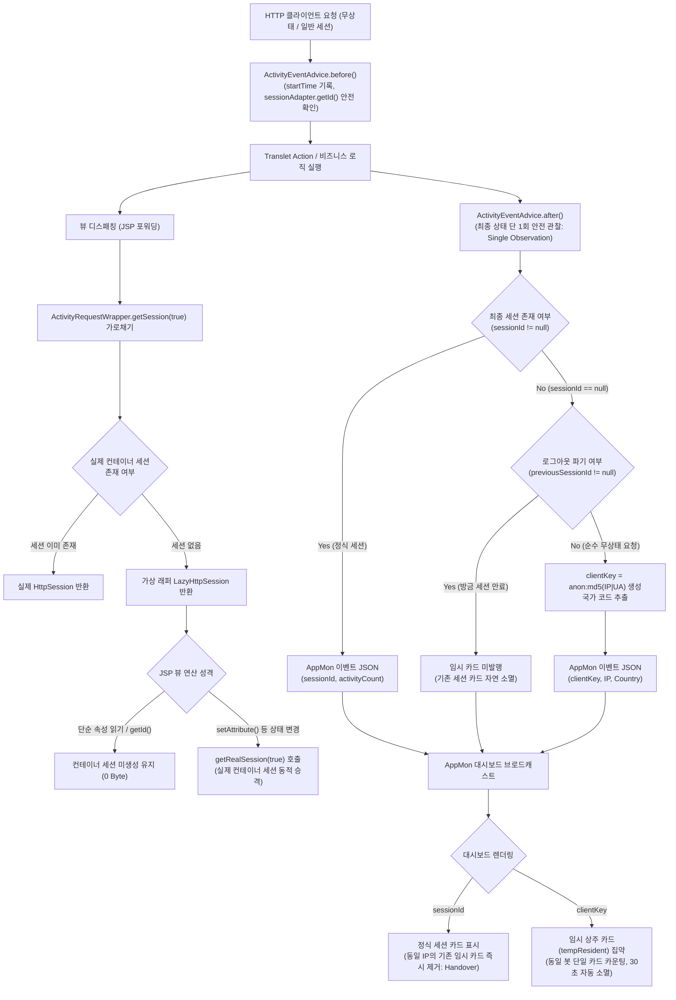


**사례 연구 (2부):** 이 문서는 지난 [대량 무상태 요청 환경에서의 세션 생성 폭풍 방지 및 Redis 세션 스토어 복원력 설계](/ko/blog/2026-11-20-session-storm-prevention-and-redis-resilience)의 2차 후속 조치입니다. Redis 쓰기 부하를 제거했음에도 백엔드 힙 메모리에서 여전히 세션 객체가 생성되던 근본 원인을 추적하여, 프레임워크 코어의 `SessionAdapter.getId()` 부작용(Side Effect) 제거, 서블릿/JSP 표준 사양의 세션 조기 생성 한계를 투명하게 극복한 `LazyHttpSession` 지연 세션 아키텍처, 그리고 대시보드 무상태 관제와 세션 인계(Handover) 메커니즘을 완성한 전 과정을 상세히 공유합니다.



현대적인 웹 아키텍처에서 고성능 분산 서비스를 지향할 때 가장 까다로운 지점 중 하나는 **"세션을 필요로 하지 않는 대량의 무상태(Stateless) 요청을 어떻게 완벽하게 격리할 것인가"**입니다. 검색 크롤러, 상태 확인(Health-check) 프로브, 비로그인 일반 방문자가 쏟아붓는 요청에 대해 서버가 단 1바이트의 불필요한 세션도 할당하지 않아야만, 제한된 인프라 자원을 온전히 비즈니스 트랜잭션에 집중시킬 수 있습니다.

지난 1차 개선을 통해 Aspectran은 신규 세션의 속성 쓰기 생략과 Redis 색인 이원화 스코어링(Dual-Scoring) 최적화로 Redis 쓰기 I/O를 98% 이상 걷어내며 타임아웃 장애를 해결했습니다. 그러나 실제 상용 환경의 트래픽을 정밀 추적한 결과, **Redis에만 저장되지 않았을 뿐 JVM 힙 메모리에서는 여전히 매 무상태 요청마다 새로운 세션 객체가 생성되고 브라우저로 `JSESSIONID` 쿠키가 발급되는 '2차 세션 누수'**가 발견되었습니다.

본 포스트에서는 이 2차 문제의 발원지를 깊이 파헤쳐, 객체지향 원칙을 위배하던 `SessionAdapter`의 상태 변경 부작용(Side Effect)을 바로잡고, 서블릿 표준과 JSP 뷰 엔진의 사양적 딜레마를 코드 수정 없이 극복한 **지연 세션 평가(Lazy Session Evaluation)** 메커니즘, 그리고 관제 대시보드의 실시간 무상태 집약 체계를 정립한 과정을 상세히 기록합니다.
<!--more-->

## 1. 1차 대응 이후의 한계와 2차 문제의 식별

### 1.1 사건의 연속선: Redis I/O는 잡았지만, 세션 객체는 왜 계속 생기는가?
지난 1차 개선([세션 생성 폭풍 방지 및 Redis 복원력 설계](/ko/blog/2026-11-20-session-storm-prevention-and-redis-resilience))의 핵심은 Redis 세션 스토어의 병목 제거였습니다:
1. `ActivityEventCounter`에서 첫 방문 세션(`isNew() == true`)의 속성 쓰기를 생략하여 신규 세션의 즉시 Redis 영속화(`c.set()`) 차단
2. `AbstractLettuceSessionStore`의 이원화 스코어링을 통해 Sorted Set 색인(`ZADD`) 갱신 주기를 60초 유예로 쓰로틀링
3. Nginx Rate Limiting으로 비정상적인 폭발적 트래픽의 인프라 1차 방어선 구축

이 조치로 CPU 100% 스파이크와 Lettuce 커맨드 타임아웃 장애는 완전히 해소되었습니다. Redis 모니터링상 쓰기 커맨드는 드라마틱하게 줄어들었습니다.

그러나 성능 테스트 툴과 봇 트래픽을 지속적으로 흘려보내며 JVM 메모리와 서블릿 응답 헤더를 정밀 분석하던 중 이상 징후가 포착되었습니다. **외부 클라이언트가 수신하는 HTTP 응답 헤더에 여전히 매번 새로운 `Set-Cookie: JSESSIONID=...`가 실려 나가고 있었으며, Undertow 세션 매니저 내부에서는 수만 개의 `TowSession` 객체가 힙 메모리에 끊임없이 할당되었다가 만료되는 현상이 지속**되고 있었던 것입니다.

Redis 저장소 부하는 0이 되었을지언정, 애플리케이션 서버 자체는 여전히 무상태 요청에 대해 세션을 무한히 찍어내는 '세션 팩토리'로 동작하고 있었습니다.

### 1.2 모니터링 로그 분석: 세션 강제 생성의 진원지
세션이 생성되는 호출 스택(Call Stack)을 디버깅한 결과, 세션 발급을 촉발한 두 개의 거대한 진원지가 드러났습니다:

첫 번째 진원지는 모니터링 엔진인 AppMon의 [ActivityEventAdvice.java](https://github.com/aspectran/aspectow/blob/main/appmon/src/main/java/com/aspectran/aspectow/appmon/engine/exporter/event/activity/ActivityEventAdvice.java)였습니다:

```java
// 기존 ActivityEventAdvice.java (개선 전)
public void before(@NonNull Activity activity) {
    startTime = System.currentTimeMillis();

    // 서블릿 컨테이너는 응답이 커밋된 후 신규 세션 생성을 허용하지 않으므로,
    // 세션 ID를 미리 확보해 두어야 한다는 방어적 의도로 작성됨
    if (activity.hasSessionAdapter()) {
        sessionId = activity.getSessionAdapter().getId(); // <- 진원지!
    }
}
```

두 번째 진원지는 JSP 뷰 템플릿을 사용하는 웹 애플리케이션(JPetStore 등)에서 발생했습니다. 백엔드 비즈니스 로직(Translet)이 세션을 전혀 사용하지 않는 순수 상품 조회 요청이었음에도, 뷰가 렌더링되는 시점에 서블릿 컨테이너에 의해 실제 세션이 강제 발급되고 있었습니다.

### 1.3 문제의 세 가지 축
문제를 면밀히 구조화한 결과, 다음 세 가지 차원의 구조적 결함이 얽혀 있음을 확인했습니다:
1. **프레임워크 코어 (`SessionAdapter`)**: 단순 식별자 조회 메서드인 `getId()`가 세션이 없으면 새로 만들어내는 **Getter의 상태 변경 부작용(Side Effect)**
2. **뷰 계층 (`JSP / Servlet Specification`)**: 표준 서블릿 JSP 사양의 `<%@ page session="true" %>` 기본값으로 인한 **조기 세션 생성(Premature Session Creation) 딜레마**
3. **관제 대시보드 (`AppMon Dashboard`)**: 서버 세션을 만들지 않는 무상태 봇 요청을 화면에 모니터링하기 위한 **식별 체계 및 세션 인계(Handover) 메커니즘의 부재**

## 2. 근본 원인 분석 1: `SessionAdapter`의 Getter 부작용(Side Effect)과 생명주기 딜레마

### 2.1 과거 설계 철학의 유산과 객체지향 원칙의 파괴
Aspectran을 처음 설계할 당시 [SessionAdapter.java](https://github.com/aspectran/aspectran/blob/master/core/src/main/java/com/aspectran/core/adapter/SessionAdapter.java)의 `getId()`는 다음과 같은 철학을 바탕으로 구현되었습니다:

> *"현재 요청 컨텍스트에서 `getId()`를 호출했다는 것은 고유한 세션 식별자가 필요하다는 뜻이므로, 세션이 없으면 즉시 새로 발급해서라도 유효한 세션 ID를 반환해야 한다."*

이 철학에 따라 `SessionAdapter` 구현체들은 내부적으로 `getSession(true).getId()`를 실행하도록 작성되었습니다.

그러나 이 사상은 객체지향 설계(OOP)의 가장 기본적인 원칙인 **조회와 변경의 분리(Command-Query Separation, CQS)**를 정면으로 위반하고 있었습니다:
* 객체지향 설계에서 Getter 메서드는 객체의 내부 상태나 시스템 상태를 변경하지 않는 순수한 멱등(Idempotent) 연산이어야 합니다.
* 그러나 `getId()`가 세션이 없을 때 신규 세션을 강제로 생성하고, 세션 쿠키를 발급하며, 세션 매니저와 스토어에 등록하는 일련의 상태 변경 작업을 일으켰습니다.
* 더욱 심각한 것은 메타데이터 조회 메서드들이었습니다. [TowSessionAdapter.java](https://github.com/aspectran/aspectran/blob/master/with-undertow/src/main/java/com/aspectran/undertow/adapter/TowSessionAdapter.java)와 [HttpSessionAdapter.java](https://github.com/aspectran/aspectran/blob/master/web-servlet/src/main/java/com/aspectran/web/servlet/adapter/HttpSessionAdapter.java)에서 `getCreationTime()`, `getLastAccessedTime()`은 세션이 없을 때 `0L`을 반환하는 것이 상식적인 기대임에도, 내부적으로 `getSession(true)`를 호출하여 **"생성 시간을 물어봤을 뿐인데 세션을 강제로 새로 만들어내는"** 황당한 모순을 안고 있었습니다.

### 2.2 `before()` 단계의 본질적인 생명주기 딜레마
`ActivityEventAdvice`가 `before()`에서 세션을 미리 확보하려 했던 데에는 서블릿 표준 컨테이너의 구조적 제약이라는 나름의 이유가 있었습니다:

```
[클라이언트 요청] 
      │
      ▼
┌───────────────┐
│ before()      │ ──> (딜레마 1) 이 요청이 봇인지, 나중에 로그인할 일반인인지 알 수 없음
└───────┬───────┘
        ▼
┌───────────────┐
│ Translet 액션 │ ──> 비즈니스 로직 도중 필요 시 세션 생성 (로그인 등)
└───────┬───────┘
        ▼
┌───────────────┐
│ 뷰 렌더링/커밋 │ ──> (딜레마 2) HTTP 응답 헤더 커밋 완료! (이후 세션 신규 생성 시 예외 발생)
└───────┬───────┘
        ▼
┌───────────────┐
│ after()       │ ──> 과거 설계에서는 커밋 후 생성이 불가능하므로 before에서 미리 생성했던 것!
└───────────────┘
```

1. **쿠키 미포함 요청의 양면성**:
   * 브라우저를 처음 열고 사이트에 접속한 일반 사용자의 첫 요청은 쿠키가 없습니다.
   * 반면, 영원히 세션을 쓰지 않을 웹 크롤러, 헬스체크 봇, 악성 스캐너 역시 쿠키 없이 들어옵니다.
2. **`before` 시점의 판단 불가능성**:
   * 일반 사용자의 세션은 `before()` 이후 비즈니스 로직(Translet Action, 로그인, 장바구니 등)이 실행되는 도중에 비로소 생성됩니다.
   * 따라서 요청이 진입하는 `before()` 시점에는 **이 요청이 나중에 세션을 만들 요청인지, 무상태로 끝날 요청인지 물리적으로 미리 판별할 방법이 없습니다.**
3. **과거 설계의 무리수**:
   * 서블릿 응답이 커밋된 후에는 세션을 신규 발급할 수 없다는 제약 때문에 `before()`에서 미리 `getId()`를 불렀고, `getId()`의 부작용으로 인해 모든 무상태 요청에 세션이 강제 발급되었던 것입니다.

## 3. 근본 원인 분석 2: JSP 뷰 렌더링 시 표준 서블릿 사양의 세션 조기 생성

백엔드 프레임워크와 비즈니스 로직(Translet)이 완벽하게 무상태를 유지하며 세션을 단 하나도 생성하지 않더라도, 뷰(View) 계층으로 넘어가는 순간 세션이 생성되는 또 다른 심각한 문제가 존재했습니다.

### 3.1 JSP 표준 사양의 암묵적 세션 바인딩 (`session="true"`)
Jakarta Servlet 및 JSP 명세(JSP Specification)에 따르면, 모든 JSP 페이지는 지시자에 별도로 `session="false"`를 명시하지 않는 한 기본값으로 `<%@ page session="true" %>`가 적용됩니다.

JSP 서블릿 컴파일러(Apache Jasper 등)는 JSP 파일을 Java 서블릿 클래스로 컴파일할 때, 내장 객체(Implicit Object)인 `session` 변수를 바인딩하기 위해 서블릿 서비스 루틴 시작부에 반드시 다음 코드를 자동 생성합니다:

```java
// JSP 서블릿 컴파일러가 자동 생성하는 코드 (_jspService)
HttpSession session = null;
...
session = request.getSession(true); // <- 서블릿 컨테이너 레벨의 강제 생성!
```

이로 인해 비즈니스 로직이 아무리 순수 무상태 조회라 할지라도, JSP 뷰로 포워딩(`RequestDispatcher.forward()`)되는 순간 서블릿 컨테이너에 의해 세션(`HttpSession`)이 실제 메모리에 할당되고 응답 헤더에 `Set-Cookie: JSESSIONID=...`가 실려 나가게 됩니다.

### 3.2 `<%@ page session="false" %>`의 치명적 한계와 구조적 딜레마
"그렇다면 모든 JSP 상단에 `<%@ page session="false" %>`를 붙이면 되지 않는가?"라는 의문이 자연스럽게 제기될 수 있습니다. 그러나 이는 현실적인 동적 웹 애플리케이션에서 절대 적용할 수 없는 함정이었습니다:

1. **내장 객체 `session` 선언의 완전 제거**:
   * JSP 사양상 `session="false"`를 선언하면 컴파일러가 생성하는 코드에서 `session` 참조 변수 자체가 아예 선언되지 않습니다.
2. **동적 세션 생성과의 충돌 (심각한 결함)**:
   * 사용자가 로그인을 완료했거나 장바구니에 아이템을 담아 백엔드 비즈니스 로직(Java 컨트롤러/Translet)에서 정상적으로 세션을 생성(`getSession(true)`)한 상태라 할지라도, 포워딩된 JSP에 `session="false"`가 붙어 있으면 JSP에서 `${sessionScope.user}`나 스크립틀릿으로 세션을 참조할 때 컴파일 오류(`session cannot be resolved to a variable`) 또는 참조 불가가 발생합니다.
3. **조건부 세션 참조의 불가능성**:
   * 즉, **"세션이 이미 존재하면 정상 참조하고, 세션이 없을 때는 새로 만들지 않는다"**는 극히 일반적인 조건부 참조 요구사항을 JSP 표준의 정적 지시자로는 물리적으로 구현할 수 없었습니다.

### 3.3 템플릿 엔진별 차이
현대적인 템플릿 엔진인 Thymeleaf를 적용한 애플리케이션(예: PetClinic)은 세션 객체를 강제로 바인딩하지 않으므로 순수 무상태 처리가 용이했습니다. 그러나 전통적인 JSP를 뷰 렌더러로 채택한 애플리케이션(예: JPetStore)의 경우, 수백 개의 JSP 파일에 `<%@ page session="true" %>`를 둘 수밖에 없었고, 프레임워크 레벨에서 이를 가로채지 않는 한 무상태 처리가 원천적으로 불가능한 상황이었습니다.

## 4. 근본 원인 분석 3: AppMon 관제 대시보드의 무상태 모니터링 한계

서버 세션 저장소 부하를 줄이기 위해 무상태 요청에서 세션 생성을 억제하더라도, 이를 실시간 모니터링 시스템(AppMon 대시보드)에서 어떻게 시각화할 것인가에 대한 까다로운 과제가 남았습니다:

1. **무작위 일회성 ID 발급 시 대시보드 마비**:
   * 무상태 요청마다 임의의 UUID나 일회성 세션 ID를 붙여 대시보드로 브로드캐스트하면, 동일한 구글 봇이나 크롤러가 수백 페이지를 긁어갈 때 대시보드 화면에 수백 개의 세션 카드가 생성됩니다. 이는 프론트엔드 DOM 렌더링 부하를 폭증시켜 브라우저를 마비시킵니다.
2. **신규 카드와 일반 카드의 중복 공존 (Handover 부재)**:
   * 무상태 요청에 대해 임시 카드를 띄운 뒤, 해당 사용자가 이후 로그인하여 정식 세션을 발급받았을 때, 기존 임시 카드와 신규 정식 세션 카드가 동일 인물임에도 대시보드에 둘 다 떠 있는 상태 왜곡이 발생했습니다.
3. **관제 가시성과 서버 자원의 양립**:
   * 서버 세션 스토어에는 0바이트를 유지하면서도, 대시보드에서는 "현재 어떤 봇과 비로그인 접속자가 활발히 활동 중인가"를 단일 카드로 집약하여 모니터링할 수 있는 새로운 식별 메커니즘이 절실했습니다.

## 5. 아키텍처 재설계: 진정한 세션 제로(0-Byte)를 위한 다계층 해결책

Aspectran은 이 복합적인 문제를 근본적으로 해결하기 위해 코어 어댑터, 웹 서블릿 래퍼, 모니터링 엔진, 프론트엔드 대시보드 전반에 걸친 유기적인 다계층 개선 아키텍처를 구축했습니다.



### 5.1 `SessionAdapter`의 순수 무상태 Getter 전환 및 `getId(boolean create)` 도입

가장 먼저 프레임워크 코어의 기본 원칙을 바로잡았습니다. `getId()`가 상태를 변경하던 치명적인 부작용을 제거하고, 세션이 없으면 `null`을 반환하는 순수한 멱등 Getter로 전환했습니다.

[SessionAdapter.java](https://github.com/aspectran/aspectran/blob/master/core/src/main/java/com/aspectran/core/adapter/SessionAdapter.java#L57-L75):
```java
public interface SessionAdapter {

    /**
     * Returns the unique identifier assigned to this session.
     * Unlike earlier versions, this method does NOT create a new session
     * if one does not already exist, returning {@code null} instead.
     * To ensure a session is created if absent, use {@link #getId(boolean)}
     * with {@code true}.
     * @return the session ID, or {@code null} if no session exists
     */
    String getId();

    /**
     * Returns the unique identifier assigned to this session.
     * @param create {@code true} to create a new session if one does not exist;
     *               {@code false} to return {@code null} if there is no current session
     * @return the session ID, or {@code null} if {@code create} is false and no session exists
     */
    default String getId(boolean create) {
        return (create || isValid() ? getId() : null);
    }

    ...
}
```

아울러 모든 하위 어댑터 구현체([TowSessionAdapter.java](https://github.com/aspectran/aspectran/blob/master/with-undertow/src/main/java/com/aspectran/undertow/adapter/TowSessionAdapter.java), [HttpSessionAdapter.java](https://github.com/aspectran/aspectran/blob/master/web-servlet/src/main/java/com/aspectran/web/servlet/adapter/HttpSessionAdapter.java), [SessionAgent.java](https://github.com/aspectran/aspectran/blob/master/core/src/main/java/com/aspectran/core/component/session/SessionAgent.java), [NettySessionAdapter.java](https://github.com/aspectran/aspectran/blob/master/with-netty/src/main/java/com/aspectran/netty/adapter/NettySessionAdapter.java))에서 `getId()`와 메타데이터 조회 메서드를 `getSession(false)` 기반으로 전면 안전화했습니다:

```java
@Override
public String getId() {
    return getId(false);
}

@Override
public String getId(boolean create) {
    Session session = getSession(create);
    return (session != null ? session.getId() : null);
}

@Override
public long getCreationTime() {
    Session session = getSession(false);
    return (session != null ? session.getCreationTime() : 0L);
}

@Override
public long getLastAccessedTime() {
    Session session = getSession(false);
    return (session != null ? session.getLastAccessedTime() : 0L);
}

@Override
public int getMaxInactiveInterval() {
    Session session = getSession(false);
    return (session != null ? session.getMaxInactiveInterval() : 0);
}
```

이제 세션이 존재하지 않는 무상태 요청에서 `getId()`, `getCreationTime()` 등을 아무리 호출해도 세션 객체가 절대 생성되지 않으며, 시스템 상태는 완벽히 불변으로 유지됩니다.

### 5.2 AppMon의 패러다임 전환: "사전 획득"에서 "사후 단일 관찰"로

`getId()`가 순수해짐에 따라 AppMon의 모니터링 방식도 완전히 새로워졌습니다. 세션을 억지로 미리 만들 필요 없이, **비즈니스 로직(Translet Action)이 모두 끝난 시점에 최종 세션 상태를 단 1회 안전하게 조회(Pure Single Observation)**하는 우아한 구조로 전환되었습니다.

[ActivityEventAdvice.java](https://github.com/aspectran/aspectow/blob/main/appmon/src/main/java/com/aspectran/aspectow/appmon/engine/exporter/event/activity/ActivityEventAdvice.java):
```java
public void before(@NonNull Activity activity) {
    startTime = System.currentTimeMillis();
    // 세션이 없으면 null 반환 (순수 조회이므로 신규 세션 생성 0%)
    if (activity.hasSessionAdapter()) {
        previousSessionId = activity.getSessionAdapter().getId();
    }
}

public String after(@NonNull Activity activity) {
    long elapsedTime = System.currentTimeMillis() - startTime;

    String sessionId = null;
    int activityCount = 0;
    String clientKey = null;
    String ipAddress = null;
    String countryCode = null;

    if (activity.hasSessionAdapter()) {
        SessionAdapter sessionAdapter = activity.getSessionAdapter();
        // 비즈니스 로직 도중 세션이 만들어졌다면 그 세션 ID를 획득 (getSession(false) 기반)
        sessionId = sessionAdapter.getId();
        if (sessionId != null) {
            if (sessionAdapter.isNew()) {
                activityCount = 1;
            } else {
                AtomicInteger counter = sessionAdapter.getAttribute(USER_ACTIVITY_COUNT);
                if (counter != null) {
                    activityCount = counter.get();
                }
            }
        }
    }

    // 로그아웃 등으로 액션 도중 기존 세션이 파기된 경우 판별
    boolean sessionTerminated = (sessionId == null && previousSessionId != null);

    // 순수 무상태 요청인 경우에만 결정론적 임시 클라이언트 키 생성
    if (sessionId == null && !sessionTerminated && activity.hasTranslet()) {
        Translet translet = activity.getTranslet();
        RequestAdapter requestAdapter = translet.getRequestAdapter();
        ipAddress = WebUtils.getRemoteAddr(translet);
        if (StringUtils.hasLength(ipAddress)) {
            String userAgent = (requestAdapter != null ? requestAdapter.getHeader("User-Agent") : null);
            String raw = ipAddress + "|" + (userAgent != null ? userAgent : "");
            clientKey = "anon:" + DigestUtils.md5DigestAsHex(raw).substring(0, 12);
            IPCountryResolver ipCountryResolver = activityEventReader.getIpCountryResolver();
            if (ipCountryResolver != null) {
                Locale locale = (requestAdapter != null ? requestAdapter.getLocale() : null);
                countryCode = ipCountryResolver.resolveCountryCode(ipAddress, locale);
            }
        }
    }
    ...
}
```

* **서블릿 컨테이너 안전성**: 응답 커밋 후 신규 세션을 생성(`create=true`)하면 `IllegalStateException`이 터지지만, 이미 액션 도중 생성된 세션을 `getSession(false)`로 조회하는 것은 서블릿 명세상 **100% 안전하며 예외가 전혀 발생하지 않습니다.**
* **세션 파기(Signoff) 감지**: `before()`에 세션이 있었으나 `after()`에 없어진 경우(`sessionTerminated = true`)는 사용자가 로그아웃한 것이므로, 불필요한 무상태 카드(`anon:...`)를 발행하지 않고 기존 카드가 자연 소멸하도록 차단했습니다.

### 5.3 `ActivityRequestWrapper`와 `LazyHttpSession`: JSP 뷰 지연 세션 생성(Lazy Session Evaluation)

JSP 페이지의 기본 지시자 `<%@ page session="true" %>`로 인한 조기 세션 생성 문제를 소스 코드 수정 없이 해결하기 위해, Aspectran 서블릿 계층에 **지연 세션 평가(Lazy Session Evaluation)** 메커니즘을 도입했습니다.

[ActivityRequestWrapper.java](https://github.com/aspectran/aspectran/blob/master/web-servlet/src/main/java/com/aspectran/web/servlet/activity/ActivityRequestWrapper.java#L51-L74):
```java
public class ActivityRequestWrapper extends HttpServletRequestWrapper {

    private HttpSession lazySession;

    @Override
    public HttpSession getSession() {
        return getSession(true);
    }

    @Override
    public HttpSession getSession(boolean create) {
        if (!create) {
            return super.getSession(false);
        }
        HttpSession session = super.getSession(false);
        if (session != null) {
            return session;
        }
        // 물리적 컨테이너 세션을 즉시 생성하지 않고 가상 래퍼를 반환!
        if (lazySession == null) {
            lazySession = new LazyHttpSession(this);
        }
        return lazySession;
    }

    HttpSession getRealSession(boolean create) {
        return super.getSession(create);
    }
}
```

핵심 동작을 담당하는 [LazyHttpSession.java](https://github.com/aspectran/aspectran/blob/master/web-servlet/src/main/java/com/aspectran/web/servlet/activity/LazyHttpSession.java)는 `jakarta.servlet.http.HttpSession` 인터페이스를 구현하며, 호출되는 메서드의 성격에 따라 동작을 분기합니다:

```java
public class LazyHttpSession implements HttpSession {

    private static final String JSTL_PREFIX = "jakarta.servlet.jsp.jstl.";

    private final ActivityRequestWrapper wrapper;

    @Nullable
    private HttpSession getSession(boolean create) {
        return wrapper.getRealSession(create);
    }

    // [1. 상태 미변경 읽기 연산] 컨테이너 세션을 절대로 생성하지 않음!
    @Override
    public String getId() {
        HttpSession session = getSession(false);
        return (session != null ? session.getId() : null);
    }

    @Override
    public Object getAttribute(String name) {
        HttpSession session = getSession(false);
        return (session != null ? session.getAttribute(name) : null);
    }

    @Override
    public Enumeration<String> getAttributeNames() {
        HttpSession session = getSession(false);
        return (session != null ? session.getAttributeNames() : Collections.emptyEnumeration());
    }

    @Override
    public boolean isNew() {
        return false;
    }

    // [2. 무영향 파기 연산] 세션이 없으면 아무 일도 하지 않음 (No-op)
    @Override
    public void removeAttribute(String name) {
        HttpSession session = getSession(false);
        if (session != null) {
            session.removeAttribute(name);
        }
    }

    @Override
    public void invalidate() {
        HttpSession session = getSession(false);
        if (session != null) {
            session.invalidate();
        }
    }

    // [3. 상태 변경 쓰기 연산] 비로소 실제 세션을 생성하고 상태를 기록!
    @Override
    public void setAttribute(String name, Object value) {
        if (value != null) {
            // JSTL fmt 태그 등이 응답 문자셋이나 로케일을 세션에 강제 캐싱하려 할 때,
            // 실제 세션이 아직 없다면 신규 세션 생성을 유발하지 않고 안전하게 무시 (no-op)
            if (name != null && name.startsWith(JSTL_PREFIX) && getSession(false) == null) {
                return;
            }
            // 실제 컨테이너 세션 실체화(Realization) 및 쿠키 발행
            HttpSession session = getSession(true);
            if (session != null) {
                session.setAttribute(name, value);
            }
        } else {
            removeAttribute(name);
        }
    }
}
```

#### 실전에서의 결정적 복병: JSTL `<fmt:>` 태그의 암묵적 세션 캐싱 차단
`LazyHttpSession`을 설계할 당시에는 "단순히 모델을 읽기만 하는 뷰는 `setAttribute()`를 부르지 않을 것"이라고 예상했습니다. 그러나 실전 테스트 중 JPetStore의 상품 상세 페이지(`Product.jsp`)에서 가격 포맷팅을 위해 사용한 **`<fmt:formatNumber>` 태그가 세션을 생성해 버리는 뜻밖의 복병**을 마주쳤습니다:

* **20년 전 레거시 사양의 유산**: JSTL 1.0 표준 구현체(`SetLocaleSupport`)는 `<fmt:formatNumber>`, `<fmt:formatDate>`, `<fmt:setLocale>` 등이 호출될 때마다, 다음 폼 제출 시 인코딩이 깨지지 않도록 현재 응답의 문자셋을 세션(`jakarta.servlet.jsp.jstl.fmt.request.charset`)에 강제로 캐싱하도록 설계되어 있었습니다.
* **조기 세션 생성의 유발**: 이로 인해 `pageContext.getSession() != null`이 참이 되면서 JSTL이 세션에 charset 저장을 시도했고, `LazyHttpSession.setAttribute()`가 이를 애플리케이션의 정상적인 상태 변경 쓰기로 오인하여 실제 세션을 실체화해버린 것입니다.
* **완벽한 격리 방어**: Aspectran은 `LazyHttpSession.setAttribute()`에서 `jakarta.servlet.jsp.jstl.` 네임스페이스 속성에 대해, 물리적 세션이 아직 존재하지 않는 무상태 상태(`getSession(false) == null`)라면 세션 생성을 유보(no-op)하도록 방어벽을 세웠습니다. 반면 로그인 후 실제 세션이 만들어진 상태에서는 정상 저장되므로 JSTL 스펙과의 하위 호환성도 100% 유지됩니다.

이로써 JSP 개발자가 `<fmt:formatNumber>`, `<fmt:formatDate>` 등 표준 JSTL 포맷팅 태그를 마음껏 사용하더라도 단 1바이트의 세션도 발급되지 않는 진정한 세션 제로(0-Byte)를 완성할 수 있었습니다.

#### 지연 세션 메커니즘의 우아함
1. **JSP 템플릿의 무수정(Zero-Touch) 유지**:
   * JPetStore와 같은 수백 개의 JSP 파일에 `<%@ page session="false" %>`를 일일이 달 필요가 전혀 없습니다.
   * JSP가 단순히 모델 데이터를 출력하거나 `${sessionScope.user}`를 읽기만 할 때는 `LazyHttpSession.getAttribute()`가 호출되어 세션이 0바이트로 유지됩니다.
2. **동적 세션 생성과의 완벽한 호환**:
   * 만약 Java 비즈니스 로직에서 로그인을 처리하여 세션을 이미 만들었다면, `ActivityRequestWrapper`는 기존 실제 세션을 즉시 반환하므로 JSP에서 로그인 사용자 정보를 아무런 제약 없이 정상 출력합니다.
   * 또한 JSP 내에서 세션에 값을 쓰는 드문 경우라도 `setAttribute()`가 호출되는 순간 투명하게 실제 세션으로 승격(Promote)됩니다.

### 5.4 AppMon 대시보드의 결정론적 `clientKey`와 세션 인계(Handover) 메커니즘

서버 세션 저장소 부하는 0바이트를 유지하면서 대시보드의 관제 가시성을 확보하기 위해 프론트엔드와 백엔드를 연계했습니다.

1. **결정론적 `clientKey` 기반 임시 상주 카드 (`tempResident`)**:
   * 무상태 요청일 경우 `clientKey = "anon:" + md5(ipAddress + "|" + userAgent).substring(0, 12)`로 고유 키를 발급합니다.
   * 대시보드(`dashboard-viewer.js`)는 `sessionId`가 없더라도 `clientKey`가 존재하면:
     - 화면에 동일한 카드가 이미 있을 때: 카운트만 `+1` 올리고 30초 만료 타이머를 연장합니다.
     - 카드가 없을 때: `tempResident: true`, `inactiveInterval: 30` 속성의 임시 세션 카드를 생성합니다.
   * **동일한 구글 봇이 1,000페이지를 크롤링하더라도 대시보드에는 단 1개의 카드가 유지되며 카운트만 1,000으로 올라갑니다.**
2. **정식 세션 승격 시 카드 즉시 인계 (Handover)**:
   * 무상태로 탐색하던 일반 사용자가 로그인하여 정식 세션이 발급되면, 대시보드가 `session.created` 이벤트를 받을 때 동일한 IP(`data-user-key='i:${ipAddress}'`)를 가진 기존 임시 카드를 즉시 탐색하여 화면에서 제거합니다.
   * 이로써 임시 카드와 일반 카드가 화면에 중복으로 떠 있는 상태 왜곡이 완벽히 해결되었습니다.
3. **프론트엔드 DOM 탐색 최적화 (`find` $\rightarrow$ `children`)**:
   * 초당 수백 건의 이벤트 유입 시 브라우저가 버벅거리지 않도록, `dashboard-viewer.js` 전반의 깊은 하향 탐색(`find("li")`)을 직계 자식 탐색(`children("li")`) 및 스코핑으로 전면 교체하여 렌더링 성능을 극대화했습니다.

### 5.5 클러스터 아키텍처와 세션 스토어별 `savePeriodSecs` 최적화 원칙

세션 스토어의 영속화 주기(`savePeriodSecs`)에 대해서도 인프라 환경(Sticky vs Non-Sticky)에 따른 체계적인 가이드를 확립했습니다.

#### 1) 스토어별 도입 배경과 역할
* **`FileSessionStore`**:
  * 로컬 디스크에 세션을 직렬화하는 스토어로, 단일 노드 또는 **L4/L7 Sticky Session(세션 어피니티) 클러스터**에 최적입니다.
  * 별도의 Redis 클러스터 구축 비용 없이도 무중단 롤링 재시작(Rolling Restart)을 경제적으로 구현할 수 있습니다.
* **`LettuceSessionStore`**:
  * Redis 중앙 저장소를 활용하여 다중 노드 간 세션을 완전히 공유하는 분산 스토어로, **Non-Sticky 클러스터** 또는 고가용성(HA) Failover가 필수적인 환경에 적용됩니다.

#### 2) `savePeriodSecs` 기본값 정책의 당위성
* **프레임워크 기본값 `savePeriodSecs = 0` 유지의 이유**:
  * 프레임워크는 외부 인프라가 Sticky 모드인지 사전에 알 수 없습니다.
  * 만약 기본값을 `savePeriodSecs > 0`으로 두면, Non-Sticky 클러스터 환경에서 요청이 노드 A와 노드 B로 번갈아 유입될 때 세션 접근 시각 미동기화로 인한 조기 만료나 정합성 깨짐이 발생합니다.
  * 따라서 **데이터 정합성과 안전성을 최우선으로 하는 프레임워크의 글로벌 기본값은 `0`(매 요청 종료 시 즉시 영속화)을 유지하는 것이 가장 안전한 방어적 기본값(Defensive Default)**입니다.
* **환경별 최적화 권장 가이드**:
  * **단일 노드 또는 Sticky 클러스터 (`FileSessionStore` / `LettuceSessionStore`)**: 디스크 및 네트워크 I/O 절감을 위해 `savePeriodSecs: 60` ~ `180` 설정을 적극 권장합니다. 단순 조회의 경우 로컬 메모리에서만 `lastAccessedTime`을 갱신하고 스토어 쓰기를 생략하므로 I/O를 95% 이상 절감할 수 있습니다.
  * **Non-Sticky 클러스터 (`LettuceSessionStore`)**: 노드 간 세션 정합성을 위해 기본값 `savePeriodSecs: 0`을 유지해야 합니다.

## 6. 전후 비교 및 실증 검증 결과

이번 2차 아키텍처 개선을 통해 변경된 핵심 동작을 비교하면 다음과 같습니다:

| 비교 항목 | 1차 개선 직후 (AS-IS) | 2차 아키텍처 완성 후 (TO-BE) | 개선 효과 |
| :--- | :--- | :--- | :--- |
| **`SessionAdapter.getId()`** | 세션 없으면 `getSession(true)` 강제 생성 | 세션 없으면 `null` 반환 (`getSession(false)`) | **Getter의 부작용(Side Effect) 완전 박멸** |
| **메타데이터 조회 (`getCreationTime`)** | 내부 `getSession(true)`로 세션 강제 생성 | `getSession(false)` 기반, 없으면 `0L` 반환 | **조회 시 세션 생성 위험 0%** |
| **AppMon 세션 관찰 시점** | `before()`에서 사전 강제 획득 | `after()`에서 최종 상태 단 1회 안전 관찰 | **서블릿 응답 커밋 제약과 완벽한 조화** |
| **JSP 뷰 디스패칭 (JPetStore)** | `<%@ page session="true" %>`로 조기 세션 생성 | `ActivityRequestWrapper` + `LazyHttpSession` | **JSP 소스 수정 없이 세션 0-Byte 달성** |
| **무상태 봇 세션 서버 자원** | 힙 메모리에 세션 객체 지속 생성/소멸 | 서버 힙/스토어 메모리 할당 **0 Byte** | **순수 무상태(Stateless) 완전 달성** |
| **대시보드 봇 모니터링** | 일회성 ID 발급 시 카드 무한 폭증 | `clientKey` 기반 단일 임시 카드로 집약 | **동일 봇 단일 카드 카운팅, DOM 부하 해소** |
| **정식 세션 전환 시 대시보드** | 임시 카드와 정식 카드가 화면에 중복 공존 | 정식 세션 수신 시 임시 카드 즉시 제거 | **완벽한 세션 인계(Handover) 달성** |
| **대시보드 DOM 탐색 성능** | 수십 곳의 전체 하향 `find()` 호출 | 직계 자식 `children()` 및 스코핑 전면 전환 | **고빈도 트래픽 수신 시 브라우저 렉 제거** |

### 실환경 검증 결과
1. **JPetStore (JSP 뷰 기반) 실측**:
   * 외부 봇 부하를 인입시켰을 때, 응답 헤더에서 `Set-Cookie: JSESSIONID`가 완전히 사라졌으며, Undertow 세션 카운트와 Redis 세션 수가 전혀 증가하지 않고 **완벽한 0건을 유지**했습니다.
   * 이후 사용자가 로그인하거나 장바구니에 상품을 담았을 때만 `LazyHttpSession`이 실제 컨테이너 세션으로 즉시 승격되며 쿠키가 정상 발급됨을 확인했습니다.
2. **AppMon 대시보드 실측**:
   * 동일 봇 트래픽 유입 시 국기 아이콘과 IP가 포함된 단 1개의 임시 카드가 생성되어 활동 카운트가 실시간으로 부드럽게 올라갔으며, 트래픽 종료 30초 후 깔끔하게 소멸했습니다.
   * 임시 상태에서 일반 사용자가 로그인하자마자 기존 임시 카드가 번개처럼 사라지고 정식 세션 카드로 매끄럽게 교체(Handover)되었습니다.

## 7. 맺음말: 진정한 프레임워크 복원력과 아키텍처적 순수성

이번 2차 개선은 단순히 버그 하나를 패치한 것이 아니라, **오랫동안 관성적으로 유지되어 온 프레임워크 내부의 설계 철학과 서블릿/JSP 표준 사양의 숨겨진 한계를 끝까지 파고들어 엔지니어링적으로 극복한 과정**이었습니다.

1. **조회와 변경의 분리(CQS)**: Getter는 어떠한 경우에도 시스템의 상태를 변경해서는 안 된다는 기본 원칙을 프레임워크 전반에 다시 확립했습니다.
2. **지연 평가(Lazy Evaluation)의 힘**: 수십 년 된 JSP 명세의 고질적 한계(`<#@ page session="true" %>`)를 레거시 코드 수정 없이 `LazyHttpSession`이라는 투명한 가상 프록시 계층으로 우아하게 해결했습니다.
3. **백엔드와 프론트엔드의 유기적 조화**: 서버는 세션을 1바이트도 쓰지 않으면서도, 관제 대시보드는 결정론적 핑거프린트와 인계(Handover) 메커니즘을 통해 완벽한 실시간 가시성을 확보했습니다.

이로써 Aspectran은 초저사양 클라우드 환경에서도 대규모 무상태 봇 트래픽과 악성 스파이크를 자원 낭비 없이 견뎌내는, 타협 없는 고성능 분산 세션 관리 아키텍처를 완성하게 되었습니다.
